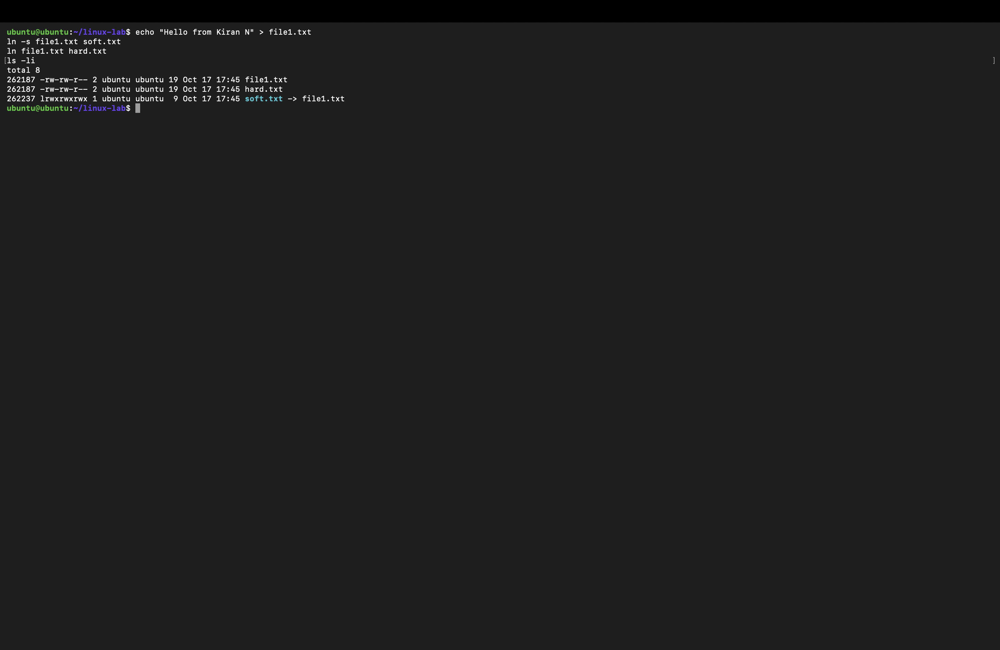
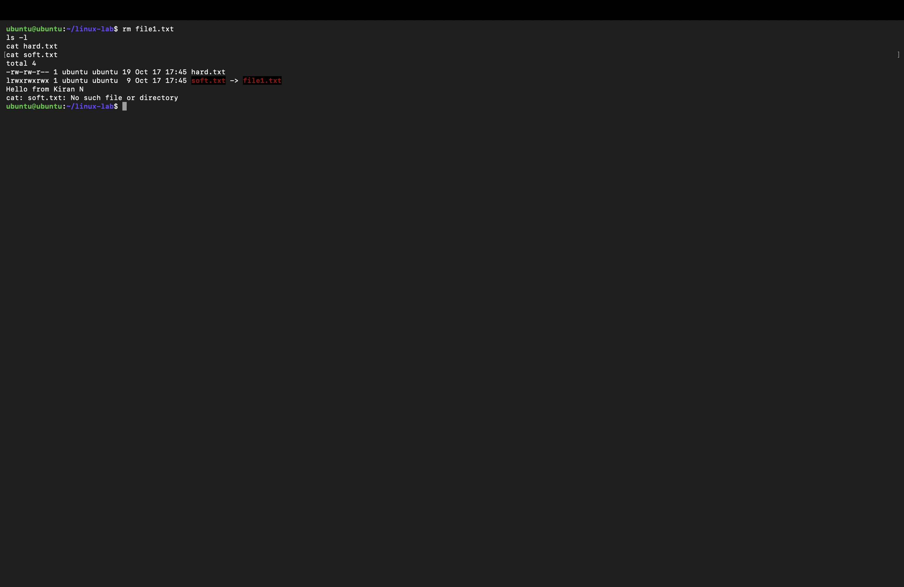
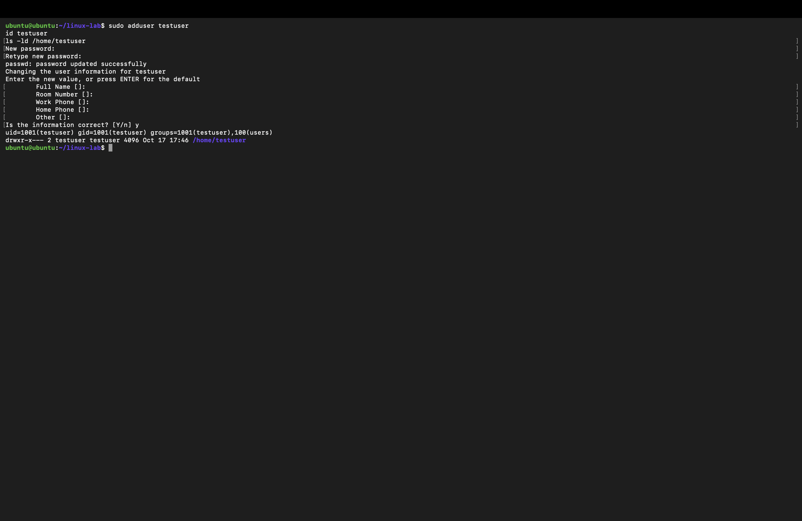
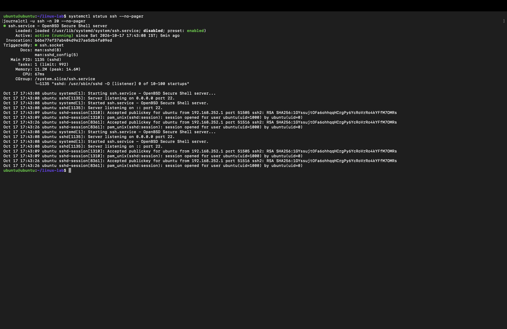

# 🐧 Session 1 & 2 — Linux Fundamentals: Homework

| | |
|---|---|
| **Name** | Kiran N |
| **Roll No.** | 10446 |
| **Course** | DevOps Heros |
| **Environment** | Ubuntu 26.04 LTS VM (Multipass on macOS) |
| **Session** | 1 & 2: Linux Fundamentals |

---

## 📋 Tasks Overview

| # | Task | Status |
|---|------|--------|
| 1 | Soft Link & Hard Link | ✅ Done |
| 2 | `adduser` vs `useradd` | ✅ Done |
| 3 | `journalctl` | ✅ Done |
| 4 | Linux Command Cheat Sheet | ✅ Done |

---

## 📌 Task 1: Soft Link & Hard Link

### What is an inode?

Every file in Linux is stored as an **inode**: a record holding the file's data blocks, permissions, owner and size. A file **name** is just an entry in a directory that points to an inode. Links are extra names for a file.

### Soft Link vs Hard Link

| Feature | Soft Link (Symbolic Link) | Hard Link |
|---|---|---|
| Points to | The original file's **path** | The same **inode** as the original |
| Inode number | Different from original | Same as original |
| Works across file systems / partitions | ✅ Yes | ❌ No |
| Can link to directories | ✅ Yes | ❌ No |
| If original file is deleted | ❌ Link **breaks** (dangling link) | ✅ Data is still accessible |
| Size | Size of the path string | Same as original file |
| `ls -l` shows | `l` file type and `soft.txt -> file1.txt` | Normal file, link count increases |
| Command | `ln -s <target> <link>` | `ln <target> <link>` |

### Hands-on: create, inspect and delete links

```bash
# 1. Create a file with some content
echo "Hello from Kiran N" > file1.txt

# 2. Create a soft link and a hard link
ln -s file1.txt soft.txt
ln file1.txt hard.txt

# 3. Check inode numbers (first column) and link count
ls -li
```

My output (Ubuntu 26.04 VM, folder `~/linux-lab`):

```text
total 8
262187 -rw-rw-r-- 2 ubuntu ubuntu 19 Oct 17 17:45 file1.txt
262187 -rw-rw-r-- 2 ubuntu ubuntu 19 Oct 17 17:45 hard.txt
262237 lrwxrwxrwx 1 ubuntu ubuntu  9 Oct 17 17:45 soft.txt -> file1.txt
```

- `file1.txt` and `hard.txt` share the **same inode** (262187) and the link count is **2**.
- `soft.txt` has its **own inode** and points to the name `file1.txt`.

```bash
# 4. Delete the original file
rm file1.txt

# 5. Test both links
ls -l
cat hard.txt
cat soft.txt

# 6. Clean up
rm soft.txt hard.txt
```

My output after deleting `file1.txt`:

```text
total 4
-rw-rw-r-- 1 ubuntu ubuntu 19 Oct 17 17:45 hard.txt
lrwxrwxrwx 1 ubuntu ubuntu  9 Oct 17 17:45 soft.txt -> file1.txt
Hello from Kiran N
cat: soft.txt: No such file or directory
```

- `hard.txt` still prints **Hello from Kiran N**; its link count dropped from 2 to 1.
- `soft.txt` is shown in red because it points to a name that no longer exists, so `cat` fails.

📸 **Screenshots**





### ❓ Interview Question: What is the difference between a soft link and a hard link?

> A **hard link** is another name for the same inode, so it shares the file's data. Deleting the original name does not remove the data until every hard link is deleted. Hard links cannot cross file systems or point to directories.
>
> A **soft (symbolic) link** is a separate small file that stores the **path** of the target. It can cross file systems and point to directories, but if the target is deleted or moved, the link breaks.
>
> **Real-world use:** soft links are used for versioned software, e.g. `/usr/bin/python3 -> python3.12`, and for enabling Nginx sites (`sites-enabled/ -> sites-available/`).

---

## 📌 Task 2: `adduser` vs `useradd`

### Difference

| Feature | `adduser` | `useradd` |
|---|---|---|
| Type | High-level, interactive **Perl script** | Low-level **binary** |
| Home directory | ✅ Created automatically (`/home/<user>`) | ❌ Only with `-m` |
| Copies `/etc/skel` files (`.bashrc`, `.profile`) | ✅ Yes | ❌ Only with `-m` |
| Asks for password & user details | ✅ Yes | ❌ No (run `passwd` separately) |
| Default shell | From `/etc/adduser.conf` (`/bin/bash`) | `/bin/sh` unless `-s` is given |
| Config file | `/etc/adduser.conf` | `/etc/default/useradd` |
| Available on | Debian / Ubuntu | All Linux distributions |
| Best for | Creating users by hand | Scripts and automation |

### Which one does Ubuntu prefer, and why?

Ubuntu and Debian recommend **`adduser`**. It is a friendly wrapper that calls `useradd` internally but also sets up everything a real user needs in one step: home directory, skeleton files, a password, the default shell and a user group. With `useradd`, forgetting `-m` or `-s` leaves a user with no home directory and a basic shell.

### Hands-on: create a test user with the recommended command

```bash
# Create the user (prompts for password and details)
sudo adduser testuser

# Verify the user
id testuser
grep testuser /etc/passwd
ls -ld /home/testuser

# Switch to the new user and back
su - testuser
whoami
exit

# Delete the user and their home directory
sudo deluser --remove-home testuser
```

Equivalent with `useradd` (for comparison):

```bash
sudo useradd -m -s /bin/bash testuser2
sudo passwd testuser2
```

My output:

```text
New password:
Retype new password:
passwd: password updated successfully
Changing the user information for testuser
Enter the new value, or press ENTER for the default
        Full Name []:
        Room Number []:
        Work Phone []:
        Home Phone []:
        Other []:
Is the information correct? [Y/n] y
uid=1001(testuser) gid=1001(testuser) groups=1001(testuser),100(users)
drwxr-x--- 2 testuser testuser 4096 Oct 17 17:46 /home/testuser
```

`adduser` asked for the password and details, created a matching `testuser` group (gid 1001), added the user to `users`, and created `/home/testuser` automatically, all without extra flags.

📸 **Screenshot**



---

## 📌 Task 3: `journalctl`

### What is `journalctl`?

`journalctl` reads the logs collected by **systemd-journald**, the logging service on systemd-based Linux systems. It shows logs from the kernel, boot process and every systemd service in one place, which makes it the first tool to use when a service fails.

### Viewing system and service logs

```bash
# All logs (oldest first)
journalctl

# Last 50 entries
journalctl -n 50

# Follow new logs live (like tail -f)
journalctl -f

# Logs from the current boot / previous boot
journalctl -b
journalctl -b -1

# Only errors and worse
journalctl -p err

# Kernel messages only
journalctl -k

# Logs in a time range
journalctl --since today
journalctl --since "1 hour ago"
journalctl --since "2026-10-17 09:00" --until "2026-10-17 10:00"

# How much disk the journal uses
journalctl --disk-usage
```

### Checking logs for a specific service

```bash
# Check the service status first
systemctl status ssh

# Last 20 log lines for ssh
journalctl -u ssh -n 20

# Follow ssh logs live and newest first
journalctl -u ssh -f
journalctl -u ssh -r

# Other services
journalctl -u cron
journalctl -u docker
```

My output (shortened):

```text
● ssh.service - OpenBSD Secure Shell server
     Loaded: loaded (/usr/lib/systemd/system/ssh.service; disabled; preset: enabled)
     Active: active (running) since Sat 2026-10-17 17:43:08 IST; 5min ago
TriggeredBy: ● ssh.socket
   Main PID: 1135 (sshd)

Oct 17 17:43:08 ubuntu systemd[1]: Starting ssh.service - OpenBSD Secure Shell server...
Oct 17 17:43:08 ubuntu sshd[1135]: Server listening on 0.0.0.0 port 22.
Oct 17 17:43:08 ubuntu systemd[1]: Started ssh.service - OpenBSD Secure Shell server.
Oct 17 17:43:09 ubuntu sshd-session[1310]: Accepted publickey for ubuntu from 192.168.252.1 port 51505 ssh2: RSA SHA256:...
Oct 17 17:43:09 ubuntu sshd-session[1310]: pam_unix(sshd:session): session opened for user ubuntu(uid=1000) by ubuntu(uid=0)
```

From the logs I can see when SSH started, that it listens on port 22, and every login: here my Mac (192.168.252.1) connected to the VM using a public key.

📸 **Screenshot**



---

## 📌 Task 4: Linux Command Cheat Sheet

### 📁 File & Directory

| Command | Description | Example |
|---|---|---|
| `pwd` | Print current directory | `pwd` |
| `ls -la` | List all files with details | `ls -la /etc` |
| `cd` | Change directory | `cd /var/log` |
| `mkdir -p` | Create directory (with parents) | `mkdir -p app/logs` |
| `rmdir` | Remove empty directory | `rmdir old` |
| `rm -rf` | Remove files/directories | `rm -rf /tmp/test` |
| `cp -r` | Copy files/directories | `cp app.conf /etc/app/` |
| `mv` | Move or rename | `mv app.log backup.log` |
| `touch` | Create empty file | `touch index.html` |
| `ln` / `ln -s` | Hard / soft link | `ln -s file1 link1` |

### 👁️ Viewing & Searching

| Command | Description | Example |
|---|---|---|
| `cat` | Show file content | `cat /etc/os-release` |
| `less` / `more` | Page through large files | `less /var/log/syslog` |
| `head` / `tail` | First / last lines | `tail -n 100 app.log` |
| `tail -f` | Follow a file live | `tail -f /var/log/syslog` |
| `grep` | Search text in files | `grep -i error app.log` |
| `find` | Find files | `find / -name "*.conf"` |
| `which` | Path of a command | `which docker` |
| `wc -l` | Count lines | `wc -l app.log` |

### 👤 Users & Permissions

| Command | Description | Example |
|---|---|---|
| `whoami` / `id` | Current user / IDs | `id kiran` |
| `sudo` | Run as root | `sudo apt update` |
| `adduser` / `useradd` | Add user | `sudo adduser testuser` |
| `passwd` | Change password | `sudo passwd testuser` |
| `usermod -aG` | Add user to group | `sudo usermod -aG docker kiran` |
| `chmod` | Change permissions | `chmod 755 script.sh` |
| `chown` | Change owner | `sudo chown kiran:kiran file` |

### ⚙️ Processes & Services

| Command | Description | Example |
|---|---|---|
| `ps aux` | All running processes | `ps aux \| grep nginx` |
| `top` / `htop` | Live resource usage | `htop` |
| `kill -9` / `pkill` | Stop a process | `pkill nginx` |
| `nohup ... &` | Keep running after logout | `nohup ./app.sh &` |
| `bg` / `fg` / `jobs` | Background / foreground jobs | `fg %1` |
| `systemctl` | Manage services | `sudo systemctl restart nginx` |
| `journalctl` | View service logs | `journalctl -u nginx` |

### 💾 Disk, Memory & System

| Command | Description | Example |
|---|---|---|
| `df -h` | Disk space | `df -h` |
| `du -sh` | Directory size | `du -sh /var/log` |
| `free -h` | Memory usage | `free -h` |
| `vmstat` | CPU / memory stats | `vmstat 2 5` |
| `uptime` | Uptime and load | `uptime` |
| `uname -a` | Kernel / OS info | `uname -a` |
| `hostname` | System hostname | `hostname -I` |

### 📦 Packages & Archives

| Command | Description | Example |
|---|---|---|
| `apt update` | Refresh package list | `sudo apt update` |
| `apt install` | Install a package | `sudo apt install nginx` |
| `tar -czvf` | Create .tar.gz | `tar -czvf logs.tar.gz logs/` |
| `tar -xzvf` | Extract .tar.gz | `tar -xzvf logs.tar.gz` |

### 🌐 Networking

| Command | Description | Example |
|---|---|---|
| `ip a` | IP addresses | `ip addr show` |
| `ip route` | Routing table | `ip route` |
| `ping` | Test connectivity | `ping -c 4 google.com` |
| `ss -tulpn` | Listening ports | `sudo ss -tulpn` |
| `curl` | HTTP request | `curl -I https://google.com` |
| `wget` | Download file | `wget https://example.com/file` |
| `traceroute` | Trace network path | `traceroute google.com` |
| `nslookup` / `dig` | DNS lookup | `dig google.com` |

---

## 🧠 What I Learned

- Hard links share an inode; soft links store a path and break when the target is removed.
- `adduser` is the safer, recommended way to create users on Ubuntu; `useradd` suits scripts.
- `journalctl -u <service>` is the quickest way to see why a service failed.
- The cheat sheet commands are the daily toolkit for working on Linux servers in DevOps.

---

> ✅ **End of Session 1 & 2 — Linux Fundamentals Homework** · Kiran N · Roll No. 10446
