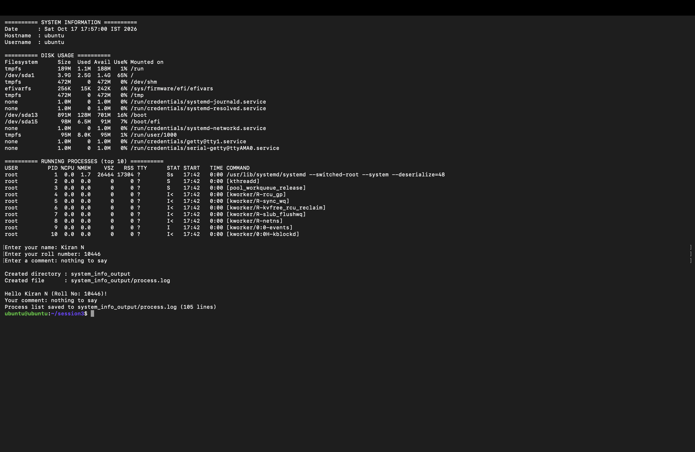
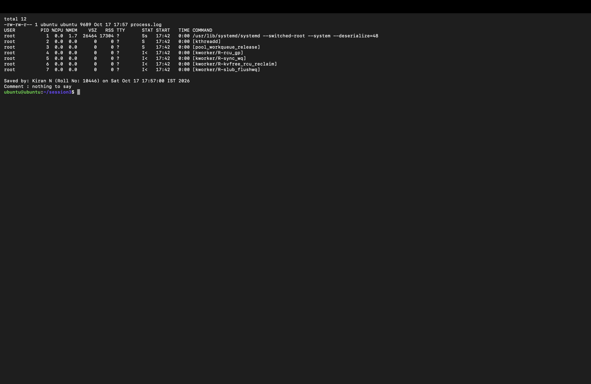

# 🐚 Session 3 — Shell Scripting: Homework

| | |
|---|---|
| **Name** | Kiran N |
| **Roll No.** | 10446 |
| **Course** | DevOps Heros |
| **Session** | 3: Shell Scripting |
| **Environment** | Ubuntu 26.04 LTS VM (Multipass on macOS) |

---

## 📌 Task: System Information Script

Write a shell script that prints system information, takes user input, creates a directory and a file, and saves the running processes into that file using output redirection.

### Requirements checklist

| # | Requirement | How the script does it | Done |
|---|---|---|---|
| 1 | Print current date | `current_date=$(date)` then `echo` | ✅ |
| 2 | Print hostname | `current_host=$(hostname)` | ✅ |
| 3 | Print username | `current_user=$(whoami)` | ✅ |
| 4 | Print disk usage | `df -h` | ✅ |
| 5 | Print running processes | `ps aux \| head -n 11` | ✅ |
| 6 | Use variables | `OUTPUT_DIR`, `LOG_FILE`, `current_date`, `name`, ... | ✅ |
| 7 | Take user input with `read -p` | name, roll number, comment | ✅ |
| 8 | Create a directory with `mkdir` | `mkdir -p system_info_output` | ✅ |
| 9 | Create a file with `touch` | `touch system_info_output/process.log` | ✅ |
| 10 | Save processes with `>` | `ps aux > system_info_output/process.log` | ✅ |

---

## 📂 Folder Structure

```text
Session 3 - Shell Scripting/
├── readme.md
├── SystemInfoScript/
│   ├── system_info.sh              # the script
│   └── system_info_output/
│       └── process.log             # created by the script
└── screenshots/
    ├── 01-script-run.png
    └── 02-process-log.png
```

---

## 📝 The Script — [`system_info.sh`](SystemInfoScript/system_info.sh)

```bash
#!/bin/bash
# Session 3 - Shell Scripting: System Information Script
# Author: Kiran N | Roll No: 10446

# ---------- Variables ----------
OUTPUT_DIR="system_info_output"
LOG_FILE="$OUTPUT_DIR/process.log"

current_date=$(date)
current_host=$(hostname)
current_user=$(whoami)

# ---------- System information ----------
echo "========== SYSTEM INFORMATION =========="
echo "Date      : $current_date"
echo "Hostname  : $current_host"
echo "Username  : $current_user"
echo

echo "========== DISK USAGE =========="
df -h
echo

echo "========== RUNNING PROCESSES (top 10) =========="
ps aux | head -n 11
echo

# ---------- User input ----------
read -p "Enter your name: " name
read -p "Enter your roll number: " roll_no
read -p "Enter a comment: " comment
echo

# ---------- Directory and file ----------
mkdir -p "$OUTPUT_DIR"
touch "$LOG_FILE"
echo "Created directory : $OUTPUT_DIR"
echo "Created file      : $LOG_FILE"

# ---------- Save processes with > redirection ----------
ps aux > "$LOG_FILE"

# Append the user's details with >>
echo "" >> "$LOG_FILE"
echo "Saved by: $name (Roll No: $roll_no) on $current_date" >> "$LOG_FILE"
echo "Comment : $comment" >> "$LOG_FILE"

echo
echo "Hello $name (Roll No: $roll_no)!"
echo "Your comment: $comment"
echo "Process list saved to $LOG_FILE ($(wc -l < "$LOG_FILE") lines)"
```

---

## 🚀 How to Run

```bash
cd SystemInfoScript
chmod +x system_info.sh     # give execute permission
./system_info.sh            # run the script
```

---

## 📋 My Output

### 1. Running the script

```text
========== SYSTEM INFORMATION ==========
Date      : Sat Oct 17 17:57:00 IST 2026
Hostname  : ubuntu
Username  : ubuntu

========== DISK USAGE ==========
Filesystem      Size  Used Avail Use% Mounted on
tmpfs           189M  1.1M  188M   1% /run
/dev/sda1       3.9G  2.5G  1.4G  65% /
tmpfs           472M     0  472M   0% /dev/shm
efivarfs        256K   15K  242K   6% /sys/firmware/efi/efivars
tmpfs           472M     0  472M   0% /tmp
/dev/sda13      891M  128M  701M  16% /boot
/dev/sda15       98M  6.5M   91M   7% /boot/efi
tmpfs            95M  8.0K   95M   1% /run/user/1000
...

========== RUNNING PROCESSES (top 10) ==========
USER         PID %CPU %MEM    VSZ   RSS TTY      STAT START   TIME COMMAND
root           1  0.0  1.7  26464 17304 ?        Ss   17:42   0:00 /usr/lib/systemd/systemd --switched-root --system --deserialize=48
root           2  0.0  0.0      0     0 ?        S    17:42   0:00 [kthreadd]
root           3  0.0  0.0      0     0 ?        S    17:42   0:00 [pool_workqueue_release]
root           4  0.0  0.0      0     0 ?        I<   17:42   0:00 [kworker/R-rcu_gp]
root           5  0.0  0.0      0     0 ?        I<   17:42   0:00 [kworker/R-sync_wq]
...

Enter your name: Kiran N
Enter your roll number: 10446
Enter a comment: nothing to say

Created directory : system_info_output
Created file      : system_info_output/process.log

Hello Kiran N (Roll No: 10446)!
Your comment: nothing to say
Process list saved to system_info_output/process.log (105 lines)
```

📸 

### 2. Checking the created directory and file

```bash
ls -l system_info_output
head -n 8 system_info_output/process.log
tail -n 3 system_info_output/process.log
```

```text
total 12
-rw-rw-r-- 1 ubuntu ubuntu 9689 Oct 17 17:57 process.log
USER         PID %CPU %MEM    VSZ   RSS TTY      STAT START   TIME COMMAND
root           1  0.0  1.7  26464 17304 ?        Ss   17:42   0:00 /usr/lib/systemd/systemd --switched-root --system --deserialize=48
root           2  0.0  0.0      0     0 ?        S    17:42   0:00 [kthreadd]
...

Saved by: Kiran N (Roll No: 10446) on Sat Oct 17 17:57:00 IST 2026
Comment : nothing to say
```

📸 

---

## 🧠 Concepts Used

| Concept | Syntax | Meaning |
|---|---|---|
| Shebang | `#!/bin/bash` | Tells Linux to run the file with Bash |
| Variable | `name="Kiran"` / `$name` | Store a value and read it back |
| Command substitution | `$(date)` | Store a command's output in a variable |
| User input | `read -p "Prompt: " var` | Show a prompt and save what the user types |
| Overwrite redirection | `cmd > file` | Write output to a file, replacing old content |
| Append redirection | `cmd >> file` | Add output to the end of a file |
| Pipe | `ps aux \| head` | Send one command's output into another |
| Permissions | `chmod +x file.sh` | Make the script executable |

## 💡 What I Learned

- `>` replaced the whole `process.log` on every run, while `>>` added my name and comment at the end without deleting the process list.
- `mkdir -p` doesn't fail if the folder already exists, so the script can be run again safely.
- Storing paths in variables (`OUTPUT_DIR`, `LOG_FILE`) means I only change them in one place.

---

> ✅ **End of Session 3 — Shell Scripting Homework** · Kiran N · Roll No. 10446
