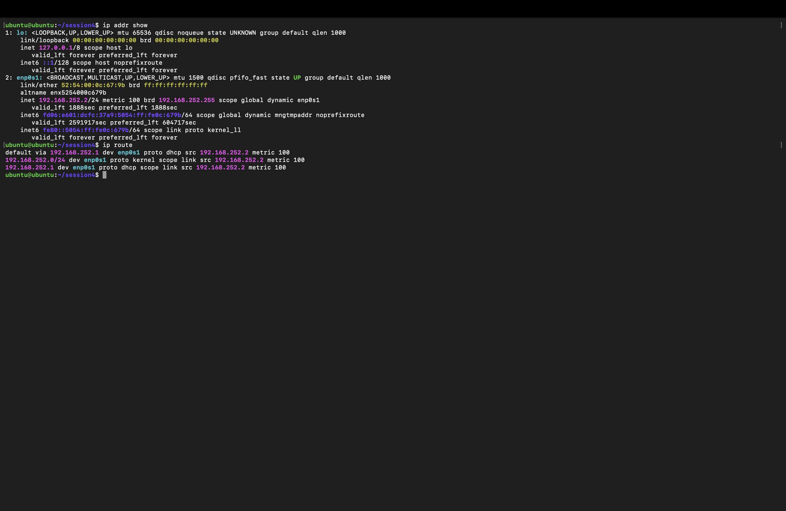
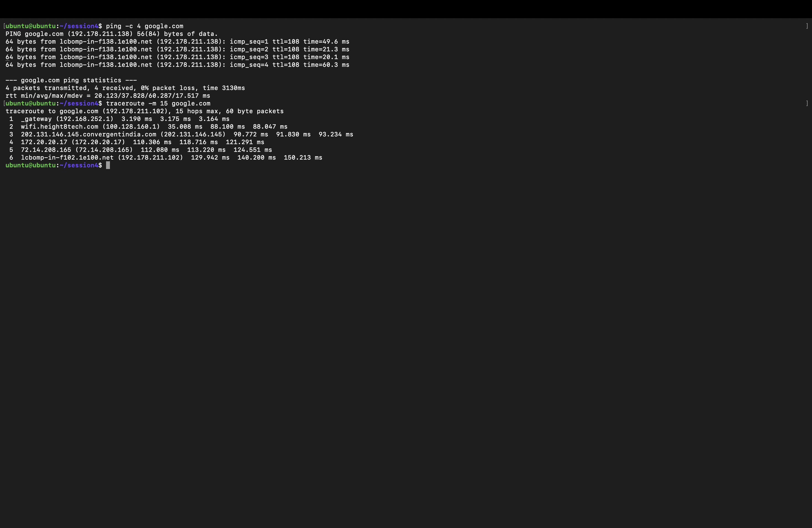
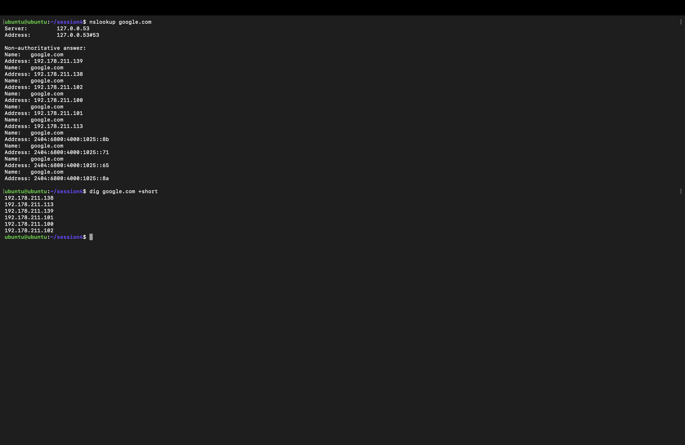
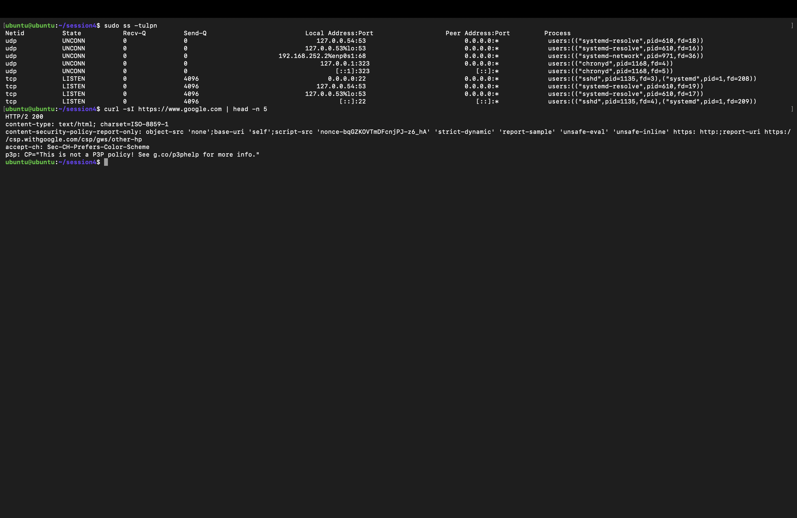

# 🌐 Session 4 — Networking Fundamentals: Homework

| | |
|---|---|
| **Name** | Kiran N |
| **Roll No.** | 10446 |
| **Course** | DevOps Heros |
| **Session** | 4: Networking Fundamentals |
| **Environment** | Ubuntu 26.04 LTS VM (Multipass on macOS) |

---

## 📌 Tasks

| # | Task | Status |
|---|------|--------|
| 1 | Practice the networking commands from the devops-heros repo | ✅ Done |
| 2 | Run the commands, add output/screenshots, and explain each one | ✅ Done |

## 📂 Files

| File | What it is |
|---|---|
| [`net_lab.sh`](net_lab.sh) | Script I wrote to run every command and save the output |
| [`network_output.txt`](network_output.txt) | Full raw output of all commands from my VM |
| [`screenshots/`](screenshots/) | Terminal screenshots |

Setup used before running the lab:

```bash
sudo apt update && sudo apt install -y traceroute dnsutils net-tools
chmod +x net_lab.sh && ./net_lab.sh
```

---

## 🧭 My Network at a Glance

| Item | Value | Found with |
|---|---|---|
| Hostname | `ubuntu` | `hostname` |
| IPv4 address | `192.168.252.2/24` | `ip addr show` |
| Network | `192.168.252.0/24` (254 usable hosts) | `ip route` |
| Default gateway | `192.168.252.1` (my Mac) | `ip route` |
| Gateway MAC | `86:94:37:ac:a3:64` | `arp -n` |
| DNS resolver | `127.0.0.53` (systemd-resolved) | `/etc/resolv.conf` |
| Open ports | 22/tcp (SSH), 53 (DNS, local only) | `ss -tulpn` |

---

## 1️⃣ `hostname` and `hostname -I`

```text
$ hostname
ubuntu

$ hostname -I
192.168.252.2 fd06:e601:dcfc:37a9:5054:ff:fe0c:679b
```

**What I understood:** `hostname` prints the machine's name. `hostname -I` lists all of its IP addresses: one IPv4 and one IPv6.

---

## 2️⃣ `ip addr show` and `ip route`

```text
$ ip addr show
1: lo: <LOOPBACK,UP,LOWER_UP> mtu 65536 qdisc noqueue state UNKNOWN group default qlen 1000
    link/loopback 00:00:00:00:00:00 brd 00:00:00:00:00:00
    inet 127.0.0.1/8 scope host lo
    inet6 ::1/128 scope host noprefixroute
2: enp0s1: <BROADCAST,MULTICAST,UP,LOWER_UP> mtu 1500 qdisc pfifo_fast state UP group default qlen 1000
    link/ether 52:54:00:0c:67:9b brd ff:ff:ff:ff:ff:ff
    inet 192.168.252.2/24 metric 100 brd 192.168.252.255 scope global dynamic enp0s1
    inet6 fd06:e601:dcfc:37a9:5054:ff:fe0c:679b/64 scope global dynamic mngtmpaddr noprefixroute
    inet6 fe80::5054:ff:fe0c:679b/64 scope link proto kernel_ll

$ ip route
default via 192.168.252.1 dev enp0s1 proto dhcp src 192.168.252.2 metric 100
192.168.252.0/24 dev enp0s1 proto kernel scope link src 192.168.252.2 metric 100
192.168.252.1 dev enp0s1 proto dhcp scope link src 192.168.252.2 metric 100
```

📸 

**What I understood:**
- There are two interfaces. `lo` is the **loopback** (`127.0.0.1`), used by the machine to talk to itself. `enp0s1` is the real network card, and it's `UP`.
- `52:54:00:0c:67:9b` is the **MAC address**, the hardware address of the card.
- `192.168.252.2/24` is my IPv4 address. `/24` means the first 24 bits are the network part (subnet mask `255.255.255.0`), so the broadcast address is `192.168.252.255`.
- `dynamic` and `proto dhcp` mean the address was handed out automatically by **DHCP**.
- `ip route` shows the **default gateway** `192.168.252.1`. Anything that isn't on my local `/24` network is sent there.

### IP addressing notes (from the session)

| Class | First octet | Default mask | Private range |
|---|---|---|---|
| A | 1 – 126 | `255.0.0.0` (/8) | `10.0.0.0 – 10.255.255.255` |
| B | 128 – 191 | `255.255.0.0` (/16) | `172.16.0.0 – 172.31.255.255` |
| C | 192 – 223 | `255.255.255.0` (/24) | `192.168.0.0 – 192.168.255.255` |
| D | 224 – 239 | multicast | — |

My VM's address `192.168.252.2` is a **Class C private** address. For `192.168.252.0/24`, there are 32 − 24 = 8 host bits, so 2⁸ = 256 addresses and **254 usable hosts**, because the network address `.0` and the broadcast address `.255` are reserved.

---

## 3️⃣ `cat /etc/resolv.conf`

```text
nameserver 127.0.0.53
options edns0 trust-ad
search .
```

**What I understood:** this file tells Linux which DNS server to ask. On Ubuntu it points to `127.0.0.53`, a local DNS stub run by `systemd-resolved`, which then forwards queries to the real upstream DNS server.

---

## 4️⃣ `ping -c 4 google.com`

```text
PING google.com (192.178.211.138) 56(84) bytes of data.
64 bytes from lcbomp-in-f138.1e100.net (192.178.211.138): icmp_seq=1 ttl=108 time=49.6 ms
64 bytes from lcbomp-in-f138.1e100.net (192.178.211.138): icmp_seq=2 ttl=108 time=21.3 ms
64 bytes from lcbomp-in-f138.1e100.net (192.178.211.138): icmp_seq=3 ttl=108 time=20.1 ms
64 bytes from lcbomp-in-f138.1e100.net (192.178.211.138): icmp_seq=4 ttl=108 time=60.3 ms

--- google.com ping statistics ---
4 packets transmitted, 4 received, 0% packet loss, time 3130ms
rtt min/avg/max/mdev = 20.123/37.828/60.287/17.517 ms
```

**What I understood:** `ping` sends ICMP echo requests and waits for replies. All 4 packets came back (**0% packet loss**) with an average round-trip time of about **38 ms**, so the internet connection works. `-c 4` stops after 4 packets; without it, ping runs until Ctrl+C. `ttl=108` is the remaining hop limit on the reply packet.

---

## 5️⃣ `traceroute -m 15 google.com`

```text
traceroute to google.com (192.178.211.102), 15 hops max, 60 byte packets
 1  _gateway (192.168.252.1)  3.190 ms  3.175 ms  3.164 ms
 2  wifi.height8tech.com (100.128.160.1)  35.008 ms  88.100 ms  88.047 ms
 3  202.131.146.145.convergentindia.com (202.131.146.145)  90.772 ms  91.830 ms  93.234 ms
 4  172.20.20.17 (172.20.20.17)  110.306 ms  118.716 ms  121.291 ms
 5  72.14.208.165 (72.14.208.165)  112.080 ms  113.220 ms  124.551 ms
 6  lcbomp-in-f102.1e100.net (192.178.211.102)  129.942 ms  140.200 ms  150.213 ms
```

📸 

**What I understood:** `traceroute` shows every router (hop) a packet passes through. My packets reached Google in **6 hops**:
1. `192.168.252.1`: the VM's gateway, which is my Mac
2. `100.128.160.1`: the Wi-Fi router
3. `convergentindia.com`: my internet service provider
4. `172.20.20.17`: an internal ISP router (private address)
5. `72.14.208.165`: the entry point into Google's network
6. `192.178.211.102`: the Google server (`1e100.net` is Google's domain)

The time grows at each hop because the packet travels further. `-m 15` sets the maximum number of hops to try.

---

## 6️⃣ `nslookup google.com` and `dig google.com +short`

```text
$ nslookup google.com
Server:         127.0.0.53
Address:        127.0.0.53#53

Non-authoritative answer:
Name:   google.com
Address: 192.178.211.139
Name:   google.com
Address: 192.178.211.138
...
Name:   google.com
Address: 2404:6800:4000:1025::8b
...

$ dig google.com +short
192.178.211.138
192.178.211.113
192.178.211.139
192.178.211.101
192.178.211.100
192.178.211.102
```

📸 

**What I understood:** both commands ask DNS to translate a name into IP addresses. `google.com` returned **6 IPv4 (A records)** and several **IPv6 (AAAA records)** addresses, because Google spreads traffic across many servers. "Non-authoritative" means the answer came from a cache, not directly from Google's own DNS server. `dig +short` prints only the IPs, which is handy in scripts.

---

## 7️⃣ `curl -sI https://www.google.com`

```text
HTTP/2 200
content-type: text/html; charset=ISO-8859-1
content-security-policy-report-only: object-src 'none';base-uri 'self';...
accept-ch: Sec-CH-Prefers-Color-Scheme
p3p: CP="This is not a P3P policy! See g.co/p3phelp for more info."
```

**What I understood:** `curl -I` fetches only the HTTP **headers**. `HTTP/2 200` means the request succeeded over HTTP/2, and `content-type` says the page is HTML. This is a quick way to check whether a website or API is up.

---

## 8️⃣ `sudo ss -tulpn` and `netstat -tuln`

```text
$ sudo ss -tulpn
Netid State  Recv-Q Send-Q        Local Address:Port Peer Address:Port Process
udp   UNCONN 0      0                127.0.0.54:53        0.0.0.0:*    users:(("systemd-resolve",pid=610,fd=18))
udp   UNCONN 0      0             127.0.0.53%lo:53        0.0.0.0:*    users:(("systemd-resolve",pid=610,fd=16))
udp   UNCONN 0      0      192.168.252.2%enp0s1:68        0.0.0.0:*    users:(("systemd-network",pid=971,fd=36))
udp   UNCONN 0      0                 127.0.0.1:323       0.0.0.0:*    users:(("chronyd",pid=1168,fd=4))
udp   UNCONN 0      0                     [::1]:323          [::]:*    users:(("chronyd",pid=1168,fd=5))
tcp   LISTEN 0      4096                0.0.0.0:22        0.0.0.0:*    users:(("sshd",pid=1135,fd=3),("systemd",pid=1,fd=208))
tcp   LISTEN 0      4096             127.0.0.54:53        0.0.0.0:*    users:(("systemd-resolve",pid=610,fd=19))
tcp   LISTEN 0      4096          127.0.0.53%lo:53        0.0.0.0:*    users:(("systemd-resolve",pid=610,fd=17))
tcp   LISTEN 0      4096                   [::]:22           [::]:*    users:(("sshd",pid=1135,fd=4),("systemd",pid=1,fd=209))

$ netstat -tuln
Proto Recv-Q Send-Q Local Address           Foreign Address         State
tcp        0      0 0.0.0.0:22              0.0.0.0:*               LISTEN
tcp        0      0 127.0.0.54:53           0.0.0.0:*               LISTEN
tcp        0      0 127.0.0.53:53           0.0.0.0:*               LISTEN
tcp6       0      0 :::22                   :::*                    LISTEN
udp        0      0 127.0.0.54:53           0.0.0.0:*
udp        0      0 127.0.0.53:53           0.0.0.0:*
udp        0      0 192.168.252.2:68        0.0.0.0:*
udp        0      0 127.0.0.1:323           0.0.0.0:*
udp6       0      0 ::1:323                 :::*
```

📸 

**What I understood:** both commands list ports the machine is listening on (`-t` TCP, `-u` UDP, `-l` listening, `-n` numbers, `-p` process). `ss` is the modern replacement for `netstat` and also shows the process.

| Port | Protocol | Process | Purpose |
|---|---|---|---|
| 22 | TCP | `sshd` | SSH: this is how Multipass logs me into the VM. `0.0.0.0` means open on all interfaces |
| 53 | TCP/UDP | `systemd-resolve` | Local DNS, only on `127.0.0.53/54`, so not reachable from outside |
| 68 | UDP | `systemd-networkd` | DHCP client, used to get the IP address |
| 323 | UDP | `chronyd` | Time sync (NTP) control, localhost only |

---

## 9️⃣ `arp -n`

```text
Address                  HWtype  HWaddress           Flags Mask            Iface
192.168.252.1            ether   86:94:37:ac:a3:64   C                     enp0s1
```

**What I understood:** ARP maps an IP address to a MAC address on the local network. The VM has learned the MAC of its gateway `192.168.252.1`. The `C` flag means the entry is complete.

---

## 🔟 `sha256sum /etc/hostname`

```text
da4d47d486c674b0e05b992713276b345aaa1858d3f147b4b185ad5215cfdc69  /etc/hostname
```

**What I understood:** `sha256sum` creates a fixed-length fingerprint (checksum) of a file. If even one byte of the file changes, the hash changes completely, so it's used to verify that downloaded files weren't corrupted or tampered with.

---

## 📝 Summary

| Command | Use it to... |
|---|---|
| `hostname -I` | See my IP addresses quickly |
| `ip addr` / `ip route` | See interfaces, IPs, MAC and the default gateway |
| `ping` | Check whether a host is reachable and how fast |
| `traceroute` | Find where on the path a connection slows down or breaks |
| `nslookup` / `dig` | Debug DNS (name → IP) |
| `curl -I` | Check whether a website/API responds and with what status |
| `ss` / `netstat` | See which ports and services are listening |
| `arp` | See IP → MAC mappings on the local network |
| `sha256sum` | Verify file integrity |

---

> ✅ **End of Session 4 — Networking Fundamentals Homework** · Kiran N · Roll No. 10446
