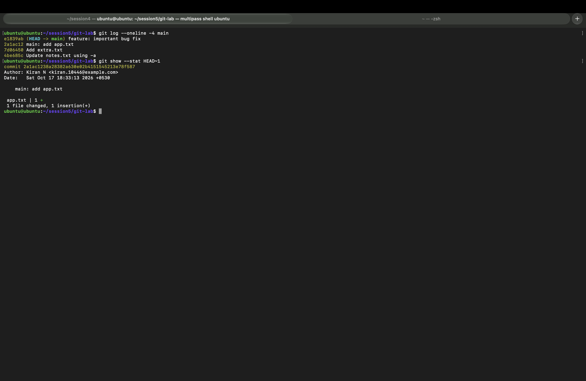
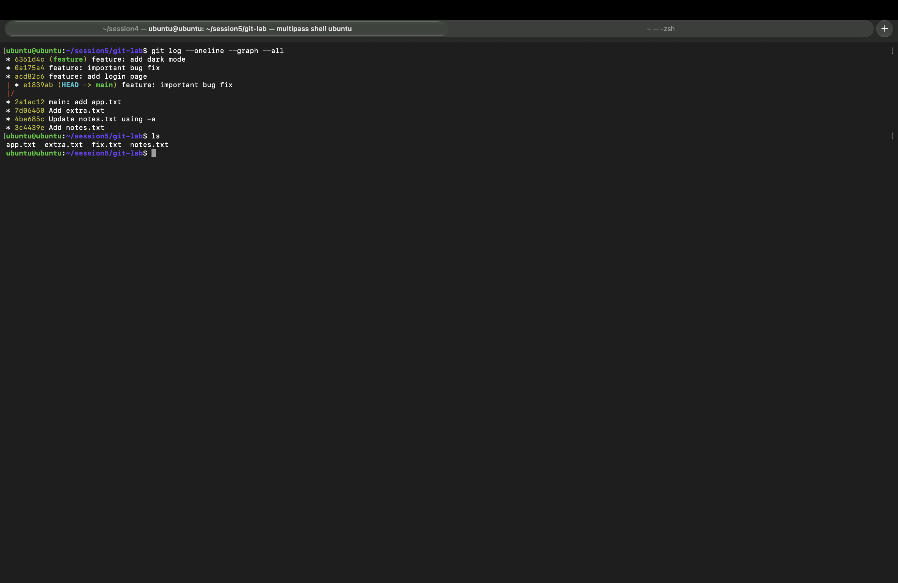

# 🔀 Session 5 — Git & GitHub: Homework

| | |
|---|---|
| **Name** | Kiran N |
| **Roll No.** | 10446 |
| **Course** | DevOps Heros |
| **Session** | 5: Git & GitHub |
| **Environment** | Ubuntu 26.04 LTS VM (Multipass on macOS), Git |

---

## 📌 Tasks

| # | Task | Status |
|---|------|--------|
| 1 | `git commit -a -m` vs `git commit -m`: practice, test both, observe the difference | ✅ Done |
| 2 | `git cherry-pick`: 2–4 commits on main, new branch with 2–3 commits, cherry-pick one into main and verify | ✅ Done |

## 📂 Files

| File | What it is |
|---|---|
| [`git_lab.sh`](git_lab.sh) | All commands I ran for both tasks |
| [`git_output.txt`](git_output.txt) | Full output from my terminal |
| [`screenshots/`](screenshots/) | Terminal screenshots |

Setup (local test repo):

```bash
mkdir -p ~/session5/git-lab && cd ~/session5/git-lab
git init -b main
git config user.name "Kiran N"
git config user.email "kiran.10446@example.com"
```

---

## 1️⃣ Task 1: `git commit -m` vs `git commit -a -m`

### The difference

| | `git commit -m "msg"` | `git commit -a -m "msg"` |
|---|---|---|
| What it commits | Only what is already **staged** with `git add` | Automatically stages **modified/deleted tracked files**, then commits |
| Needs `git add` first? | ✅ Yes | ❌ Not for tracked files |
| Includes **new (untracked)** files? | Only if you `git add` them | ❌ **Never**. New files still need `git add` |
| Typical use | Careful, selective commits | Quick commit of edits to existing files |

### What I did

1. Created `notes.txt`, then ran `git add` and `git commit -m`, which is the normal flow.
2. **Modified** `notes.txt` (tracked) and **created** `extra.txt` (untracked).
3. Tried `git commit -m` **without** `git add`.
4. Ran `git commit -a -m`.
5. Checked what was left.

```text
$ echo "line 2" >> notes.txt
$ echo "new file" > extra.txt

$ git status --short
 M notes.txt
?? extra.txt
```

`M` means a tracked file was modified. `??` means the file is untracked (Git has never seen it).

**Step 3: `git commit -m` without `git add` commits nothing:**

```text
$ git commit -m "Try commit without add"
On branch main
Changes not staged for commit:
	modified:   notes.txt

Untracked files:
	extra.txt

no changes added to commit (use "git add" and/or "git commit -a")
```

**Step 4: `git commit -a -m` commits the tracked file automatically:**

```text
$ git commit -a -m "Update notes.txt using -a"
[main 4be685c] Update notes.txt using -a
 1 file changed, 1 insertion(+)

$ git status --short
?? extra.txt

$ git show --stat --oneline HEAD
4be685c Update notes.txt using -a
 notes.txt | 1 +
 1 file changed, 1 insertion(+)
```

**Step 5: the new file was skipped, so it still needs `git add`:**

```text
$ git add extra.txt
$ git commit -m "Add extra.txt"
[main 7d06450] Add extra.txt
 1 file changed, 1 insertion(+)
 create mode 100644 extra.txt
```

📸 

### ✅ Observation

- `git commit -m` refused to commit because nothing was staged.
- `git commit -a -m` committed **only `notes.txt`** (1 file changed). `extra.txt` stayed `??` because `-a` doesn't pick up new files.
- So `-a` is a shortcut for `git add -u` + `git commit`, and it only works for files Git already tracks.

---

## 2️⃣ Task 2: `git cherry-pick`

`git cherry-pick <commit>` copies **one specific commit** from another branch onto the current branch, without merging the whole branch.

### Step 1: 4 commits on `main`

```text
$ git log --oneline
2a1ac12 main: add app.txt
7d06450 Add extra.txt
4be685c Update notes.txt using -a
3c4439e Add notes.txt
```

### Step 2: new branch `feature` with 3 commits

```text
$ git checkout -b feature
Switched to a new branch 'feature'

$ git commit -m "feature: add login page"      -> acd82c6
$ git commit -m "feature: important bug fix"   -> 0a175a4
$ git commit -m "feature: add dark mode"       -> 6351d4c

$ git log --oneline
6351d4c feature: add dark mode
0a175a4 feature: important bug fix
acd82c6 feature: add login page
2a1ac12 main: add app.txt
...
```

### Step 3: identify the commit and cherry-pick only the bug fix into `main`

The bug fix is commit **`0a175a4`**. The login page and dark mode aren't ready, so I don't want them on `main`.

```text
$ git checkout main
Switched to branch 'main'

$ git cherry-pick 0a175a4
[main e1839ab] feature: important bug fix
 Date: Sat Oct 17 18:33:13 2026 +0530
 1 file changed, 1 insertion(+)
 create mode 100644 fix.txt
```

### Step 4: verify

```text
$ git log --oneline --graph --all
* 6351d4c (feature) feature: add dark mode
* 0a175a4 feature: important bug fix
* acd82c6 feature: add login page
| * e1839ab (HEAD -> main) feature: important bug fix
|/
* 2a1ac12 main: add app.txt
* 7d06450 Add extra.txt
* 4be685c Update notes.txt using -a
* 3c4439e Add notes.txt

$ ls
app.txt  extra.txt  fix.txt  notes.txt
```

📸 

### ✅ Observation

- `main` now has the bug-fix commit as a **new commit `e1839ab`**. It has the same changes and message but a different hash, because its parent is different.
- `fix.txt` is on `main`, but `login.txt` and `theme.txt` are **not**, so only the one selected commit was copied.
- The `feature` branch is unchanged.

---

## 🛠️ Commands Used

| Command | Purpose |
|---|---|
| `git init -b main` | Create a new repo with `main` as the default branch |
| `git status --short` | Short status (`M` modified, `??` untracked) |
| `git add <file>` | Stage a file |
| `git commit -m "msg"` | Commit staged changes |
| `git commit -a -m "msg"` | Stage tracked changes and commit in one step |
| `git log --oneline` | One line per commit |
| `git log --oneline --graph --all` | History of all branches as a graph |
| `git show --stat <commit>` | Files changed in a commit |
| `git checkout -b <branch>` | Create and switch to a branch |
| `git cherry-pick <hash>` | Copy one commit onto the current branch |

## 💡 What I Learned

- Use `git commit -a -m` for quick edits, but always check `git status` first, because new files are silently left out.
- Cherry-pick is useful for bringing an urgent **hotfix** to `main` (or a release branch) without merging unfinished features.

---

> ✅ **End of Session 5 — Git & GitHub Homework** · Kiran N · Roll No. 10446
