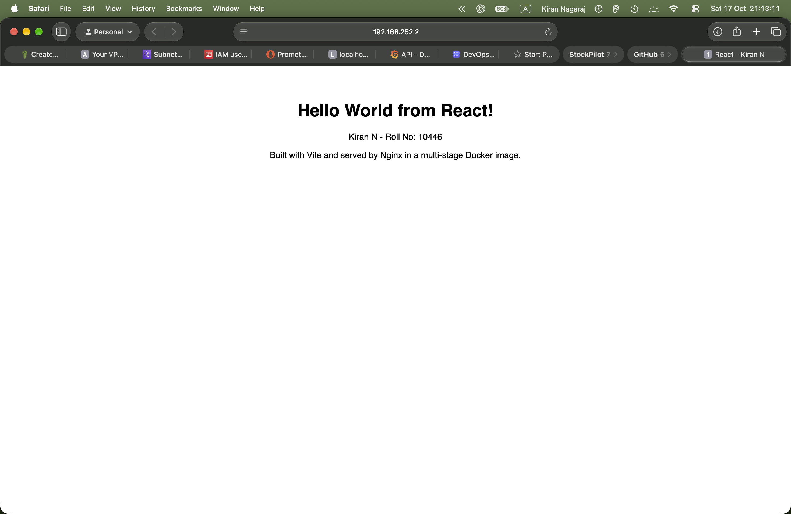

# 🐳 Session 6 — Docker Fundamentals: Hello World Apps

**Name:** Kiran N · **Roll No.:** 10446 · **Environment:** Ubuntu 26.04 VM (arm64), Docker 29.1

---

## 📌 Task

Create a simple **Hello World** web app with Docker for Node.js, Python, Java, Apache, React and Nginx. Each one has its own folder, code and Dockerfile, is built into an image, runs as a container, and shows Hello World on a web page.

| Folder | App | Port | Verified |
|---|---|---|---|
| [`nodejs-app`](nodejs-app) | Node.js (built-in `http` module) | 3001 | ✅ HTTP 200 |
| [`python-app`](python-app) | Python (`http.server`) | 5001 | ✅ HTTP 200 |
| [`java-app`](java-app) | Java (`com.sun.net.httpserver`) | 8081 | ✅ HTTP 200 |
| [`Apache-app`](Apache-app) | Apache httpd serving `index.html` | 8082 | ✅ HTTP 200 |
| [`React-app`](React-app) | React + Vite, served by Nginx | 8083 | ✅ HTTP 200 |
| [`nginx-app`](nginx-app) | Nginx serving `index.html` | 8084 | ✅ HTTP 200 |

---

## 1️⃣ Node.js — `nodejs-app`

```dockerfile
FROM node:20-alpine
WORKDIR /app
COPY package.json server.js ./
EXPOSE 3000
CMD ["npm", "start"]
```

A tiny server using Node's built-in `http` module, so no `npm install` is needed. `npm start` runs `node server.js`.

## 2️⃣ Python — `python-app`

```dockerfile
FROM python:3.12-alpine
WORKDIR /app
COPY app.py .
EXPOSE 5000
CMD ["python", "app.py"]
```

Uses Python's standard `http.server`. It listens on `0.0.0.0` so it can be reached from outside the container.

## 3️⃣ Java — `java-app`

```dockerfile
# Stage 1: compile with the full JDK
FROM eclipse-temurin:21-jdk-alpine AS build
WORKDIR /src
COPY HelloWorld.java .
RUN javac HelloWorld.java

# Stage 2: run with only the JRE (smaller image)
FROM eclipse-temurin:21-jre-alpine
WORKDIR /app
COPY --from=build /src/HelloWorld.class .
EXPOSE 8080
CMD ["java", "HelloWorld"]
```

The JDK (compiler) is only needed to build, so the final image ships just the JRE and the compiled `.class` file.

## 4️⃣ Apache — `Apache-app`

```dockerfile
FROM httpd:2.4-alpine
COPY index.html /usr/local/apache2/htdocs/index.html
EXPOSE 80
```

Apache's document root in the official image is `/usr/local/apache2/htdocs/`.

## 5️⃣ React — `React-app`

```dockerfile
# Stage 1: build the React app
FROM node:20-alpine AS build
WORKDIR /app
COPY package.json ./
RUN npm install
COPY . .
RUN npm run build

# Stage 2: serve the static build with Nginx
FROM nginx:alpine
COPY --from=build /app/dist /usr/share/nginx/html
EXPOSE 80
```

`npm run build` (Vite) produces static files in `dist/`. Node is only needed to build them, so the final image is plain Nginx at **102 MB**. `.dockerignore` keeps `node_modules` out of the build context.

📸 

## 6️⃣ Nginx — `nginx-app`

```dockerfile
FROM nginx:alpine
COPY index.html /usr/share/nginx/html/index.html
EXPOSE 80
```

---

## 🛠️ Build, Run and Verify

All six apps are built and started by [`build_and_run.sh`](build_and_run.sh). For one app, the steps are:

```bash
docker build -t python-app ./python-app               # build an image from the Dockerfile
docker run -d --name python-app -p 5001:5000 python-app   # run it in the background, map host 5001 -> container 5000
curl http://localhost:5001                            # check the page
docker ps                                             # see the running container
docker logs python-app                                # see what the app printed
docker rm -f python-app                               # stop and remove it
```

My output (full log in [`docker_output.txt`](docker_output.txt)):

```text
$ curl -s http://localhost:3001
HTTP 200  Hello World from Node.js!
$ curl -s http://localhost:5001
HTTP 200  Hello World from Python!
$ curl -s http://localhost:8081
HTTP 200  Hello World from Java!
$ curl -s http://localhost:8082
HTTP 200  title: Apache - Kiran N
$ curl -s http://localhost:8083
HTTP 200  title: React - Kiran N
$ curl -s http://localhost:8084
HTTP 200  title: Nginx - Kiran N

REPOSITORY        TAG             SIZE
nginx-app         latest          102MB
react-app         latest          102MB
apache-app        latest          115MB
java-app          latest          286MB
python-app        latest          87.9MB
nodejs-app        latest          194MB
```

📸 

---

## 🧠 Dockerfile Instructions Used

| Instruction | Meaning |
|---|---|
| `FROM` | Base image to start from (`AS name` names a build stage) |
| `WORKDIR` | Working directory inside the image |
| `COPY` | Copy files from my folder (or from another stage with `--from`) into the image |
| `RUN` | Run a command while **building** the image (e.g. `npm install`, `javac`) |
| `EXPOSE` | Documents which port the app listens on |
| `CMD` | The command run when a **container starts** |

## 💡 What I Learned

- An **image** is the read-only template built from a Dockerfile; a **container** is a running instance of it.
- `-p host:container` publishes a container port, which is how I opened the apps from Safari on my Mac at `http://192.168.252.2:<port>`.
- `alpine` base images and multi-stage builds keep images small: React went from a Node build environment down to a 102 MB Nginx image.
