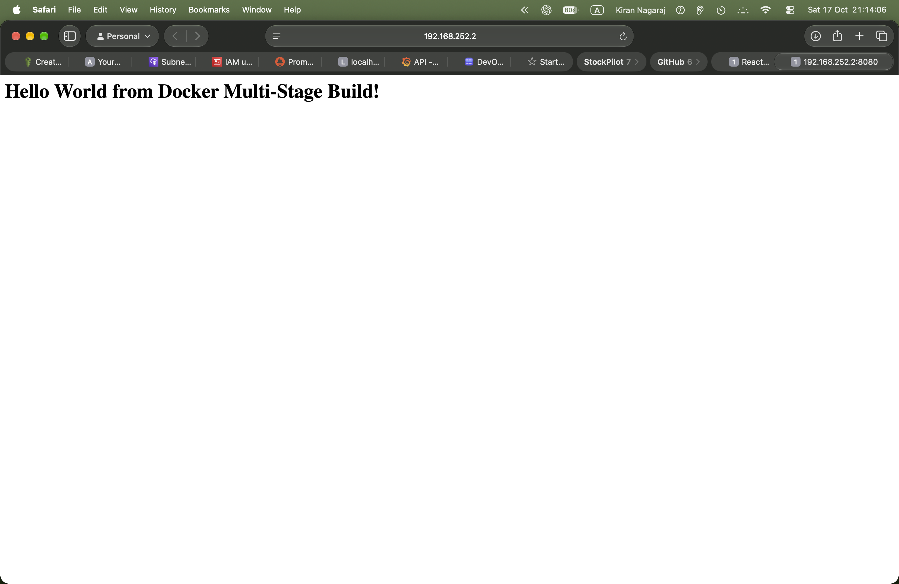
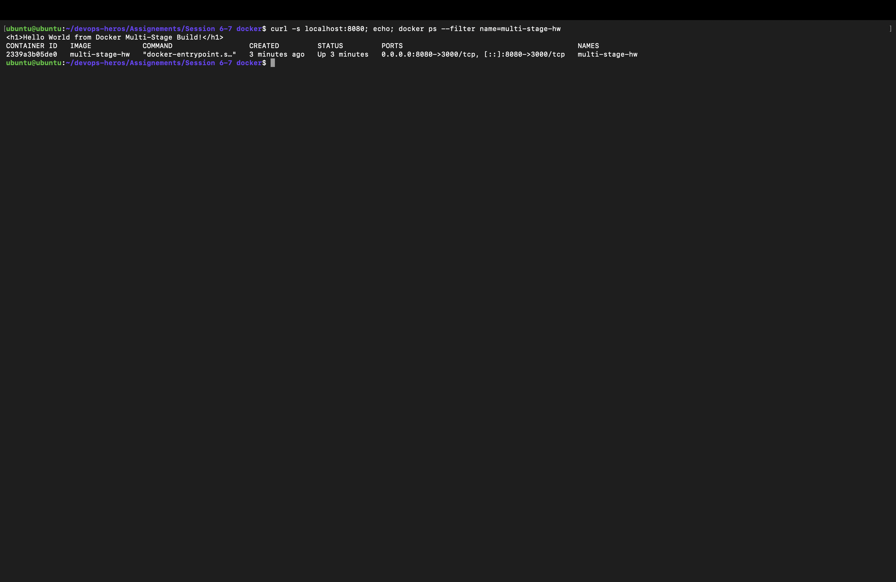
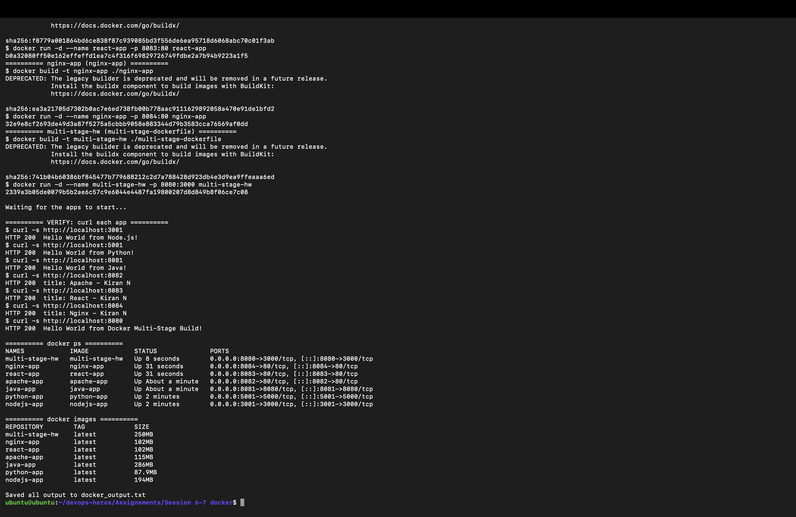

# 🏗️ Session 7 — Dockerfiles & Images: Multi-Stage Build Homework

| | |
|---|---|
| **Name** | Kiran N |
| **Enrollment / Roll No.** | 10446 |
| **Environment** | Ubuntu 26.04 VM (Multipass, arm64) · Docker 29.1 |

---

## 📌 Task 1: Run the Multi-Stage Dockerfile

The multi-stage Dockerfile comes from the instructor's repository (`session6-7-docker/multi-stage-dockerfile`), which I cloned into [`multi-stage-dockerfile/`](multi-stage-dockerfile).

### The Dockerfile

```dockerfile
# -------------------------
# Stage 1: Build
# -------------------------
FROM node:24-alpine AS builder
WORKDIR /app
COPY package*.json ./
RUN npm install
COPY . .

# -------------------------
# Stage 2: Production
# -------------------------
FROM node:24-alpine AS production
WORKDIR /app
COPY --from=builder /app/package*.json ./
RUN npm install --omit=dev
COPY --from=builder /app/server.js ./
EXPOSE 3000
CMD ["npm", "start"]
```

**How it works:**
- **Stage 1 (`builder`)** installs all dependencies and copies the whole project.
- **Stage 2 (`production`)** starts from a fresh image and copies **only** `package.json` and `server.js` from the builder. It installs only production dependencies (`--omit=dev`), so dev tools and build leftovers never reach the final image.
- The app (Express) listens on port **3000** inside the container. I published it on host port **8080** with `-p 8080:3000`.

### Build and run

```bash
docker build -t multi-stage-hw ./multi-stage-dockerfile
docker run -d --name multi-stage-hw -p 8080:3000 multi-stage-hw
```

```text
$ docker build -t multi-stage-hw ./multi-stage-dockerfile
sha256:741b04b60386bf845477b779688212c2d7a788428d923db4e3d9ea9ffeaaa6ed
$ docker run -d --name multi-stage-hw -p 8080:3000 multi-stage-hw
2339a3b05de0079b5b2ae6c57c9e6044e4487fa19800207d8d849b8f06ce7c08
```

---

## 📌 Task 2: Documentation and Verification

### ✅ Application running and showing the message

```text
$ curl -s localhost:8080
<h1>Hello World from Docker Multi-Stage Build!</h1>
```

📸 **Application in the browser** (Safari on my Mac → `http://192.168.252.2:8080`):



### ✅ `docker ps` showing the container on port 8080

```text
$ docker ps --filter name=multi-stage-hw
CONTAINER ID   IMAGE            COMMAND                  CREATED         STATUS         PORTS                                         NAMES
2339a3b05de0   multi-stage-hw   "docker-entrypoint.s…"   3 minutes ago   Up 3 minutes   0.0.0.0:8080->3000/tcp, [::]:8080->3000/tcp   multi-stage-hw
```

`0.0.0.0:8080->3000/tcp` confirms that host port **8080** forwards to the app's port 3000 inside the container.

📸 

---

## 📌 Task 3: Deploy at Least 3 Different Application Types

I deployed **6** types. All built from their own Dockerfile and returned HTTP 200 (details in [docker-fundamentals-homework.md](docker-fundamentals-homework.md)).

| Type | Container | Port | Multi-stage? |
|---|---|---|---|
| Node.js | `nodejs-app` | 3001 | – |
| Python | `python-app` | 5001 | – |
| Java | `java-app` | 8081 | ✅ JDK → JRE |
| Apache | `apache-app` | 8082 | – |
| React | `react-app` | 8083 | ✅ Node build → Nginx |
| Nginx | `nginx-app` | 8084 | – |

📸 

---

## 🧠 Why Multi-Stage Builds?

| Single-stage | Multi-stage |
|---|---|
| Build tools (compilers, dev dependencies) stay in the final image | Only the runtime and the built output are copied into the final stage |
| Bigger image, slower to pull and deploy | Smaller image, faster to pull |
| Larger attack surface | Fewer packages, so fewer vulnerabilities |

Examples from my own images:
- **React:** the build stage needs Node and `node_modules`, but the final image is just Nginx plus static files, at **102 MB**.
- **Java:** the build stage needs the full JDK (`javac`), but the final image only needs the JRE to run `HelloWorld.class`.

---

> ✅ **End of Session 7 — Multi-Stage Build Homework** · Kiran N · Roll No. 10446
