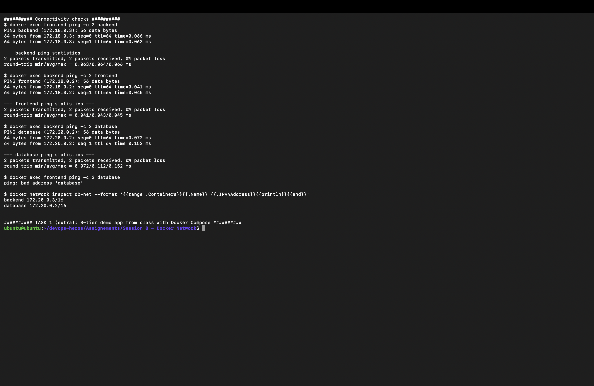
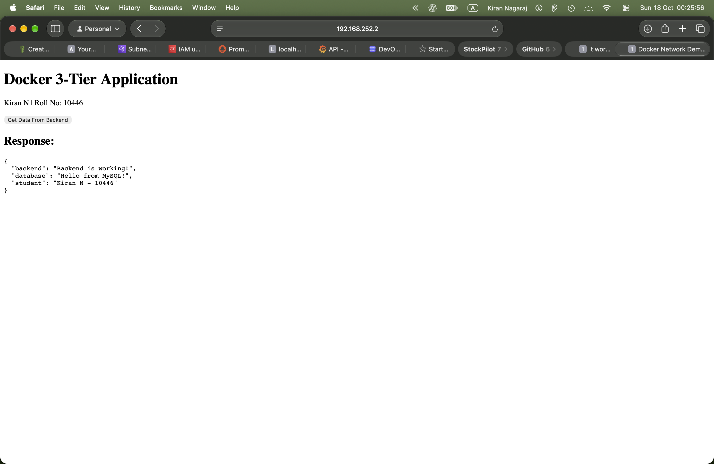
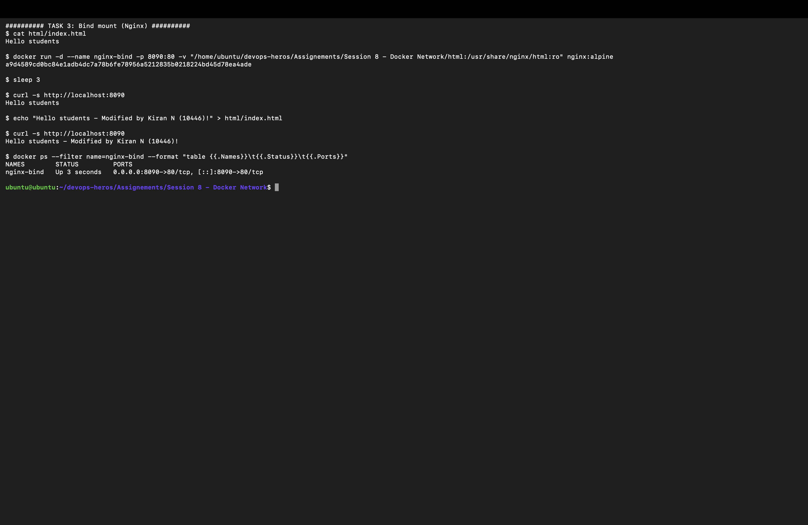

# 🐳 Session 8 — Docker Networking & Volumes: Homework

| | |
|---|---|
| **Name** | Kiran N |
| **Roll No.** | 10446 |
| **Course** | DevOps Heros |
| **Session** | 8: Docker Network |
| **Environment** | Ubuntu 26.04 LTS VM (Multipass on macOS, arm64) · Docker 29.1 · Docker Compose v2 |

---

## 📌 Tasks

| # | Task | Status |
|---|------|--------|
| 1 | 3 containers (frontend, backend, database), 3 networks, backend on 2 networks, check connectivity | ✅ Done (plus the 3-tier class demo with Compose) |
| 2 | Apache2 container on the **host** network, open it on port 80 | ✅ Done |
| 3 | Bind mount a folder with `index.html` ("Hello students") into Nginx, modify it, see the change without a restart | ✅ Done |
| 4 | Research overlay networks | ✅ Done (below) |

## 📂 Files

| File / Folder | What it is |
|---|---|
| [`network_lab.sh`](network_lab.sh) | The script I ran for Tasks 1–3 |
| [`network_lab_output.txt`](network_lab_output.txt) | Full output from my VM (image download progress lines removed) |
| [`html/index.html`](html/index.html) | The bind-mounted page (final, modified version) |
| [`demo/`](demo) | 3-tier app from class: Nginx frontend → Flask backend → MySQL, on 2 networks |
| [`docker-compose-app/`](docker-compose-app) | Simple Compose file from class (frontend, backend, database) |
| [`screenshots/`](screenshots) | My screenshots |

Run it from this folder:

```bash
sudo apt install -y docker-compose-v2   # needed once, for the demo
bash network_lab.sh
```

---

## 1️⃣ Task 1: Container Networking

### Plan

```text
        frontend-net              backend-net               db-net
   ┌──────────────────┐     ┌──────────────────┐     ┌──────────────────┐
   │ frontend (nginx) │     │                  │     │ database (mysql) │
   │        │         │     │                  │     │        │         │
   │        └─────────┼─────┼── backend ───────┼─────┼────────┘         │
   └──────────────────┘     │  (alpine)        │     └──────────────────┘
                            └──────────────────┘
```

- **frontend** (`nginx:alpine`) is only on `frontend-net`.
- **database** (`mysql:8.4`) is only on `db-net`.
- **backend** (`alpine`) starts on `backend-net` and is then connected to `frontend-net` and `db-net`, so it sits in the middle and can talk to both.

### Commands

```bash
docker network create frontend-net
docker network create backend-net
docker network create db-net

docker run -d --name frontend --network frontend-net nginx:alpine
docker run -d --name backend  --network backend-net  alpine sleep infinity
docker run -d --name database --network db-net -e MYSQL_ROOT_PASSWORD=root123 mysql:8.4

docker network connect frontend-net backend   # backend joins a 2nd network
docker network connect db-net backend         # ...and a 3rd
```

### Output

```text
$ docker ps --format "table {{.Names}}\t{{.Image}}\t{{.Networks}}"
NAMES        IMAGE          NETWORKS
database     mysql:8.4      db-net
backend      alpine         backend-net,db-net,frontend-net
frontend     nginx:alpine   frontend-net

$ docker network ls --filter name=-net
NETWORK ID     NAME           DRIVER    SCOPE
fad9f5dd0b8d   backend-net    bridge    local
d8a47d1fc304   db-net         bridge    local
eb45b4ef48ab   frontend-net   bridge    local
```

### Connectivity checks

```text
$ docker exec frontend ping -c 2 backend
PING backend (172.18.0.3): 56 data bytes
64 bytes from 172.18.0.3: seq=0 ttl=64 time=0.066 ms
2 packets transmitted, 2 packets received, 0% packet loss

$ docker exec backend ping -c 2 frontend
PING frontend (172.18.0.2): 56 data bytes
2 packets transmitted, 2 packets received, 0% packet loss

$ docker exec backend ping -c 2 database
PING database (172.20.0.2): 56 data bytes
2 packets transmitted, 2 packets received, 0% packet loss

$ docker exec frontend ping -c 2 database
ping: bad address 'database'

$ docker network inspect db-net --format '{{range .Containers}}{{.Name}} {{.IPv4Address}}{{println}}{{end}}'
backend 172.20.0.3/16
database 172.20.0.2/16
```

📸 

| From → To | Shared network? | Result |
|---|---|---|
| frontend → backend | ✅ `frontend-net` | ✅ ping works |
| backend → frontend | ✅ `frontend-net` | ✅ ping works |
| backend → database | ✅ `db-net` | ✅ ping works |
| frontend → database | ❌ none | ❌ `bad address 'database'` |

### ✅ Observation

- On a **user-defined bridge network**, Docker's built-in DNS lets containers reach each other **by name** (`ping backend`).
- The frontend can't even **resolve** the name `database`, because they share no network. This is how networks isolate tiers: the database is reachable only through the backend.
- The backend has **one IP per network** (`172.18.0.3` on frontend-net, `172.20.0.3` on db-net).

### Extra: the 3-tier demo from class, with Docker Compose

The [`demo/`](demo) app from class does the same thing with a real app: Nginx (frontend) → Flask (backend) → MySQL (database). The frontend is only on `frontend_net`, the database is only on `backend_net`, and the backend is on both. Nginx forwards `/api` to `http://backend:5000/api`, and the backend reads a row from MySQL.

Changes I made to the class version:
- Added my name and roll number to the page and the API reply.
- Added `depends_on: backend` to the frontend. Without it, Nginx sometimes started before the backend existed, failed with `host not found in upstream "backend"`, and exited.

```text
$ docker compose -f demo/docker-compose.yml ps
NAME              IMAGE          COMMAND                  SERVICE    CREATED          STATUS          PORTS
demo-backend-1    demo-backend   "python app.py"          backend    30 seconds ago   Up 30 seconds   5000/tcp
demo-database-1   mysql:8.0      "docker-entrypoint.s…"   database   30 seconds ago   Up 30 seconds   3306/tcp, 33060/tcp
demo-frontend-1   nginx:latest   "/docker-entrypoint.…"   frontend   30 seconds ago   Up 30 seconds   0.0.0.0:8080->80/tcp, [::]:8080->80/tcp

$ curl -s http://localhost:8080/api
{"backend":"Backend is working!","database":"Hello from MySQL!","student":"Kiran N - 10446"}

$ docker network ls --filter name=demo
NETWORK ID     NAME                DRIVER    SCOPE
437475dd14bc   demo_backend_net    bridge    local
6ec5283d22a5   demo_frontend_net   bridge    local

$ docker exec demo-frontend-1 getent hosts backend
172.22.0.2      backend

$ docker exec demo-frontend-1 getent hosts database || echo 'frontend cannot resolve database (not on backend_net)'
frontend cannot resolve database (not on backend_net)
```

📸 

The browser talks only to the frontend. The frontend reaches the backend, and the backend reaches MySQL, but the frontend can't see the database directly.

---

## 2️⃣ Task 2: Host Network (Apache)

```bash
docker run -d --name apache-host --network host httpd:alpine
```

There is **no `-p` port mapping**. With `--network host` the container uses the VM's own network stack, so Apache listens directly on the VM's port 80.

```text
$ curl -s http://localhost:80
<html>
<head>
<title>It works! Apache httpd</title>
</head>
<body>
<p>It works!</p>
</body>
</html>

$ docker inspect apache-host --format "Network mode: {{.HostConfig.NetworkMode}}"
Network mode: host
```

Opened from Safari on my Mac at `http://192.168.252.2` (the VM's IP, port 80):

📸 

### ✅ Observation

| | Bridge (default) | Host |
|---|---|---|
| Own IP / network namespace | ✅ yes | ❌ shares the host's |
| Needs `-p host:container` | ✅ yes | ❌ no, the app port is the host port |
| Isolation | Better | Less (port clashes with host services) |
| Performance | Small NAT overhead | No NAT, slightly faster |

---

## 3️⃣ Task 3: Bind Mount (Nginx)

```bash
echo "Hello students" > html/index.html
docker run -d --name nginx-bind -p 8090:80 \
  -v "$PWD/html:/usr/share/nginx/html:ro" nginx:alpine
```

`-v <host folder>:<container folder>:ro` mounts my local `html/` folder over Nginx's web root (read-only inside the container).

```text
$ cat html/index.html
Hello students

$ curl -s http://localhost:8090
Hello students

$ echo "Hello students - Modified by Kiran N (10446)!" > html/index.html

$ curl -s http://localhost:8090
Hello students - Modified by Kiran N (10446)!

$ docker ps --filter name=nginx-bind --format "table {{.Names}}\t{{.Status}}\t{{.Ports}}"
NAMES        STATUS         PORTS
nginx-bind   Up 3 seconds   0.0.0.0:8090->80/tcp, [::]:8090->80/tcp
```

📸 

### ✅ Observation

- I edited the file **on the host**, and the next request showed the new text straight away.
- `docker ps` shows the same container still `Up`. It was **never restarted or rebuilt**, because the container reads the host folder directly.

| | Bind mount | Named volume |
|---|---|---|
| Where the data lives | A folder I choose on the host | Managed by Docker (`/var/lib/docker/volumes/`) |
| Syntax | `-v /host/path:/container/path` | `-v myvol:/container/path` |
| Good for | Live code/config editing in development | Database data, persistent app data |
| Example here | `html/` → Nginx | `db_data` → MySQL in the demo |

---

## 4️⃣ Task 4: Overlay Networks (Research)

### What it is

An **overlay network** is a Docker network that **spans multiple Docker hosts**. Containers on different machines join the same overlay network and talk to each other by name, as if they were on one bridge network on one host. It uses the `overlay` driver and needs **Docker Swarm** mode.

### How it works across hosts

```text
   Host A (192.168.1.10)                         Host B (192.168.1.11)
 ┌──────────────────────┐                     ┌──────────────────────┐
 │ web  10.0.1.5        │                     │ api  10.0.1.6        │
 │   │                  │                     │   ▲                  │
 │   ▼  overlay "app"   │  VXLAN, UDP 4789    │   │  overlay "app"   │
 │  [VTEP] ─────────────┼────────────────────►┼─ [VTEP]              │
 └──────────────────────┘   (encapsulated)    └──────────────────────┘
```

1. **Swarm control plane:** `docker swarm init` on a manager and `docker swarm join` on the workers. The managers store the network config and share which container is on which host (gossip, TCP/UDP **7946**; cluster management on TCP **2377**).
2. **VXLAN encapsulation:** when `web` on Host A sends a packet to `api` (10.0.1.6), Docker wraps the original Ethernet frame inside a **UDP packet (port 4789)** addressed to Host B's real IP. This is VXLAN.
3. **Decapsulation:** Host B unwraps the packet and delivers the original frame to `api`. To the containers it looks like one flat network (`10.0.1.0/24`).
4. **Service discovery and load balancing:** Swarm's built-in DNS resolves service names to a virtual IP, and the routing mesh spreads requests across all replicas on any host.
5. **Encryption (optional):** `--opt encrypted` encrypts VXLAN traffic between hosts with IPsec.

### Commands

```bash
docker swarm init                                         # on the manager
docker swarm join --token <token> <manager-ip>:2377      # on each worker
docker network create -d overlay --attachable app-net    # --attachable lets plain containers join too
docker service create --name web --network app-net --replicas 3 nginx:alpine
docker network inspect app-net
```

### Use cases

- **Multi-host microservices:** frontend, API and database services spread across several servers but on one private network.
- **Docker Swarm services:** scaling a service to many replicas on many nodes, with built-in load balancing.
- **High availability:** if one host fails, replicas on other hosts are still reachable on the same network.
- **Isolating apps in a cluster:** separate overlay networks per app or per team on shared hosts.

### Bridge vs host vs overlay

| | Bridge | Host | Overlay |
|---|---|---|---|
| Scope | One host | One host | **Many hosts** |
| Container IP | Private per network | Host's IP | Private, cluster-wide |
| Needs Swarm | ❌ | ❌ | ✅ |
| Typical use | Single-host apps (this homework) | Max performance, no isolation | Multi-host clusters |

> Kubernetes doesn't use Docker overlay networks. It solves the same problem with CNI plugins (Flannel, Calico and others), many of which also use VXLAN.

---

## 🛠️ Commands Used

| Command | Purpose |
|---|---|
| `docker network create <name>` | Create a user-defined bridge network |
| `docker run --network <name>` | Start a container on a network |
| `docker network connect <net> <container>` | Attach a running container to another network |
| `docker network ls` / `inspect` | List networks / see their containers and IPs |
| `docker exec <c> ping <name>` | Test name resolution and connectivity |
| `--network host` | Share the host's network stack |
| `-v /host/dir:/container/dir:ro` | Bind mount a host folder (read-only) |
| `docker compose up -d --build` | Build and start a multi-container app |

## 💡 What I Learned

- Containers on the same user-defined network find each other by name. Containers on different networks can't see each other at all, which is a simple way to protect the database.
- A container can be on several networks. That's how the backend bridges the frontend and database tiers.
- Host networking removes port mapping, but it also removes isolation.
- A bind mount reflects host file changes live, which is great for development.
- Overlay networks extend all this across many hosts using VXLAN.

---

> ✅ **End of Session 8 — Docker Networking & Volumes Homework** · Kiran N · Roll No. 10446
