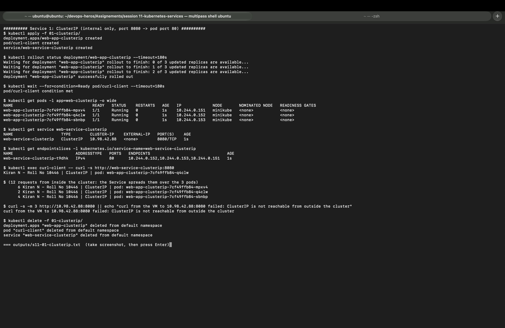
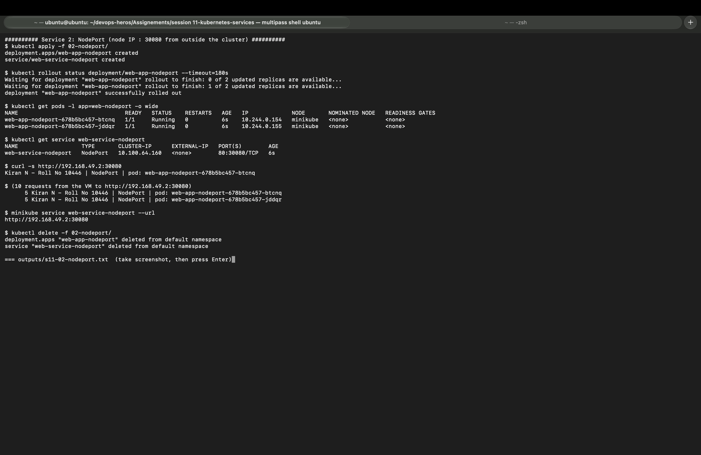
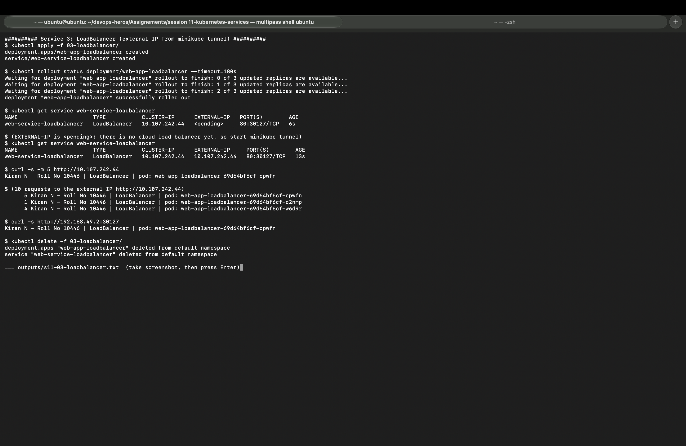
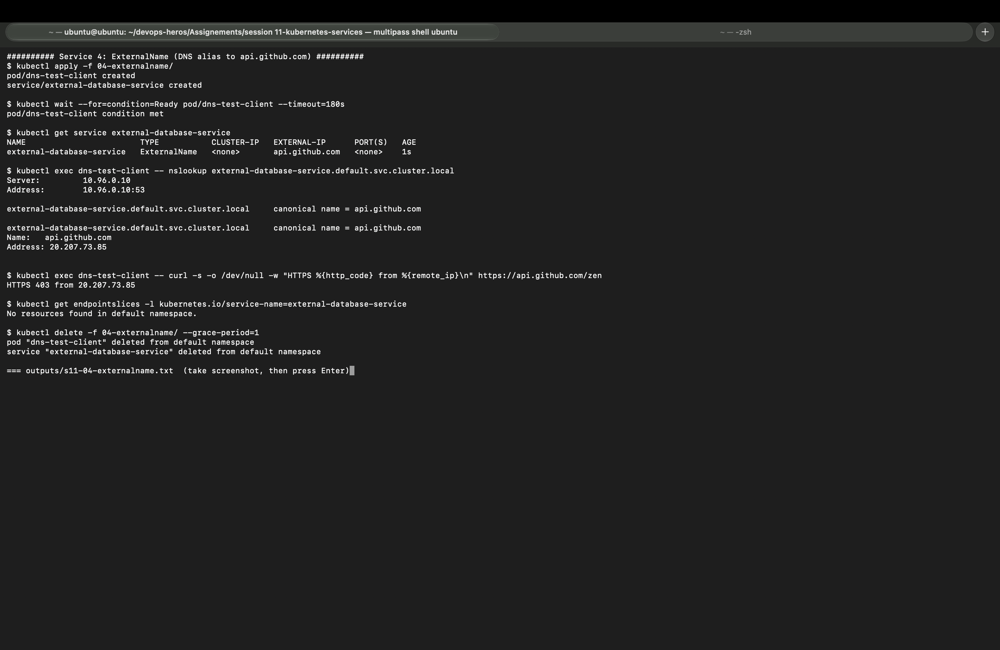
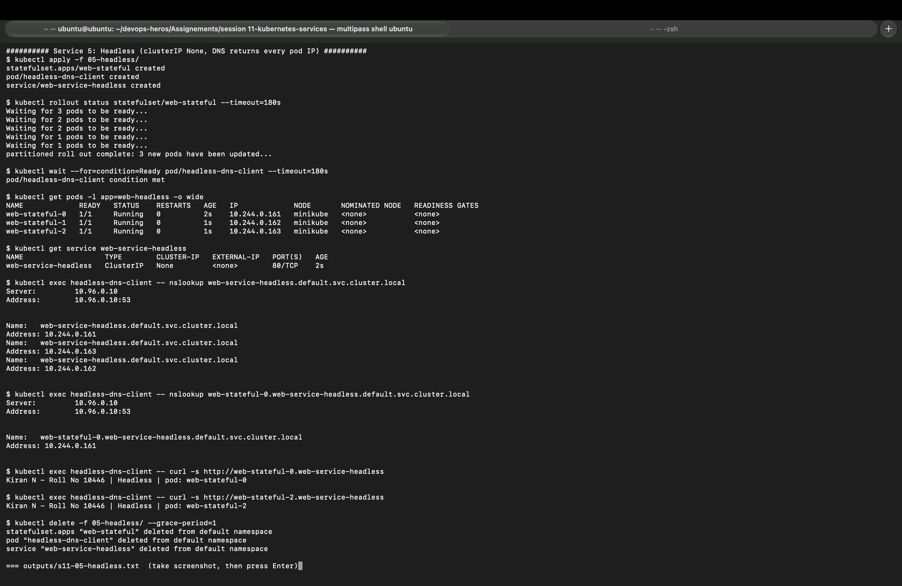
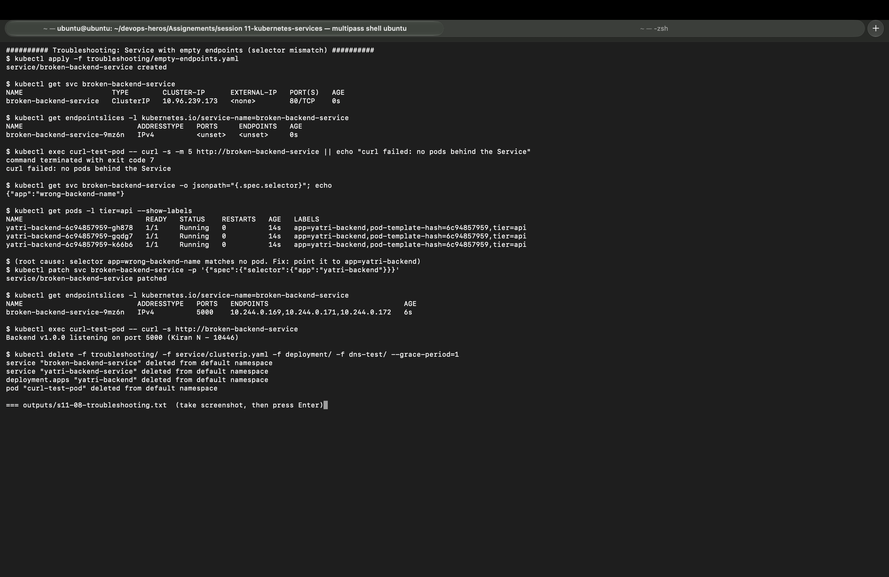

# Session 11: Kubernetes Networking and Services

| | |
|---|---|
| **Name** | Kiran N |
| **Roll No.** | 10446 |
| **Session** | 11: Kubernetes Networking and Services |
| **Environment** | Multipass Ubuntu VM (arm64) on Mac, Minikube v1.39.0 (docker driver), Kubernetes v1.37.0, node IP 192.168.49.2 |

All outputs below come from my own run of [`session11_lab.sh`](session11_lab.sh). Full text outputs are in [`outputs/`](outputs/) and screenshots are in [`screenshots/`](screenshots/).

Parts 6 (FQDN) and 8 (troubleshooting) were run a second time with `bash session11_lab.sh 6 8` after I added a short wait for the Service endpoints; the outputs and screenshots are from that second run.

Every nginx pod serves one line, `Kiran N - Roll No 10446 | <Service type> | pod: <pod name>`, so each answer shows which pod the Service picked.

---

## Homework tasks

| # | Task | Where |
|---|------|-------|
| 1 | Deploy and test all 5 Service types | [Task 1](#task-1-the-5-service-types) |
| 2 | Object comparison (Deployment, ReplicaSet, DaemonSet, StatefulSet, Service) | [Task 2](#task-2-kubernetes-object-comparison) |
| 3 | FQDN | [fqdn/README.md](fqdn/README.md) |
| 4 | CoreDNS | [coredns/README.md](coredns/README.md) |
| Extra | Troubleshooting a Service with no endpoints (class demo) | [Troubleshooting](#extra-troubleshooting-a-service-with-empty-endpoints) |

---

## Folder structure

```
session 11-kubernetes-services/
├── readme.md                 # this file (Task 1 + Task 2)
├── session11_lab.sh          # script I ran: bash session11_lab.sh  (or only some parts: bash session11_lab.sh 6 8)
├── 01-clusterip/             # Deployment (3 nginx) + Service port 8080 + curl client pod
├── 02-nodeport/              # Deployment (2 nginx) + NodePort 30080
├── 03-loadbalancer/          # Deployment (3 nginx) + LoadBalancer
├── 04-externalname/          # ExternalName -> api.github.com + client pod
├── 05-headless/              # StatefulSet (3 nginx) + headless Service + client pod
├── deployment/               # class demo backend (yatri-backend, Python on port 5000)
├── service/                  # class demo ClusterIP / NodePort / LoadBalancer for the backend
├── dns-test/                 # curl test pod
├── troubleshooting/          # Service with a wrong selector
├── fqdn/README.md            # Task 3
├── coredns/README.md         # Task 4
├── fqdn.md, service.md, instructor-notes.md   # class notes from the instructor
├── outputs/                  # s11-01 ... s11-08 (.txt)
└── screenshots/              # s11-01 ... s11-08 (.png)
```

---

## Task 1: The 5 Service types

### Why a Service is needed

Pods get a new IP every time they are recreated, and a Deployment has many pods. A **Service** gives one stable name and IP, finds the right pods with a **label selector**, and load-balances traffic across them. The pod IPs behind a Service are kept in **EndpointSlices**.

| Type | Reachable from | How |
|------|----------------|-----|
| ClusterIP | Inside the cluster only | Virtual IP + DNS name |
| NodePort | Outside, via `<NodeIP>:30000-32767` | Opens the same port on every node |
| LoadBalancer | Outside, via an external IP | Cloud load balancer (or `minikube tunnel`) in front of a NodePort |
| ExternalName | Inside the cluster | DNS CNAME to an outside name, no proxy |
| Headless | Inside the cluster | `clusterIP: None`, DNS returns the pod IPs directly |

---

### 1. ClusterIP

**Files:** [app-deployment.yaml](01-clusterip/app-deployment.yaml), [service.yaml](01-clusterip/service.yaml) (port 8080 → targetPort 80), [client-pod.yaml](01-clusterip/client-pod.yaml)

```
$ kubectl get pods -l app=web-clusterip -o wide
NAME                                 READY   STATUS    RESTARTS   AGE   IP             NODE
web-app-clusterip-7cf49ffb84-mpxv4   1/1     Running   0          1s    10.244.0.151   minikube
web-app-clusterip-7cf49ffb84-q4clw   1/1     Running   0          1s    10.244.0.152   minikube
web-app-clusterip-7cf49ffb84-sbnbp   1/1     Running   0          1s    10.244.0.153   minikube

$ kubectl get service web-service-clusterip
NAME                    TYPE        CLUSTER-IP    EXTERNAL-IP   PORT(S)    AGE
web-service-clusterip   ClusterIP   10.98.42.88   <none>        8080/TCP   1s

$ kubectl get endpointslices -l kubernetes.io/service-name=web-service-clusterip
NAME                          ADDRESSTYPE   PORTS   ENDPOINTS                                AGE
web-service-clusterip-t9dhk   IPv4          80      10.244.0.152,10.244.0.153,10.244.0.151   1s

$ kubectl exec curl-client -- curl -s http://web-service-clusterip:8080
Kiran N - Roll No 10446 | ClusterIP | pod: web-app-clusterip-7cf49ffb84-q4clw

(12 requests from inside the cluster: the Service spreads them over the 3 pods)
      6 Kiran N - Roll No 10446 | ClusterIP | pod: web-app-clusterip-7cf49ffb84-mpxv4
      2 Kiran N - Roll No 10446 | ClusterIP | pod: web-app-clusterip-7cf49ffb84-q4clw
      4 Kiran N - Roll No 10446 | ClusterIP | pod: web-app-clusterip-7cf49ffb84-sbnbp

$ curl -s -m 3 http://10.98.42.88:8080 || echo "..."
curl from the VM to 10.98.42.88:8080 failed: ClusterIP is not reachable from outside the cluster
```

**What I saw:** the Service found all 3 pods (EndpointSlice has their 3 IPs) and the client pod reached it by name on port **8080**, while nginx listens on **80** (`port` vs `targetPort`). The 12 requests landed on all 3 pods. From the VM itself the ClusterIP did not answer, which proves ClusterIP is internal only. Used for backend APIs and databases that only other pods call.



---

### 2. NodePort

**Files:** [app-deployment.yaml](02-nodeport/app-deployment.yaml), [service.yaml](02-nodeport/service.yaml) (nodePort 30080)

```
$ kubectl get service web-service-nodeport
NAME                   TYPE       CLUSTER-IP      EXTERNAL-IP   PORT(S)        AGE
web-service-nodeport   NodePort   10.100.64.160   <none>        80:30080/TCP   6s

$ curl -s http://192.168.49.2:30080
Kiran N - Roll No 10446 | NodePort | pod: web-app-nodeport-678b5bc457-btcnq

(10 requests from the VM to http://192.168.49.2:30080)
      5 Kiran N - Roll No 10446 | NodePort | pod: web-app-nodeport-678b5bc457-btcnq
      5 Kiran N - Roll No 10446 | NodePort | pod: web-app-nodeport-678b5bc457-jddqr

$ minikube service web-service-nodeport --url
http://192.168.49.2:30080
```

**What I saw:** `80:30080/TCP` means Service port 80, node port 30080. From **outside** the cluster (my VM) I reached the app on the node IP and port 30080, and the 10 requests were split 5/5 between the 2 pods. A NodePort also gets a ClusterIP, so it works inside too. Good for demos and labs; in production it is usually replaced by a LoadBalancer or Ingress because the high port and node IPs are exposed.



---

### 3. LoadBalancer

**Files:** [app-deployment.yaml](03-loadbalancer/app-deployment.yaml), [service.yaml](03-loadbalancer/service.yaml)

```
$ kubectl get service web-service-loadbalancer
NAME                       TYPE           CLUSTER-IP      EXTERNAL-IP   PORT(S)        AGE
web-service-loadbalancer   LoadBalancer   10.107.242.44   <pending>     80:30127/TCP   6s

(EXTERNAL-IP is <pending>: there is no cloud load balancer yet, so start minikube tunnel)
$ kubectl get service web-service-loadbalancer
NAME                       TYPE           CLUSTER-IP      EXTERNAL-IP     PORT(S)        AGE
web-service-loadbalancer   LoadBalancer   10.107.242.44   10.107.242.44   80:30127/TCP   13s

$ curl -s -m 5 http://10.107.242.44
Kiran N - Roll No 10446 | LoadBalancer | pod: web-app-loadbalancer-69d64bf6cf-cpwfn

(10 requests to the external IP http://10.107.242.44)
      5 Kiran N - Roll No 10446 | LoadBalancer | pod: web-app-loadbalancer-69d64bf6cf-cpwfn
      1 Kiran N - Roll No 10446 | LoadBalancer | pod: web-app-loadbalancer-69d64bf6cf-q2nmp
      4 Kiran N - Roll No 10446 | LoadBalancer | pod: web-app-loadbalancer-69d64bf6cf-w6d9r

$ curl -s http://192.168.49.2:30127
Kiran N - Roll No 10446 | LoadBalancer | pod: web-app-loadbalancer-69d64bf6cf-cpwfn
```

**What I saw:** on a laptop there is no cloud provider, so `EXTERNAL-IP` stayed `<pending>`. The script started `minikube tunnel`, which acts like the cloud load balancer and gave the Service an external IP (`10.107.242.44`). Requests to that IP reached all 3 pods. A LoadBalancer is built on top of a NodePort (here `30127`) and a ClusterIP, so the NodePort also worked. On AWS/GCP/Azure the same YAML creates a real public load balancer.



---

### 4. ExternalName

**Files:** [service.yaml](04-externalname/service.yaml) (`externalName: api.github.com`), [client-pod.yaml](04-externalname/client-pod.yaml)

```
$ kubectl get service external-database-service
NAME                        TYPE           CLUSTER-IP   EXTERNAL-IP      PORT(S)   AGE
external-database-service   ExternalName   <none>       api.github.com   <none>    1s

$ kubectl exec dns-test-client -- nslookup external-database-service.default.svc.cluster.local
Server:         10.96.0.10
Address:        10.96.0.10:53

external-database-service.default.svc.cluster.local     canonical name = api.github.com
Name:   api.github.com
Address: 20.207.73.85

$ kubectl exec dns-test-client -- curl -s -o /dev/null -w "HTTPS %{http_code} from %{remote_ip}\n" https://api.github.com/zen
HTTPS 403 from 20.207.73.85

$ kubectl get endpointslices -l kubernetes.io/service-name=external-database-service
No resources found in default namespace.
```

**What I saw:** the Service has **no ClusterIP, no ports and no endpoints**. CoreDNS (`10.96.0.10`) answered the Service name with a **CNAME** (`canonical name = api.github.com`), which then resolved to GitHub's IP `20.207.73.85`. The pod reached that IP over HTTPS (403 is GitHub's rate limit for anonymous calls, but the connection worked). ExternalName lets pods use a cluster name for an outside system (managed database, external API), so only the Service needs to change if the address changes.

> I changed the instructor's `externalName` (a personal domain) to `api.github.com` so the DNS test always resolves.



---

### 5. Headless

**Files:** [app-statefulset.yaml](05-headless/app-statefulset.yaml), [service.yaml](05-headless/service.yaml) (`clusterIP: None`), [client-pod.yaml](05-headless/client-pod.yaml)

```
$ kubectl get pods -l app=web-headless -o wide
NAME             READY   STATUS    RESTARTS   AGE   IP             NODE
web-stateful-0   1/1     Running   0          2s    10.244.0.161   minikube
web-stateful-1   1/1     Running   0          1s    10.244.0.162   minikube
web-stateful-2   1/1     Running   0          1s    10.244.0.163   minikube

$ kubectl get service web-service-headless
NAME                   TYPE        CLUSTER-IP   EXTERNAL-IP   PORT(S)   AGE
web-service-headless   ClusterIP   None         <none>        80/TCP    2s

$ kubectl exec headless-dns-client -- nslookup web-service-headless.default.svc.cluster.local
Name:   web-service-headless.default.svc.cluster.local
Address: 10.244.0.161
Name:   web-service-headless.default.svc.cluster.local
Address: 10.244.0.163
Name:   web-service-headless.default.svc.cluster.local
Address: 10.244.0.162

$ kubectl exec headless-dns-client -- nslookup web-stateful-0.web-service-headless.default.svc.cluster.local
Name:   web-stateful-0.web-service-headless.default.svc.cluster.local
Address: 10.244.0.161

$ kubectl exec headless-dns-client -- curl -s http://web-stateful-0.web-service-headless
Kiran N - Roll No 10446 | Headless | pod: web-stateful-0

$ kubectl exec headless-dns-client -- curl -s http://web-stateful-2.web-service-headless
Kiran N - Roll No 10446 | Headless | pod: web-stateful-2
```

**What I saw:** `CLUSTER-IP None` means there is no virtual IP and no load balancing. DNS for the Service returned **all 3 pod IPs**, and each StatefulSet pod got **its own DNS name** (`web-stateful-0.web-service-headless...` → `10.244.0.161`). I could call a chosen pod directly. Databases such as MySQL, MongoDB, Kafka or Cassandra use this so a client can always reach "the primary" (`-0`) or a specific replica.



---

### Service types compared

| | ClusterIP | NodePort | LoadBalancer | ExternalName | Headless |
|---|---|---|---|---|---|
| **Gets a ClusterIP** | Yes | Yes | Yes | No | No (`None`) |
| **Reachable from outside** | No | Yes, node IP + 30000-32767 | Yes, external IP | n/a | No |
| **Load balancing** | Yes (kube-proxy) | Yes | Yes (cloud LB + kube-proxy) | No (DNS only) | No, client picks a pod |
| **DNS answer** | ClusterIP | ClusterIP | ClusterIP | CNAME | All pod IPs |
| **My result** | 12 requests over 3 pods; not reachable from VM | 5/5 over 2 pods on :30080 | `<pending>` → `10.107.242.44` with tunnel | CNAME to api.github.com | 3 pod IPs, `web-stateful-0` by name |
| **Typical use** | Internal APIs, DBs | Labs, quick access | Public apps on cloud | External DB/API alias | StatefulSets |

More theory from class: [service.md](service.md).

---

## Task 2: Kubernetes object comparison

### Deployment vs ReplicaSet

| | ReplicaSet | Deployment |
|---|---|---|
| **Purpose** | Keep N identical pods running | Manage an app's versions and updates |
| **Pod management** | Creates/deletes pods to match `replicas` using a selector | Does not touch pods directly; creates and scales ReplicaSets |
| **Scaling** | `kubectl scale rs` | `kubectl scale deployment` (changes the current ReplicaSet) |
| **Rolling updates** | No. Changing the template does not replace running pods | Yes. New ReplicaSet scales up while the old one scales down; `rollout undo` goes back |
| **History** | None | Keeps old ReplicaSets as revisions |

**Relationship:** `Deployment → ReplicaSet → Pods`. When I change the image, the Deployment creates a **new** ReplicaSet (new pod-template hash, e.g. `web-app-clusterip-7cf49ffb84`) and keeps the old one at 0 replicas for rollback. In Session 10 I saw exactly this: `app-rolling-67d4c969d` at 0 and `app-rolling-86d7cb89c7` at 4. So in practice we create Deployments and never manage ReplicaSets by hand.

### Deployment vs DaemonSet vs StatefulSet

| | Deployment | DaemonSet | StatefulSet |
|---|---|---|---|
| **Use case** | Stateless apps (web, APIs) | One agent per node (logs, monitoring, CNI) | Stateful apps (databases, queues) |
| **Pod creation** | All at once, random names (`web-app-...-mpxv4`) | One pod on every (matching) node | One by one in order, fixed names (`web-stateful-0`, `-1`, `-2`) |
| **Scaling** | `replicas: N`, any order | Follows the number of nodes, no `replicas` | `replicas: N`, scales up 0→N and down N→0 in order |
| **Networking** | Normal Service, pods are interchangeable | Often `hostNetwork`/hostPort to see the node | Headless Service, each pod has its own DNS name |
| **Storage** | Shared or none; all pods use the same PVC if any | Usually `hostPath` of the node | `volumeClaimTemplates`: one PVC per pod that stays with it |
| **Examples** | nginx, frontend, REST API | node-exporter, Fluent Bit, kube-proxy | MySQL, MongoDB, Kafka, Elasticsearch |

In my Session 11 run the StatefulSet `web-stateful` started pod `-0` first (age 2s) then `-1` and `-2` (age 1s), and the headless Service gave each one a stable DNS name.

### ReplicaSet vs Service

| | ReplicaSet | Service |
|---|---|---|
| **Responsibility** | Keep the right **number** of pods alive | Give those pods one stable **address** and spread traffic |
| **Works on** | Pod lifecycle (create, replace) | Networking (IP, DNS, ports) |
| **Finds pods by** | Label selector | Label selector |
| **If a pod dies** | Creates a new one with a new IP | Updates its endpoints to the new IP automatically |

**Why a Service is required:** pod IPs change every time a pod is replaced, and there are several pods. Clients cannot keep track of that. The Service stays the same while the pods behind it change.

**How traffic reaches a pod:**

```
client pod
   │  curl http://web-service-clusterip:8080
   ▼
CoreDNS  ── name → ClusterIP 10.98.42.88
   ▼
kube-proxy rules on the node (iptables)
   │  picks one endpoint from the EndpointSlice
   ▼
pod 10.244.0.151:80   (or .152 / .153)
```

The ReplicaSet and the Service never talk to each other; both just use the **same labels**. That is why a wrong selector breaks a Service even when all pods are healthy, as the next section shows.

---

## Extra: Troubleshooting a Service with empty endpoints

**File:** [troubleshooting/empty-endpoints.yaml](troubleshooting/empty-endpoints.yaml) with the class demo backend [deployment/backend-deployment.yaml](deployment/backend-deployment.yaml).

| Step | Command | Result |
|------|---------|--------|
| 1. Problem | `kubectl exec curl-test-pod -- curl http://broken-backend-service` | `exit code 7` (connection refused) |
| 2. Investigate | `kubectl get endpointslices -l kubernetes.io/service-name=broken-backend-service` | `ENDPOINTS <unset>`: no pods behind it |
| 3. Compare labels | `kubectl get svc ... -o jsonpath="{.spec.selector}"` and `kubectl get pods -l tier=api --show-labels` | Selector `app=wrong-backend-name`, pods have `app=yatri-backend` |
| 4. Fix | `kubectl patch svc broken-backend-service -p '{"spec":{"selector":{"app":"yatri-backend"}}}'` | `service/broken-backend-service patched` |
| 5. Verify | endpoints + curl again | 3 endpoints on port 5000, `Backend v1.0.0 listening on port 5000 (Kiran N - 10446)` |

```
$ kubectl get endpointslices -l kubernetes.io/service-name=broken-backend-service
NAME                           ADDRESSTYPE   PORTS     ENDPOINTS   AGE
broken-backend-service-9mz6n   IPv4          <unset>   <unset>     0s

$ kubectl get svc broken-backend-service -o jsonpath="{.spec.selector}"
{"app":"wrong-backend-name"}

$ kubectl patch svc broken-backend-service -p '{"spec":{"selector":{"app":"yatri-backend"}}}'
service/broken-backend-service patched

$ kubectl get endpointslices -l kubernetes.io/service-name=broken-backend-service
NAME                           ADDRESSTYPE   PORTS   ENDPOINTS                                AGE
broken-backend-service-9mz6n   IPv4          5000    10.244.0.169,10.244.0.171,10.244.0.172   6s

$ kubectl exec curl-test-pod -- curl -s http://broken-backend-service
Backend v1.0.0 listening on port 5000 (Kiran N - 10446)
```

**Root cause:** the Service selector did not match any pod label. **Lesson:** when a Service does not answer, check its endpoints first. Empty endpoints almost always mean a selector/label mismatch (or pods that are not Ready).



---

## Commands used

| Command | Purpose |
|---------|---------|
| `kubectl apply -f <folder>/` / `kubectl delete -f <folder>/` | Create / remove the demo |
| `kubectl get svc <name>` | Type, ClusterIP, external IP, ports |
| `kubectl get endpointslices -l kubernetes.io/service-name=<svc>` | Which pod IPs are behind a Service |
| `kubectl exec <pod> -- curl -s http://<service>:<port>` | Test from inside the cluster |
| `curl http://$(minikube ip):<nodePort>` | Test a NodePort from outside |
| `minikube service <svc> --url` | Get the URL for a NodePort/LoadBalancer |
| `minikube tunnel` | Give LoadBalancer Services an external IP on Minikube |
| `kubectl exec <pod> -- nslookup <name>` | Check DNS answers (CNAME, pod IPs) |
| `kubectl patch svc <svc> -p '<json>'` | Fix a Service in place |

## What I learned

* A Service is a stable name + IP in front of changing pods, and it finds them only by labels.
* ClusterIP is the base; NodePort adds a port on every node; LoadBalancer adds an external IP on top of NodePort.
* ExternalName and Headless are DNS features: one returns a CNAME, the other returns pod IPs, and neither uses a virtual IP.
* `port` is what clients call, `targetPort` is where the container listens, `nodePort` is opened on the node.
* When a Service fails, check endpoints first, then labels.

---

**Kiran N | Roll No. 10446**
