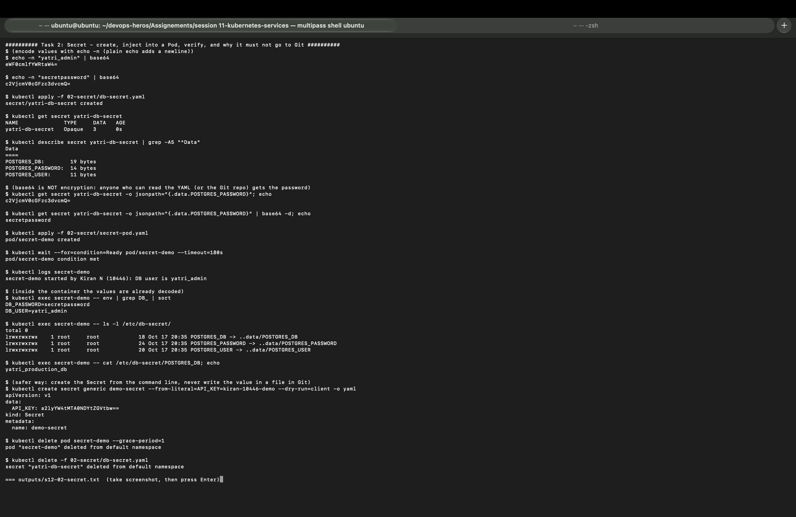
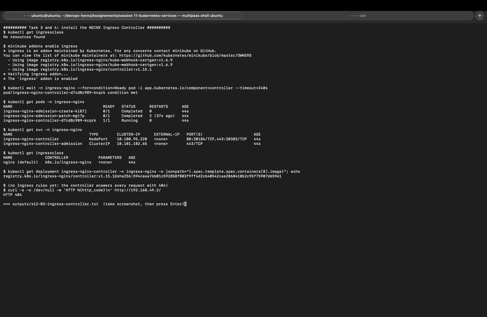
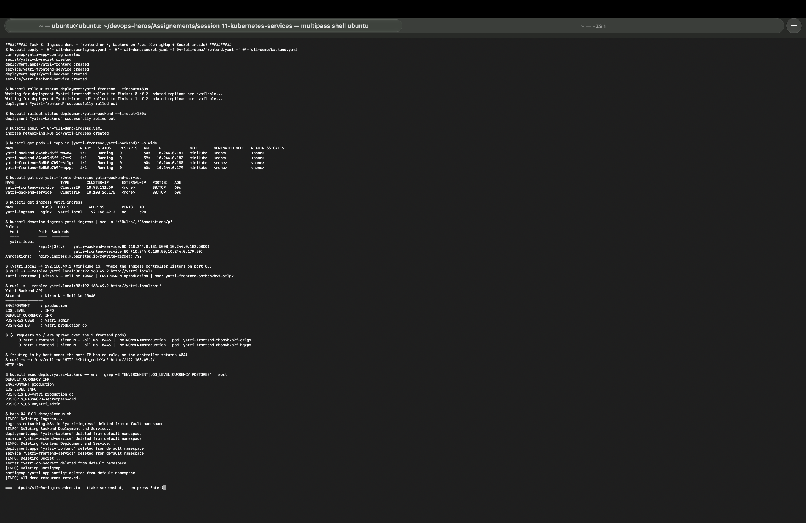

# Session 12: Ingress, ConfigMaps and Secrets

| | |
|---|---|
| **Name** | Kiran N |
| **Roll No.** | 10446 |
| **Session** | 12: Ingress, ConfigMaps and Secrets |
| **Environment** | Multipass Ubuntu VM (arm64) on Mac, Minikube v1.39.0 (docker driver), Kubernetes v1.37.0, node IP 192.168.49.2, ingress-nginx controller v1.15.1 |

All outputs below come from my own run of [`session12_lab.sh`](session12_lab.sh). Full text outputs are in [`outputs/`](outputs/) and screenshots are in [`screenshots/`](screenshots/).

My name is inside the apps themselves, so every answer proves it came from my cluster: the frontend prints `Yatri Frontend | Kiran N - Roll No 10446 | ...` and the backend prints `Student : Kiran N - Roll No 10446`.

---

## Homework tasks

| # | Task | Where |
|---|------|-------|
| 1 | ConfigMap: create it, inject it into a Pod, verify inside the container | [Task 1](#task-1-configmap) |
| 2 | Secret: create it, inject it, verify, and explain why Secrets must not be committed to Git | [Task 2](#task-2-secret) |
| 3 | Ingress: install the controller and route `/` to the frontend and `/api` to the backend | [Task 3](#task-3-ingress) |
| 4 | Ingress vs Ingress Controller | [ingress-vs-ingress-controller/README.md](ingress-vs-ingress-controller/README.md) |
| 5 | Troubleshooting: database login fails because of a hidden newline in a Secret | [Task 5](#task-5-troubleshooting-the-hidden-newline-in-a-secret) and [troubleshooting/README.md](troubleshooting/README.md) |

---

## Folder structure

```
session 12-ingress-configmaps-secrets/
├── readme.md                         # this file
├── session12_lab.sh                  # script I ran: bash session12_lab.sh  (or some parts: bash session12_lab.sh 4 5)
├── lab.md, instructor-notes.md       # instructor lab guide and notes
├── 01-configmap/
│   ├── app-config.yaml               # ConfigMap yatri-app-config (5 keys)
│   └── configmap-pod.yaml            # my Pod: ConfigMap as env vars + as files in /etc/config
├── 02-secret/
│   ├── db-secret.yaml                # Secret yatri-db-secret (3 keys, base64)
│   └── secret-pod.yaml               # my Pod: Secret as env vars + as files in /etc/db-secret
├── 03-ingress/                       # instructor Ingress examples (routes, path based, TLS)
├── 04-full-demo/                     # frontend + backend + ConfigMap + Secret + Ingress (Task 3)
├── app/backend-with-config.yaml      # instructor backend example
├── ingress-vs-ingress-controller/
│   └── README.md                     # Task 4
├── troubleshooting/
│   ├── broken-db-secret.yaml         # Secret with "secretpassword\n" (broken on purpose)
│   ├── db-login-pod.yaml             # app that logs in with that Secret
│   ├── secret-base64-gotcha.md       # instructor note
│   └── README.md                     # Task 5 write-up
├── outputs/                          # s12-01 ... s12-05 text outputs
└── screenshots/                      # s12-01 ... s12-05 screenshots
```

---

## Task 1: ConfigMap

### What it is

A ConfigMap keeps **non-secret settings** (environment name, log level, port, currency) outside the container image. The same image can then run in dev, test and production; only the ConfigMap changes.

[`01-configmap/app-config.yaml`](01-configmap/app-config.yaml):

```yaml
apiVersion: v1
kind: ConfigMap
metadata:
  name: yatri-app-config
data:
  ENVIRONMENT: "production"
  LOG_LEVEL: "INFO"
  PORT: "5000"
  DEFAULT_CURRENCY: "INR"
  MAX_BOOKING_DAYS: "30"
```

### How my Pod uses it

[`01-configmap/configmap-pod.yaml`](01-configmap/configmap-pod.yaml) reads the ConfigMap in both ways Kubernetes allows:

```yaml
      envFrom:
        - configMapRef:
            name: yatri-app-config          # every key becomes an env var
      env:
        - name: APP_CURRENCY                # one key under a different name
          valueFrom:
            configMapKeyRef:
              name: yatri-app-config
              key: DEFAULT_CURRENCY
      volumeMounts:
        - name: config-volume
          mountPath: /etc/config            # every key becomes a file
  volumes:
    - name: config-volume
      configMap:
        name: yatri-app-config
```

### Output

```
$ kubectl get configmap yatri-app-config
NAME               DATA   AGE
yatri-app-config   5      0s

$ kubectl logs configmap-demo
configmap-demo started by Kiran N (10446): ENVIRONMENT=production LOG_LEVEL=INFO

$ kubectl exec configmap-demo -- env | grep -E "ENVIRONMENT|LOG_LEVEL|PORT|CURRENCY|MAX_BOOKING" | sort
APP_CURRENCY=INR
DEFAULT_CURRENCY=INR
ENVIRONMENT=production
LOG_LEVEL=INFO
MAX_BOOKING_DAYS=30
PORT=5000
(KUBERNETES_PORT_* lines removed here, they are in the full output)

$ kubectl exec configmap-demo -- ls /etc/config
DEFAULT_CURRENCY
ENVIRONMENT
LOG_LEVEL
MAX_BOOKING_DAYS
PORT

$ kubectl exec configmap-demo -- cat /etc/config/LOG_LEVEL
INFO
```

All 5 keys arrived as environment variables, `APP_CURRENCY` shows a single key renamed with `configMapKeyRef`, and the volume holds one file per key.

### Changing a value while the Pod runs

```
$ kubectl patch configmap yatri-app-config -p '{"data":{"LOG_LEVEL":"DEBUG"}}'
configmap/yatri-app-config patched

(file changed after about 75 seconds)
$ kubectl exec configmap-demo -- cat /etc/config/LOG_LEVEL
DEBUG

$ kubectl exec configmap-demo -- printenv LOG_LEVEL
INFO
```

This is the main difference between the two ways:

| | Environment variable | Mounted file |
|---|---|---|
| When it is read | Once, when the container starts | Every time the app opens the file |
| After the ConfigMap changes | Keeps the old value (INFO) | Updated by the kubelet after a short delay (DEBUG after about 75 s) |
| To pick up a change | Restart the Pod (`kubectl rollout restart`) | The app only has to re-read the file |


Full output: [outputs/s12-01-configmap.txt](outputs/s12-01-configmap.txt)

---

## Task 2: Secret

### What it is

A Secret holds sensitive values (passwords, tokens, keys). It is used like a ConfigMap, but Kubernetes treats it more carefully: values are hidden in `kubectl describe`, kept in memory (tmpfs) on the node, and access can be limited separately with RBAC.

The values in the YAML must be base64. `echo -n` is important, because plain `echo` adds a newline (that is exactly the bug in Task 5):

```
$ echo -n "yatri_admin" | base64
eWF0cmlfYWRtaW4=

$ echo -n "secretpassword" | base64
c2VjcmV0cGFzc3dvcmQ=
```

### Create and inspect

```
$ kubectl apply -f 02-secret/db-secret.yaml
secret/yatri-db-secret created

$ kubectl get secret yatri-db-secret
NAME              TYPE     DATA   AGE
yatri-db-secret   Opaque   3      0s

$ kubectl describe secret yatri-db-secret | grep -A5 "^Data"
Data
====
POSTGRES_DB:        19 bytes
POSTGRES_PASSWORD:  14 bytes
POSTGRES_USER:      11 bytes
```

`describe` shows only the size of each value, never the value.

### Inject into a Pod and verify

[`02-secret/secret-pod.yaml`](02-secret/secret-pod.yaml) takes two keys as env vars (`secretKeyRef`) and mounts the whole Secret at `/etc/db-secret` with `defaultMode: 0400`.

```
$ kubectl logs secret-demo
secret-demo started by Kiran N (10446): DB user is yatri_admin

$ kubectl exec secret-demo -- env | grep DB_ | sort
DB_PASSWORD=secretpassword
DB_USER=yatri_admin

$ kubectl exec secret-demo -- ls -l /etc/db-secret/
lrwxrwxrwx    1 root     root            18 Oct 17 20:35 POSTGRES_DB -> ..data/POSTGRES_DB
lrwxrwxrwx    1 root     root            24 Oct 17 20:35 POSTGRES_PASSWORD -> ..data/POSTGRES_PASSWORD
lrwxrwxrwx    1 root     root            20 Oct 17 20:35 POSTGRES_USER -> ..data/POSTGRES_USER

$ kubectl exec secret-demo -- cat /etc/db-secret/POSTGRES_DB
yatri_production_db
```

Inside the container the values are already decoded, so the app reads plain `secretpassword`. The files are symlinks to `..data/`; when the Secret changes, the kubelet swaps `..data` in one step, so the app never sees a half-written file.



Full output: [outputs/s12-02-secret.txt](outputs/s12-02-secret.txt)

### Why Secrets must not be committed to Git

My own output shows the problem. Anyone who can read the YAML can get the password back with one command:

```
$ kubectl get secret yatri-db-secret -o jsonpath="{.data.POSTGRES_PASSWORD}"
c2VjcmV0cGFzc3dvcmQ=

$ kubectl get secret yatri-db-secret -o jsonpath="{.data.POSTGRES_PASSWORD}" | base64 -d
secretpassword
```

1. **Base64 is encoding, not encryption.** It has no key. `base64 -d` reverses it for anyone.
2. **Git keeps history forever.** Deleting the file in a later commit does not remove it; the password stays in old commits, forks and clones.
3. **Many people can read a repo.** Every developer, CI system and fork gets the password, and a public repo is scanned by bots within minutes.
4. **Rotation becomes painful.** A leaked password has to be changed everywhere it is used.

The same applies to the running app: in Task 3, `kubectl exec deploy/yatri-backend -- env` printed `POSTGRES_PASSWORD=secretpassword`, so access to `exec` and to Secrets has to be limited with RBAC too.

**Safer ways I can use instead:**

| Way | How it keeps the value out of Git |
|---|---|
| `kubectl create secret ... --from-literal` / `--from-file` | The value is typed at deploy time (or comes from a CI secret variable), not stored in a file |
| `.gitignore` | Keeps local secret files such as `*.env` or `secret-values.yaml` out of commits |
| Sealed Secrets (Bitnami) | Only an encrypted SealedSecret goes to Git; only the controller in the cluster can decrypt it |
| External Secrets Operator | Git has only a pointer; the real value lives in AWS Secrets Manager, Azure Key Vault or GCP Secret Manager |
| HashiCorp Vault | Values are injected into Pods at runtime and can be short-lived |
| SOPS | Encrypts the values inside the YAML file with a KMS or age key |
| Encryption at rest in etcd | Protects Secrets inside the cluster storage itself |

Example of the command-line way (nothing is saved in a file, and `--dry-run=client` only prints it):

```
$ kubectl create secret generic demo-secret --from-literal=API_KEY=kiran-10446-demo --dry-run=client -o yaml
apiVersion: v1
data:
  API_KEY: a2lyYW4tMTA0NDYtZGVtbw==
kind: Secret
metadata:
  name: demo-secret
```

Note: `02-secret/db-secret.yaml` and `04-full-demo/secret.yaml` are the instructor's demo files with a dummy password. In a real project they would not be committed.

---

## Task 3: Ingress

### Why Ingress

A NodePort or LoadBalancer gives one Service one entry point. With many Services that means many ports or many paid load balancers. An **Ingress** gives a single entry point (port 80/443) and routes each request by **host name** and **path** to the right ClusterIP Service.

```
                    http://yatri.local
                           |
                 NGINX Ingress Controller  (192.168.49.2:80)
                    /                \
            path /                  path /api
               |                        |
   yatri-frontend-service     yatri-backend-service
      (2 nginx pods)           (2 python pods, port 5000)
                                 uses ConfigMap + Secret
```

### Step 1: install the Ingress Controller

An Ingress object does nothing on its own. Before the addon there was no IngressClass at all:

```
$ kubectl get ingressclass
No resources found

$ minikube addons enable ingress
  - Using image registry.k8s.io/ingress-nginx/controller:v1.15.1
* The 'ingress' addon is enabled

$ kubectl get pods -n ingress-nginx
NAME                                       READY   STATUS      RESTARTS      AGE
ingress-nginx-admission-create-kl87j       0/1     Completed   0             44s
ingress-nginx-admission-patch-mgt7p        0/1     Completed   2 (37s ago)   44s
ingress-nginx-controller-d7cd8c989-kcqrk   1/1     Running     0             44s

$ kubectl get svc -n ingress-nginx
NAME                                 TYPE        CLUSTER-IP      EXTERNAL-IP   PORT(S)                      AGE
ingress-nginx-controller             NodePort    10.100.95.220   <none>        80:30186/TCP,443:30383/TCP   44s
ingress-nginx-controller-admission   ClusterIP   10.101.102.65   <none>        443/TCP                      44s

$ kubectl get ingressclass
NAME              CONTROLLER             PARAMETERS   AGE
nginx (default)   k8s.io/ingress-nginx   <none>       44s

$ curl -s -o /dev/null -w 'HTTP %{http_code}\n' http://192.168.49.2/
HTTP 404
```

- The two `admission` pods are one-time Jobs that create the certificate for the validating webhook, so `Completed` is correct.
- The controller pod is the actual NGINX that receives traffic.
- The 404 comes from the controller itself: it is listening, but there are no Ingress rules yet.



Full output: [outputs/s12-03-ingress-controller.txt](outputs/s12-03-ingress-controller.txt)

### Step 2: deploy the app and the Ingress

[`04-full-demo/`](04-full-demo/) has the ConfigMap, the Secret, the frontend (2 nginx pods), the backend (2 Python pods that print the ConfigMap and Secret values they received) and [`ingress.yaml`](04-full-demo/ingress.yaml):

```yaml
  annotations:
    nginx.ingress.kubernetes.io/ssl-redirect: "false"
    nginx.ingress.kubernetes.io/use-regex: "true"
    nginx.ingress.kubernetes.io/rewrite-target: /$2
spec:
  ingressClassName: nginx
  rules:
    - host: yatri.local
      http:
        paths:
          - path: /api(/|$)(.*)           # /api/xyz -> backend gets /xyz
            pathType: ImplementationSpecific
            backend:
              service:
                name: yatri-backend-service
                port:
                  number: 80
          - path: /
            pathType: Prefix
            backend:
              service:
                name: yatri-frontend-service
                port:
                  number: 80
```

```
$ kubectl get pods -l "app in (yatri-frontend,yatri-backend)" -o wide
NAME                              READY   STATUS    RESTARTS   AGE   IP
yatri-backend-64ccb7d5ff-wmwd4    1/1     Running   0          60s   10.244.0.181
yatri-backend-64ccb7d5ff-z7mm9    1/1     Running   0          59s   10.244.0.182
yatri-frontend-5b5b5b7b9f-6tlgx   1/1     Running   0          60s   10.244.0.180
yatri-frontend-5b5b5b7b9f-hqzps   1/1     Running   0          60s   10.244.0.179

$ kubectl get svc yatri-frontend-service yatri-backend-service
NAME                     TYPE        CLUSTER-IP      EXTERNAL-IP   PORT(S)   AGE
yatri-frontend-service   ClusterIP   10.98.131.69    <none>        80/TCP    60s
yatri-backend-service    ClusterIP   10.108.26.175   <none>        80/TCP    60s

$ kubectl get ingress yatri-ingress
NAME            CLASS   HOSTS         ADDRESS        PORTS   AGE
yatri-ingress   nginx   yatri.local   192.168.49.2   80      59s

$ kubectl describe ingress yatri-ingress
Rules:
  Host         Path  Backends
  ----         ----  --------
  yatri.local
               /api(/|$)(.*)   yatri-backend-service:80 (10.244.0.181:5000,10.244.0.182:5000)
               /               yatri-frontend-service:80 (10.244.0.180:80,10.244.0.179:80)
Annotations:   nginx.ingress.kubernetes.io/rewrite-target: /$2
```

Both Services are only `ClusterIP`; the Ingress is the only way in from outside. `describe` shows that each rule already points at the right pod IPs.

### Step 3: test the routes

`yatri.local` is not in DNS, so `curl --resolve` sends it to the minikube IP (same effect as a line in `/etc/hosts`):

```
$ curl -s --resolve yatri.local:80:192.168.49.2 http://yatri.local/
Yatri Frontend | Kiran N - Roll No 10446 | ENVIRONMENT=production | pod: yatri-frontend-5b5b5b7b9f-6tlgx

$ curl -s --resolve yatri.local:80:192.168.49.2 http://yatri.local/api/
Yatri Backend API
Student         : Kiran N - Roll No 10446
=================
ENVIRONMENT     : production
LOG_LEVEL       : INFO
DEFAULT_CURRENCY: INR
POSTGRES_USER   : yatri_admin
POSTGRES_DB     : yatri_production_db

(6 requests to / are spread over the 2 frontend pods)
      3 Yatri Frontend | Kiran N - Roll No 10446 | ENVIRONMENT=production | pod: yatri-frontend-5b5b5b7b9f-6tlgx
      3 Yatri Frontend | Kiran N - Roll No 10446 | ENVIRONMENT=production | pod: yatri-frontend-5b5b5b7b9f-hqzps

(routing is by host name: the bare IP has no rule, so the controller returns 404)
$ curl -s -o /dev/null -w 'HTTP %{http_code}\n' http://192.168.49.2/
HTTP 404
```

What this proves:

- `/` went to the frontend and `/api/` went to the backend: path-based routing works.
- The backend answer shows values from the **ConfigMap** (ENVIRONMENT, LOG_LEVEL, DEFAULT_CURRENCY) and from the **Secret** (POSTGRES_USER, POSTGRES_DB), so all three topics of this session work together.
- The `rewrite-target: /$2` annotation removed the `/api` prefix, so the backend received `/`.
- The 6 requests split 3 and 3 over both frontend pods: the controller load balances.
- The bare IP returned 404: the rule only matches host `yatri.local` (host-based routing).

The backend deliberately does not print the password, but the env check shows it is there in plain text:

```
$ kubectl exec deploy/yatri-backend -- env | grep -E "ENVIRONMENT|LOG_LEVEL|CURRENCY|POSTGRES" | sort
DEFAULT_CURRENCY=INR
ENVIRONMENT=production
LOG_LEVEL=INFO
POSTGRES_DB=yatri_production_db
POSTGRES_PASSWORD=secretpassword
POSTGRES_USER=yatri_admin
```



Full output: [outputs/s12-04-ingress-demo.txt](outputs/s12-04-ingress-demo.txt)

---

## Task 4: Ingress vs Ingress Controller

Written up in [ingress-vs-ingress-controller/README.md](ingress-vs-ingress-controller/README.md). In short: the **Ingress** is only a set of routing rules stored in the API server; the **Ingress Controller** is the running proxy (here NGINX in the `ingress-nginx` namespace) that reads those rules and actually forwards the traffic. My Task 3 output shows both sides: before the controller existed there was no IngressClass, and after it was installed the same port answered 404 until my Ingress rules were added.

---

## Task 5: Troubleshooting: the hidden newline in a Secret

Full write-up: [troubleshooting/README.md](troubleshooting/README.md)

| Step | What I saw |
|---|---|
| Problem | `db-login-check` pod in `Error`, log `FATAL: password authentication failed for user "yatri_admin"` |
| Clue | Log says `password length: 15`, but `secretpassword` has 14 characters |
| Investigation | Stored value `c2VjcmV0cGFzc3dvcmQK`; `base64 -d \| od -c` ends with `\n`; `wc -c` = 15 |
| Root cause | The value was encoded with `echo "secretpassword" \| base64`, and `echo` adds a newline |
| Fix | Recreate the Secret with `--from-literal` (no newline), value becomes `c2VjcmV0cGFzc3dvcmQ=` (14 bytes) |
| Result | Recreated pod `Completed`, log `LOGIN OK: connected to yatri_production_db` |

```
BEFORE
$ kubectl logs db-login-check
Connecting as yatri_admin (password length: 15)
FATAL: password authentication failed for user "yatri_admin"

AFTER
$ kubectl logs db-login-check
Connecting as yatri_admin (password length: 14)
LOGIN OK: connected to yatri_production_db
```


Full output: [outputs/s12-05-troubleshooting.txt](outputs/s12-05-troubleshooting.txt)

---

## ConfigMap vs Secret

| | ConfigMap | Secret |
|---|---|---|
| For | Normal settings | Passwords, tokens, keys, certificates |
| Stored as | Plain text | Base64 (encrypted only if etcd encryption is turned on) |
| `kubectl describe` | Shows the values | Shows only the size in bytes |
| On the node | Normal files | tmpfs (memory), not written to disk |
| Used in a Pod | `envFrom`, `configMapKeyRef`, volume | `envFrom`, `secretKeyRef`, volume |
| Size limit | 1 MiB | 1 MiB |
| Safe in Git? | Yes | No |

---

## Commands used

```bash
# ConfigMap
kubectl apply -f 01-configmap/app-config.yaml
kubectl describe configmap yatri-app-config
kubectl patch configmap yatri-app-config -p '{"data":{"LOG_LEVEL":"DEBUG"}}'
kubectl exec configmap-demo -- cat /etc/config/LOG_LEVEL

# Secret
echo -n "secretpassword" | base64
kubectl get secret yatri-db-secret -o jsonpath="{.data.POSTGRES_PASSWORD}" | base64 -d
kubectl create secret generic demo-secret --from-literal=API_KEY=... --dry-run=client -o yaml

# Ingress
minikube addons enable ingress
kubectl get pods,svc -n ingress-nginx
kubectl get ingressclass
kubectl get ingress yatri-ingress
kubectl describe ingress yatri-ingress
curl -s --resolve yatri.local:80:$(minikube ip) http://yatri.local/api/

# Troubleshooting
kubectl get secret db-login-secret -o jsonpath="{.data.POSTGRES_PASSWORD}" | base64 -d | od -c
```

---

## What I learned

- A ConfigMap lets one image run in any environment. Env vars are fixed when the container starts, while mounted files update by themselves (about 75 seconds in my run).
- A Secret is only base64, so it is not safe in Git. `--from-literal`, Sealed Secrets, External Secrets or Vault keep the real value out of the repo.
- An Ingress is only rules; without a controller nothing happens. One controller can serve many apps by host and path on a single port.
- `rewrite-target` with regex groups lets the backend receive clean paths without the `/api` prefix.
- `echo` adds a newline. When a password "is correct" but login fails, check the exact bytes with `base64 -d | od -c` or `wc -c`.
- Env vars from a Secret are read only at container start, so after fixing a Secret the Pod has to be recreated.
