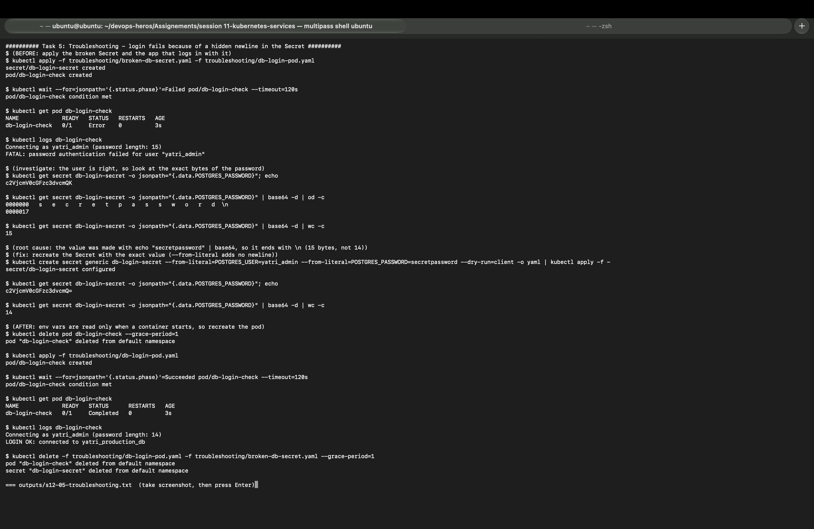

# Task 5: Troubleshooting: database login fails with a "correct" password

| | |
|---|---|
| **Name** | Kiran N |
| **Roll No.** | 10446 |
| **Session** | 12: Ingress, ConfigMaps and Secrets |

Back to the [session readme](../readme.md). Instructor note on the same bug: [secret-base64-gotcha.md](secret-base64-gotcha.md).

Files:

- [`broken-db-secret.yaml`](broken-db-secret.yaml): Secret `db-login-secret`, password encoded with `echo "secretpassword" | base64` (broken on purpose)
- [`db-login-pod.yaml`](db-login-pod.yaml): pod `db-login-check` that acts like an app logging in to PostgreSQL. It only accepts the exact password `secretpassword`, prints the password length, and exits with `FATAL` like PostgreSQL does.

Run with `bash session12_lab.sh 5`. Full output: [../outputs/s12-05-troubleshooting.txt](../outputs/s12-05-troubleshooting.txt)

---

## 1. Identify the problem

```
$ kubectl apply -f troubleshooting/broken-db-secret.yaml -f troubleshooting/db-login-pod.yaml
secret/db-login-secret created
pod/db-login-check created

$ kubectl get pod db-login-check
NAME             READY   STATUS   RESTARTS   AGE
db-login-check   0/1     Error    0          3s

$ kubectl logs db-login-check
Connecting as yatri_admin (password length: 15)
FATAL: password authentication failed for user "yatri_admin"
```

The user name is right and the developer says the password is `secretpassword`. But `secretpassword` has **14** characters and the app received **15**.

## 2. Investigate

Look at what is really stored, byte by byte:

```
$ kubectl get secret db-login-secret -o jsonpath="{.data.POSTGRES_PASSWORD}"
c2VjcmV0cGFzc3dvcmQK

$ kubectl get secret db-login-secret -o jsonpath="{.data.POSTGRES_PASSWORD}" | base64 -d | od -c
0000000   s   e   c   r   e   t   p   a   s   s   w   o   r   d  \n
0000017

$ kubectl get secret db-login-secret -o jsonpath="{.data.POSTGRES_PASSWORD}" | base64 -d | wc -c
15
```

- The correct encoding of `secretpassword` is `c2VjcmV0cGFzc3dvcmQ=` (Task 2). The stored one ends in `K` instead of `=`.
- `od -c` shows the 15th byte: `\n`, a newline.

## 3. Root cause

The value was made with:

```bash
echo "secretpassword" | base64      # c2VjcmV0cGFzc3dvcmQK  -> "secretpassword\n"
```

`echo` adds a newline at the end, and `base64` encodes it too. Kubernetes passes the value to the container exactly as stored, so the app sent `secretpassword\n` and the database rejected it. The newline is invisible in a terminal, which is why the password "looked correct".

## 4. Fix

Recreate the Secret from the exact value. `--from-literal` encodes the string as typed, with no newline. Piping `--dry-run=client -o yaml` into `kubectl apply` updates the existing Secret in place:

```
$ kubectl create secret generic db-login-secret \
    --from-literal=POSTGRES_USER=yatri_admin \
    --from-literal=POSTGRES_PASSWORD=secretpassword \
    --dry-run=client -o yaml | kubectl apply -f -
secret/db-login-secret configured

$ kubectl get secret db-login-secret -o jsonpath="{.data.POSTGRES_PASSWORD}"
c2VjcmV0cGFzc3dvcmQ=

$ kubectl get secret db-login-secret -o jsonpath="{.data.POSTGRES_PASSWORD}" | base64 -d | wc -c
14
```

Other correct ways: `echo -n "secretpassword" | base64`, `printf '%s' "secretpassword" | base64`, or use `stringData:` in the YAML so Kubernetes does the encoding.

## 5. Verify (after)

Env vars from a Secret are read only when a container starts, so fixing the Secret does not change a pod that already ran. The pod has to be recreated (for a Deployment: `kubectl rollout restart`).

```
$ kubectl delete pod db-login-check --grace-period=1
$ kubectl apply -f troubleshooting/db-login-pod.yaml
pod/db-login-check created

$ kubectl get pod db-login-check
NAME             READY   STATUS      RESTARTS   AGE
db-login-check   0/1     Completed   0          3s

$ kubectl logs db-login-check
Connecting as yatri_admin (password length: 14)
LOGIN OK: connected to yatri_production_db
```

## Before and after

| | Before | After |
|---|---|---|
| Stored base64 | `c2VjcmV0cGFzc3dvcmQK` | `c2VjcmV0cGFzc3dvcmQ=` |
| Decoded bytes | 15 (`secretpassword\n`) | 14 (`secretpassword`) |
| Pod status | `Error` | `Completed` |
| Log | `FATAL: password authentication failed` | `LOGIN OK: connected to yatri_production_db` |



## How to avoid it

- Never use plain `echo` for Secret values; use `echo -n`, `printf '%s'`, `--from-literal` or `stringData`.
- When a "correct" password fails, compare the length (`wc -c`) and look for hidden characters (`od -c`, `xxd`, `cat -A`). Files saved on Windows can also add `\r`.
- After changing a Secret used as env vars, restart the pods.
