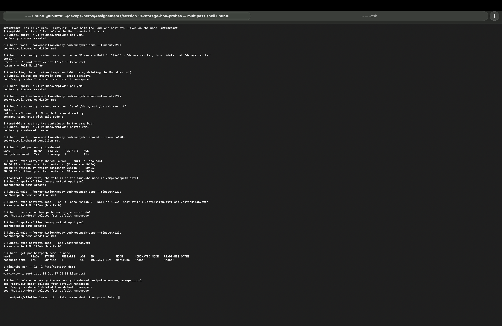
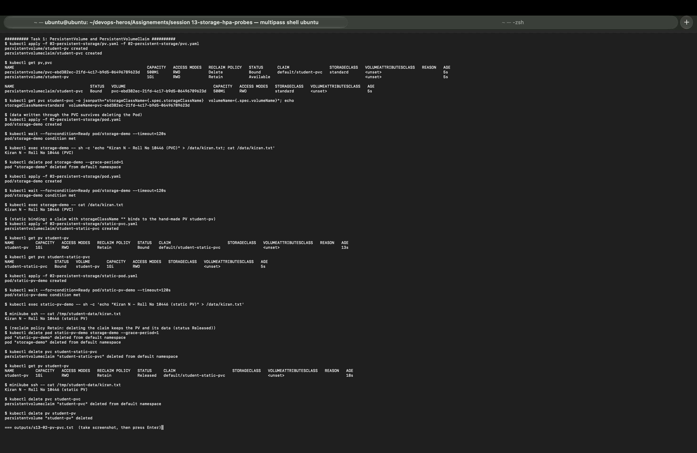
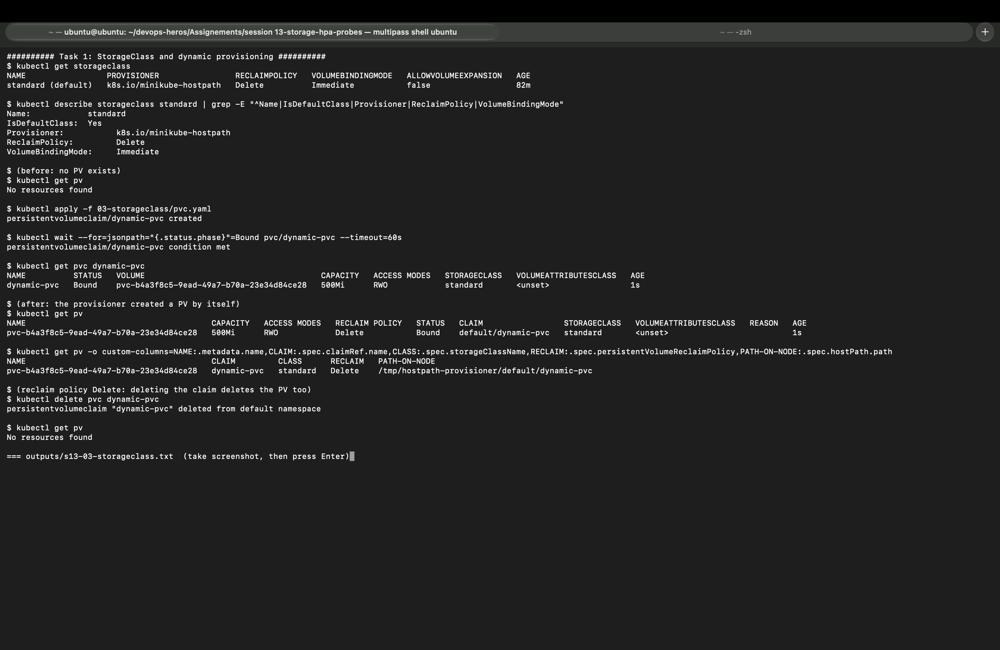

# Task 1: Kubernetes Volumes

| | |
|---|---|
| **Name** | Kiran N |
| **Roll No.** | 10446 |
| **Session** | 13: Kubernetes Storage, HPA and Probes |
| **Environment** | Multipass Ubuntu VM (arm64) on Mac, Minikube v1.39.0 (docker driver), Kubernetes v1.37.0 |

Back to the [session readme](../ResultReadme.md). Every example below is from my own run of `bash session13_lab.sh 1 2 3`. Full outputs: [s13-01-volumes.txt](../outputs/s13-01-volumes.txt), [s13-02-pv-pvc.txt](../outputs/s13-02-pv-pvc.txt), [s13-03-storageclass.txt](../outputs/s13-03-storageclass.txt).

---

## Why volumes are needed

A container's own filesystem is thrown away when the container is replaced. A database, uploaded files or logs written there are lost. A **volume** is a directory that Kubernetes mounts into the container from somewhere else, so the data can live longer than the container (and, for persistent volumes, longer than the Pod).

| Type | Data lives as long as | Where it is | Typical use |
|---|---|---|---|
| `emptyDir` | The Pod | Node disk (or RAM with `medium: Memory`) | Scratch space, cache, sharing files between containers |
| `hostPath` | The node | A folder on that node | Node agents, logs; single-node labs |
| PersistentVolume + PVC | Until the PV is deleted | Storage backend (cloud disk, NFS, hostPath in minikube) | Databases, uploads, anything that must survive |
| StorageClass | (creates PVs on demand) | Decided by the provisioner | Dynamic provisioning, the normal way in real clusters |

---

## 1. emptyDir

An empty folder created when the Pod is scheduled and **deleted when the Pod is deleted**. A container restart keeps it; deleting the Pod does not.

[`../01-volumes/emptydir-pod.yaml`](../01-volumes/emptydir-pod.yaml):

```yaml
      volumeMounts:
        - name: app-storage
          mountPath: /data
  volumes:
    - name: app-storage
      emptyDir: {}
```

My test: write a file, delete the Pod, create it again.

```
$ kubectl exec emptydir-demo -- sh -c 'echo "Kiran N - Roll No 10446" > /data/kiran.txt; ls -l /data; cat /data/kiran.txt'
total 4
-rw-r--r-- 1 root root 24 Oct 17 20:50 kiran.txt
Kiran N - Roll No 10446

$ kubectl delete pod emptydir-demo --grace-period=1
$ kubectl apply -f 01-volumes/emptydir-pod.yaml

$ kubectl exec emptydir-demo -- sh -c 'ls -l /data; cat /data/kiran.txt'
total 0
cat: /data/kiran.txt: No such file or directory
```

The new Pod got a **new, empty** emptyDir. The file is gone.

### emptyDir shared by two containers

The main practical use: two containers in one Pod see the same folder. In my [`emptydir-shared.yaml`](../01-volumes/emptydir-shared.yaml) a busybox `writer` appends a line every 5 seconds and an nginx `web` container serves the same folder:

```
$ kubectl get pod emptydir-shared
NAME              READY   STATUS    RESTARTS   AGE
emptydir-shared   2/2     Running   0          11s

$ kubectl exec emptydir-shared -c web -- curl -s localhost
20:50:37 written by writer container (Kiran N - 10446)
20:50:42 written by writer container (Kiran N - 10446)
20:50:47 written by writer container (Kiran N - 10446)
```

nginx served lines written by the other container, every 5 seconds.

---

## 2. hostPath

Mounts a folder **from the node** into the Pod. The data stays on the node after the Pod is deleted, but only on that node; a Pod scheduled on another node sees a different folder. It also gives the Pod access to the node's filesystem, so it is avoided in production apps (fine for node agents like log collectors, and for single-node labs).

[`../01-volumes/hostpath-pod.yaml`](../01-volumes/hostpath-pod.yaml):

```yaml
  volumes:
    - name: host-storage
      hostPath:
        path: /tmp/hostpath-data
        type: DirectoryOrCreate     # create the folder on the node if missing
```

```
$ kubectl exec hostpath-demo -- sh -c 'echo "Kiran N - Roll No 10446 (hostPath)" > /data/kiran.txt; cat /data/kiran.txt'
Kiran N - Roll No 10446 (hostPath)

$ kubectl delete pod hostpath-demo --grace-period=1
$ kubectl apply -f 01-volumes/hostpath-pod.yaml

$ kubectl exec hostpath-demo -- cat /data/kiran.txt
Kiran N - Roll No 10446 (hostPath)

$ minikube ssh -- ls -l /tmp/hostpath-data
-rw-r--r-- 1 root root 35 Oct 17 20:50 kiran.txt
```

The file survived deleting the Pod, and `minikube ssh` shows it really sits on the node.



---

## 3. PersistentVolume (PV) and PersistentVolumeClaim (PVC)

Kubernetes separates **who provides storage** from **who uses it**:

- **PersistentVolume (PV):** a piece of storage in the cluster (size, access mode, reclaim policy, backend). Cluster-wide, made by an admin or by a provisioner.
- **PersistentVolumeClaim (PVC):** a request from an app: "I need 500Mi, ReadWriteOnce". Namespaced. Kubernetes **binds** it to a matching PV.
- **Pod:** only names the claim (`persistentVolumeClaim.claimName`), so the same YAML works on any cluster.

```
Pod  --uses-->  PVC (request: 500Mi RWO)  --bound to-->  PV (1Gi, hostPath /tmp/student-data)
```

Access modes: `ReadWriteOnce` (RWO, one node read-write), `ReadOnlyMany` (ROX), `ReadWriteMany` (RWX, many nodes, needs NFS/EFS/CephFS etc.), `ReadWriteOncePod` (exactly one Pod).

Reclaim policy (what happens to the PV when its PVC is deleted): `Retain` (keep the PV and data, status `Released`, admin cleans up) or `Delete` (delete the PV and the storage).

### What really happened with the instructor's files

[`pv.yaml`](../02-persistent-storage/pv.yaml) creates `student-pv` (1Gi, Retain, hostPath `/tmp/student-data`) and [`pvc.yaml`](../02-persistent-storage/pvc.yaml) asks for 500Mi. I expected them to bind, but:

```
$ kubectl get pv,pvc
NAME                                                        CAPACITY   RECLAIM POLICY   STATUS      CLAIM                 STORAGECLASS
persistentvolume/pvc-ebd382ec-21fd-4c17-b9d5-06496789623d   500Mi      Delete           Bound       default/student-pvc   standard
persistentvolume/student-pv                                 1Gi        Retain           Available

NAME                                STATUS   VOLUME                                     CAPACITY   STORAGECLASS
persistentvolumeclaim/student-pvc   Bound    pvc-ebd382ec-21fd-4c17-b9d5-06496789623d   500Mi      standard

$ kubectl get pvc student-pvc -o jsonpath="storageClassName={.spec.storageClassName}  volumeName={.spec.volumeName}"
storageClassName=standard  volumeName=pvc-ebd382ec-21fd-4c17-b9d5-06496789623d
```

**Why:** the PVC has no `storageClassName`, and minikube has a **default StorageClass** (`standard`). Kubernetes fills in the default class, so the claim only matches PVs of class `standard`. `student-pv` has no class, so it was skipped and the provisioner made a new 500Mi PV instead. `student-pv` stayed `Available`.

The PVC still works for the Pod; the data survives deleting the Pod:

```
$ kubectl exec storage-demo -- sh -c 'echo "Kiran N - Roll No 10446 (PVC)" > /data/kiran.txt; cat /data/kiran.txt'
Kiran N - Roll No 10446 (PVC)

$ kubectl delete pod storage-demo --grace-period=1
$ kubectl apply -f 02-persistent-storage/pod.yaml

$ kubectl exec storage-demo -- cat /data/kiran.txt
Kiran N - Roll No 10446 (PVC)
```

### Static binding to the hand-made PV

To use `student-pv` I wrote [`static-pvc.yaml`](../02-persistent-storage/static-pvc.yaml) with `storageClassName: ""` (explicitly "no class", so the default is not added):

```
$ kubectl get pv student-pv
NAME         CAPACITY   ACCESS MODES   RECLAIM POLICY   STATUS   CLAIM
student-pv   1Gi        RWO            Retain           Bound    default/student-static-pvc

$ kubectl get pvc student-static-pvc
NAME                 STATUS   VOLUME       CAPACITY   ACCESS MODES
student-static-pvc   Bound    student-pv   1Gi        RWO
```

The claim asked for 500Mi but got the whole 1Gi PV: binding is one claim to one PV. A Pod ([`static-pod.yaml`](../02-persistent-storage/static-pod.yaml)) wrote a file and I read it straight from the node:

```
$ kubectl exec static-pv-demo -- sh -c 'echo "Kiran N - Roll No 10446 (static PV)" > /data/kiran.txt'
$ minikube ssh -- cat /tmp/student-data/kiran.txt
Kiran N - Roll No 10446 (static PV)
```

### Reclaim policy Retain

```
$ kubectl delete pvc student-static-pvc
$ kubectl get pv student-pv
NAME         CAPACITY   RECLAIM POLICY   STATUS     CLAIM
student-pv   1Gi        Retain           Released   default/student-static-pvc

$ minikube ssh -- cat /tmp/student-data/kiran.txt
Kiran N - Roll No 10446 (static PV)
```

The claim is gone, the PV is `Released` (not reused automatically, it still remembers the old claim) and the data is still there. That is what you want for important data.



---

## 4. StorageClass

A StorageClass describes **a kind of storage** and **which provisioner creates it**. Minikube has one:

```
$ kubectl get storageclass
NAME                 PROVISIONER                RECLAIMPOLICY   VOLUMEBINDINGMODE   ALLOWVOLUMEEXPANSION   AGE
standard (default)   k8s.io/minikube-hostpath   Delete          Immediate           false                  82m
```

| Field | Meaning |
|---|---|
| `PROVISIONER` | The program that creates the storage (here a folder on the node; on AWS it would be `ebs.csi.aws.com`) |
| `RECLAIMPOLICY` | Policy given to the PVs it creates; `Delete` removes the storage with the claim |
| `VOLUMEBINDINGMODE` | `Immediate` creates the PV as soon as the PVC exists; `WaitForFirstConsumer` waits for a Pod, so the disk is made in the right zone |
| `ALLOWVOLUMEEXPANSION` | Whether a PVC can be resized later |
| `(default)` | Used for every PVC that does not name a class |

Cloud examples: AWS `gp3` (EBS CSI), GKE `standard-rwo` / `premium-rwo`, Azure `managed-csi`.

---

## 5. Dynamic provisioning

With a StorageClass, nobody creates PVs by hand. The app creates a PVC, and the provisioner creates a matching PV automatically.

[`../03-storageclass/pvc.yaml`](../03-storageclass/pvc.yaml) asks for `storageClassName: standard`, 500Mi:

```
$ kubectl get pv
No resources found

$ kubectl apply -f 03-storageclass/pvc.yaml
persistentvolumeclaim/dynamic-pvc created

$ kubectl get pvc dynamic-pvc
NAME          STATUS   VOLUME                                     CAPACITY   ACCESS MODES   STORAGECLASS
dynamic-pvc   Bound    pvc-b4a3f8c5-9ead-49a7-b70a-23e34d84ce28   500Mi      RWO            standard

$ kubectl get pv -o custom-columns=NAME:.metadata.name,CLAIM:.spec.claimRef.name,CLASS:.spec.storageClassName,RECLAIM:.spec.persistentVolumeReclaimPolicy,PATH-ON-NODE:.spec.hostPath.path
NAME                                       CLAIM         CLASS      RECLAIM   PATH-ON-NODE
pvc-b4a3f8c5-9ead-49a7-b70a-23e34d84ce28   dynamic-pvc   standard   Delete    /tmp/hostpath-provisioner/default/dynamic-pvc

$ kubectl delete pvc dynamic-pvc
$ kubectl get pv
No resources found
```

- Before: no PV. After the PVC: a PV named `pvc-<uid>` appeared, bound within a second, exactly 500Mi.
- The minikube provisioner made a folder `/tmp/hostpath-provisioner/<namespace>/<pvc name>` on the node.
- Reclaim policy `Delete`: deleting the PVC deleted the PV too.



### Static vs dynamic provisioning

| | Static | Dynamic |
|---|---|---|
| Who creates the PV | An admin, by hand (`pv.yaml`) | The StorageClass provisioner, when a PVC appears |
| PVC needs | A matching PV to already exist (`storageClassName: ""` on minikube) | Only `storageClassName` (or the default class) |
| Size | Whole PV, maybe bigger than asked (1Gi for 500Mi) | Exactly what was asked |
| My example | `student-pv` + `student-static-pvc` | `dynamic-pvc`, `student-pvc`, and the mini project's `web-data` |
| Used in | Pre-existing NFS shares, old disks | Almost every real cluster |

---

## Key points

- `emptyDir` lives and dies with the Pod; `hostPath` lives on one node; PV/PVC lives independently of Pods.
- A Pod should only know the **PVC**; the PV and backend can change per cluster.
- When a default StorageClass exists, a PVC without `storageClassName` gets it and is provisioned dynamically; use `storageClassName: ""` to bind to a hand-made PV.
- `Retain` keeps data after the claim is deleted; `Delete` removes it.
