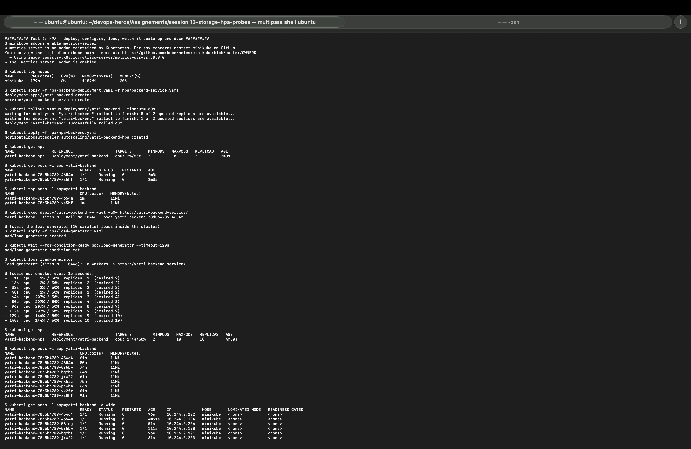
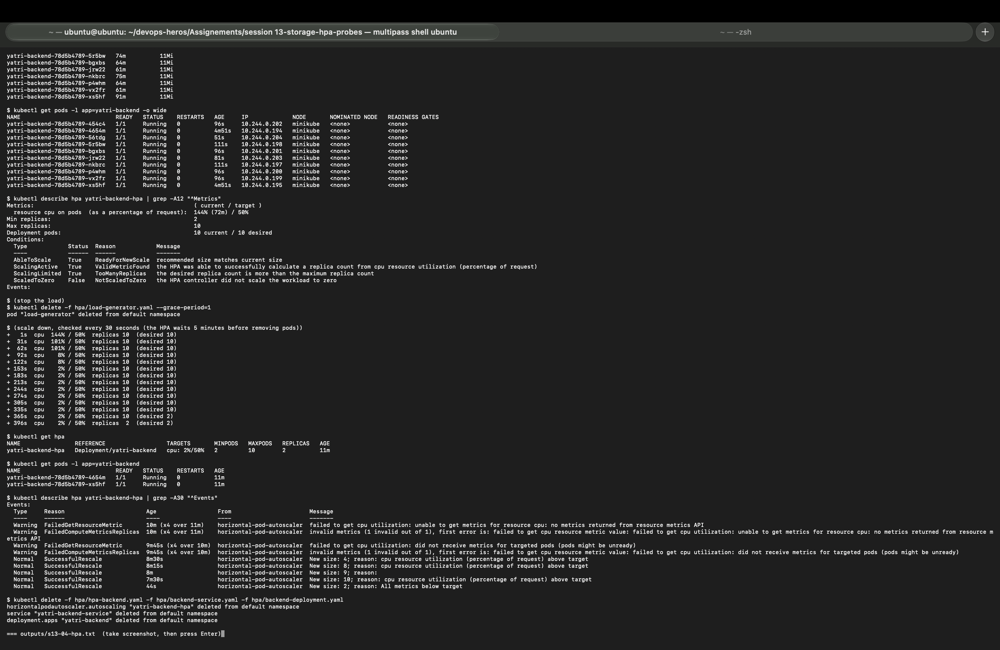
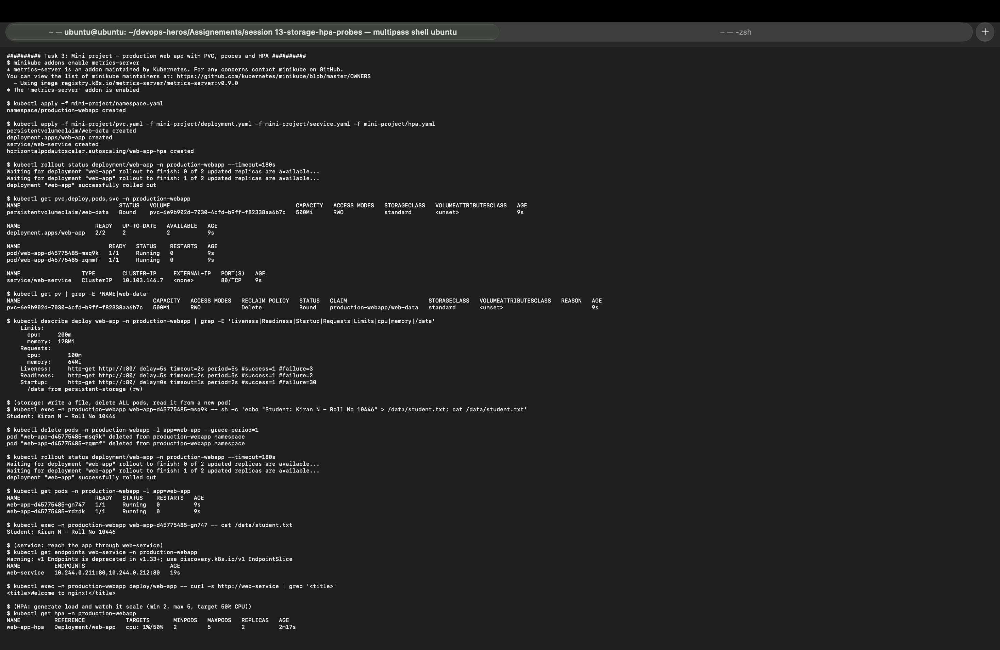
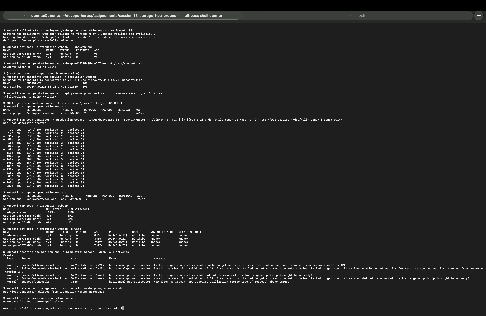
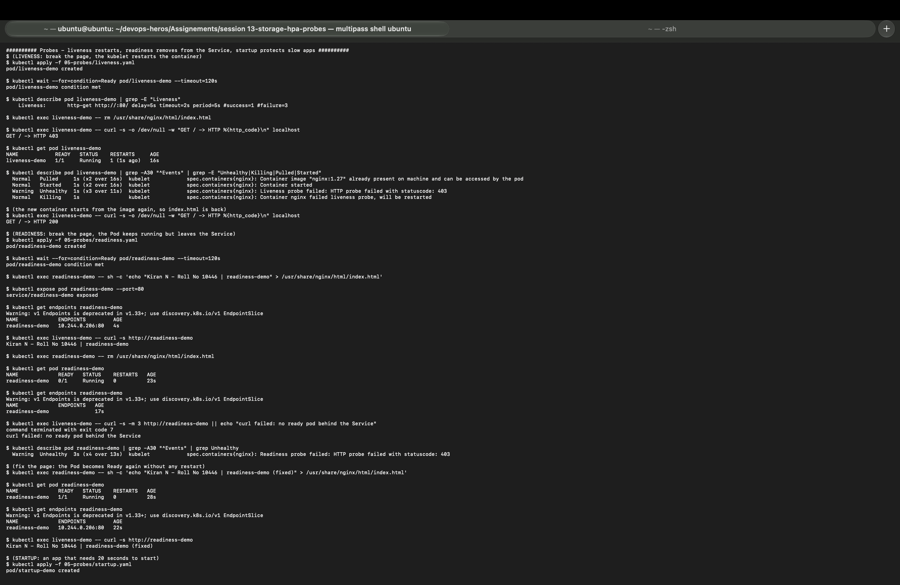
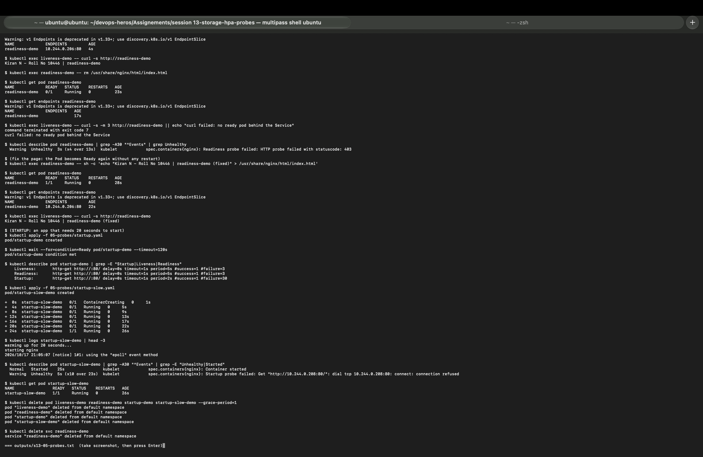

# Session 13: Kubernetes Storage, HPA and Probes

| | |
|---|---|
| **Name** | Kiran N |
| **Roll No.** | 10446 |
| **Session** | 13: Kubernetes Storage, HPA and Probes |
| **Environment** | Multipass Ubuntu VM (arm64) on Mac, Minikube v1.39.0 (docker driver), Kubernetes v1.37.0, metrics-server v0.9.0 |

All outputs below come from my own run of [`session13_lab.sh`](session13_lab.sh). Full text outputs are in [`outputs/`](outputs/) and screenshots are in [`screenshots/`](screenshots/). Files I wrote or changed carry my name; my name is also inside the data the Pods write and the pages they serve.

---

## Homework tasks

| # | Task | Where |
|---|------|-------|
| 1 | Kubernetes volumes: emptyDir, hostPath, PV, PVC, StorageClass, dynamic provisioning | [01-kubernetes-volumes/README.md](01-kubernetes-volumes/README.md) (summary [below](#task-1-kubernetes-volumes)) |
| 2 | HPA hands-on: deploy, configure, load generator, CPU, scaling | [Task 2](#task-2-hpa-hands-on) |
| 3 | Mini project: web app with PVC, probes and HPA | [Task 3](#task-3-mini-project) |
| Extra | Liveness, readiness and startup probes | [Probes](#extra-probes) |

---

## Folder structure

```
session 13-storage-hpa-probes/
├── ResultReadme.md                 # this file
├── session13_lab.sh                # script I ran: bash session13_lab.sh  (or some parts: bash session13_lab.sh 4 6)
├── 01-kubernetes-volumes/
│   └── README.md                   # Task 1 write-up
├── 01-volumes/                     # emptyDir and hostPath pods (+ my emptydir-shared.yaml)
├── 02-persistent-storage/          # pv.yaml, pvc.yaml, pod.yaml (+ my static-pvc.yaml, static-pod.yaml)
├── 03-storageclass/                # dynamic PVC
├── 04-hpa/                         # instructor nginx HPA example and demo Helm chart
├── hpa/                            # Task 2
│   ├── backend-deployment.yaml     # my yatri-backend Deployment (the target of the HPA)
│   ├── backend-service.yaml        # ClusterIP Service, port 80 -> 5000
│   ├── hpa-backend.yaml            # HPA: min 2, max 10, 50% CPU
│   ├── load-generator.yaml         # my in-cluster load generator (10 workers)
│   └── load_generator.sh           # instructor load generator (port-forward + curl)
├── 05-probes/                      # liveness, readiness, startup (+ my startup-slow.yaml)
├── mini-project/                   # Task 3: namespace, pvc, deployment, service, hpa
├── outputs/                        # s13-01 ... s13-06 text outputs
└── screenshots/                    # s13-01 ... s13-06 screenshots
```

---

## Task 1: Kubernetes volumes

The full write-up with every output is in [01-kubernetes-volumes/README.md](01-kubernetes-volumes/README.md). What my run showed:

| Test | Result |
|---|---|
| **emptyDir**: write `/data/kiran.txt`, delete the Pod, recreate | File gone (`total 0`): emptyDir lives only as long as the Pod |
| **emptyDir shared** by 2 containers | nginx served lines the busybox writer added every 5 s |
| **hostPath**: same test | File still there, and `minikube ssh -- ls /tmp/hostpath-data` shows it on the node |
| **PVC** (instructor `pvc.yaml`) | Got the default class `standard` and a **new dynamic PV**; the hand-made `student-pv` stayed `Available`. Data survived deleting the Pod |
| **Static PV** (my `static-pvc.yaml`, `storageClassName: ""`) | Bound to `student-pv` (1Gi); file visible on the node in `/tmp/student-data` |
| **Retain** | After deleting the claim, `student-pv` became `Released` and the file was still on the node |
| **StorageClass / dynamic provisioning** | `dynamic-pvc` created PV `pvc-b4a3f8c5-...` at `/tmp/hostpath-provisioner/default/dynamic-pvc`; deleting the PVC deleted the PV (`Delete`) |

Screenshots: [volumes](screenshots/s13-01-volumes.png), [PV and PVC](screenshots/s13-02-pv-pvc.png), [StorageClass](screenshots/s13-03-storageclass.png).

---

## Task 2: HPA hands-on

### How HPA works

The Horizontal Pod Autoscaler changes the **number of Pods** of a Deployment based on a metric. Every 15 seconds it reads CPU usage from **metrics-server** and computes:

```
desired replicas = ceil( current replicas x current CPU% / target CPU% )
```

CPU% is measured against the container's **CPU request**, so a Deployment without `resources.requests.cpu` cannot be autoscaled on CPU (the HPA shows `<unknown>`).

### Files

- [`hpa/backend-deployment.yaml`](hpa/backend-deployment.yaml) (mine): `yatri-backend`, a small Python server on port 5000 that answers `Yatri backend | Kiran N - Roll No 10446 | pod: <name>`. 2 replicas, **CPU request 50m**, limit 150m. The instructor's `hpa/` folder had the Service and the HPA for `yatri-backend` but not the Deployment itself, so I added it.
- [`hpa/backend-service.yaml`](hpa/backend-service.yaml): ClusterIP, port 80 to 5000.
- [`hpa/hpa-backend.yaml`](hpa/hpa-backend.yaml):

```yaml
spec:
  scaleTargetRef:
    apiVersion: apps/v1
    kind: Deployment
    name: yatri-backend
  minReplicas: 2
  maxReplicas: 10
  metrics:
    - type: Resource
      resource:
        name: cpu
        target:
          type: Utilization
          averageUtilization: 50     # 50% of 50m = 25m per pod on average
```

- [`hpa/load-generator.yaml`](hpa/load-generator.yaml) (mine): a busybox Pod with 10 parallel `wget` loops against `http://yatri-backend-service/`. I ran the load **inside the cluster** instead of the instructor's [`load_generator.sh`](hpa/load_generator.sh), because that script sends traffic through `kubectl port-forward`, which is slow and becomes the bottleneck itself.

### Steps 1 to 3: deploy, configure and verify

```
$ minikube addons enable metrics-server
  - Using image registry.k8s.io/metrics-server/metrics-server:v0.9.0
* The 'metrics-server' addon is enabled

$ kubectl top nodes
NAME       CPU(cores)   CPU(%)   MEMORY(bytes)   MEMORY(%)
minikube   179m         8%       1189Mi          20%

$ kubectl apply -f hpa/backend-deployment.yaml -f hpa/backend-service.yaml
deployment.apps/yatri-backend created
service/yatri-backend-service created

$ kubectl apply -f hpa/hpa-backend.yaml
horizontalpodautoscaler.autoscaling/yatri-backend-hpa created

$ kubectl get hpa
NAME                REFERENCE                  TARGETS       MINPODS   MAXPODS   REPLICAS   AGE
yatri-backend-hpa   Deployment/yatri-backend   cpu: 2%/50%   2         10        2          2m3s

$ kubectl top pods -l app=yatri-backend
NAME                            CPU(cores)   MEMORY(bytes)
yatri-backend-78d5b4789-4654m   1m           11Mi
yatri-backend-78d5b4789-xs5hf   1m           11Mi

$ kubectl exec deploy/yatri-backend -- wget -qO- http://yatri-backend-service/
Yatri backend | Kiran N - Roll No 10446 | pod: yatri-backend-78d5b4789-4654m
```

Idle: 1m CPU per pod = 2% of the 50m request, so the HPA keeps the minimum of 2 pods.

### Steps 4 to 7: load, CPU and scaling

```
$ kubectl apply -f hpa/load-generator.yaml
pod/load-generator created

$ kubectl logs load-generator
load-generator (Kiran N - 10446): 10 workers -> http://yatri-backend-service/
```

My script checked the HPA every 15 seconds:

```
+   1s  cpu    2% / 50%  replicas  2  (desired 2)
+  16s  cpu    2% / 50%  replicas  2  (desired 2)
+  32s  cpu    2% / 50%  replicas  2  (desired 2)
+  48s  cpu    2% / 50%  replicas  2  (desired 2)
+  64s  cpu  207% / 50%  replicas  2  (desired 4)
+  80s  cpu  207% / 50%  replicas  4  (desired 8)
+  96s  cpu  207% / 50%  replicas  8  (desired 9)
+ 112s  cpu  207% / 50%  replicas  9  (desired 9)
+ 129s  cpu  144% / 50%  replicas  9  (desired 10)
+ 145s  cpu  144% / 50%  replicas 10  (desired 10)
```

```
$ kubectl get hpa
NAME                REFERENCE                  TARGETS         MINPODS   MAXPODS   REPLICAS   AGE
yatri-backend-hpa   Deployment/yatri-backend   cpu: 144%/50%   2         10        10         4m50s

$ kubectl top pods -l app=yatri-backend
NAME                            CPU(cores)   MEMORY(bytes)
yatri-backend-78d5b4789-454c4   61m          11Mi
yatri-backend-78d5b4789-4654m   80m          11Mi
yatri-backend-78d5b4789-5r5bw   74m          11Mi
yatri-backend-78d5b4789-bgxbs   64m          11Mi
yatri-backend-78d5b4789-jrw22   61m          11Mi
yatri-backend-78d5b4789-nkbrc   75m          11Mi
yatri-backend-78d5b4789-p4whm   64m          11Mi
yatri-backend-78d5b4789-vx2fr   61m          11Mi
yatri-backend-78d5b4789-xs5hf   91m          11Mi

$ kubectl describe hpa yatri-backend-hpa
Metrics:                                               ( current / target )
  resource cpu on pods  (as a percentage of request):  144% (72m) / 50%
Min replicas:                                          2
Max replicas:                                          10
Deployment pods:                                       10 current / 10 desired
Conditions:
  Type            Status  Reason            Message
  AbleToScale     True    ReadyForNewScale  recommended size matches current size
  ScalingActive   True    ValidMetricFound  the HPA was able to successfully calculate a replica count from cpu resource utilization (percentage of request)
  ScalingLimited  True    TooManyReplicas   the desired replica count is more than the maximum replica count
```

What I observed:

- **CPU jumped from 2% to 207%** about 60 seconds after the load started. metrics-server only refreshes its numbers every ~60 seconds, so the HPA reacts with that delay.
- **The HPA scaled 2 → 4 → 8 → 9 → 10.** It did not jump straight to the formula's answer (2 x 207 / 50 = 9) because scale-up is rate-limited: by default it adds at most 4 pods or doubles the count (whichever is more) every 15 seconds.
- **It stopped at 10**, the `maxReplicas`. Even with 10 pods CPU was still 144% (72m per pod), and the condition `ScalingLimited True TooManyReplicas` says it wanted more but hit the limit. In real use I would raise `maxReplicas` or the CPU request.
- `kubectl top pods` shows only 9 pods: the 10th pod was too new to have metrics yet.
- All pods stayed on the single `minikube` node with 0 restarts.



### Scale down

```
$ kubectl delete -f hpa/load-generator.yaml --grace-period=1
pod "load-generator" deleted from default namespace

+   1s  cpu  144% / 50%  replicas 10  (desired 10)
+  31s  cpu  101% / 50%  replicas 10  (desired 10)
+  62s  cpu  101% / 50%  replicas 10  (desired 10)
+  92s  cpu    8% / 50%  replicas 10  (desired 10)
+ 122s  cpu    8% / 50%  replicas 10  (desired 10)
+ 153s  cpu    2% / 50%  replicas 10  (desired 10)
  ...
+ 335s  cpu    2% / 50%  replicas 10  (desired 10)
+ 365s  cpu    2% / 50%  replicas 10  (desired 2)
+ 396s  cpu    2% / 50%  replicas  2  (desired 2)

$ kubectl get hpa
NAME                REFERENCE                  TARGETS       MINPODS   MAXPODS   REPLICAS   AGE
yatri-backend-hpa   Deployment/yatri-backend   cpu: 2%/50%   2         10        2          11m

$ kubectl describe hpa yatri-backend-hpa | grep -A30 "^Events"
  Normal   SuccessfulRescale   8m30s   horizontal-pod-autoscaler  New size: 4; reason: cpu resource utilization (percentage of request) above target
  Normal   SuccessfulRescale   8m15s   horizontal-pod-autoscaler  New size: 8; reason: cpu resource utilization (percentage of request) above target
  Normal   SuccessfulRescale   8m      horizontal-pod-autoscaler  New size: 9; reason:
  Normal   SuccessfulRescale   7m30s   horizontal-pod-autoscaler  New size: 10; reason: cpu resource utilization (percentage of request) above target
  Normal   SuccessfulRescale   44s     horizontal-pod-autoscaler  New size: 2; reason: All metrics below target
```

- CPU fell to 2% within about 2.5 minutes, but the HPA **kept 10 pods for about 5 more minutes**. This is the scale-down **stabilization window** (300 seconds by default): the HPA uses the highest recommendation of the last 5 minutes, so a short dip in traffic does not remove pods that are needed again a moment later.
- Then it went straight from 10 to 2 (`All metrics below target`), back to `minReplicas`.
- The `Warning FailedGetResourceMetric` events at the top of the Events list are from the first minute after creating the HPA, before metrics-server had data for the new pods (`<unknown>` in `kubectl get hpa`). They stopped once metrics arrived.



Full output: [outputs/s13-04-hpa.txt](outputs/s13-04-hpa.txt)

---

## Task 3: Mini project

The instructor's [mini project](mini-project/README.md) combines all three topics in namespace `production-webapp`:

| File | What it does |
|---|---|
| [`namespace.yaml`](mini-project/namespace.yaml) | Namespace `production-webapp` |
| [`pvc.yaml`](mini-project/pvc.yaml) | PVC `web-data`, 500Mi RWO (default StorageClass) |
| [`deployment.yaml`](mini-project/deployment.yaml) | `web-app`: 2 nginx replicas, `Recreate` strategy, requests 100m/64Mi, limits 200m/128Mi, startup + readiness + liveness probes, PVC mounted at `/data` |
| [`service.yaml`](mini-project/service.yaml) | ClusterIP `web-service` port 80 |
| [`hpa.yaml`](mini-project/hpa.yaml) | `web-app-hpa`: min 2, max 5, 50% CPU |

### Deploy

```
$ kubectl apply -f mini-project/namespace.yaml
namespace/production-webapp created

$ kubectl apply -f mini-project/pvc.yaml -f mini-project/deployment.yaml -f mini-project/service.yaml -f mini-project/hpa.yaml
persistentvolumeclaim/web-data created
deployment.apps/web-app created
service/web-service created
horizontalpodautoscaler.autoscaling/web-app-hpa created

$ kubectl get pvc,deploy,pods,svc -n production-webapp
NAME                             STATUS   VOLUME                                     CAPACITY   ACCESS MODES   STORAGECLASS
persistentvolumeclaim/web-data   Bound    pvc-6e9b902d-7030-4cfd-b9ff-f82338aa6b7c   500Mi      RWO            standard

NAME                      READY   UP-TO-DATE   AVAILABLE   AGE
deployment.apps/web-app   2/2     2            2           9s

NAME                          READY   STATUS    RESTARTS   AGE
pod/web-app-d45775485-msq9k   1/1     Running   0          9s
pod/web-app-d45775485-zqmmf   1/1     Running   0          9s

NAME                  TYPE        CLUSTER-IP     EXTERNAL-IP   PORT(S)   AGE
service/web-service   ClusterIP   10.103.146.7   <none>        80/TCP    9s

$ kubectl describe deploy web-app -n production-webapp
    Limits:     cpu: 200m   memory: 128Mi
    Requests:   cpu: 100m   memory: 64Mi
    Liveness:     http-get http://:80/ delay=5s timeout=2s period=5s #success=1 #failure=3
    Readiness:    http-get http://:80/ delay=5s timeout=2s period=5s #success=1 #failure=2
    Startup:      http-get http://:80/ delay=0s timeout=1s period=2s #success=1 #failure=30
      /data from persistent-storage (rw)
```

The PVC was provisioned dynamically by the `standard` StorageClass, and both pods share it (RWO allows several pods on the same node).

### Verify storage persistence

I wrote my name, deleted **all** pods, and read it from a brand-new pod:

```
$ kubectl exec -n production-webapp web-app-d45775485-msq9k -- sh -c 'echo "Student: Kiran N - Roll No 10446" > /data/student.txt; cat /data/student.txt'
Student: Kiran N - Roll No 10446

$ kubectl delete pods -n production-webapp -l app=web-app --grace-period=1
pod "web-app-d45775485-msq9k" deleted from production-webapp namespace
pod "web-app-d45775485-zqmmf" deleted from production-webapp namespace

$ kubectl get pods -n production-webapp -l app=web-app
NAME                      READY   STATUS    RESTARTS   AGE
web-app-d45775485-gn747   1/1     Running   0          9s
web-app-d45775485-rdzdk   1/1     Running   0          9s

$ kubectl exec -n production-webapp web-app-d45775485-gn747 -- cat /data/student.txt
Student: Kiran N - Roll No 10446
```

No pod from before was left, yet the file was still there: it lives on the PersistentVolume, not in a pod.

### Verify the Service

```
$ kubectl get endpoints web-service -n production-webapp
NAME          ENDPOINTS                         AGE
web-service   10.244.0.211:80,10.244.0.212:80   19s

$ kubectl exec -n production-webapp deploy/web-app -- curl -s http://web-service | grep '<title>'
<title>Welcome to nginx!</title>
```

The endpoints are the IPs of the 2 new pods; they were added only after the readiness probes passed.



### Trigger HPA scaling

```
$ kubectl run load-generator -n production-webapp --image=busybox:1.36 --restart=Never -- /bin/sh -c 'for i in $(seq 1 20); do (while true; do wget -q -O- http://web-service >/dev/null; done) & done; wait'
pod/load-generator created

+   0s  cpu    1% / 50%  replicas  2  (desired 2)
  ...
+  66s  cpu   51% / 50%  replicas  2  (desired 2)
+  82s  cpu   51% / 50%  replicas  2  (desired 2)
+  99s  cpu   51% / 50%  replicas  2  (desired 2)
+ 115s  cpu   51% / 50%  replicas  2  (desired 2)
+ 132s  cpu   58% / 50%  replicas  2  (desired 3)
+ 148s  cpu   58% / 50%  replicas  3  (desired 3)
+ 165s  cpu   58% / 50%  replicas  3  (desired 3)
+ 181s  cpu   47% / 50%  replicas  3  (desired 3)
  ...
+ 283s  cpu   41% / 50%  replicas  3  (desired 3)

$ kubectl get hpa -n production-webapp
NAME          REFERENCE            TARGETS        MINPODS   MAXPODS   REPLICAS   AGE
web-app-hpa   Deployment/web-app   cpu: 42%/50%   2         5         3          7m21s

$ kubectl top pods -n production-webapp
NAME                      CPU(cores)   MEMORY(bytes)
load-generator            1299m        11Mi
web-app-d45775485-692h9   42m          3Mi
web-app-d45775485-gn747   42m          3Mi
web-app-d45775485-rdzdk   42m          3Mi

$ kubectl describe hpa web-app-hpa -n production-webapp | grep SuccessfulRescale
  Normal   SuccessfulRescale   3m6s   horizontal-pod-autoscaler  New size: 3; reason: cpu resource utilization (percentage of request) above target
```

What I observed (different from the instructor's expected 5 pods, and here is why):

- **51% did not scale.** The HPA has a **10% tolerance**: it does nothing while current/target is between 0.9 and 1.1. 51/50 = 1.02, so it stayed at 2.
- **58% scaled to 3.** 58/50 = 1.16 is outside the tolerance, and ceil(2 x 1.16) = 3.
- **With 3 pods CPU settled at 41 to 47%**, below the target, so 3 is the right answer for this amount of traffic and it did not go to 5.
- **The load generator was the limit, not nginx.** `kubectl top` shows the load generator using **1299m** CPU while each nginx pod used only 42m. busybox `wget` starts a new process for every request, so the client spends far more CPU than nginx needs to serve a small static page. More load generator pods would push the HPA towards 5.
- The new pod `web-app-d45775485-692h9` mounted the same PVC and passed its startup and readiness probes before receiving traffic.



Full output: [outputs/s13-06-mini-project.txt](outputs/s13-06-mini-project.txt). After the test the script deleted the load generator and the whole namespace.

---

## Extra: Probes

| Probe | Question | When it fails |
|---|---|---|
| **Startup** | Has the app finished starting? | Container is restarted after `failureThreshold x periodSeconds`; until it passes, liveness and readiness are not run |
| **Readiness** | Can it take traffic now? | Pod is removed from the Service endpoints. **No restart** |
| **Liveness** | Is it still healthy? | kubelet **restarts** the container |

Probe types: `httpGet` (2xx/3xx = success), `tcpSocket`, `exec` (exit 0), `grpc`.

### Liveness: the container is restarted

I deleted nginx's `index.html` so `/` returns 403:

```
$ kubectl exec liveness-demo -- rm /usr/share/nginx/html/index.html
$ kubectl exec liveness-demo -- curl -s -o /dev/null -w "GET / -> HTTP %{http_code}\n" localhost
GET / -> HTTP 403

$ kubectl get pod liveness-demo
NAME            READY   STATUS    RESTARTS     AGE
liveness-demo   1/1     Running   1 (1s ago)   16s

$ kubectl describe pod liveness-demo | grep -A30 "^Events" | grep -E "Unhealthy|Killing|Pulled|Started"
  Warning  Unhealthy  1s (x3 over 11s)  kubelet  Liveness probe failed: HTTP probe failed with statuscode: 403
  Normal   Killing    1s                kubelet  Container nginx failed liveness probe, will be restarted

$ kubectl exec liveness-demo -- curl -s -o /dev/null -w "GET / -> HTTP %{http_code}\n" localhost
GET / -> HTTP 200
```

3 failures (`#failure=3`, every 5 s) then a restart. The new container starts from the image again, so `index.html` is back and `/` returns 200.

### Readiness: the Pod leaves the Service but is not restarted

```
$ kubectl expose pod readiness-demo --port=80
$ kubectl get endpoints readiness-demo
NAME             ENDPOINTS         AGE
readiness-demo   10.244.0.206:80   4s

$ kubectl exec liveness-demo -- curl -s http://readiness-demo
Kiran N - Roll No 10446 | readiness-demo

$ kubectl exec readiness-demo -- rm /usr/share/nginx/html/index.html

$ kubectl get pod readiness-demo
NAME             READY   STATUS    RESTARTS   AGE
readiness-demo   0/1     Running   0          23s

$ kubectl get endpoints readiness-demo
NAME             ENDPOINTS   AGE
readiness-demo               17s

$ kubectl exec liveness-demo -- curl -s -m 3 http://readiness-demo || echo "curl failed: no ready pod behind the Service"
curl failed: no ready pod behind the Service

(fix the page)
$ kubectl get pod readiness-demo
NAME             READY   STATUS    RESTARTS   AGE
readiness-demo   1/1     Running   0          28s

$ kubectl get endpoints readiness-demo
NAME             ENDPOINTS         AGE
readiness-demo   10.244.0.206:80   22s

$ kubectl exec liveness-demo -- curl -s http://readiness-demo
Kiran N - Roll No 10446 | readiness-demo (fixed)
```

`Running` but `0/1`, **0 restarts**, and the Service had no endpoints. After the fix it came back by itself. (`kubectl get endpoints` prints a deprecation warning on Kubernetes 1.33+, see the full output; EndpointSlice is the new API.)



### Startup: protecting a slow app

My [`startup-slow.yaml`](05-probes/startup-slow.yaml) sleeps 20 seconds before starting nginx. The startup probe allows 30 x 2 = 60 seconds:

```
+  0s  startup-slow-demo   0/1   ContainerCreating   0     1s
+  4s  startup-slow-demo   0/1   Running   0     5s
+  8s  startup-slow-demo   0/1   Running   0     9s
+ 12s  startup-slow-demo   0/1   Running   0     13s
+ 16s  startup-slow-demo   0/1   Running   0     17s
+ 20s  startup-slow-demo   0/1   Running   0     22s
+ 24s  startup-slow-demo   1/1   Running   0     26s

$ kubectl describe pod startup-slow-demo | grep -A30 "^Events" | grep -E "Unhealthy|Started"
  Normal   Started    25s                kubelet  Container started
  Warning  Unhealthy  5s (x10 over 23s)  kubelet  Startup probe failed: Get "http://10.244.0.208:80/": dial tcp 10.244.0.208:80: connect: connection refused
```

The startup probe failed 10 times (connection refused while the app was "warming up") but the container was **not restarted** (RESTARTS 0), because it was still within its 60-second allowance. With only the liveness probe (period 5 s, 3 failures), this container would have been killed after about 15 seconds and never started.



Full output: [outputs/s13-05-probes.txt](outputs/s13-05-probes.txt)

---

## Commands used

```bash
# Storage
kubectl get pv,pvc
kubectl get storageclass
kubectl get pvc <name> -o jsonpath="{.spec.storageClassName}"
minikube ssh -- ls -l /tmp/hostpath-data

# HPA
minikube addons enable metrics-server
kubectl top nodes
kubectl top pods
kubectl get hpa
kubectl describe hpa yatri-backend-hpa
kubectl get hpa yatri-backend-hpa -o jsonpath='{.status.currentReplicas}'

# Probes
kubectl describe pod <pod> | grep -E "Liveness|Readiness|Startup"
kubectl get endpoints <service>
kubectl describe pod <pod> | grep -A30 "^Events"
```

---

## What I learned

- emptyDir is for temporary or shared data inside one Pod; hostPath ties data to one node; PV/PVC keeps data independent of Pods.
- With a default StorageClass, a PVC without a class is provisioned dynamically and ignores hand-made PVs; `storageClassName: ""` binds to them.
- `Retain` keeps the data after a claim is deleted, `Delete` removes it.
- HPA needs metrics-server and CPU requests. It reacts with about a one-minute delay, scales up in steps (double or +4 per 15 s), stops at `maxReplicas`, has a 10% tolerance, and waits 5 minutes before scaling down.
- When load does not scale as expected, check `kubectl top`: in the mini project the load generator, not the app, was the bottleneck.
- Liveness restarts, readiness removes from the Service, startup gives slow apps time before the other two start checking.
