# Session 14: Kubernetes Troubleshooting

| | |
|---|---|
| **Name** | Kiran N |
| **Roll No.** | 10446 |
| **Session** | 14: Kubernetes Troubleshooting |
| **Environment** | Multipass Ubuntu VM (arm64) on Mac, Minikube v1.39.0 (docker driver), Kubernetes v1.37.0, containerd 2.3.4, metrics-server v0.9.0 |
| **Node** | `minikube`, 192.168.49.2, allocatable 2 CPU / 6040184Ki memory |

All outputs below come from my own run of [`session14_lab.sh`](session14_lab.sh). Full text outputs are in [`outputs/`](outputs/) and screenshots are in [`screenshots/`](screenshots/). The files I added carry my name, and my name also appears in the data the Pods print (ConfigMap value, exec test file, fixed scenario logs).

---

## Homework tasks

| # | Task | Where |
|---|------|-------|
| 1 | Practise `get`, `describe`, `logs`, `exec`, `events`, `explain`, `top`, `get -o wide` | [Task 1](#task-1-troubleshooting-commands) |
| 2 | Troubleshoot CrashLoopBackOff, ImagePullBackOff / ErrImagePull, Pending, ContainerCreating, Service connectivity, DNS, Pod networking, configuration issues | [Task 2](#task-2-troubleshooting-common-issues) |
| Extra | Triage gauntlet: 5 broken production pods at once | [Triage gauntlet](#extra-triage-gauntlet-5-broken-pods) |
| 3 | Mini project: troubleshooting challenge (Q1-Q5, table, README questions) | [Task 3](#task-3-mini-project-troubleshooting-challenge) |

---

## Folder structure

```
session 14-kubernetes-troubleshooting/
├── Session14-README.md                 # this file
├── README.md                           # instructor notes
├── session14_lab.sh                    # script I ran: bash session14_lab.sh  (or some parts: bash session14_lab.sh 7 8)
├── 01-kubectl-get/ 02-kubectl-describe/ 03-kubectl-logs/ 04-kubectl-exec/ 05-events/
├── 06-crashloopbackoff/                # broken-pod.yaml, fixed-pod.yaml
├── 07-imagepullbackoff/                # broken-pod.yaml, fixed-pod.yaml
├── 08-pending-pods/                    # broken-pod.yaml, fixed-pod.yaml
├── 09-service-dns-troubleshooting/     # deployment, service, broken-service, dns-test-pod (+ my netshoot-pod.yaml)
├── 10-config-issues/                   # mine: containercreating-pod.yaml (missing ConfigMap), config-error-pod.yaml (missing Secret)
├── scenarios/                          # triage gauntlet: broken.yaml per scenario (+ my fixed.yaml files and postgres-db.yaml)
│   └── triage_all.sh
├── mini-project/                       # Task 3: deployment, service, broken-pod
├── outputs/                            # s14-01 ... s14-09 text outputs
└── screenshots/                        # s14-01 ... s14-09 screenshots
```

How I ran it inside the VM:

```bash
cd ~/devops-heros/Assignements/"session 14-kubernetes-troubleshooting"
bash session14_lab.sh            # all 9 parts, then cleanup
bash session14_lab.sh 7 8        # re-run only DNS/networking and the gauntlet
```

The troubleshooting order I followed for every problem:

```
IDENTIFY (get)  ->  INVESTIGATE (describe / events / logs / exec)  ->  ROOT CAUSE  ->  FIX  ->  VERIFY  ->  DOCUMENT
```

---

## Task 1: Troubleshooting commands

Output: [`outputs/s14-01-commands.txt`](outputs/s14-01-commands.txt)

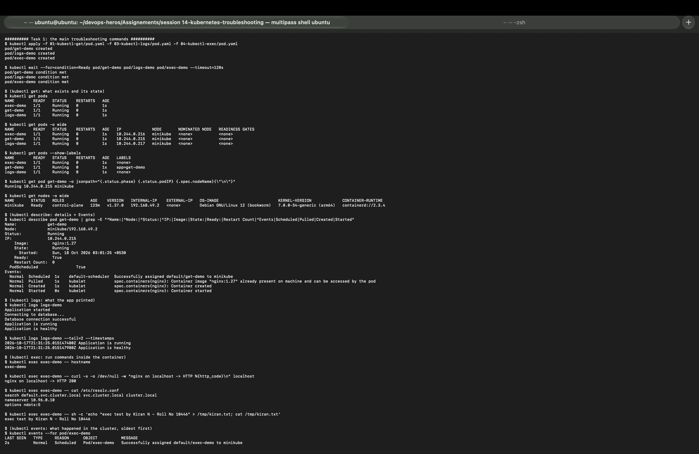
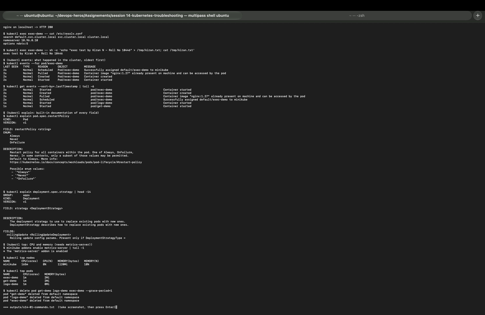

I created three pods from the instructor folders (`get-demo`, `logs-demo`, `exec-demo`) and used each command on them.

| Command | What it tells me | My result |
|---|---|---|
| `kubectl get pods` | What exists and its state (READY, STATUS, RESTARTS, AGE). The first thing to run. | 3 pods `Running`, 0 restarts |
| `kubectl get pods -o wide` | Adds the Pod IP and the node. Needed for pod-to-pod tests. | get-demo 10.244.0.215, exec-demo .216, logs-demo .217, all on `minikube` |
| `kubectl get pods --show-labels` | Shows labels, which is what Services and Deployments select on. | only get-demo has `app=get-demo` |
| `kubectl get pod get-demo -o jsonpath=...` | Prints exactly the fields I ask for. | `Running 10.244.0.215 minikube` |
| `kubectl get nodes -o wide` | Node version, IP, OS, kernel and runtime. | v1.37.0, 192.168.49.2, Debian 12, arm64, `containerd://2.3.4` |
| `kubectl describe pod get-demo` | Full details: image, state, ready, restart count and the **Events** at the bottom. | image `nginx:1.27`, Ready True, events Scheduled → Pulled → Created → Started |
| `kubectl logs logs-demo` | What the application printed (stdout/stderr). | `Application started ... Database connection successful ... Application is healthy` |
| `kubectl logs --tail=2 --timestamps` | Only the last lines, with time. | `2026-10-17T21:31:25.015Z Application is healthy` |
| `kubectl exec exec-demo -- <cmd>` | Runs a command inside the container. | `hostname` → exec-demo, `curl localhost` → HTTP 200 |
| `kubectl exec exec-demo -- cat /etc/resolv.conf` | The DNS settings the Pod uses. | `nameserver 10.96.0.10`, `search default.svc.cluster.local svc.cluster.local cluster.local`, `ndots:5` |
| `kubectl exec ... sh -c 'echo ... > /tmp/kiran.txt'` | Writing and reading a file inside the container. | `exec test by Kiran N - Roll No 10446` |
| `kubectl events --for pod/exec-demo` | Events of one object, oldest first. | Scheduled, Pulled, Created, Started |
| `kubectl get events --sort-by=.lastTimestamp` | Everything that happened in the namespace, in time order. | the Started events of all 3 pods last |
| `kubectl explain pod.spec.restartPolicy` | Built-in docs for any field, no internet needed. | enum `Always`, `Never`, `OnFailure`, default Always |
| `kubectl explain deployment.spec.strategy` | Docs for a Deployment field. | `rollingUpdate <RollingUpdateDeployment>` |
| `kubectl top nodes` / `kubectl top pods` | Live CPU and memory (needs metrics-server). | node 165m CPU (8%), 1120Mi (18%); each pod 1m CPU, 0-2Mi |

---

## Task 2: Troubleshooting common issues

### 2.1 CrashLoopBackOff

Output: [`outputs/s14-02-crashloopbackoff.txt`](outputs/s14-02-crashloopbackoff.txt)

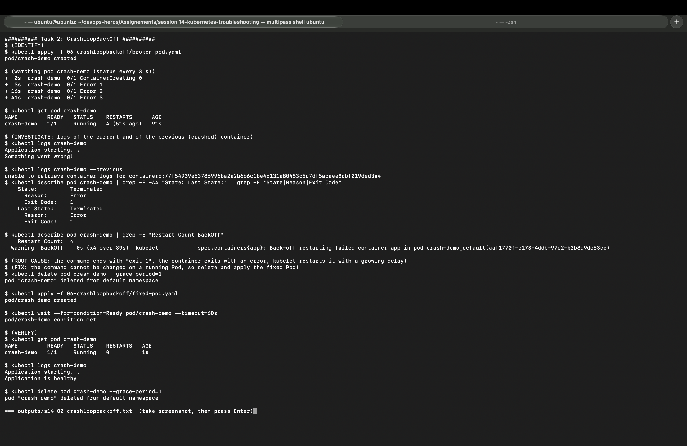

| Step | What I did and saw |
|---|---|
| **Identify** | `kubectl apply -f 06-crashloopbackoff/broken-pod.yaml`. Every 3 s: `ContainerCreating 0` → `Error 1` (3 s) → `Error 2` (16 s) → `Error 3` (41 s). The restart gaps grow: that is the back-off. |
| **Investigate** | `kubectl logs crash-demo` → `Application starting...` / `Something went wrong!`. `describe`: `State: Terminated, Reason: Error, Exit Code: 1`, the same in `Last State`, `Restart Count: 4`, and the event `Warning BackOff ... Back-off restarting failed container app (x4 over 89s)`. |
| **Root cause** | The container command ends with `exit 1`. The process exits with an error, `restartPolicy: Always` restarts it, and the kubelet waits longer each time (10 s, 20 s, 40 s ... up to 5 min). |
| **Fix** | The command of a running Pod cannot be changed, so `kubectl delete pod crash-demo` and `kubectl apply -f 06-crashloopbackoff/fixed-pod.yaml`. |
| **Verify** | `crash-demo 1/1 Running 0`, logs `Application starting...` / `Application is healthy`. |

What I noticed on my cluster:
* On Kubernetes 1.37 the STATUS column mostly showed **`Error`** while the pod was waiting, not the word `CrashLoopBackOff`. The proof of a crash loop is the growing restart count plus the `Back-off restarting failed container` event. My `kubectl get pod` at 91 s even caught it in the short moment it was `Running 4 (51s ago)` before it exited again.
* `kubectl logs --previous` answered `unable to retrieve container logs for containerd://f549...`, because the old container had already been removed when the next restart happened. Plain `kubectl logs` still showed the error lines, because the script prints and exits immediately.

### 2.2 ErrImagePull and ImagePullBackOff

Output: [`outputs/s14-03-imagepullbackoff.txt`](outputs/s14-03-imagepullbackoff.txt)

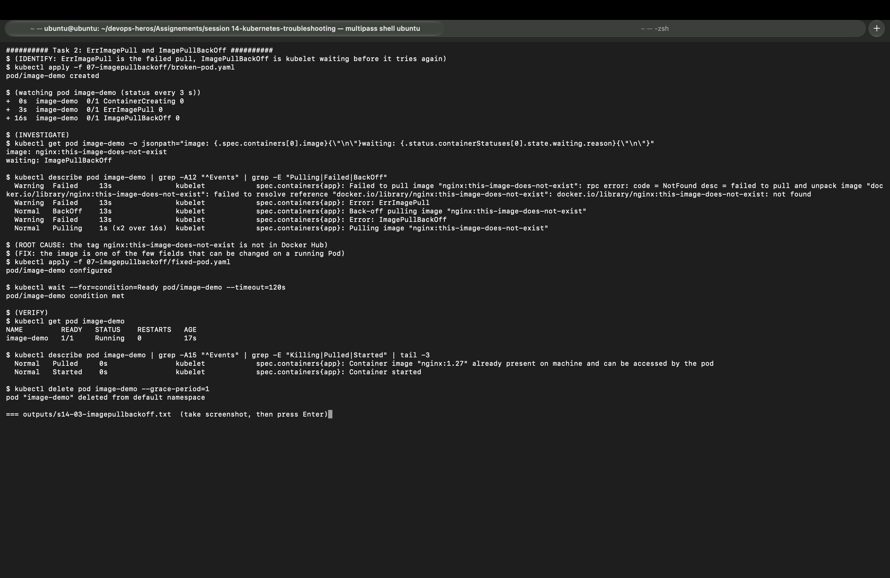

| Step | What I did and saw |
|---|---|
| **Identify** | `ContainerCreating` (0 s) → `ErrImagePull` (3 s) → `ImagePullBackOff` (16 s). |
| **Investigate** | jsonpath: `image: nginx:this-image-does-not-exist`, `waiting: ImagePullBackOff`. Events: `Failed to pull image ... docker.io/library/nginx:this-image-does-not-exist: not found`, then `Back-off pulling image`, then `Pulling (x2 over 16s)`. |
| **Root cause** | The tag `this-image-does-not-exist` is not on Docker Hub. **ErrImagePull** is the failed pull itself; **ImagePullBackOff** is the kubelet waiting before it tries again. |
| **Fix** | `kubectl apply -f 07-imagepullbackoff/fixed-pod.yaml` answered `pod/image-demo configured`: the image is one of the few Pod fields that can be changed in place, so no delete was needed. |
| **Verify** | `image-demo 1/1 Running 0`, events `Pulled ... nginx:1.27` and `Started`. |

### 2.3 Pending

Output: [`outputs/s14-04-pending.txt`](outputs/s14-04-pending.txt)

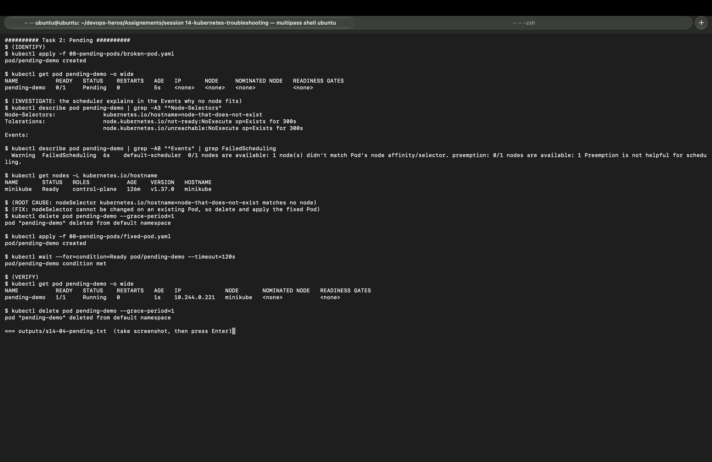

| Step | What I did and saw |
|---|---|
| **Identify** | `pending-demo 0/1 Pending`, IP `<none>`, NODE `<none>`: the pod was never placed on a node. |
| **Investigate** | `describe`: `Node-Selectors: kubernetes.io/hostname=node-that-does-not-exist` and event `FailedScheduling ... 0/1 nodes are available: 1 node(s) didn't match Pod's node affinity/selector`. `kubectl get nodes -L kubernetes.io/hostname` shows my only node is `minikube`. |
| **Root cause** | The nodeSelector asks for a node that does not exist, so the scheduler has nowhere to put it. |
| **Fix** | nodeSelector cannot be edited on an existing Pod: delete it and apply `08-pending-pods/fixed-pod.yaml`. |
| **Verify** | `pending-demo 1/1 Running`, IP 10.244.0.221 on `minikube`. |

A second Pending cause (not enough CPU/memory) is in the [triage gauntlet](#extra-triage-gauntlet-5-broken-pods), scenario 3.

### 2.4 ContainerCreating and configuration issues

Output: [`outputs/s14-05-config-issues.txt`](outputs/s14-05-config-issues.txt)

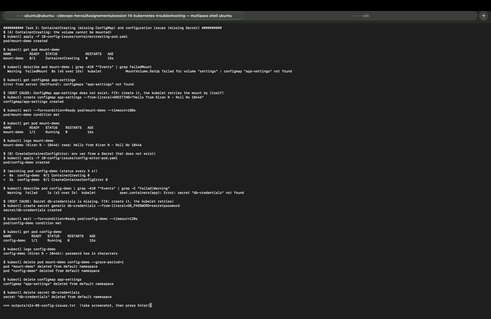

The instructor folders have no example for these two, so I wrote [`10-config-issues/containercreating-pod.yaml`](10-config-issues/containercreating-pod.yaml) and [`10-config-issues/config-error-pod.yaml`](10-config-issues/config-error-pod.yaml).

**A) Stuck in ContainerCreating (missing ConfigMap volume)**

| Step | What I did and saw |
|---|---|
| **Identify** | `mount-demo 0/1 ContainerCreating` after 15 s. |
| **Investigate** | Event `FailedMount (x5 over 15s) MountVolume.SetUp failed for volume "settings" : configmap "app-settings" not found`. `kubectl get configmap app-settings` → `NotFound`. |
| **Root cause** | The pod mounts ConfigMap `app-settings`, which was never created. The kubelet cannot build the volume, so the container is never started. |
| **Fix** | `kubectl create configmap app-settings --from-literal=GREETING="Hello from Kiran N - Roll No 10446"`. No pod restart needed: the kubelet retries the mount by itself. |
| **Verify** | `mount-demo 1/1 Running`, log `mount-demo (Kiran N - 10446) read: Hello from Kiran N - Roll No 10446`. |

**B) CreateContainerConfigError (missing Secret for an env variable)**

| Step | What I did and saw |
|---|---|
| **Identify** | `ContainerCreating` → `CreateContainerConfigError` after 3 s. |
| **Investigate** | Event `Error: secret "db-credentials" not found`. |
| **Root cause** | `DB_PASSWORD` uses `secretKeyRef` to a Secret that does not exist, so the container config cannot be built. |
| **Fix** | `kubectl create secret generic db-credentials --from-literal=DB_PASSWORD=secretpassword`. The kubelet retries. |
| **Verify** | `config-demo 1/1 Running`, log `config-demo (Kiran N - 10446): password has 14 characters` (the app proves it got the value without printing it). |

### 2.5 Service connectivity

Output: [`outputs/s14-06-service.txt`](outputs/s14-06-service.txt)

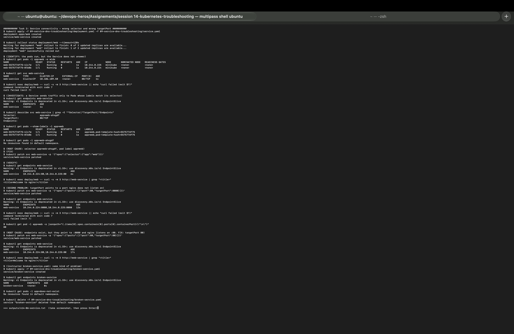

**Problem 1: wrong selector**

| Step | What I did and saw |
|---|---|
| **Identify** | Both `web` pods `Running` (10.244.0.224, .225), `web-service` ClusterIP 10.106.109.50, but `curl http://web-service` from a pod → `exit code 7` (connection refused). |
| **Investigate** | `kubectl get endpoints web-service` → `<none>`. `describe svc`: `Selector: app=web-ahsgdf`. `get pods --show-labels`: pods have `app=web`. `kubectl get pods -l app=web-ahsgdf` → `No resources found`. |
| **Root cause** | The Service selector does not match any Pod label, so the Service has no endpoints to send traffic to. |
| **Fix** | `kubectl patch svc web-service -p '{"spec":{"selector":{"app":"web"}}}'` |
| **Verify** | Endpoints `10.244.0.224:80,10.244.0.225:80`, curl → `<title>Welcome to nginx!</title>`. |

**Problem 2: wrong targetPort** (I broke it on purpose)

| Step | What I did and saw |
|---|---|
| **Identify** | After patching `targetPort: 8080`, curl → `exit code 7` again. |
| **Investigate** | This time endpoints **do** exist: `10.244.0.224:8080,10.244.0.225:8080`. The container's `containerPort` is `80`. |
| **Root cause** | The selector is fine, but traffic is sent to port 8080 where nginx is not listening. Endpoints alone do not prove the Service works; the port must match too. |
| **Fix** | Patch `targetPort` back to `80`. |
| **Verify** | Endpoints on `:80`, curl → `Welcome to nginx!`. |

The instructor's `broken-service.yaml` had the same kind of fault: endpoints `<none>` because its selector `app=does-not-exist` matches no pod.

### 2.6 DNS issues and Pod networking

Output: [`outputs/s14-07-dns-networking.txt`](outputs/s14-07-dns-networking.txt)

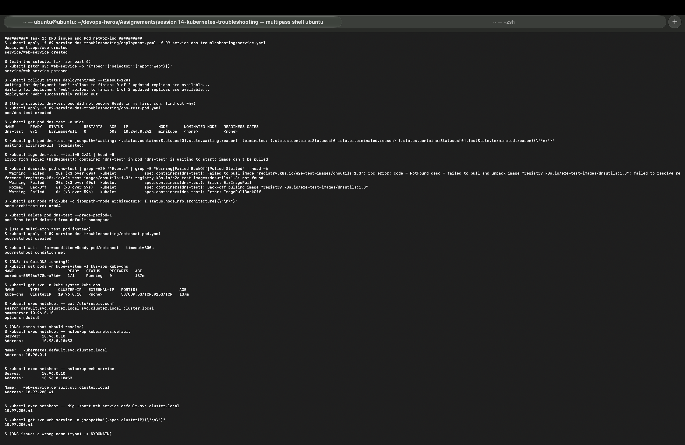
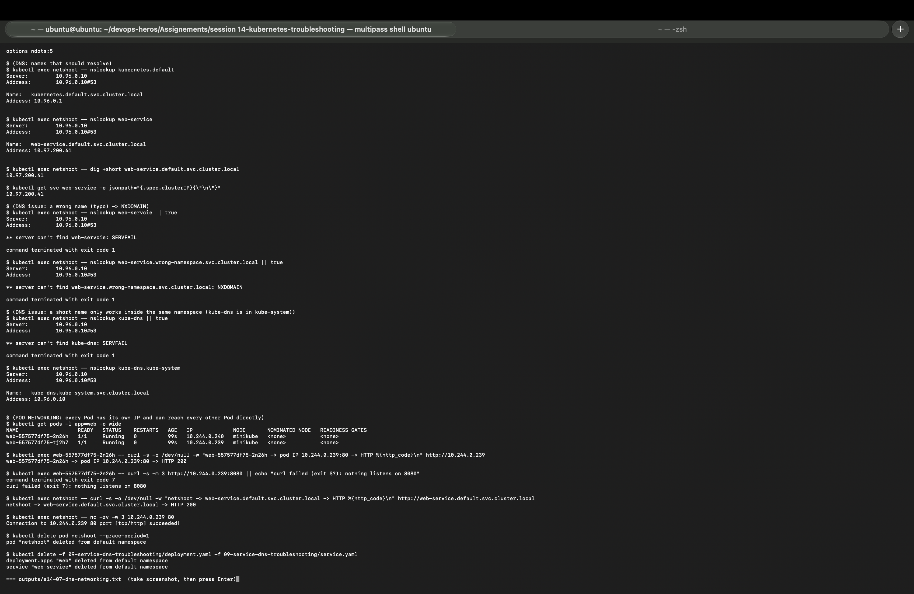

**A real problem I hit first: the instructor's `dns-test` pod never became Ready**

| Step | What I did and saw |
|---|---|
| **Identify** | In my first run `kubectl wait` on `dns-test` timed out. On the re-run: `dns-test 0/1 ErrImagePull` after 60 s. |
| **Investigate** | `kubectl logs` → `container "dns-test" ... is waiting to start: image can't be pulled`. Events: `Failed to pull image "registry.k8s.io/e2e-test-images/dnsutils:1.3" ... not found (x3 over 60s)`, then `ImagePullBackOff`. |
| **Root cause** | The tag `dnsutils:1.3` does not exist in `registry.k8s.io` ("not found", not "no matching manifest for arm64"). So it is a wrong tag, not an architecture problem, even though my node is arm64. |
| **Fix** | I used my own [`netshoot-pod.yaml`](09-service-dns-troubleshooting/netshoot-pod.yaml) (`nicolaka/netshoot:v0.13`, multi-arch, has `nslookup`, `dig`, `curl`, `nc`). |
| **Verify** | `pod/netshoot condition met`, all tests below ran from it. |

**DNS checks**

| Check | Command | Result |
|---|---|---|
| Is CoreDNS running? | `kubectl get pods -n kube-system -l k8s-app=kube-dns` | `coredns-559f6c778d-x7k6w 1/1 Running` |
| DNS Service | `kubectl get svc -n kube-system kube-dns` | ClusterIP `10.96.0.10`, 53/UDP, 53/TCP |
| Pod DNS config | `cat /etc/resolv.conf` | nameserver `10.96.0.10`, search `default.svc.cluster.local ...`, `ndots:5` |
| API service | `nslookup kubernetes.default` | `kubernetes.default.svc.cluster.local` → `10.96.0.1` |
| My Service | `nslookup web-service` and `dig +short web-service.default.svc.cluster.local` | both `10.97.200.41`, same as `kubectl get svc web-service` ClusterIP |
| Typo in the name | `nslookup web-servcie` | `server can't find web-servcie: SERVFAIL` |
| Wrong namespace (full name) | `nslookup web-service.wrong-namespace.svc.cluster.local` | `NXDOMAIN` |
| Short name of a Service in another namespace | `nslookup kube-dns` | `SERVFAIL` |
| Same with the namespace | `nslookup kube-dns.kube-system` | `kube-dns.kube-system.svc.cluster.local` → `10.96.0.10` |

What I learned from the DNS results:
* A short name like `web-service` works only from the **same namespace**, because the search list adds `default.svc.cluster.local`. For a Service in another namespace I must use `<service>.<namespace>` or the full `<service>.<namespace>.svc.cluster.local`.
* A full name that does not exist returns a clean `NXDOMAIN`. On my cluster the short wrong names returned `SERVFAIL` instead: the resolver tries every search domain and the last one is forwarded to the upstream DNS of the VM, which fails. Either way the answer is "this name does not exist".

**Pod networking checks**

| Check | Result |
|---|---|
| Pod to pod by IP: `web-...-2n26h` → `http://10.244.0.239` | `HTTP 200` |
| Pod to a port nobody listens on: `10.244.0.239:8080` | `exit 7: nothing listens on 8080` |
| Pod to Service by full DNS name: `http://web-service.default.svc.cluster.local` | `HTTP 200` |
| TCP port test: `nc -zv -w 3 10.244.0.239 80` | `Connection to 10.244.0.239 80 port [tcp/http] succeeded!` |

So the Pod network was healthy: every pod can reach every other pod IP directly, and failures are about wrong ports or names, not the network.

---

## Extra: Triage gauntlet (5 broken pods)

Output: [`outputs/s14-08-triage-gauntlet.txt`](outputs/s14-08-triage-gauntlet.txt)

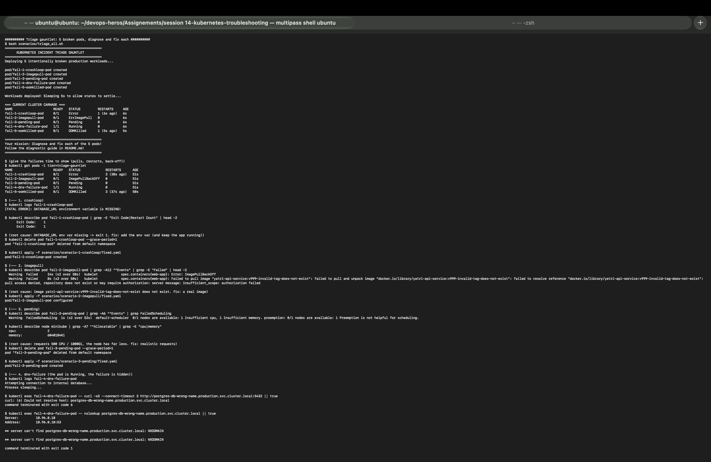
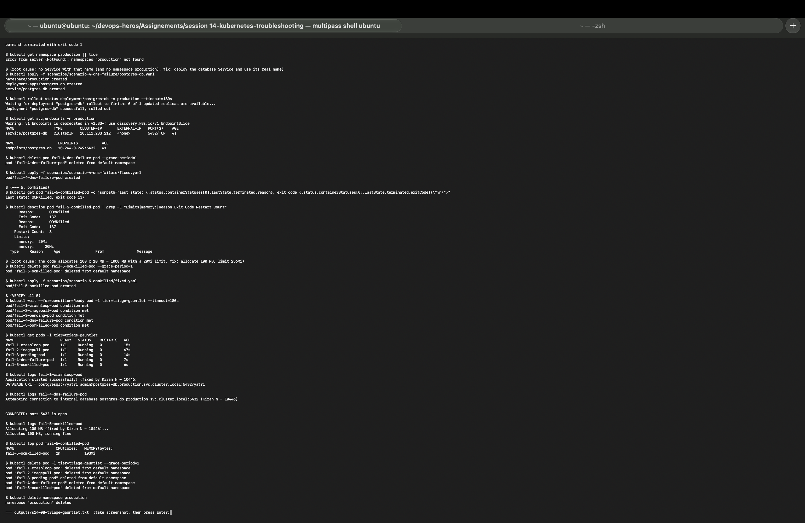

`bash scenarios/triage_all.sh` deployed 5 broken pods. After about 50 s:

```
fail-1-crashloop-pod     0/1     Error              3 (38s ago)
fail-2-imagepull-pod     0/1     ImagePullBackOff   0
fail-3-pending-pod       0/1     Pending            0
fail-4-dns-failure-pod   1/1     Running            0        <- looks fine, but is broken
fail-5-oomkilled-pod     0/1     OOMKilled          3 (37s ago)
```

| # | Status | Command that found it | Evidence | Root cause | My fix |
|---|---|---|---|---|---|
| 1 | Error / restarts | `kubectl logs` | `[FATAL ERROR]: DATABASE_URL environment variable is MISSING!`, Exit Code 1 | Required env var not set | [`fixed.yaml`](scenarios/scenario-1-crashloop/fixed.yaml): add `DATABASE_URL`, keep the app running |
| 2 | ImagePullBackOff | `kubectl describe` (Events) | `yatri-api-service:v999-invalid-tag-does-not-exist ... pull access denied, repository does not exist` | Image repository/tag does not exist | [`fixed.yaml`](scenarios/scenario-2-imagepull/fixed.yaml): `nginx:1.27` (applied in place: `configured`) |
| 3 | Pending | `kubectl describe pod` + `describe node` | `0/1 nodes are available: 1 Insufficient cpu, 1 Insufficient memory`; node allocatable `cpu: 2`, `memory: 6040184Ki` | Requests of `500` CPUs and `1000Gi` memory | [`fixed.yaml`](scenarios/scenario-3-pending/fixed.yaml): requests 100m/128Mi, limits 250m/256Mi |
| 4 | Running (hidden) | `kubectl exec ... curl` / `nslookup` | `curl: (6) Could not resolve host: postgres-db-wrong-name.production.svc.cluster.local`, `NXDOMAIN`, `namespaces "production" not found` | Wrong Service name, and the database did not exist | [`postgres-db.yaml`](scenarios/scenario-4-dns-failure/postgres-db.yaml) (namespace `production`, ClusterIP 10.111.233.212, endpoint 10.244.0.249:5432) + [`fixed.yaml`](scenarios/scenario-4-dns-failure/fixed.yaml) using `postgres-db.production.svc.cluster.local` |
| 5 | OOMKilled | `kubectl get ... lastState` + `describe` | `last state: OOMKilled, exit code 137`, `Limits: memory: 20Mi`, Restart Count 3 | Code allocates 100 x 10 MB with a 20Mi limit | [`fixed.yaml`](scenarios/scenario-5-oomkilled/fixed.yaml): allocate 100 MB, limit 256Mi, request 128Mi |

**Verify:** all 5 `condition met`, then `1/1 Running 0` restarts.

```
fail-1: Application started successfully! (fixed by Kiran N - 10446)
        DATABASE_URL = postgresql://yatri_admin@postgres-db.production.svc.cluster.local:5432/yatri
fail-4: Attempting connection to internal database postgres-db.production.svc.cluster.local:5432 (Kiran N - 10446)
        CONNECTED: port 5432 is open
fail-5: Allocated 100 MB, running fine      (kubectl top: 2m CPU, 103Mi memory, under the 256Mi limit)
```

Lesson from scenario 4: `Running` does not mean healthy. The status only says the process is alive; I had to `exec` into the pod to see that the app could not reach its database. Lesson from scenario 5: exit code **137** = 128 + 9 (SIGKILL), the kernel killed the process for using more memory than its limit.

---

## Task 3: Mini project (troubleshooting challenge)

Output: [`outputs/s14-09-mini-project.txt`](outputs/s14-09-mini-project.txt)

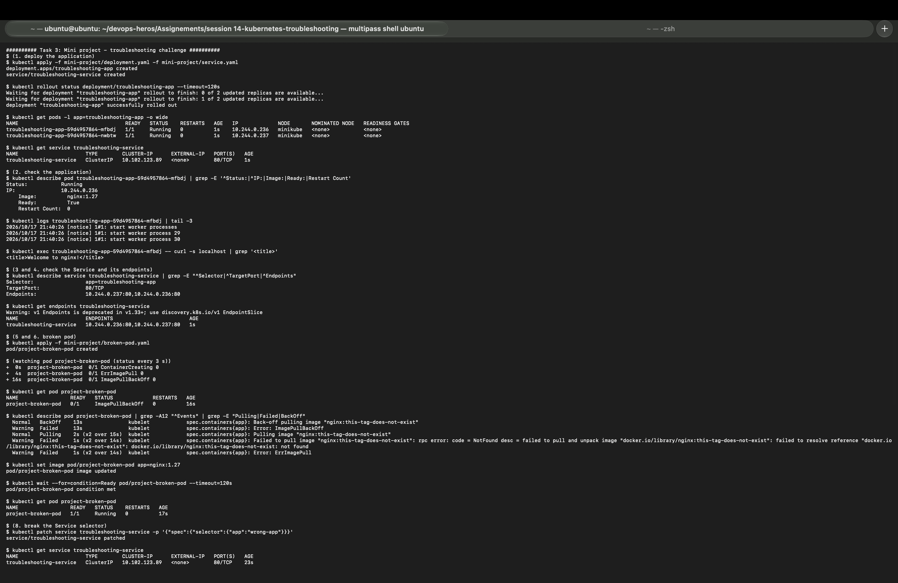
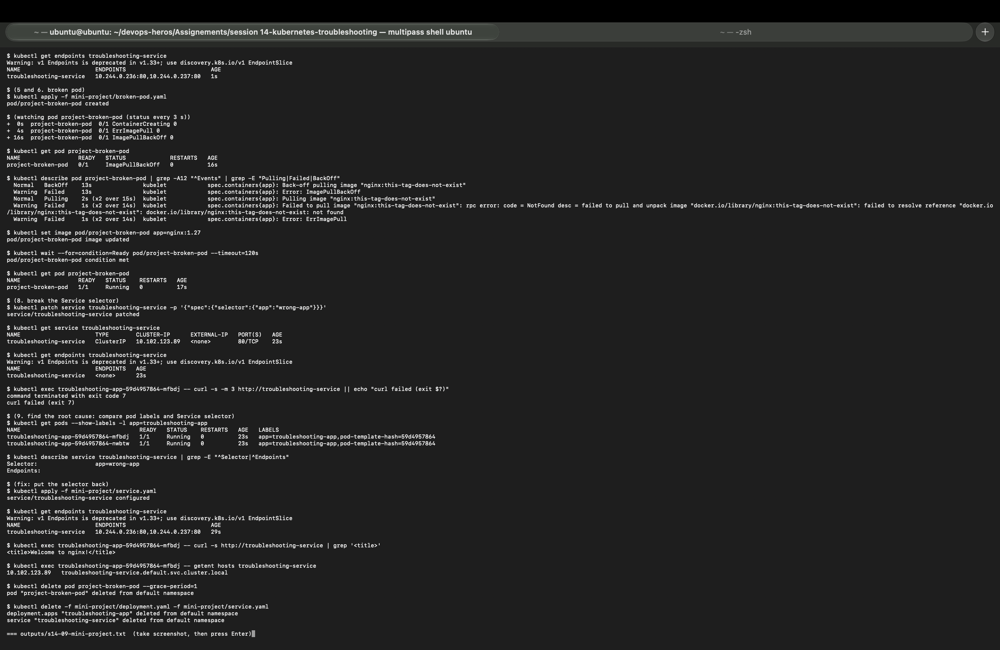

**1-4. Deploy and check the application**
* `troubleshooting-app` rolled out with 2 pods: 10.244.0.236 and 10.244.0.237, image `nginx:1.27`, Ready True, 0 restarts.
* `curl localhost` inside a pod → `<title>Welcome to nginx!</title>`. Logs show nginx `start worker processes`.
* `troubleshooting-service` ClusterIP `10.102.123.89`, `Selector: app=troubleshooting-app`, `TargetPort: 80/TCP`, endpoints `10.244.0.236:80,10.244.0.237:80`.

**5-6. Broken pod**: `project-broken-pod` went `ContainerCreating` → `ErrImagePull` (4 s) → `ImagePullBackOff` (16 s). I did not touch the YAML first; I ran `get` and `describe` and read the Events.

### 7. Answers for the broken Pod

**Question 1: What is the Pod status?**
*Answer:* `0/1 ImagePullBackOff` (it showed `ErrImagePull` at 4 s first). The container never started, so READY is 0/1 and RESTARTS is 0.

**Question 2: What is the actual error?**
*Answer:* `Failed to pull image "nginx:this-tag-does-not-exist": rpc error: code = NotFound desc = ... docker.io/library/nginx:this-tag-does-not-exist: not found`, followed by `Back-off pulling image`.

**Question 3: Which command helped you find the reason?**
*Answer:* `kubectl describe pod project-broken-pod`, in the **Events** section at the bottom. `kubectl get pod` only told me the status, and `kubectl logs` cannot help because no container ever ran.

**Question 4: What is wrong with the image?**
*Answer:* The repository `nginx` is fine, but the tag `this-tag-does-not-exist` is not published on Docker Hub, so the registry answers "not found".

**Question 5: How would you fix it?**
*Answer:* Use a real tag. I ran `kubectl set image pod/project-broken-pod app=nginx:1.27` (the image field can be changed on a live pod), and the pod became `1/1 Running 0`. The permanent fix is to change `image:` in `broken-pod.yaml` to `nginx:1.27` so the next apply is correct too.

**8. Service selector challenge**: I patched the selector to `app: wrong-app`. The ClusterIP `10.102.123.89` stayed, but `kubectl get endpoints troubleshooting-service` → `<none>` and `curl http://troubleshooting-service` → `exit 7`.

**9. Root cause**: `kubectl get pods --show-labels` → pods have `app=troubleshooting-app`; `kubectl describe service` → `Selector: app=wrong-app`, `Endpoints:` empty. Mismatch found. `kubectl apply -f mini-project/service.yaml` put the selector back: endpoints `10.244.0.236:80,10.244.0.237:80`, curl → `Welcome to nginx!`, and `getent hosts troubleshooting-service` → `10.102.123.89 troubleshooting-service.default.svc.cluster.local` (DNS works too).

### 11. Troubleshooting table

| Problem | What I Saw | Command I Used | Root Cause | Fix |
| :--- | :--- | :--- | :--- | :--- |
| **Broken Pod** | `project-broken-pod 0/1 ImagePullBackOff`, 0 restarts, container never started | `kubectl get pod project-broken-pod`, `kubectl describe pod project-broken-pod` (Events) | The pod points to an image that cannot be pulled, so the kubelet keeps backing off | `kubectl set image pod/project-broken-pod app=nginx:1.27` → `1/1 Running` |
| **Service Problem** | Pods Running, but `curl http://troubleshooting-service` → exit 7, endpoints `<none>` | `kubectl get endpoints troubleshooting-service`, `kubectl get pods --show-labels`, `kubectl describe service troubleshooting-service` | Selector `app=wrong-app` does not match pod label `app=troubleshooting-app` | `kubectl apply -f mini-project/service.yaml` (selector `app: troubleshooting-app`) → endpoints .236:80, .237:80, curl OK |
| **Image Problem** | `Failed to pull image "nginx:this-tag-does-not-exist" ... not found`, `ErrImagePull` then `ImagePullBackOff` | `kubectl describe pod` (Events) | Tag `this-tag-does-not-exist` is not on Docker Hub | Use an existing tag `nginx:1.27` (and fix the YAML) |

### 12. README questions

1. **What does `kubectl get` tell us?**
   A quick list of objects and their current state: for pods READY, STATUS, RESTARTS and AGE, and with `-o wide` the IP and node. It answers "what exists and is it healthy" and is always my first command.

2. **What is the difference between `get` and `describe`?**
   `get` is a one-line summary per object. `describe` shows one object in detail: configuration (image, ports, selector, nodeSelector, limits), container state with exit codes and reasons, conditions, and the **Events**, which usually contain the actual reason (FailedScheduling, FailedMount, Failed to pull image, BackOff).

3. **Why do we use `kubectl logs`?**
   To read what the application printed. When the container ran but failed, the logs show why, e.g. `[FATAL ERROR]: DATABASE_URL environment variable is MISSING!`. `--previous` reads the last crashed container, `--tail` and `--timestamps` trim and time-stamp the output. Logs are empty when the container never started (ImagePullBackOff, Pending).

4. **When would you use `kubectl exec`?**
   When I need to test from inside the cluster: `curl` a Service or another pod, `nslookup` a name, `nc -z` a port, read `/etc/resolv.conf` or a mounted file. In the gauntlet the DNS pod was `Running`; only `exec` showed `Could not resolve host`.

5. **What does `CrashLoopBackOff` mean?**
   The container starts, exits (crashes), gets restarted, crashes again, and the kubelet waits longer before each new restart (10 s, 20 s, 40 s ... max 5 min). The cause is in the app or its config (exit 1, missing env var, wrong command). On my k8s 1.37 cluster the STATUS often showed `Error` between restarts, but the growing restart count and the `Back-off restarting failed container` event are the sign.

6. **What does `ImagePullBackOff` mean?**
   The kubelet could not pull the image (`ErrImagePull`) and is now waiting before retrying. Causes: wrong tag, wrong repository name, private registry without credentials, or no network to the registry. The exact reason is in the Events.

7. **Why can a Pod remain `Pending`?**
   The scheduler cannot find a node for it: the requested CPU/memory is more than any node has (`Insufficient cpu, Insufficient memory`), a nodeSelector/affinity matches no node (`didn't match Pod's node affinity/selector`), taints without tolerations, or a PVC that is not bound. The `FailedScheduling` event says which one.

8. **Why can a Service have no endpoints?**
   Because no Ready pod has labels that match the Service selector: a typo in the selector or label (my `app=web-ahsgdf` and `app=wrong-app` cases), pods in another namespace, or pods that are not Ready (failing readiness probe). Also, endpoints that exist can still fail if `targetPort` is wrong, as my 8080 test showed.

9. **What is the relationship between a Service selector and Pod labels?**
   The Service picks its backend pods only by labels. Every Ready pod whose labels contain all the key=value pairs of the selector becomes an endpoint. Change the selector or the labels so they no longer match, and the endpoints disappear immediately even though the pods keep running.

10. **What is Kubernetes DNS?**
    CoreDNS, running in `kube-system` behind the `kube-dns` Service (10.96.0.10 on my cluster). Every pod has it as its nameserver, and every Service gets a name `<service>.<namespace>.svc.cluster.local` that resolves to its ClusterIP (`web-service` → 10.97.200.41, `troubleshooting-service` → 10.102.123.89). Inside the same namespace the short name works thanks to the search list.

### 13. Final architecture (what I ended with)

```
                    Kubernetes Cluster (minikube)
                              │
                              ▼
               ┌──────────────────────────────┐
               │   troubleshooting-service    │
               │   ClusterIP 10.102.123.89:80 │
               └──────────────┬───────────────┘
                              │ selector app=troubleshooting-app
               ┌──────────────┴───────────────┐
               ▼                              ▼
       Pod 10.244.0.236:80            Pod 10.244.0.237:80
               │                              │
               └────────── nginx:1.27 ────────┘

   + project-broken-pod (fixed to nginx:1.27, Running)
```

---

## Commands I used

```bash
# look
kubectl get pods -o wide
kubectl get pods --show-labels
kubectl get pod <pod> -o jsonpath='{.status.containerStatuses[0].lastState.terminated.reason}'
kubectl describe pod <pod>
kubectl events --for pod/<pod>
kubectl get events --sort-by=.lastTimestamp
kubectl logs <pod> [--previous] [--tail=N --timestamps]
kubectl top nodes / kubectl top pods
kubectl explain <resource.field>

# inside the cluster
kubectl exec <pod> -- curl -s http://<service>
kubectl exec <pod> -- nslookup <service>.<namespace>
kubectl exec <pod> -- nc -zv <ip> <port>

# services
kubectl get endpoints <service>
kubectl describe service <service>
kubectl patch svc <service> -p '{"spec":{"selector":{"app":"web"}}}'

# fixes
kubectl set image pod/<pod> <container>=<image>
kubectl create configmap / kubectl create secret generic
kubectl delete pod <pod> && kubectl apply -f fixed.yaml
```

## What I learned

* Never guess. `get` shows the symptom, `describe` and Events usually show the reason, `logs` show the app's own error, and `exec` tests the network from inside.
* The STATUS word tells me where to look: `Pending` = scheduler (describe pod/node), `ContainerCreating` / `CreateContainerConfigError` = kubelet setup (missing ConfigMap, Secret, volume), `ErrImagePull` / `ImagePullBackOff` = image name or registry, `Error` / `CrashLoopBackOff` = the application (logs), `OOMKilled` (137) = memory limit.
* Some fields can be fixed in place (image, Service selector and ports); others (command, env, nodeSelector, resources) need the pod deleted and re-created, which is why real apps use Deployments.
* A Service with no endpoints is almost always a label/selector mismatch; a Service with endpoints that still fails is often a wrong targetPort.
* DNS short names only work inside the same namespace; use `<svc>.<ns>.svc.cluster.local` across namespaces.
* `Running` is not the same as working: the DNS scenario was Running the whole time.
* Even the course files can break: the instructor's `dnsutils:1.3` image tag does not exist, and I diagnosed it with the same steps (describe → Events → "not found") and worked around it with netshoot.
