# Session 15: Helm

| | |
|---|---|
| **Name** | Kiran N |
| **Roll No.** | 10446 |
| **Session** | 15: Helm, the package manager for Kubernetes |
| **Environment** | Multipass Ubuntu VM (arm64) on Mac, Minikube v1.39.0, Kubernetes v1.37.0, **Helm v3.22.1** (installed by the official `get-helm-3` script) |

All outputs below come from my own run of [`session15_lab.sh`](session15_lab.sh). Full text outputs are in [`outputs/`](outputs/) and screenshots are in [`screenshots/`](screenshots/). My name is in the values I passed to the releases (podinfo message, guestbook ConfigMap, Notes app `APP_NAME`), so it shows up inside the running applications.

---

## Homework tasks

| # | Task | Where |
|---|------|-------|
| 1 | Helm commands: `create`, `install`, `list`, `status`, `get`, `upgrade`, `history`, `rollback`, `uninstall`, `repo`, `search` | [Task 1](#task-1-helm-commands) |
| 2 | Rollback workflow: install → upgrade → verify → upgrade again → verify → rollback → verify | [Task 2](#task-2-helm-rollback-workflow) |
| 3 | Mini project: package and deploy the Notes app with Helm | [Task 3](#task-3-mini-project-notes-app) |
| Extra | Chart structure, Chart.yaml, values, templates, and the guestbook application | [Chart basics](#chart-structure-values-and-templates), [Guestbook](#extra-deploying-an-application-guestbook-chart) |

---

## Folder structure

```
session 15-helm/
├── resultReadme.md               # this file
├── README.md                     # instructor notes
├── session15_lab.sh              # script I ran: bash session15_lab.sh  (or some parts: bash session15_lab.sh 4 7)
├── 01-what-is-helm/              # notes
├── 02-helm-charts/               # demo-chart and myapp (charts made with helm create)
├── 03-chart-structure/           # simple-chart: the minimum chart
├── 04-chart-yaml/                # Chart.yaml fields
├── 05-values-yaml/               # my-app chart + values.yaml / values-prod.yaml
├── 06-templates/                 # template-demo: .Release, .Values, if block
├── 07-install-upgrade/           # app-chart used for install/upgrade and for Task 2
├── 08-rollback/                  # notes
├── 09-deploying-application/     # guestbook-chart (Deployment + Service + ConfigMap)
├── mini-project/notes-chart/     # Task 3: Chart.yaml, values.yaml, values-prod.yaml, templates/
├── outputs/                      # s15-01 ... s15-07 text outputs
└── screenshots/                  # s15-01 ... s15-07 screenshots
```

How I ran it inside the VM:

```bash
cd ~/devops-heros/Assignements/"session 15-helm"
bash session15_lab.sh          # all 7 parts (installs Helm first if missing)
bash session15_lab.sh 4 7      # re-run only some parts
```

**Three words to know**

| Word | Meaning | In my run |
|---|---|---|
| **Chart** | A package of Kubernetes YAML templates + default values (the recipe) | `notes-chart`, `app-chart`, `kiran-app` |
| **Values** | The variables passed to the templates (the ingredients) | `values.yaml`, `values-prod.yaml`, `--set image.tag=1.27` |
| **Release** | One installed copy of a chart in the cluster, with numbered revisions (the cooked meal) | `notes-dev`, `rollback-demo`, `kiran-app` |

Helm 3 has no Tiller: the `helm` client talks to the API server with my kubeconfig and stores every revision of a release as a Secret (`sh.helm.release.v1.<name>.v<N>`).

---

## Task 1: Helm commands

### helm create, lint, template

Output: [`outputs/s15-01-helm-create.txt`](outputs/s15-01-helm-create.txt)

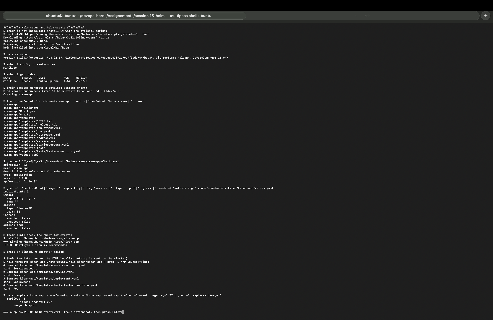

| Command | What it does | My result |
|---|---|---|
| `curl ... get-helm-3 \| bash` | Installs the Helm binary | `helm installed into /usr/local/bin/helm` |
| `helm version` | Shows the client version | `v3.22.1`, go1.26.9 |
| `helm create kiran-app` | Generates a complete starter chart | `Chart.yaml`, `values.yaml`, `.helmignore`, `charts/`, `templates/` with deployment, service, serviceaccount, ingress, httproute, hpa, `_helpers.tpl`, `NOTES.txt`, `tests/test-connection.yaml` |
| `helm lint <chart>` | Checks the chart for errors and best practices | `1 chart(s) linted, 0 chart(s) failed` (only `[INFO] icon is recommended`) |
| `helm template <name> <chart>` | Renders the YAML locally, sends nothing to the cluster | ServiceAccount, Service, Deployment, test Pod |
| `helm template ... --set replicaCount=3 --set image.tag=1.27` | Same, with overrides | `replicas: 3`, `image: "nginx:1.27"` |

The default `values.yaml` from `helm create` has `image.tag: ""`, so the template falls back to `appVersion` (`1.16.0`). That is why I installed it with `--set image.tag=1.27`.

### install, list, status, get, upgrade, history, rollback, uninstall

Output: [`outputs/s15-03-helm-commands.txt`](outputs/s15-03-helm-commands.txt)

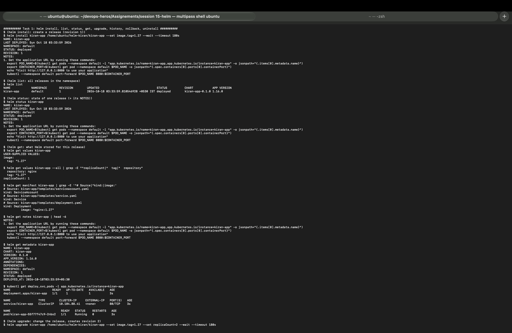
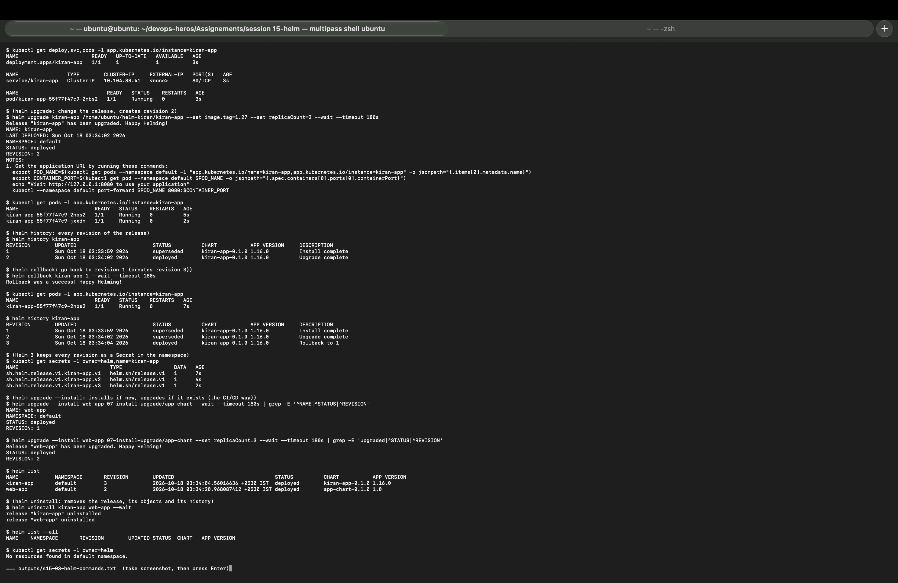

| Command | What it does | My result |
|---|---|---|
| `helm install kiran-app <chart> --set image.tag=1.27 --wait` | Creates a release (revision 1). `--wait` waits until the pods are Ready | `STATUS: deployed`, `REVISION: 1`, plus the chart's NOTES |
| `helm list` | Lists releases in the namespace | `kiran-app  default  1  deployed  kiran-app-0.1.0  1.16.0` |
| `helm status kiran-app` | State of one release, last deploy time, NOTES | `STATUS: deployed`, `REVISION: 1` |
| `helm get values kiran-app` | Only the values I supplied | `image.tag: "1.27"` |
| `helm get values kiran-app --all` | All values (defaults + mine) | `repository: nginx`, `tag: "1.27"`, `replicaCount: 1` |
| `helm get manifest kiran-app` | The exact YAML Helm applied | ServiceAccount, Service, Deployment with `image: "nginx:1.27"` |
| `helm get notes kiran-app` | The NOTES.txt text | the port-forward instructions |
| `helm get metadata kiran-app` | Chart, version, app version, revision, deploy time | `CHART: kiran-app`, `VERSION: 0.1.0`, `APP_VERSION: 1.16.0`, `REVISION: 1` |
| `helm upgrade kiran-app <chart> --set replicaCount=2 ...` | Changes the release, creates revision 2 | `has been upgraded`, `REVISION: 2`, 2 pods Running |
| `helm history kiran-app` | All revisions with status and description | 1 superseded `Install complete`, 2 deployed `Upgrade complete` |
| `helm rollback kiran-app 1` | Re-applies revision 1 as a **new** revision | `Rollback was a success!`, back to 1 pod, history 3 = `Rollback to 1` |
| `kubectl get secrets -l owner=helm,name=kiran-app` | Where Helm 3 stores the history | `sh.helm.release.v1.kiran-app.v1`, `.v2`, `.v3` |
| `helm upgrade --install web-app <chart>` | Installs if the release is new, upgrades if it exists (the CI/CD way) | first call `REVISION: 1`, second call `has been upgraded`, `REVISION: 2` |
| `helm uninstall kiran-app web-app` | Deletes the release, its objects and its history | both `uninstalled`; `helm list --all` empty; no `owner=helm` secrets left |

### helm repo and helm search

Output: [`outputs/s15-04-repo-search.txt`](outputs/s15-04-repo-search.txt)

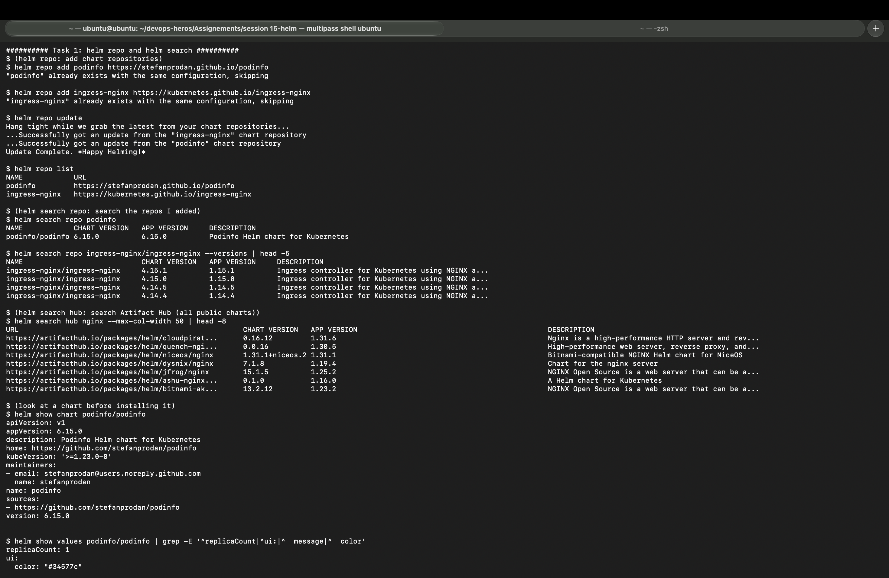
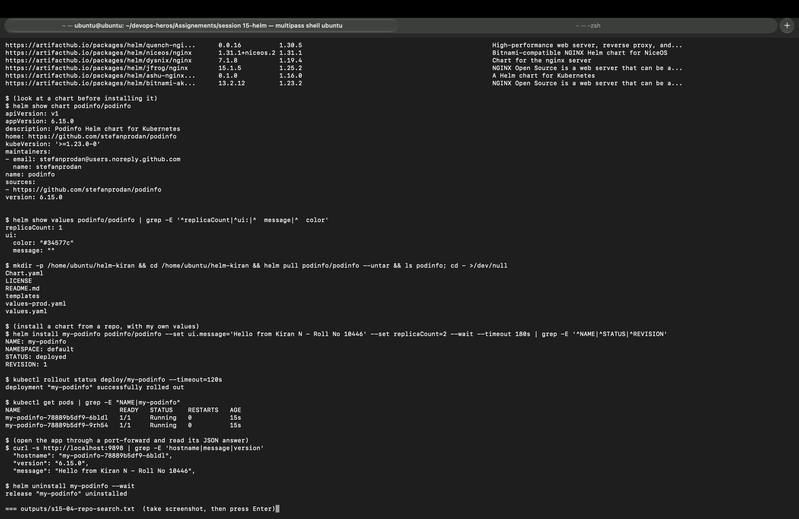

| Command | What it does | My result |
|---|---|---|
| `helm repo add podinfo https://stefanprodan.github.io/podinfo` | Registers a chart repository | `"podinfo" has been added` (on my re-run: `already exists with the same configuration, skipping`) |
| `helm repo add ingress-nginx https://kubernetes.github.io/ingress-nginx` | A second repository | added |
| `helm repo update` | Downloads the latest index of every repo | `Update Complete. ⎈Happy Helming!⎈` |
| `helm repo list` | Shows my repos | `podinfo`, `ingress-nginx` with URLs |
| `helm search repo podinfo` | Searches only my added repos | `podinfo/podinfo 6.15.0 6.15.0` |
| `helm search repo ingress-nginx/ingress-nginx --versions` | All versions of one chart | 4.15.1, 4.15.0, 4.14.5, 4.14.4 ... |
| `helm search hub nginx` | Searches Artifact Hub (all public charts) | cloudpirates, niceos, dysnix, jfrog, bitnami-compatible nginx charts ... |
| `helm show chart podinfo/podinfo` | Chart.yaml of a repo chart | `version: 6.15.0`, `kubeVersion: '>=1.23.0-0'` |
| `helm show values podinfo/podinfo` | Default values I can override | `replicaCount: 1`, `ui.message: ""` |
| `helm pull podinfo/podinfo --untar` | Downloads the chart to read or edit it | `Chart.yaml LICENSE README.md templates values-prod.yaml values.yaml` |
| `helm install my-podinfo podinfo/podinfo --set ui.message=... --set replicaCount=2` | Installs a chart straight from a repo | `deployed`, 2 pods Running |
| `curl http://localhost:9898` (port-forward) | Checks the app | `"hostname": "my-podinfo-78889b5df9-6bldl"`, `"version": "6.15.0"`, **`"message": "Hello from Kiran N - Roll No 10446"`** |

---

## Chart structure, values and templates

Output: [`outputs/s15-02-structure-values-templates.txt`](outputs/s15-02-structure-values-templates.txt)

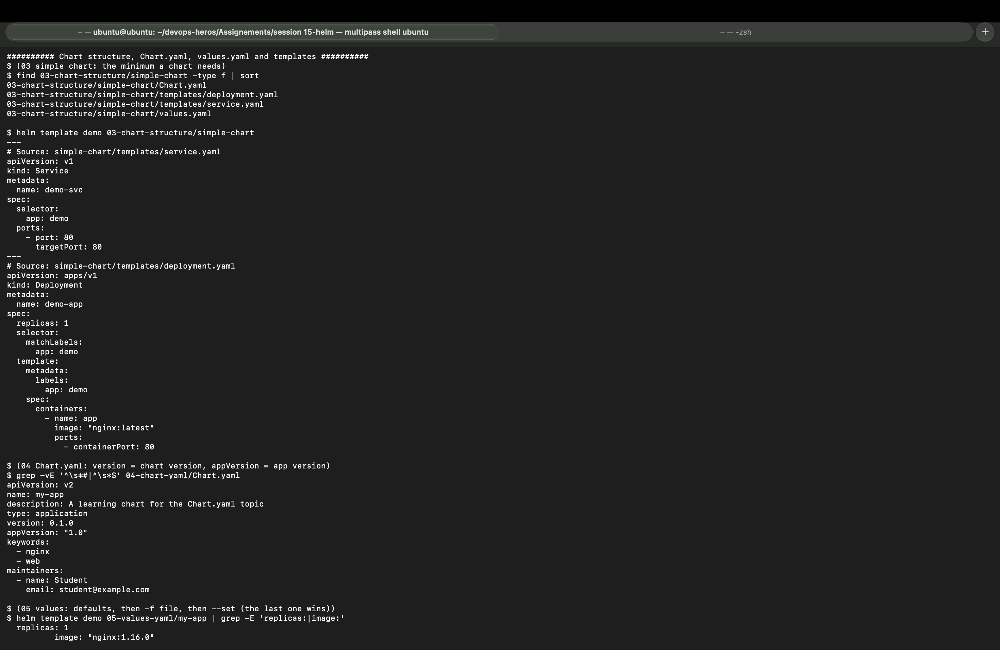
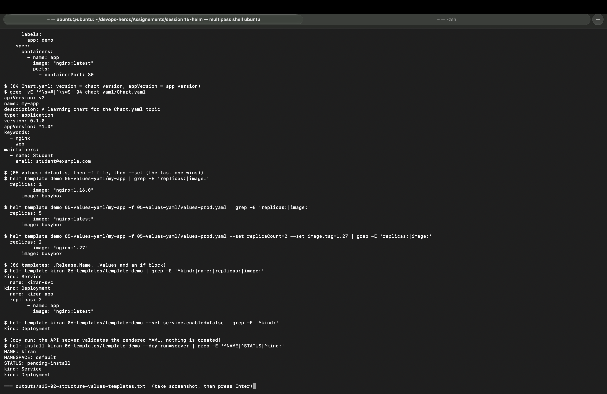

```
simple-chart/
├── Chart.yaml          # name, version (of the chart), appVersion (of the app)
├── values.yaml         # default values
└── templates/          # Kubernetes YAML with {{ }} placeholders
    ├── deployment.yaml
    └── service.yaml
```

* **03 simple chart:** `helm template demo` turned `{{ .Release.Name }}-app` into `demo-app` and `{{ .Release.Name }}-svc` into `demo-svc`.
* **04 Chart.yaml:** `version: 0.1.0` is the chart's own version (bump it when the templates change); `appVersion: "1.0"` is the version of the application inside. Optional fields: `keywords`, `maintainers`.
* **05 values priority** (the last one wins):

  | Command | replicas | image |
  |---|---|---|
  | defaults only | 1 | `nginx:1.16.0` |
  | `-f values-prod.yaml` | 5 | `nginx:latest` |
  | `-f values-prod.yaml --set replicaCount=2 --set image.tag=1.27` | 2 | `nginx:1.27` |

* **06 templates:** with release name `kiran` I got `kiran-svc` and `kiran-app` with 2 replicas. With `--set service.enabled=false`, the `{{- if .Values.service.enabled }}` block removed the Service and only `kind: Deployment` was rendered.
* **Dry run:** `helm install kiran ... --dry-run=server` → `STATUS: pending-install`. The API server validated the Service and Deployment, but nothing was created.

---

## Task 2: Helm rollback workflow

Output: [`outputs/s15-05-rollback-workflow.txt`](outputs/s15-05-rollback-workflow.txt)

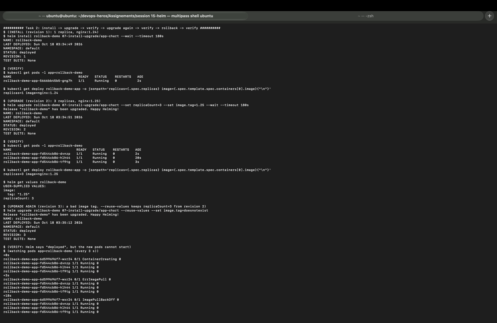
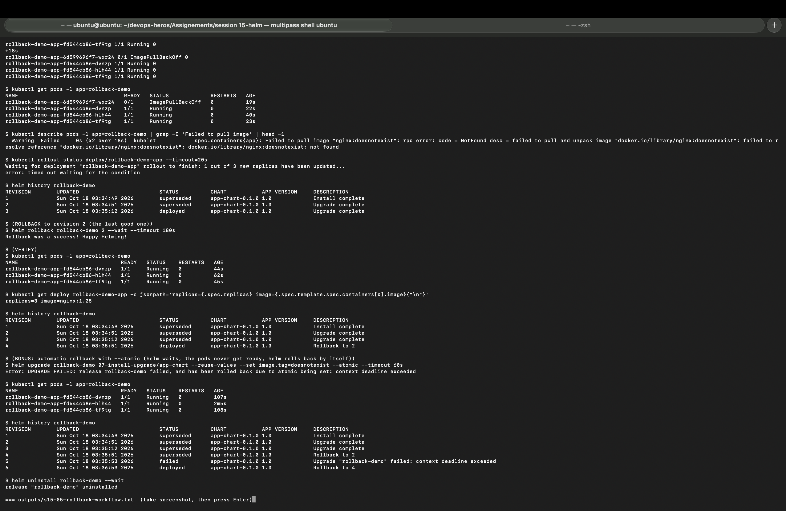

Chart: [`07-install-upgrade/app-chart`](07-install-upgrade/app-chart), release `rollback-demo`.

| Step | Command | Verify (my result) |
|---|---|---|
| **Install** (rev 1) | `helm install rollback-demo 07-install-upgrade/app-chart --wait` | 1 pod Running, `replicas=1 image=nginx:1.24` |
| **Upgrade** (rev 2) | `helm upgrade rollback-demo ... --set replicaCount=3 --set image.tag=1.25 --wait` | 3 pods Running, `replicas=3 image=nginx:1.25`; `helm get values` → `tag: "1.25"`, `replicaCount: 3` |
| **Upgrade again** (rev 3, bad) | `helm upgrade rollback-demo ... --reuse-values --set image.tag=doesnotexist` | Helm said `STATUS: deployed` but the new pod went `ContainerCreating` → `ErrImagePull` (3 s) → `ImagePullBackOff` (18 s); `Failed to pull image "nginx:doesnotexist" ... not found`; `rollout status` → `1 out of 3 new replicas have been updated... timed out` |
| **Rollback** (rev 4) | `helm rollback rollback-demo 2 --wait` | `Rollback was a success!`; 3 pods Running, `replicas=3 image=nginx:1.25`; the broken pod is gone |

History after the rollback:

```
REVISION  STATUS      DESCRIPTION
1         superseded  Install complete
2         superseded  Upgrade complete
3         superseded  Upgrade complete      <- the broken one
4         deployed    Rollback to 2
```

**Bonus: automatic rollback with `--atomic`**

```
$ helm upgrade rollback-demo ... --reuse-values --set image.tag=doesnotexist --atomic --timeout 60s
Error: UPGRADE FAILED: release rollback-demo failed, and has been rolled back due to atomic being set: context deadline exceeded
```

The 3 pods on `nginx:1.25` kept running, and the history got two new lines: `5 failed  Upgrade "rollback-demo" failed: context deadline exceeded` and `6 deployed  Rollback to 4`.

What this showed me:
* **Helm "deployed" does not mean the app is healthy.** Without `--wait`, Helm only checks that Kubernetes accepted the YAML. Revision 3 was "deployed" while its pod was in ImagePullBackOff. With `--wait` or `--atomic`, Helm waits for the pods to be Ready.
* **The app stayed up during the bad upgrade.** The Deployment's rolling update created 1 new pod first (maxSurge) and kept all 3 old pods because the new one never became Ready.
* **A rollback never deletes history.** It copies an old revision into a new revision number (4, and 6 for the automatic one).
* **`--reuse-values` matters.** Without it, an upgrade starts again from the chart defaults plus the new `--set`, so `replicaCount` would have gone back to 1. You can see exactly that in the mini project, step 13.

---

## Extra: Deploying an application (guestbook chart)

Output: [`outputs/s15-06-guestbook.txt`](outputs/s15-06-guestbook.txt)

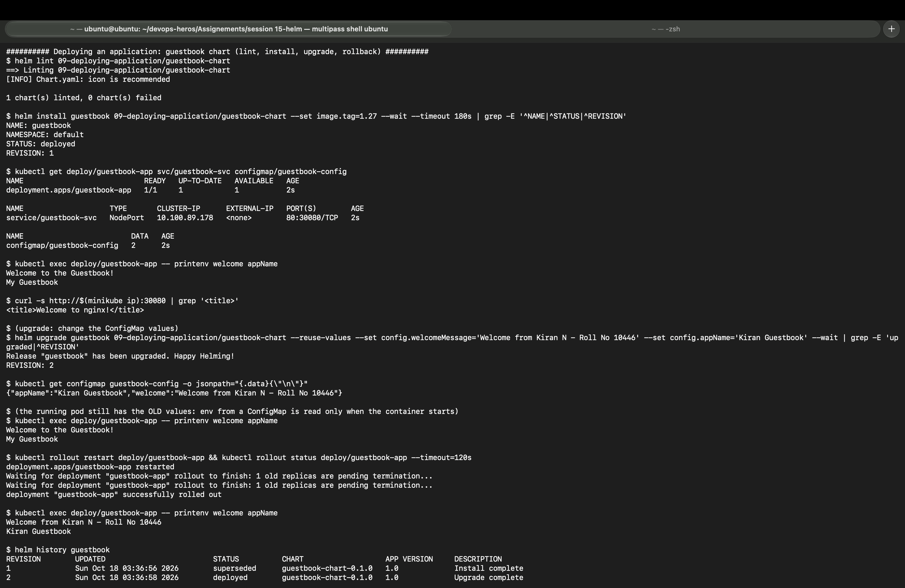
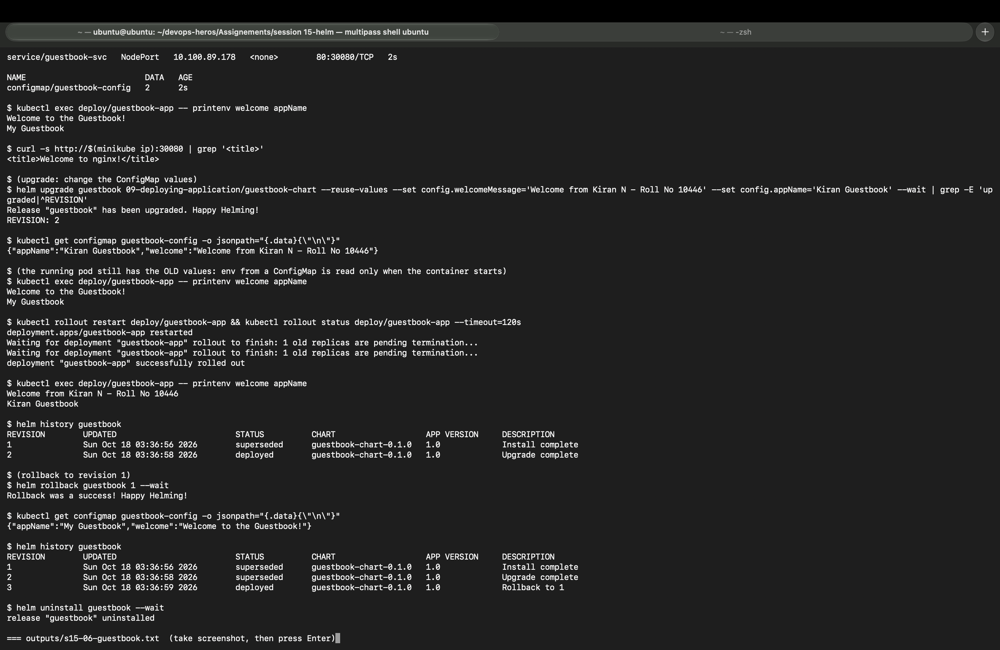

* `helm lint` → 0 failed. `helm install guestbook ... --set image.tag=1.27` → Deployment `guestbook-app` 1/1, Service `guestbook-svc` NodePort `80:30080`, ConfigMap `guestbook-config` with 2 keys.
* Inside the pod: `welcome=Welcome to the Guestbook!`, `appName=My Guestbook`. `curl http://$(minikube ip):30080` → `<title>Welcome to nginx!</title>`.
* **Upgrade (rev 2)** with `config.welcomeMessage='Welcome from Kiran N - Roll No 10446'` and `config.appName='Kiran Guestbook'`. The ConfigMap changed straight away, **but the running pod still printed the old values.** Environment variables from a ConfigMap are read only when the container starts, and the Deployment template did not change, so Kubernetes had no reason to replace the pod.
* After `kubectl rollout restart deploy/guestbook-app`, the new pod printed `Welcome from Kiran N - Roll No 10446` / `Kiran Guestbook`. (A common chart fix is a `checksum/config` annotation on the pod template, so every ConfigMap change rolls the pods automatically.)
* `helm rollback guestbook 1` → ConfigMap back to `My Guestbook` / `Welcome to the Guestbook!`; history 3 = `Rollback to 1`. Then uninstalled.

---

## Task 3: Mini project (Notes app)

Output: [`outputs/s15-07-mini-project.txt`](outputs/s15-07-mini-project.txt)

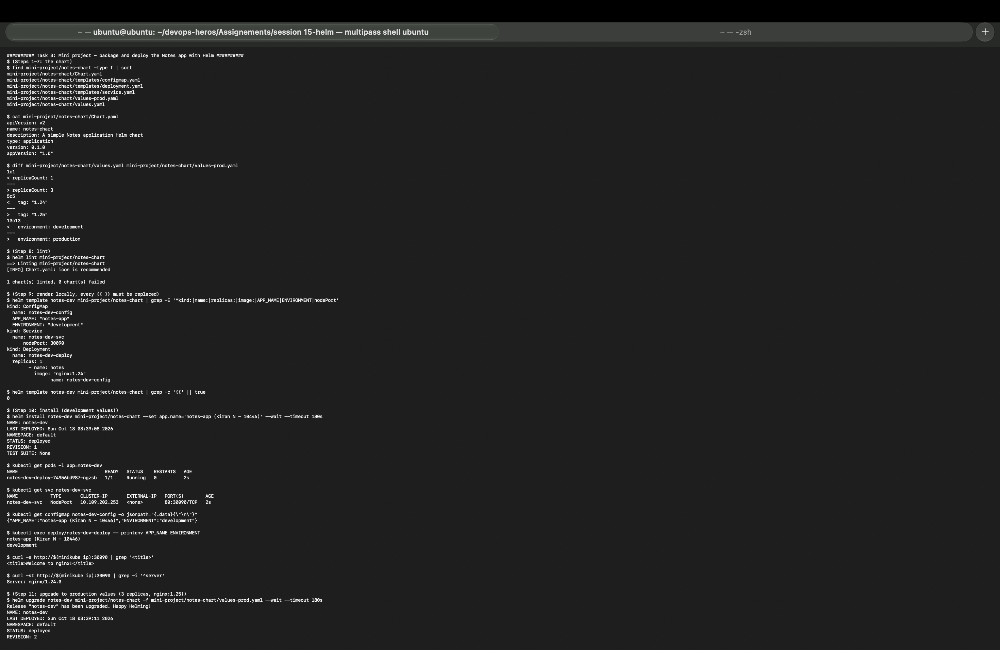
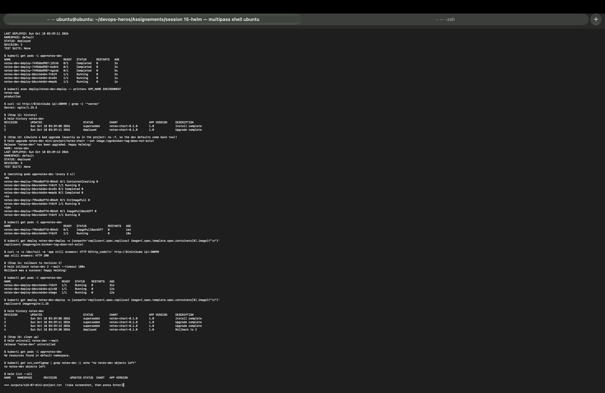

**Steps 1-7: the chart** ([`mini-project/notes-chart`](mini-project/notes-chart))

```
notes-chart/
├── Chart.yaml            # name notes-chart, version 0.1.0, appVersion "1.0"
├── values.yaml           # dev: 1 replica, nginx:1.24, NodePort 30090, environment development
├── values-prod.yaml      # prod: 3 replicas, nginx:1.25, environment production
└── templates/
    ├── configmap.yaml    # <release>-config: APP_NAME, ENVIRONMENT
    ├── deployment.yaml   # <release>-deploy, envFrom the ConfigMap
    └── service.yaml      # <release>-svc, NodePort
```

`diff values.yaml values-prod.yaml` showed exactly three differences: `replicaCount 1 → 3`, `tag "1.24" → "1.25"`, `environment development → production`.

| Step | What I ran | Result |
|---|---|---|
| 8 Lint | `helm lint mini-project/notes-chart` | `1 chart(s) linted, 0 chart(s) failed` |
| 9 Render | `helm template notes-dev mini-project/notes-chart` | ConfigMap `notes-dev-config` (`APP_NAME: "notes-app"`, `ENVIRONMENT: "development"`), Service `notes-dev-svc` nodePort 30090, Deployment `notes-dev-deploy` 1 replica `nginx:1.24`; `grep -c '{{'` → **0** (every placeholder replaced) |
| 10 Install (dev) | `helm install notes-dev ... --set app.name='notes-app (Kiran N - 10446)' --wait` | `REVISION: 1`; 1 pod Running; Service `80:30090/TCP`; ConfigMap and pod env `APP_NAME=notes-app (Kiran N - 10446)`, `ENVIRONMENT=development`; `curl $(minikube ip):30090` → `Welcome to nginx!`, `Server: nginx/1.24.0` |
| 11 Upgrade (prod) | `helm upgrade notes-dev ... -f values-prod.yaml --wait` | `REVISION: 2`; 3 new pods Running (the old pods shown as `Completed` while they shut down); env `notes-app` / `production`; `Server: nginx/1.25.5` |
| 12 History | `helm history notes-dev` | 1 superseded `Install complete`, 2 deployed `Upgrade complete` |
| 13 Bad upgrade | `helm upgrade notes-dev ... --set image.tag=broken-tag-does-not-exist` | `REVISION: 3` "deployed"; new pod `ErrImagePull` (4 s) → `ImagePullBackOff` (16 s); `replicas=1 image=nginx:broken-tag-does-not-exist`; one old pod kept serving: `app still answers: HTTP 200` |
| 14 Rollback | `helm rollback notes-dev 2 --wait` | `Rollback was a success!`; 3 pods Running; `replicas=3 image=nginx:1.25`; history 4 = `Rollback to 2` |
| 15 Clean up | `helm uninstall notes-dev --wait` | pods: `No resources found`; `no notes-dev objects left`; `helm list --all` empty |

Why step 13 also dropped to **1 replica**: the bad upgrade ran without `-f values-prod.yaml` and without `--reuse-values`, so Helm used the chart defaults (`replicaCount: 1`) plus the broken tag. The rollback to revision 2 brought back both the production values and the good image in one command.

**What I practised**

```
[PASS] Created and linted a Helm chart (helm create + notes-chart)
[PASS] Used values.yaml and values-prod.yaml, and overrides with --set
[PASS] Deployed to Kubernetes with helm install and checked it with curl on the NodePort
[PASS] Upgraded the release with production values (1 -> 3 pods, nginx 1.24 -> 1.25)
[PASS] Simulated a bad upgrade (broken image tag)
[PASS] Rolled back to the healthy revision
[PASS] Cleaned up with helm uninstall
```

---

## Interview questions (answered from my run)

**What is Helm?** The package manager for Kubernetes. It packages YAML templates and default values into a chart, which can be installed, upgraded, rolled back and removed with single commands.

**Chart vs Release?** A chart is the template package (`notes-chart`). A release is one installed copy of it (`notes-dev`), with its own revision history.

**values.yaml vs `--set`?** `values.yaml` holds the defaults that live in Git. `-f values-prod.yaml` overrides them per environment, and `--set` overrides single values on the command line (the last one wins). For production, a values file is better because it can be reviewed in Git.

**What does `--atomic` do?** It waits for the upgrade to become ready, and if it doesn't within `--timeout`, it rolls back automatically. My run: revision 5 `failed`, revision 6 `Rollback to 4`.

**`helm upgrade` is stuck in `pending-upgrade`, what do you do?** Look at `helm history`, check the release secrets with `kubectl get secrets -l owner=helm,name=<release>`, then `helm rollback <release> <last good revision>`. If needed, delete the stuck `pending` revision secret first.

---

## Commands I used

```bash
helm version
helm create <chart>
helm lint <chart>
helm template <release> <chart> [-f file] [--set k=v]
helm install <release> <chart> [--set k=v] [-f values-prod.yaml] --wait --timeout 180s
helm install <release> <chart> --dry-run=server
helm list [--all]
helm status <release>
helm get values|manifest|notes|metadata <release> [--all]
helm upgrade <release> <chart> [--reuse-values] [--set k=v] [-f file] [--wait] [--atomic --timeout 60s]
helm upgrade --install <release> <chart>
helm history <release>
helm rollback <release> <revision> --wait
helm uninstall <release> --wait
helm repo add|update|list
helm search repo <word> [--versions]
helm search hub <word>
helm show chart|values <repo/chart>
helm pull <repo/chart> --untar
kubectl get secrets -l owner=helm
```

## What I learned

* One chart plus one values file per environment replaces copies of YAML. `notes-chart` went from dev (1 × nginx 1.24) to prod (3 × nginx 1.25) by changing only the values file.
* `helm template` and `helm lint` catch mistakes before anything touches the cluster, and `--dry-run=server` lets the API server check the result.
* Every install, upgrade and rollback is a numbered revision stored as a Secret, so rolling back is one command and the history is never lost.
* "deployed" in Helm is not the same as healthy. I always add `--wait` (or `--atomic`) and still check the pods.
* Upgrades start from the chart defaults unless I pass the same values file again or use `--reuse-values`.
* Changing a ConfigMap through Helm does not restart pods that read it as env variables. They need a restart or a checksum annotation.
* Public charts (podinfo) are installed the same way as my own; I only change them through values (`ui.message`).
