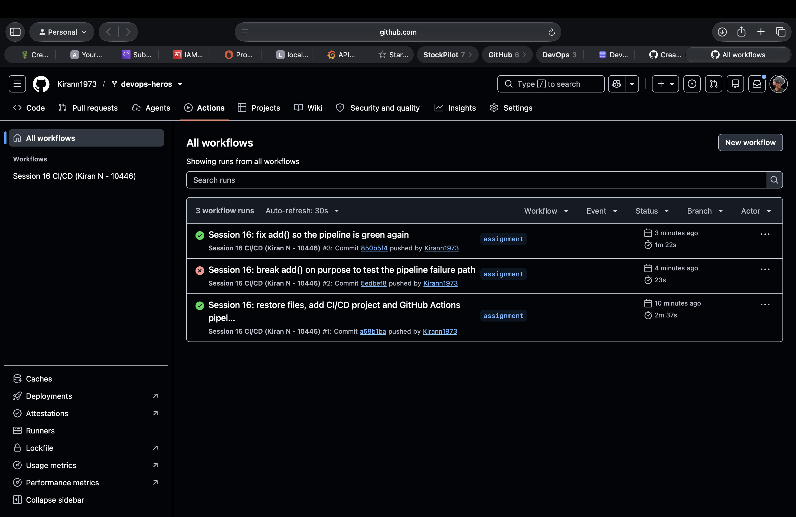
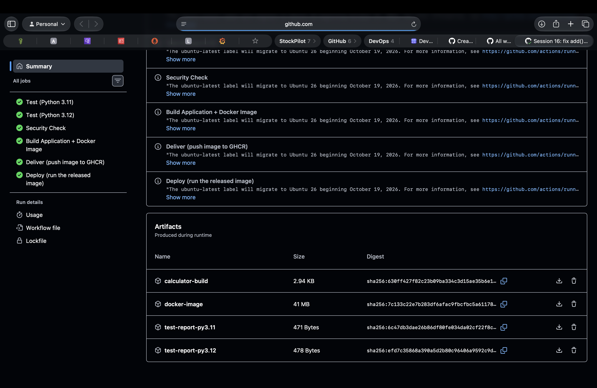
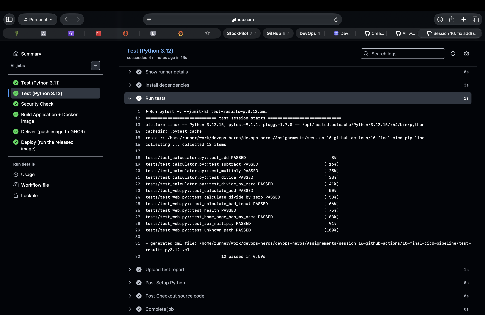
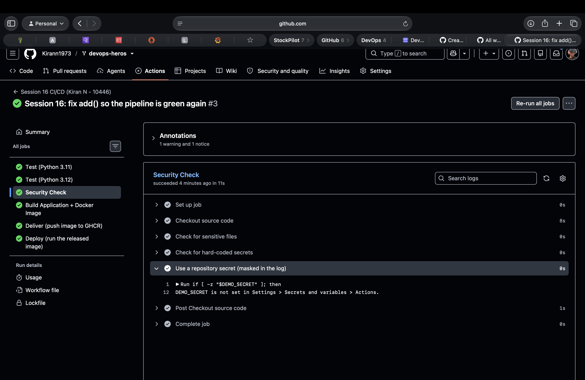
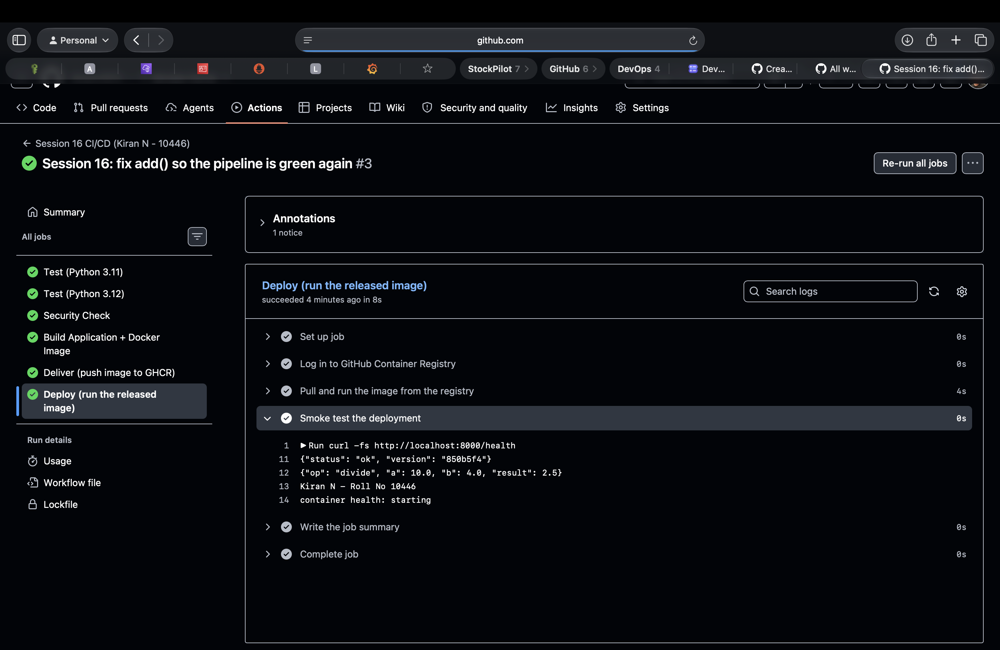
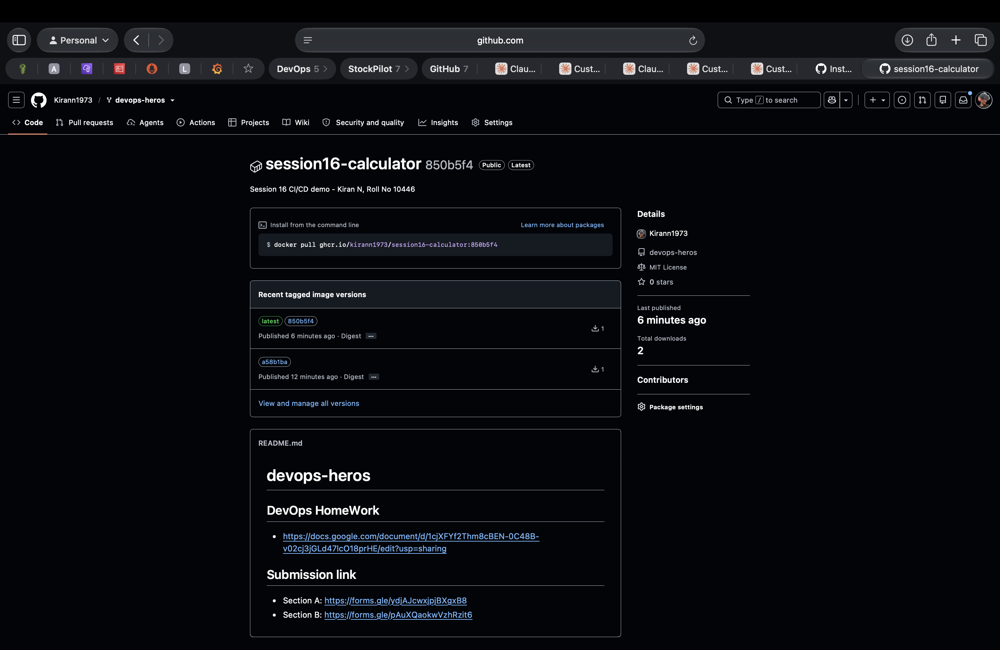
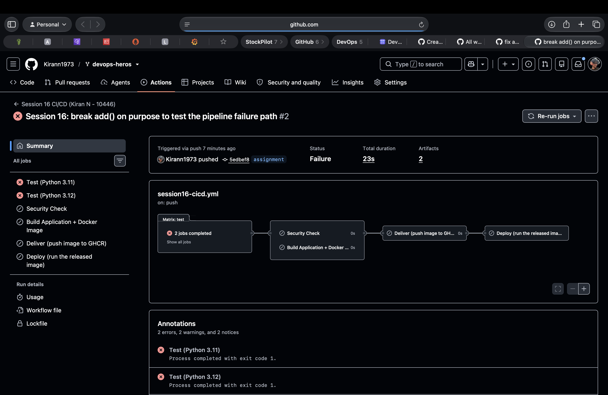

# Session 16: CI/CD and GitHub Actions

| | |
|---|---|
| **Name** | Kiran N |
| **Roll No.** | 10446 |
| **Session** | 16: CI/CD and GitHub Actions |
| **Repository** | [Kirann1973/devops-heros](https://github.com/Kirann1973/devops-heros), branch `assignment` |
| **Pipeline** | [`.github/workflows/session16-cicd.yml`](../../.github/workflows/session16-cicd.yml), name **Session 16 CI/CD (Kiran N - 10446)** |
| **Project** | [`10-final-cicd-pipeline/`](10-final-cicd-pipeline/) |
| **Runs** | [#1 green](https://github.com/Kirann1973/devops-heros/actions/runs/39075092146), [#2 red (failure scenario)](https://github.com/Kirann1973/devops-heros/actions/runs/39075521818), [#3 green (fixed)](https://github.com/Kirann1973/devops-heros/actions/runs/39075571208) |
| **Image** | `ghcr.io/kirann1973/session16-calculator` (tags `latest`, `850b5f4`, `a58b1ba`) |

Everything below ran on real GitHub-hosted runners in my repository. The screenshots are in [`screenshots/`](screenshots/).

---

## Homework task: demo project

> Build a complete CI/CD demo project using GitHub Actions (refer to `10-final-cicd-pipeline`), covering CI vs CD, CI/CD pipeline, GitHub Actions, workflow, jobs, steps, runners, secrets, artifacts, build, test and pipeline execution.

| Deliverable | Where |
|---|---|
| Application source code | [`10-final-cicd-pipeline/app/`](10-final-cicd-pipeline/app/): `calculator.py` (instructor's calculator) + `web.py` (my small web API) |
| Tests | [`10-final-cicd-pipeline/tests/`](10-final-cicd-pipeline/tests/): 12 pytest tests |
| Dockerfile | [`10-final-cicd-pipeline/Dockerfile`](10-final-cicd-pipeline/Dockerfile) |
| GitHub Actions workflow | [`.github/workflows/session16-cicd.yml`](../../.github/workflows/session16-cicd.yml) |
| CI pipeline | jobs `test` (matrix), `security-check`, `build` |
| CD pipeline | jobs `deliver` (push to GHCR) and `deploy` (run the released image) |
| Screenshots of successful execution | [below](#pipeline-execution) |
| Failure and fix | [run #2 and #3](#failure-scenario-and-fix) |

---

## Folder structure

```
devops-heros/
├── .github/workflows/session16-cicd.yml      # the pipeline (GitHub only runs workflows from the repo root)
└── Assignements/session 16-github-actions/
    ├── resultReadme.md                       # this file
    ├── 01-ci-vs-cd ... 09-build-test-pipeline   # instructor topic folders (kept as they are)
    ├── 10-final-cicd-pipeline/               # my demo project
    │   ├── app/
    │   │   ├── __init__.py
    │   │   ├── calculator.py                 # add, subtract, multiply, divide
    │   │   └── web.py                        # /, /health, /api/<op>?a=&b=   (standard library only)
    │   ├── tests/
    │   │   ├── test_calculator.py            # 5 tests (instructor)
    │   │   └── test_web.py                   # 7 tests (mine: API, health, home page has my name, 404)
    │   ├── build.sh                          # packages build/ + build-info.txt
    │   ├── Dockerfile                        # python:3.12-slim, runs as nobody, HEALTHCHECK
    │   ├── requirements.txt                  # pytest
    │   ├── .dockerignore
    │   └── .gitignore
    └── screenshots/                          # s16-01 ... s16-07
```

---

## CI vs CD (in my pipeline)

| | Meaning | My jobs |
|---|---|---|
| **CI**, Continuous Integration | Every push is automatically tested and built, so broken code is caught in minutes | `test` (Python 3.11 + 3.12), `security-check`, `build` |
| **CD**, Continuous Delivery | Every green build becomes a release-ready artifact in a registry | `deliver`: pushes the image to GitHub Container Registry |
| **CD**, Continuous Deployment | The release is deployed automatically and checked | `deploy`: pulls the image from the registry, runs it, smoke-tests it (environment `staging`) |

## The pipeline

```
 git push (branch assignment, files in 10-final-cicd-pipeline/ or the workflow)
        │
        ▼
 ┌────────────────────────────┐
 │ test  (matrix)             │   Python 3.11 ─┐
 │ checkout → setup-python →  │   Python 3.12 ─┤ both must pass
 │ pip install → pytest       │                │
 │ → upload test report       │                │
 └────────────┬───────────────┘                │
        ┌─────┴──────────────┐                 │
        ▼                    ▼
 ┌──────────────┐   ┌────────────────────────────────────┐
 │security-check│   │ build                              │
 │ sensitive    │   │ build.sh → artifact calculator-build│
 │ files, hard- │   │ docker build → run → curl tests     │
 │ coded keys,  │   │ docker save → artifact docker-image │
 │ secret demo  │   └──────────────┬─────────────────────┘
 └──────┬───────┘                  │
        └────────────┬─────────────┘
                     ▼
        ┌─────────────────────────────┐
        │ deliver (CD)                │  not on pull requests
        │ load image → docker login   │  permissions: packages: write
        │ ghcr.io → push :sha, :latest│
        └────────────┬────────────────┘
                     ▼
        ┌─────────────────────────────┐
        │ deploy (CD), env: staging   │
        │ pull from ghcr.io → run →   │
        │ smoke test → job summary    │
        └─────────────────────────────┘
```

**How each GitHub Actions concept is used**

| Concept | In my workflow |
|---|---|
| **Workflow** | One YAML file in `.github/workflows/`, `name: Session 16 CI/CD (Kiran N - 10446)` |
| **Triggers** (`on:`) | `push` to `assignment` with a `paths` filter (only my project or the workflow file), `pull_request`, and `workflow_dispatch` (manual run) |
| **Jobs** | 5 jobs (6 runs, because the test job is a matrix). `needs:` builds the chain: `security-check` and `build` need `test`; `deliver` needs both; `deploy` needs `deliver` |
| **Steps** | `uses:` for ready-made actions (`actions/checkout@v6`, `actions/setup-python@v6`, `actions/upload-artifact@v6`, `actions/download-artifact@v7`) and `run:` for shell commands |
| **Runners** | `runs-on: ubuntu-latest`. Every job gets a fresh GitHub-hosted VM, which is why the image is passed between jobs as an artifact |
| **Matrix** | `python-version: ["3.11", "3.12"]` with `fail-fast: false`, so the same tests run on two Python versions in parallel |
| **Secrets** | `secrets.GITHUB_TOKEN` (created automatically for every run) logs in to `ghcr.io`; `secrets.DEMO_SECRET` shows how a repository secret is read and masked |
| **Permissions** | Workflow default `contents: read`; only `deliver` gets `packages: write` (least privilege) |
| **Artifacts** | `test-report-py3.11`, `test-report-py3.12` (JUnit XML), `calculator-build`, `docker-image` (kept 3 days) |
| **Outputs** | `deliver` exports `image=ghcr.io/kirann1973/session16-calculator:<sha>`, which `deploy` reads with `needs.deliver.outputs.image` |
| **Conditions** | `if: always()` uploads the test report even when tests fail; `if: github.event_name != 'pull_request'` keeps PRs from publishing images |
| **Environment** | `deploy` runs in the `staging` environment (appears under *Deployments*) |
| **Job summary** | `deploy` writes a Markdown table to `$GITHUB_STEP_SUMMARY` |

---

## Pipeline execution

### All runs



| Run | Commit | Message | Result | Duration |
|---|---|---|---|---|
| #1 | `a58b1ba` | Session 16: restore files, add CI/CD project and GitHub Actions pipeline | ✅ success | 2m 37s |
| #2 | `5edbef8` | Session 16: break add() on purpose to test the pipeline failure path | ❌ failure | 23s |
| #3 | `850b5f4` | Session 16: fix add() so the pipeline is green again | ✅ success | 1m 22s |

All three were pushed by **Kirann1973** to branch `assignment`.

### Run #3: every job green, and the artifacts



| Job | Result | Time |
|---|---|---|
| Test (Python 3.11) | ✅ | 25 s |
| Test (Python 3.12) | ✅ | 16 s |
| Security Check | ✅ | 11 s |
| Build Application + Docker Image | ✅ | 25 s |
| Deliver (push image to GHCR) | ✅ | 15 s |
| Deploy (run the released image) | ✅ | 8 s |

Artifacts: `calculator-build` 2.94 KB, `docker-image` 41 MB, `test-report-py3.11` 471 bytes, `test-report-py3.12` 478 bytes.

The annotations show GitHub's notice that *"the ubuntu-latest label will migrate to Ubuntu 26 beginning October 19, 2026"*. That is why real pipelines often pin a version such as `ubuntu-24.04`.

### Test job (CI)



`pytest -v --junitxml=test-results-py3.12.xml` on Python 3.12.15 / pytest 9.1.1 collected **12 items** and gave **12 passed in 0.59s**, including `test_home_page_has_my_name`. The XML report was uploaded as an artifact.

### Security check and secrets



* *Check for sensitive files*: no `.env`, `*.pem` or `*.key` in the project.
* *Check for hard-coded secrets*: no AWS keys (`AKIA...`), GitHub tokens (`ghp_...`) or `password = "..."` in the code.
* *Use a repository secret*: I did not create `DEMO_SECRET`, so the step printed `DEMO_SECRET is not set in Settings > Secrets and variables > Actions.` If it is added, the step prints its length, and printing the value shows only `***`, because GitHub masks every secret in the logs.
* The secret that does the real work is `GITHUB_TOKEN`. GitHub creates it for each run, it expires when the run ends, and it never appears in the repository.

### Build job

`build.sh` creates `build/` with the app, the Dockerfile and `build-info.txt` (commit, run number, runner OS). Then the job builds the image `session16-calculator:<sha>`, runs it, checks `/health`, the home page and `/api/add?a=10&b=5`, prints the container logs, and saves the image as the `docker-image` artifact.

### Deliver and deploy (CD)



The deploy job pulled `ghcr.io/kirann1973/session16-calculator:850b5f4` from the registry, ran it, and the smoke test returned:

```
{"status": "ok", "version": "850b5f4"}                       <- version = commit that built it
{"op": "divide", "a": 10.0, "b": 4.0, "result": 2.5}
Kiran N - Roll No 10446                                      <- from the home page
container health: starting
```

`container health: starting` is correct: Docker's HEALTHCHECK runs every 10 s and the check ran in the first seconds. The app itself had already answered `/health`.



The package page shows **session16-calculator**, published by Kirann1973 from `devops-heros`, described as *"Session 16 CI/CD demo - Kiran N, Roll No 10446"* (from the Dockerfile `LABEL`), with tags `latest` + `850b5f4` (run #3) and `a58b1ba` (run #1). Anyone can run it:

```bash
docker pull ghcr.io/kirann1973/session16-calculator:850b5f4
docker run -p 8000:8000 ghcr.io/kirann1973/session16-calculator:850b5f4
curl "http://localhost:8000/api/add?a=10&b=5"
```

---

## Failure scenario and fix

As in the `10-final-cicd-pipeline` instructions, I broke the application on purpose:

```python
def add(a, b):
    return a + b + 1      # run #2
```



* **Test (Python 3.11)** ❌ and **Test (Python 3.12)** ❌: `Process completed with exit code 1.`
  Two tests failed, both because of `add`, while the other 10 still passed:
  ```
  FAILED tests/test_calculator.py::test_add - assert 16 == 15
  FAILED tests/test_web.py::test_calculate_add - ... 'result': 16.0} == ... 'result': 15.0}
  2 failed, 10 passed
  ```
* **Security Check, Build, Deliver, Deploy**: ⊘ **skipped** (0 s), because every one of them `needs:` the test job. The broken code was never built, never pushed to the registry and never deployed. The good image from run #1 stayed as `latest`.
* The run still has **2 artifacts**: the test reports, uploaded because of `if: always()`. They are exactly what you need to see why it failed.

Then I restored `return a + b` (commit `850b5f4`). Run #3 was green again, and the fixed image became `latest`.

---

## Run it locally

```bash
cd "Assignements/session 16-github-actions/10-final-cicd-pipeline"
python3 -m pip install -r requirements.txt
pytest -v                                  # 12 passed
./build.sh                                 # build/ + build-info.txt
python3 -m app.web                         # http://localhost:8000
python3 app/calculator.py                  # instructor's interactive calculator
docker build -t session16-calculator .
docker run -p 8000:8000 session16-calculator
```

## What I learned

* CI catches problems early: one wrong `+ 1` was stopped in 23 seconds, before anything was built or shipped.
* `needs:` is the safety gate of the pipeline. If a job it depends on fails, everything after it is skipped.
* Each job runs on a fresh runner, so anything shared between jobs has to travel as an artifact (my Docker image) or an output (the image name).
* A matrix runs the same tests on several versions in parallel for free.
* Secrets come from repository settings, never from the code. GitHub masks them in logs, and `GITHUB_TOKEN` with narrow `permissions:` is enough to push to GHCR, with no personal token needed.
* `paths:` filters stop the pipeline from running for unrelated changes in the rest of the repository.
* "Green" is only meaningful if the pipeline checks the real thing: my deploy job pulls the image back from the registry and calls the live API.
