# Session 17: DevSecOps

| | |
|---|---|
| **Name** | Kiran N |
| **Roll No.** | 10446 |
| **Session** | 17: DevSecOps (CI/CD + security) |
| **Repository** | [Kirann1973/devops-heros](https://github.com/Kirann1973/devops-heros), branch `assignment` |
| **Pipeline** | [`.github/workflows/session17-devsecops.yml`](../../.github/workflows/session17-devsecops.yml), name **Session 17 DevSecOps (Kiran N - 10446)** |
| **Project** | [`09-devsecops-project/`](09-devsecops-project/) |
| **Runs** | [#1 green](https://github.com/Kirann1973/devops-heros/actions/runs/39082577667), [#2 red (blocked by Trivy)](https://github.com/Kirann1973/devops-heros/actions/runs/39082866005), [#3 red (blocked by SCA)](https://github.com/Kirann1973/devops-heros/actions/runs/39083059614), [#4 green (fixed)](https://github.com/Kirann1973/devops-heros/actions/runs/39083180464) |
| **Image** | [`ghcr.io/kirann1973/session17-devsecops`](https://github.com/Kirann1973/devops-heros/pkgs/container/session17-devsecops) (public, tags `latest`, `0fdd68a`, `74de274`) |
| **Local lab** | [`session17_lab.sh`](session17_lab.sh) on my Ubuntu VM with Minikube |

The pipeline ran on real GitHub-hosted runners, and the lab script ran on my own VM. All screenshots are in [`screenshots/`](screenshots/).

---

## Homework task

> Build a complete CI/CD + DevSecOps pipeline.
> **CI/CD:** application build, unit testing, Docker image build, container registry, Kubernetes deployment.
> **Security:** SAST, SCA, secret scanning, container image scanning, security gates.
> **Flow:** Code → Build → Unit Test → SAST → SCA → Secret Scan → Docker Build → Container Image Scan → Security Gate → Push Image → Deploy to Kubernetes.

| Deliverable | Where |
|---|---|
| Application | [`09-devsecops-project/app/`](09-devsecops-project/app/): a Flask API with my name and roll number |
| Unit tests | [`09-devsecops-project/tests/test_app.py`](09-devsecops-project/tests/test_app.py): 13 tests, 98% coverage |
| Dockerfile | [`09-devsecops-project/Dockerfile`](09-devsecops-project/Dockerfile): non-root user, gunicorn, HEALTHCHECK |
| GitHub Actions workflow | [`.github/workflows/session17-devsecops.yml`](../../.github/workflows/session17-devsecops.yml): 9 jobs |
| Security tools configuration | [`09-devsecops-project/security/`](09-devsecops-project/security/): CodeQL, Bandit, Gitleaks, Trivy |
| Kubernetes manifests | [`09-devsecops-project/k8s/`](09-devsecops-project/k8s/): namespace, deployment, service |
| Successful pipeline output | [Run #4](#run-4-green-all-9-stages-passed), with every stage green and the app deployed to Kubernetes |
| Security gate blocking a bad build | [Run #2 and run #3](#the-security-gate-stopping-a-vulnerable-build) |
| Screenshots | 11 from GitHub and 7 from my VM, shown below |
| README | this file |

---

## Folder structure

```
devops-heros/
├── .github/workflows/session17-devsecops.yml   # the pipeline (GitHub only runs workflows from the repo root)
└── Assignements/session 17-devsecops/
    ├── resultReadme.md                         # this file
    ├── session17_lab.sh                        # local lab: same checks by hand + Minikube deploy
    ├── 02-container-registry ... 08-security-gates   # instructor topic notes (kept as they are)
    ├── demo/                                   # instructor demo project (kept as it is)
    ├── 09-devsecops-project/                   # my project
    │   ├── app/
    │   │   ├── __init__.py
    │   │   ├── app.py                          # /, /health, /api/info, /api/calculate, /api/password-check
    │   │   └── templates/index.html            # page with my name and the 11 pipeline stages
    │   ├── tests/test_app.py                   # 13 pytest tests
    │   ├── security/
    │   │   ├── codeql-config.yml               # SAST: CodeQL, security-and-quality queries, only my app/
    │   │   ├── bandit.yaml                     # SAST: Bandit settings
    │   │   ├── gitleaks.toml                   # secret scanning: default rules + my own rule
    │   │   ├── trivy.yaml                      # image scanning: the gate policy
    │   │   └── .trivyignore                    # accepted risks (empty on purpose)
    │   ├── k8s/
    │   │   ├── namespace.yaml                  # Pod Security "restricted"
    │   │   ├── deployment.yaml                 # 2 replicas, probes, limits, non-root, read-only FS
    │   │   └── service.yaml                    # NodePort 30080
    │   ├── Dockerfile
    │   ├── requirements.txt                    # Flask==3.1.3, gunicorn==26.2.0 (pinned)
    │   ├── requirements-dev.txt                # + pytest, pytest-cov
    │   ├── pytest.ini
    │   ├── .dockerignore
    │   └── .gitignore
    └── screenshots/                            # s17-gh-* (GitHub) and s17-vm-* (my VM)
```

---

## The application

[`app/app.py`](09-devsecops-project/app/app.py) is a small Flask API:

| Route | What it returns |
|---|---|
| `GET /` | HTML page: "Kiran N \| Roll No: 10446", the version, and the 11 pipeline stages |
| `GET /health` | `{"status": "healthy", "version": ..., "uptime_seconds": ...}` (used by the Kubernetes probes) |
| `GET /api/info` | app name, owner, roll number, version, Python version, pod hostname |
| `POST /api/calculate` | `{"a": 6, "b": 3, "operation": "multiply"}` → result (add, subtract, multiply, divide) |
| `POST /api/password-check` | password strength score out of 5 (the password is never stored or logged) |

The code is written to pass the security checks:
- **No debug mode.** The instructor's demo runs `app.run(debug=True)`, which Bandit flags as HIGH (B201). In my container the app runs under gunicorn instead.
- **Security headers on every response:** `X-Content-Type-Options`, `X-Frame-Options: DENY`, `Content-Security-Policy` and `Referrer-Policy`.
- **Input checking.** Bad input gets a 400 with a message, not a crash.
- **No secrets in the code.** The version comes from the `APP_VERSION` environment variable.

### Dockerfile

```dockerfile
FROM python:3.12-slim
ARG APP_VERSION=dev
ENV APP_VERSION=${APP_VERSION} HOME=/tmp PYTHONDONTWRITEBYTECODE=1 PIP_NO_CACHE_DIR=1 ...
RUN apt-get update && apt-get upgrade -y && rm -rf /var/lib/apt/lists/*   # patch OS packages
COPY requirements.txt . && RUN pip install -r requirements.txt               # pinned versions
COPY app/ app/
RUN useradd --uid 10001 ... appuser
USER 10001                                                                   # never root
HEALTHCHECK ... /health
CMD ["gunicorn", "--bind", "0.0.0.0:8080", "--workers", "2", "--worker-tmp-dir", "/dev/shm", "app.app:app"]
```

`.dockerignore` keeps tests, k8s files, security configs and docs out of the image.

---

## The pipeline

```
 Code ─► 1. Build + Unit Tests ─┬─► 2. SAST (CodeQL + Bandit) ──┐
                                ├─► 3. SCA (pip-audit) ─────────┼─► 5. Docker Build ─► 6. Image Scan (Trivy)
                                └─► 4. Secret Scan (Gitleaks) ──┘                                │
                                                                                                 ▼
                       9. Deploy to Kubernetes (kind) ◄── 8. Push Image (GHCR) ◄── 7. SECURITY GATE
```

The pipeline runs on every push to `assignment` that touches the project or the workflow, on pull requests (which never push or deploy), and on manual runs.

| # | Job | What it does | When it stops the pipeline |
|---|---|---|---|
| 1 | **Build + Unit Tests** | `pip install`, `compileall` (build), `pytest` with coverage, uploads JUnit + coverage XML | a test fails or coverage drops below 90% |
| 2 | **SAST** | **CodeQL** (`security-and-quality` queries, results in the Security tab) + **Bandit** | Bandit finds a MEDIUM or HIGH issue, or CodeQL fails |
| 3 | **SCA** | **pip-audit** checks every pinned dependency against the PyPI vulnerability database | any known vulnerability (`--strict`) |
| 4 | **Secret Scan** | **Gitleaks** with the default rules + my own rule | a secret is found |
| 5 | **Docker Build** | builds the image tagged with the commit SHA, smoke-tests it read-only, saves it as an artifact | build or smoke test fails |
| 6 | **Image Scan** | **Trivy** on the *same* image: full report, SARIF to the Security tab, the gate scan, and a config scan of the Dockerfile + k8s files | a fixable HIGH/CRITICAL CVE, or a HIGH/CRITICAL misconfiguration |
| 7 | **Security Gate** | checks the result of jobs 1 to 6 and writes a table to the run summary | any of them is not `success` |
| 8 | **Push Image** | loads the scanned image and pushes `:<sha>` and `:latest` to GHCR with `GITHUB_TOKEN` | only runs after the gate passes, never on pull requests |
| 9 | **Deploy to Kubernetes** | creates a **kind** cluster on the runner, pulls the image from GHCR, applies the manifests, waits for the rollout, smoke-tests through the Service | rollout or smoke test fails |

Design choices:
- **Build once, scan that image, push that image.** Job 5 saves the image as an artifact. Jobs 6 and 8 load that exact file, so the image that passed the scan is the one that gets released. The instructor's demo rebuilds the image three times instead.
- **Security Gate uses `if: always()`.** It still runs when an earlier job failed, so a failure shows up as a clear red gate with a table instead of a chain of grey "skipped" jobs.
- **Least privilege.** The workflow default is `contents: read`. Only SAST and Image Scan get `security-events: write`, and only Push gets `packages: write`.
- **Tool versions are pinned:** Trivy `aquasec/trivy:0.76.0`, Gitleaks `zricethezav/gitleaks:v8.30.1`, and all Python packages.
- **`shell: bash`** for every step, which turns on `pipefail`. I learned this from run #2 (see below).

### Security tools configuration

| Check | Tool | Config | Policy |
|---|---|---|---|
| SAST | CodeQL | [`security/codeql-config.yml`](09-devsecops-project/security/codeql-config.yml) | `security-and-quality` query suite, scans only `09-devsecops-project/app` |
| SAST | Bandit | [`security/bandit.yaml`](09-devsecops-project/security/bandit.yaml) | `-ll`: fail on MEDIUM and HIGH |
| SCA | pip-audit | `--strict` on `requirements.txt` | fail on any known vulnerability |
| Secret scanning | Gitleaks | [`security/gitleaks.toml`](09-devsecops-project/security/gitleaks.toml) | built-in rules + my rule `kiran-generic-assignment` for `api_key/secret/token/password = "16+ chars"` |
| Image scanning | Trivy | [`security/trivy.yaml`](09-devsecops-project/security/trivy.yaml) | fail on HIGH/CRITICAL **that have a fix** (`ignore-unfixed: true`), scans vulnerabilities and secrets |
| Accepted risks | Trivy | [`security/.trivyignore`](09-devsecops-project/security/.trivyignore) | empty: nothing is accepted |
| IaC / config | Trivy config | Dockerfile + `k8s/*.yaml` | fail on HIGH/CRITICAL |

**Why `ignore-unfixed`?** The Debian base image has about 44 HIGH CVEs that have no patched version yet (see the VM screenshot below). Failing on them would block every build without anything I could fix. So the gate fails only when a fix exists, meaning the dependency could be upgraded and wasn't. All findings are still uploaded to the Security tab, so none are hidden.

### Kubernetes manifests

- [`namespace.yaml`](09-devsecops-project/k8s/namespace.yaml): namespace `devsecops` with `pod-security.kubernetes.io/enforce: restricted`. Kubernetes itself rejects any pod that is not hardened.
- [`deployment.yaml`](09-devsecops-project/k8s/deployment.yaml):
  - 2 replicas, with a rolling update of `maxUnavailable: 0` and `maxSurge: 1`.
  - Readiness and liveness probes on `/health`.
  - CPU and memory requests and limits.
  - `runAsNonRoot` as user 10001, `readOnlyRootFilesystem`, `allowPrivilegeEscalation: false`, `capabilities.drop: [ALL]`, and seccomp `RuntimeDefault`.
  - `automountServiceAccountToken: false`, and an `emptyDir` mounted at `/tmp`.
  - The image is `ghcr.io/kirann1973/session17-devsecops:__TAG__`. The pipeline replaces `__TAG__` with the commit SHA it just pushed.
- [`service.yaml`](09-devsecops-project/k8s/service.yaml): NodePort, port 80 → container port 8080, nodePort 30080.

---

## Pipeline execution

### All runs

| Run | Commit | What changed | Result |
|---|---|---|---|
| [#1](https://github.com/Kirann1973/devops-heros/actions/runs/39082577667) | `74de274` | project + pipeline | ✅ all 9 jobs, image `:74de274` pushed and deployed |
| [#2](https://github.com/Kirann1973/devops-heros/actions/runs/39082866005) | `4892b4d` | added `requests==2.19.1` (known CVEs) | ❌ **Image Scan** failed → gate failed → push + deploy skipped |
| [#3](https://github.com/Kirann1973/devops-heros/actions/runs/39083059614) | `2d5054c` | workflow: `shell: bash` (pipefail) | ❌ **SCA** failed → gate failed → build, scan, push, deploy skipped |
| [#4](https://github.com/Kirann1973/devops-heros/actions/runs/39083180464) | `0fdd68a` | removed `requests==2.19.1` | ✅ all 9 jobs, image `:0fdd68a` pushed and deployed |

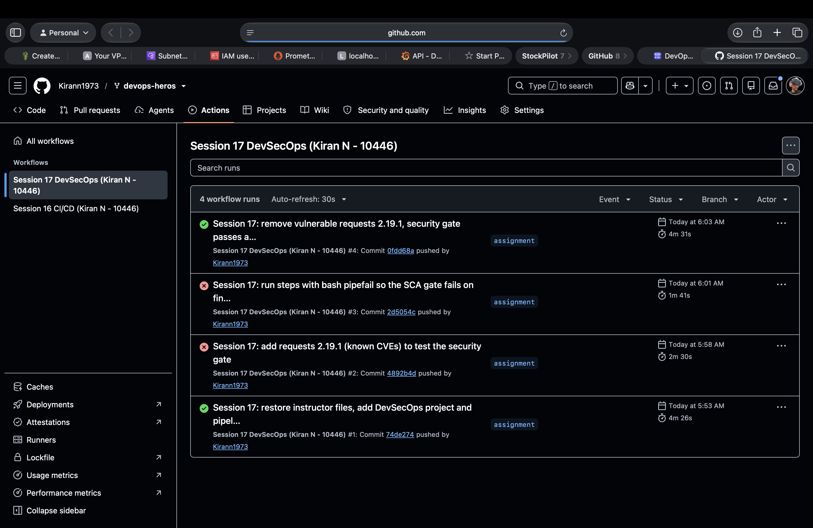

### Run #4: green, all 9 stages passed

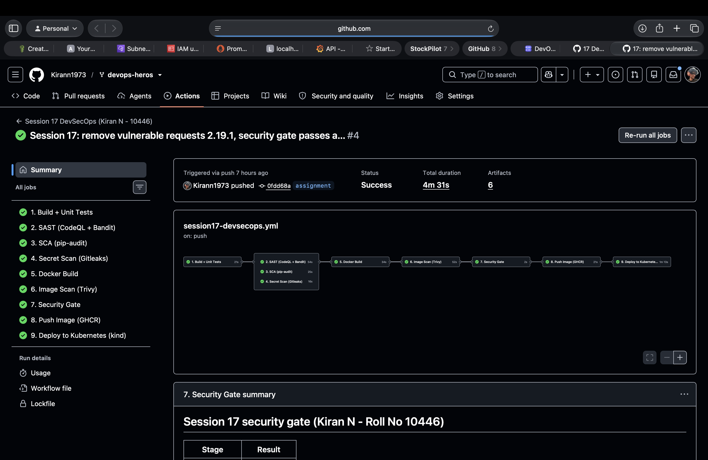

The run produced 6 artifacts: the scanned Docker image, test reports, the Bandit report, the pip-audit report, the Gitleaks report and the Trivy reports.

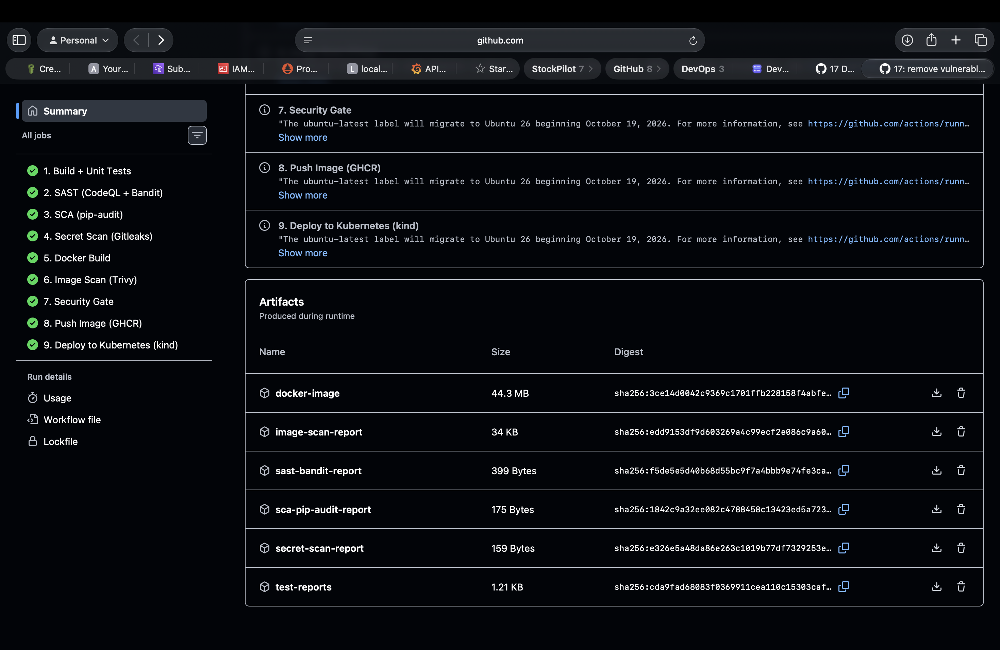

**Image gate:** Trivy found 0 fixable HIGH/CRITICAL vulnerabilities in the Debian 13.7 layer and in every Python package.

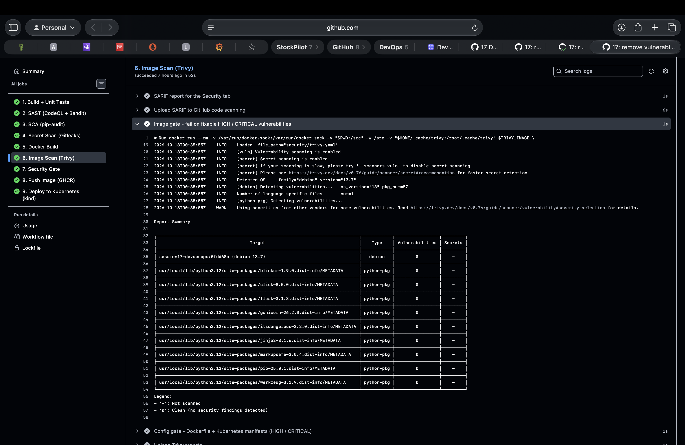

**Deploy to Kubernetes:** both pods are `Running` with `ghcr.io/kirann1973/session17-devsecops:0fdd68a`. The smoke test went through the Service and got `/health`, `/api/info` (owner Kiran N, roll_no 10446), `104 + 46 = 150` and "Kiran N | Roll No: 10446" from the home page.

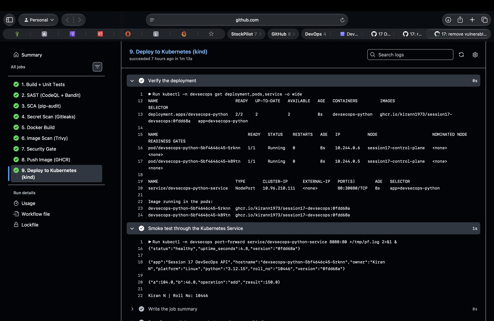

**Image in GHCR:** the package is public, with tags `latest`, `0fdd68a` and `74de274`. There is no tag from run #2 or #3, because the gate blocked those.

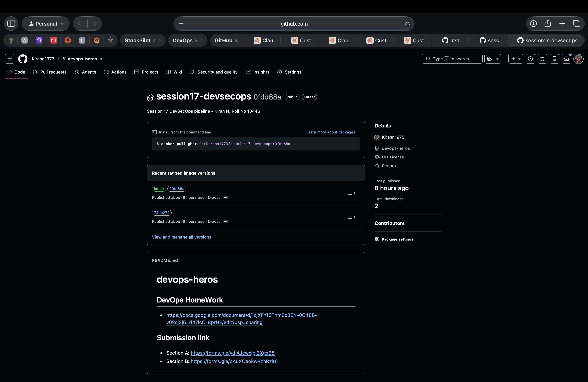

**Security tab, code scanning:** Trivy and CodeQL results are uploaded as SARIF. The 19 closed alerts are, as far as I can tell, the `requests` and `urllib3` CVEs from run #2. GitHub closes an alert automatically once a later scan no longer finds it, and run #4 removed the package. CodeQL found nothing in my code. The open ones are mostly unfixed OS package CVEs in the base image, the same ones the gate ignores.

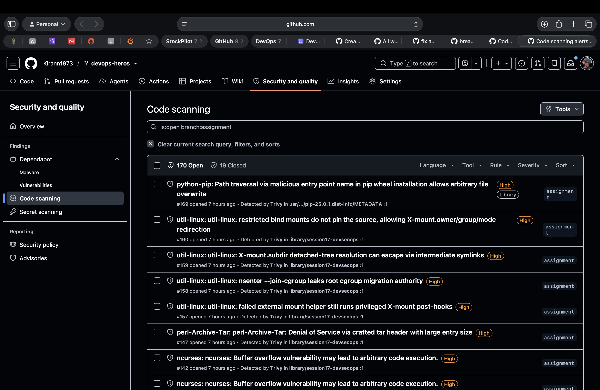

### The security gate stopping a vulnerable build

To prove the gates work, I added an old `requests==2.19.1` to `requirements.txt` on purpose. It has many known CVEs, plus its old `urllib3` and `idna`.

**Run #2: blocked by the image scan.** The SCA job listed the CVEs but still went green. The cause was that GitHub runs `run:` steps with `bash -e`, without `pipefail`, unless `shell: bash` is set. So `pip-audit ... | tee report.txt` returned `tee`'s exit code 0. Defence in depth still worked: Trivy found the same CVEs inside the image, the image gate failed, the Security Gate failed, and push and deploy were skipped.

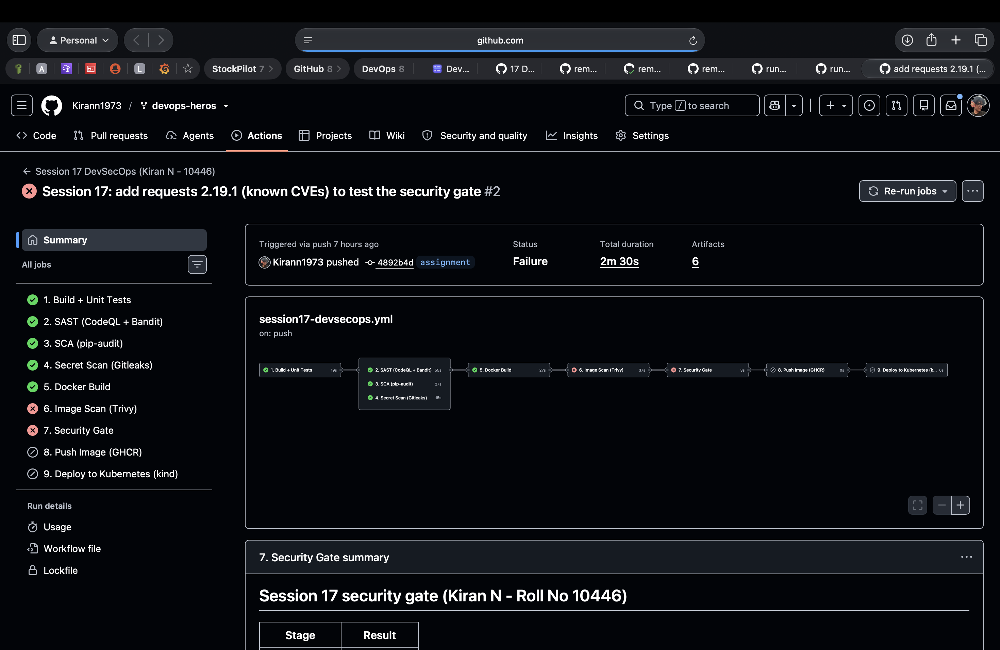
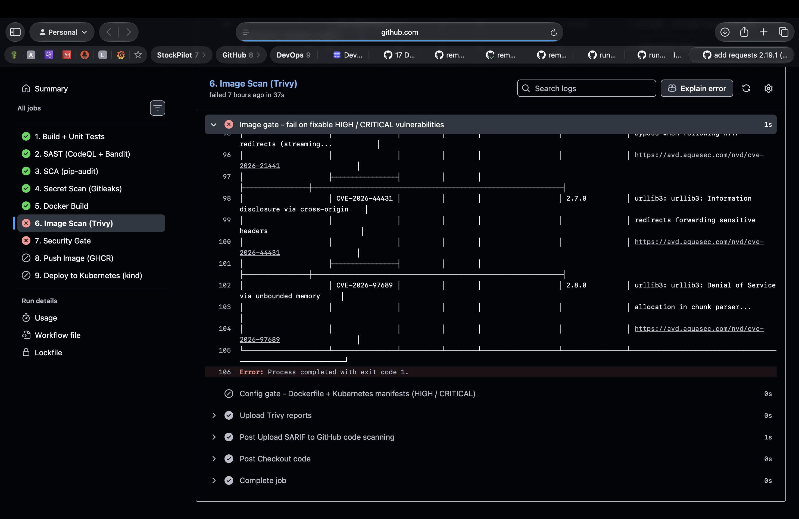

**Run #3: the SCA gate fixed.** I set `defaults.run.shell: bash`, which turns on `-o pipefail`, and pushed again with the vulnerable package still in place. This time SCA failed at the first security stage. Docker Build, Image Scan, Push and Deploy never ran, and the Security Gate was red.

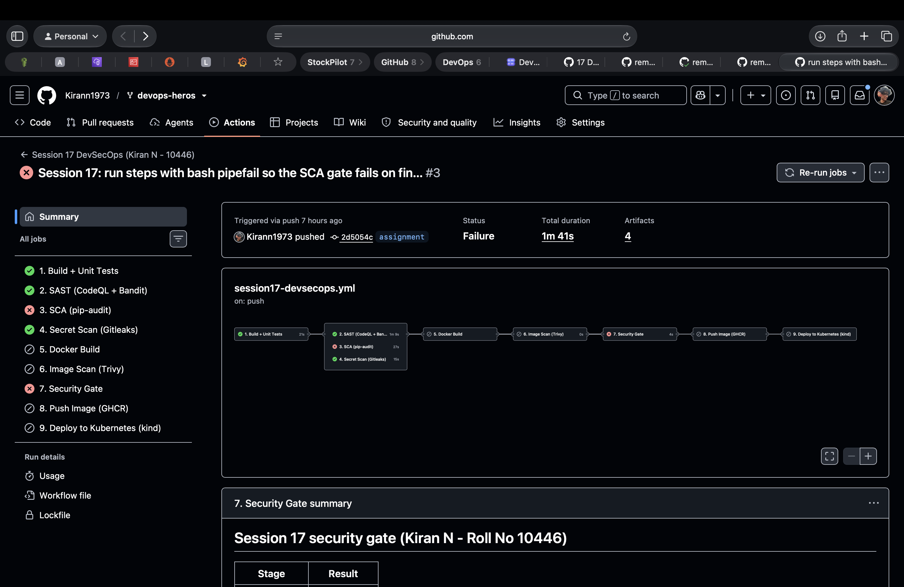
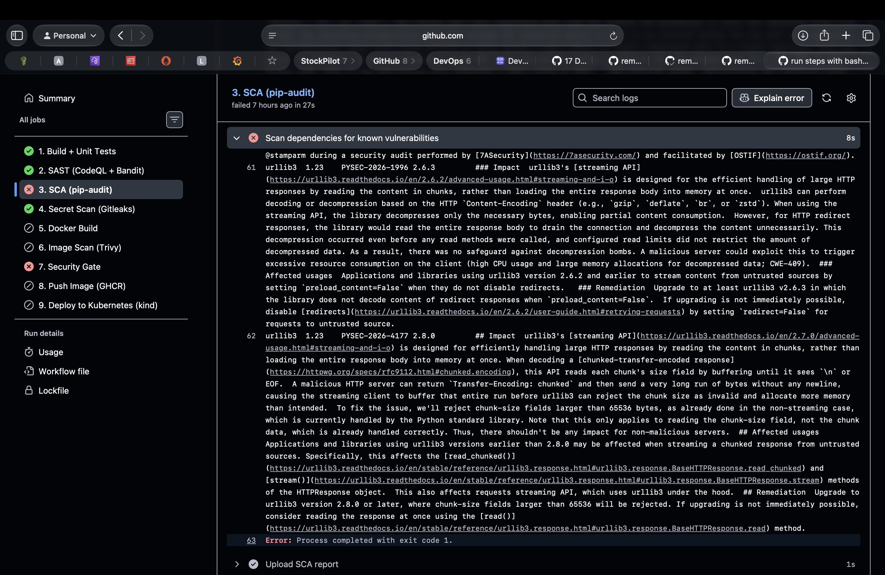

**Run #4: remediation.** I removed the vulnerable package and the whole pipeline was green again, as shown above. This follows the remediation flow from `05-sca`: find vulnerability → identify package and version → check the fixed version → update or remove → run the tests → run SCA again.

---

## Local lab on my VM (Minikube)

[`session17_lab.sh`](session17_lab.sh) runs the same checks by hand on my Ubuntu VM (arm64) and deploys to Minikube. It writes each part to `outputs/`.

```bash
cd "Assignements/session 17-devsecops"
bash session17_lab.sh          # all 5 parts, then cleanup
bash session17_lab.sh 2 4      # only parts 2 and 4
```

It installs pytest, Bandit and pip-audit in a venv, and the Gitleaks 8.30.1 and Trivy 0.76.0 binaries in `~/devsecops-kiran/bin`. Every "gate" line prints the tool's exit code: 0 means pass, and anything else means the pipeline would stop.

### Part 1: build, unit tests, SAST

The build compiled, all 13 tests passed with 98% coverage, and Bandit found no issues in my code. As a demo, Bandit scanned a deliberately bad file with `shell=True`, `debug=True` and binding to `0.0.0.0`. It reported **B602 HIGH, B201 HIGH and B104 MEDIUM** and exited with code 1.

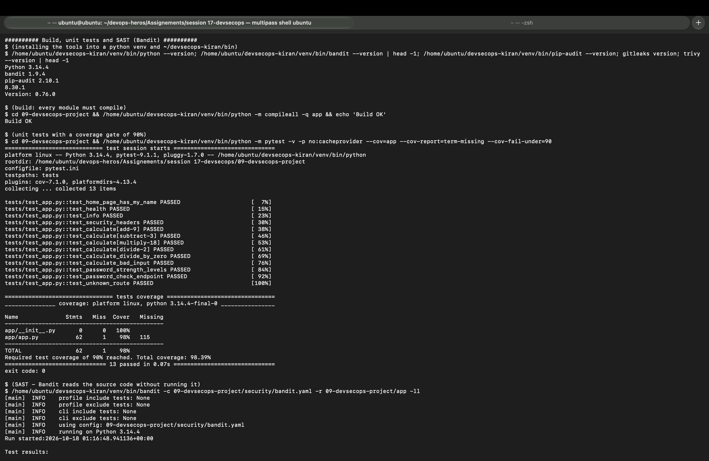
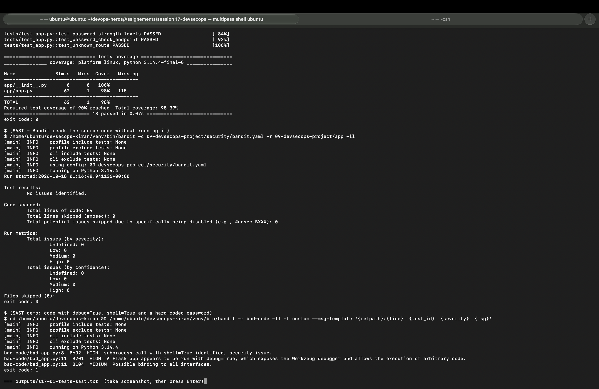

### Part 2: SCA and secret scanning

pip-audit found no known vulnerabilities in my requirements and exited with 0. The demo file with `requests==2.19.1` gave 10 vulnerabilities and exit code 1. Gitleaks found no leaks in the project. In a scratch file containing a fake `api_key = "..."`, my custom rule `kiran-generic-assignment` caught it, again with exit code 1. The fake key is never committed.

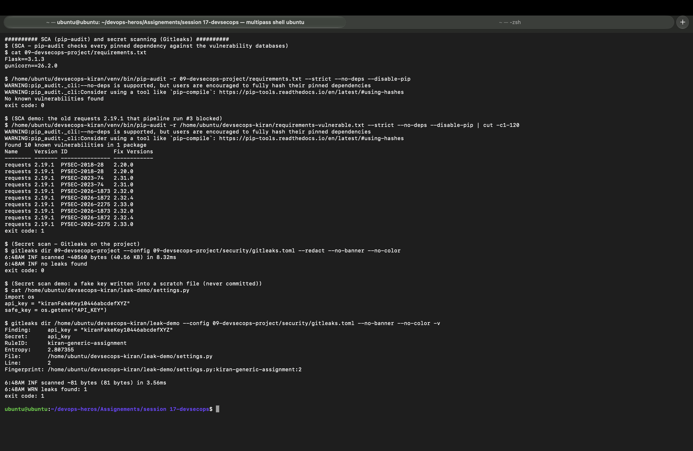

### Part 3: Docker build, image scan and the gate

- Minikube built `local-v1` and `local-v2` natively for arm64.
- The full Trivy report shows 164 OS findings (44 HIGH) and 6 in the Python packages (none HIGH).
- With the gate policy (fixable HIGH/CRITICAL only), the result is **0 and exit code 0**.
- With `--ignore-unfixed=false` the result is **44 HIGH and exit code 1**. This is why the policy only blocks CVEs that have a fix.
- The Trivy config scan found 0 misconfigurations in the Dockerfile and all three k8s files.

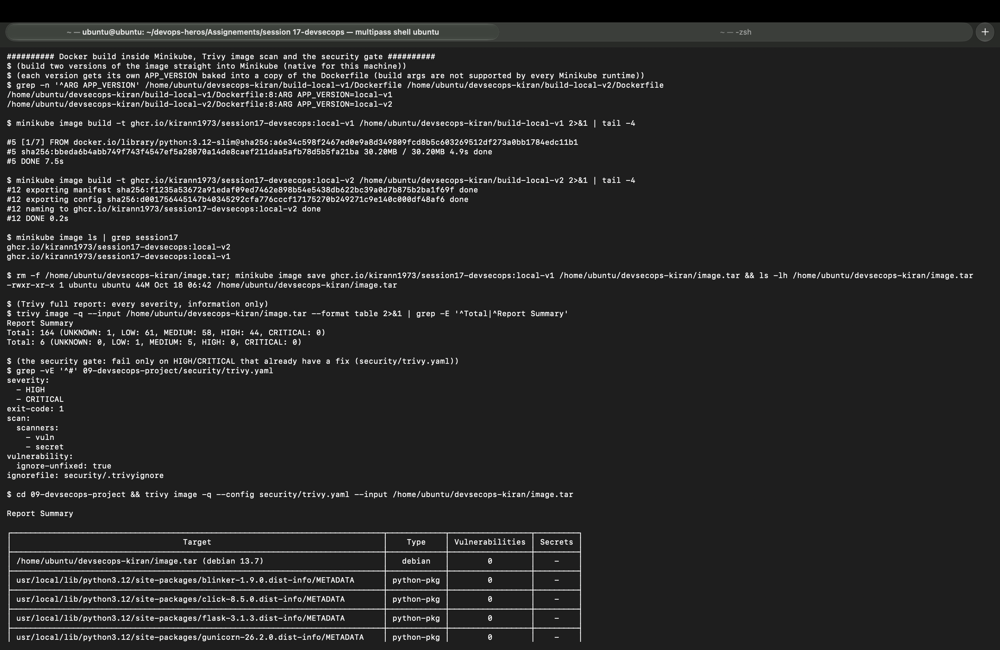
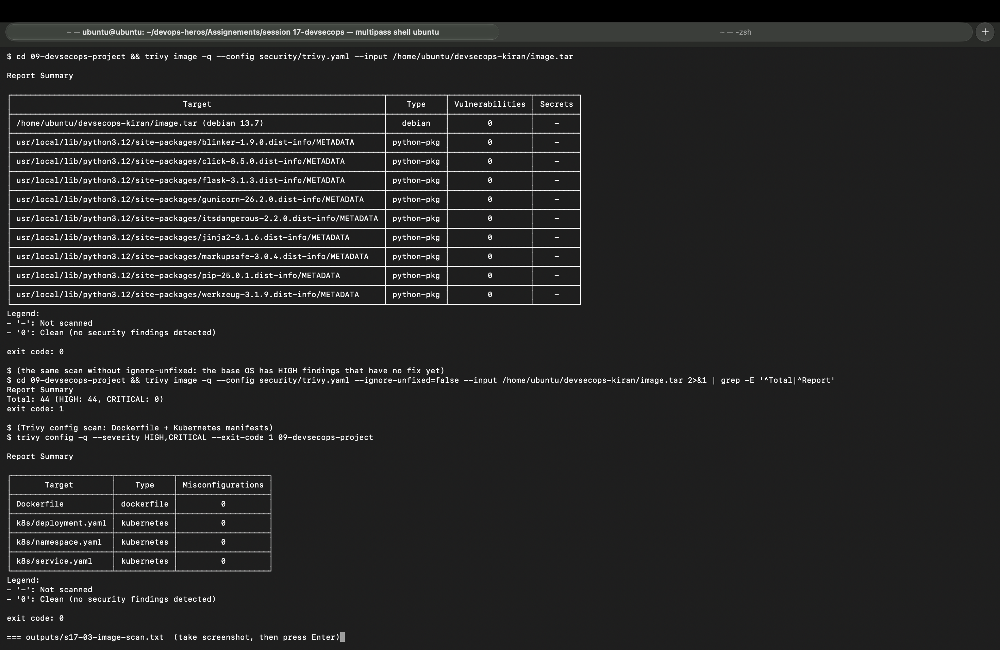

### Part 4: deploy to Kubernetes

The namespace was created with `enforce=restricted`. The deployment rolled out with 2/2 pods running as user 10001 with a read-only root filesystem. Through the Service, the app returned:
- `/health`: healthy, version local-v1.
- `/api/info`: my name and roll number.
- `104 + 46 = 150`.
- A strong password score of 5/5.
- The security headers.

Pod Security also **rejected a normal root `nginx` pod**, because it doesn't set `allowPrivilegeEscalation=false`, `capabilities.drop=["ALL"]`, `runAsNonRoot` or `seccompProfile`.

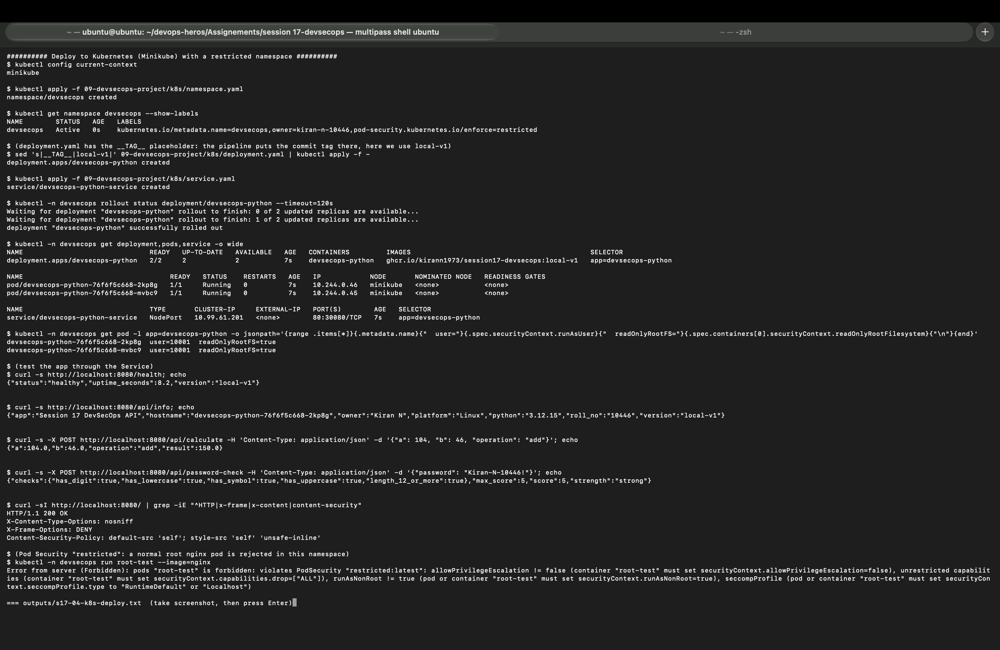

### Part 5: change the image tag, rolling update, rollback

`kubectl set image` moved the deployment from `local-v1` to `local-v2`, and `rollout status` waited until the update finished. During the update a v1 pod and two v2 pods ran side by side, because `maxUnavailable: 0`. After that `/health` reported `local-v2`. `rollout history` showed revision 2 with my change-cause. `rollout undo` brought the deployment back to `local-v1`.

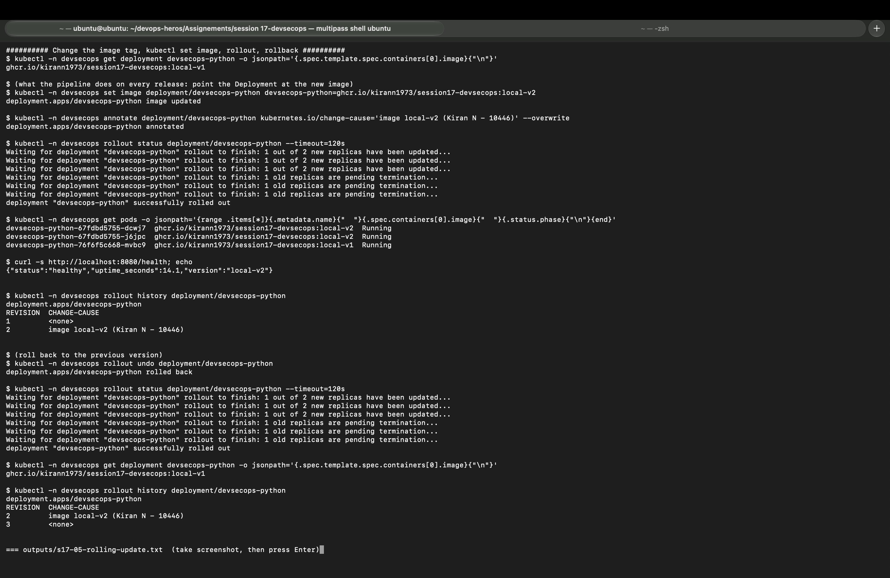

---

## Practice questions (from the instructor's topic folders)

**02 Container Registry**
1. I built the image in job 5. Job 8 logged in to GHCR with `GITHUB_TOKEN` (permission `packages: write`) and pushed the image.
2. The package is at [Kirann1973/devops-heros → Packages → session17-devsecops](https://github.com/Kirann1973/devops-heros/pkgs/container/session17-devsecops).
3. Exact name and tag: `ghcr.io/kirann1973/session17-devsecops:0fdd68a`. The tag is the commit SHA of run #4. GHCR needs the owner in lowercase, so the workflow lowercases `Kirann1973`.

**03 Kubernetes Deployment**
1. Deployed to Kubernetes both in CI (a kind cluster on the runner, using the image pulled from GHCR) and locally (Minikube).
2. Changed the image tag with `kubectl set image` and watched the rollout with `kubectl rollout status`.
3. Checked the new pods with `kubectl get pods`.
4. A GitHub-hosted runner can't reach Minikube on my laptop. That's why CI creates its own kind cluster for automated deployment, and the local deployment is done by the lab script.

**04 SAST**
CodeQL runs in job 2 and its results appear under Security → Code scanning. CodeQL had no findings in my code. Bandit shows a finding's file and line, for example `bad_app.py:11 B201 HIGH`. A clean SAST result does not mean the whole app is secure, which is why SCA, secret scanning and image scanning also run.

**05 SCA**
- `pip-audit` output columns: package name, installed version, vulnerability ID (PYSEC/GHSA/CVE) and fix version.
- **Example:** `requests 2.19.1 PYSEC-2023-74 → fixed in 2.31.0`.
- **Remediation:** upgrade to the fix version, or remove the package if it isn't needed (I removed it). Then run the tests and SCA again.

**06 Secret Scanning**
1. **Why not keep secrets in source code?** Everyone with access to the repo can read them, they stay in the git history forever, and forks, clones and CI logs copy them.
2. **GitHub Actions secret vs source-code secret:** an Actions secret is encrypted and stored by GitHub. It is passed to a job only at runtime and masked as `***` in logs. A secret in source code is plain text that anyone can read.
3. **If a real cloud key is pushed:** treat it as compromised. Revoke or rotate it first, remove it from the code and history (deleting the line is not enough), check for unauthorised use, then store the new key in a secret manager or Actions secret.

**07 Container Image Scanning**
Image scanning finds vulnerable OS packages and libraries that SCA on `requirements.txt` can't see. `--exit-code 1` makes Trivy return 1 when it finds anything at the selected severity, which fails the GitHub Actions step and so stops the pipeline. Without it, Trivy only prints a report and the pipeline carries on.

**08 Security Gates**
Every item in the practice list is met. Tests, SAST, SCA and secret scanning all have to pass before the Docker build. The image is scanned, the Security Gate checks every result, the image is pushed only after the gate passes, deployment happens only after the push, and the deploy waits with `kubectl rollout status`. Runs #2 and #3 show the gate stopping a vulnerable build.

---

## What I learned

- A scan only **finds** problems. The **gate** (`needs:`, exit codes and the Security Gate job) is what stops a bad build.
- The `| tee` pipefail bug in run #2 showed why one tool isn't enough. SCA missed the issue because of my bug, but the image scan still caught it.
- Scanning the exact image you release matters. So does a sensible threshold (fixable HIGH/CRITICAL), so that teams fix real issues instead of ignoring a gate that is always red.
- Kubernetes adds its own layer of security: a restricted namespace, a non-root user, a read-only filesystem and dropped capabilities.
