# Session 18: Terraform and Infrastructure as Code

| | |
|---|---|
| **Name** | Kiran N |
| **Roll No.** | 10446 |
| **Session** | 18: Terraform IaC on AWS |
| **Repository** | [Kirann1973/devops-heros](https://github.com/Kirann1973/devops-heros), branch `assignment` |
| **Task 1 project** | [`terraform-s3-demo/`](terraform-s3-demo/): my S3 bucket in Terraform |
| **Task 2 notes** | [`aws-services/`](aws-services/): IAM, EC2, S3, VPC, DynamoDB + RDS |
| **Lab script** | [`session18_lab.sh`](session18_lab.sh), run on my Ubuntu VM (Multipass, arm64) |
| **AWS** | Account `780603796984`, IAM user `kiran-terraform`, region `ap-south-1` (Mumbai) |
| **Tools** | Terraform v1.13.4, AWS provider v6.66.0, AWS CLI v2.38.1 |

Everything below ran against my real AWS account on 18 Oct 2026. The bucket was created, checked in the CLI and the console, and then destroyed. All screenshots are in [`screenshots/`](screenshots/).

---

## Homework tasks

> **Task 1:** Create a Terraform project `terraform-s3-demo/` with `main.tf`, `variables.tf`, `outputs.tf`, `provider.tf`, `terraform.tfvars` and `README.md` that creates an S3 bucket. Run `terraform init`, `fmt`, `validate`, `plan`, `apply`, `show`, `output` and `destroy`.
>
> **Task 2:** Create `aws-services/` with `01-iam/`, `02-ec2/`, `03-s3/`, `04-vpc/` and `05-dynamodb-rds/`, each with a README explaining the service.

| Deliverable | Where |
|---|---|
| `terraform.tf` | [required Terraform + provider versions](terraform-s3-demo/terraform.tf) |
| `provider.tf` | [AWS provider, region and default tags with my name and roll number](terraform-s3-demo/provider.tf) |
| `variables.tf` | [5 variables with types, defaults and validation](terraform-s3-demo/variables.tf) |
| `terraform.tfvars` | [my values (no secrets)](terraform-s3-demo/terraform.tfvars) |
| `main.tf` | [bucket + versioning + encryption + public access block + one object](terraform-s3-demo/main.tf) |
| `outputs.tf` | [5 outputs](terraform-s3-demo/outputs.tf) |
| Project README | [terraform-s3-demo/README.md](terraform-s3-demo/README.md) |
| init / fmt / validate | [Step 3](#step-3-init-fmt-validate) |
| plan / apply / output | [Steps 4 and 5](#step-4-plan) |
| show / state | [Step 6](#step-6-show-state-list-state-show) |
| destroy | [Step 9](#step-9-destroy) |
| IAM | [aws-services/01-iam/README.md](aws-services/01-iam/README.md) |
| EC2 | [aws-services/02-ec2/README.md](aws-services/02-ec2/README.md) |
| S3 | [aws-services/03-s3/README.md](aws-services/03-s3/README.md) |
| VPC | [aws-services/04-vpc/README.md](aws-services/04-vpc/README.md) |
| DynamoDB and RDS | [aws-services/05-dynamodb-rds/README.md](aws-services/05-dynamodb-rds/README.md) |

---

## What Terraform is doing here

```text
  my .tf files  ──terraform init──▶  downloads hashicorp/aws v6.66.0 (checked against .terraform.lock.hcl)
       │
       ├─terraform validate──▶ syntax, types, references (no AWS calls)
       │
       ├─terraform plan──────▶ reads real AWS + state, prints the difference  "5 to add"
       │
       ├─terraform apply─────▶ calls the AWS API with the kiran-terraform IAM user
       │                          │
       │                          ▼
       │                 S3 bucket kiran-n-10446-session18-demo (ap-south-1)
       │                   ├─ versioning: Enabled
       │                   ├─ encryption: SSE-S3 (AES256)
       │                   ├─ block public access: all 4 on
       │                   ├─ tags: Owner=Kiran N, RollNo=10446, ...
       │                   └─ hello.txt
       │
       ├─terraform.tfstate ◀── records what was created (local, git-ignored)
       │
       └─terraform destroy───▶ deletes all 5 resources
```

The 5 resources in [`main.tf`](terraform-s3-demo/main.tf):

| Terraform address | What it creates |
|---|---|
| `aws_s3_bucket.kiran_demo` | The bucket, with `force_destroy = true` so destroy can empty it |
| `aws_s3_bucket_versioning.kiran_demo` | Versioning, on/off from `var.versioning_enabled` |
| `aws_s3_bucket_server_side_encryption_configuration.kiran_demo` | Default encryption AES256 |
| `aws_s3_bucket_public_access_block.kiran_demo` | Blocks all public access |
| `aws_s3_object.hello` | `hello.txt` with my name and roll number, uploaded after encryption and versioning exist (`depends_on`) |

---

## Step 1: AWS access with an IAM user (not root)

I created the IAM user `kiran-terraform` with only `AmazonS3FullAccess` and `AmazonEC2FullAccess` and no console access. Then I made an access key for the CLI and saved it with `aws configure`. The keys live in `~/.aws/credentials` on the VM and never in a `.tf` file.

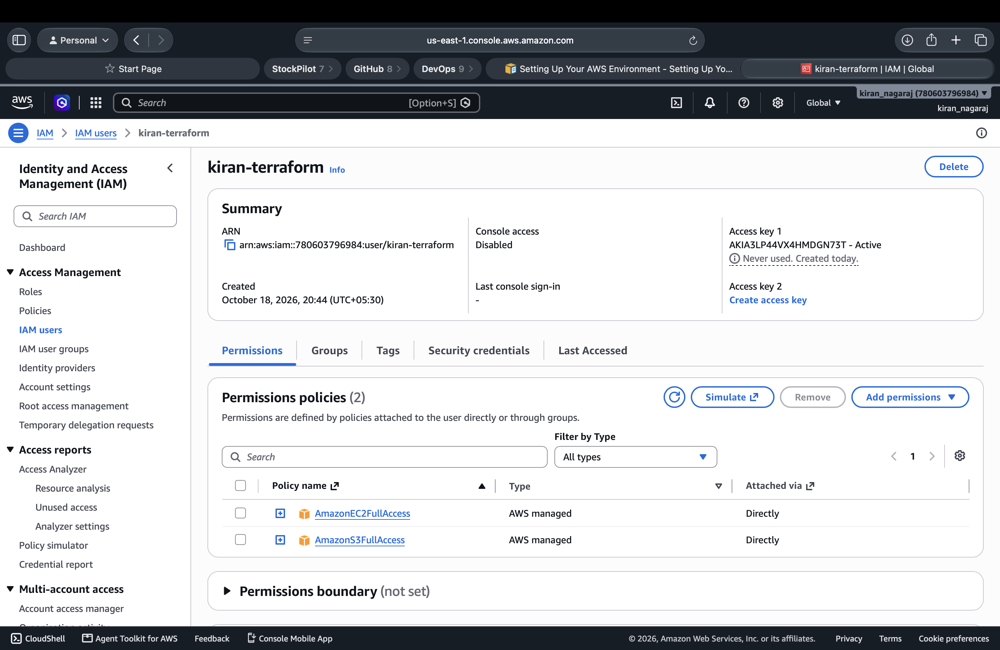

`bash session18_lab.sh 1` installs Terraform and AWS CLI v2 into `~/.local/bin` without apt, then checks who I am on AWS:

```text
$ terraform version
Terraform v1.13.4
on linux_arm64

$ aws sts get-caller-identity
{
    "UserId": "AIDA3LP44VX4MKZZQI6JJ",
    "Account": "780603796984",
    "Arn": "arn:aws:iam::780603796984:user/kiran-terraform"
}
```

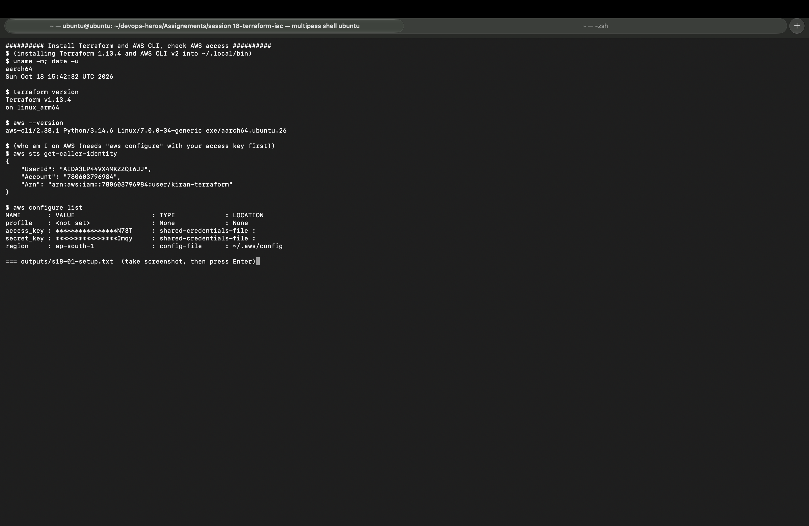

## Step 2: The class examples 01 to 09

`bash session18_lab.sh 2` runs `init`, `fmt -check` and `validate` in every class folder. All 9 are valid.

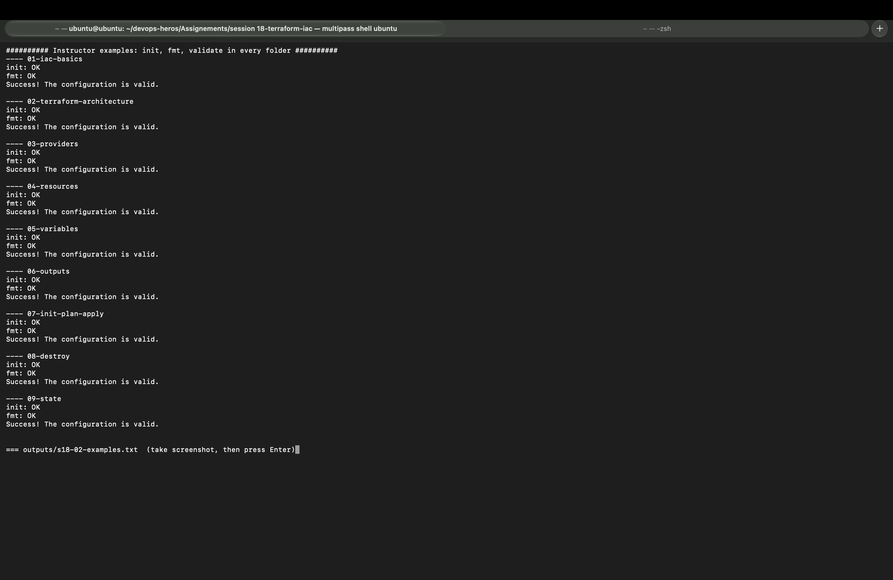

**Variables (05-variables):** the same code gives a different plan when I pass `-var` values on the command line:

```text
default values:       + bucket_prefix = "terraform-training-dev-"
-var project_name=kiran-10446 -var environment=test:
                      + bucket_prefix = "kiran-10446-test-"
                          + "Environment" = "test"
                          + "Project"     = "kiran-10446"
Plan: 1 to add, 0 to change, 0 to destroy.
```

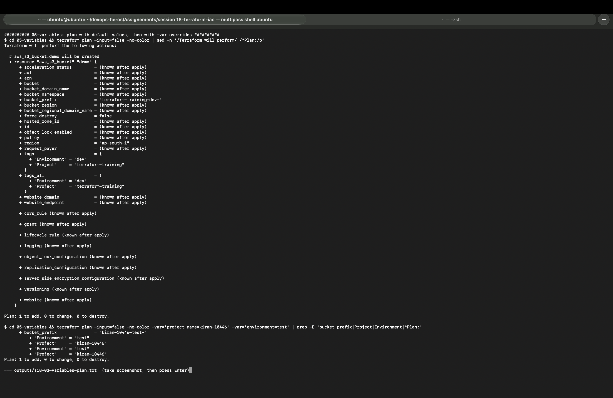

**State (09-state):** apply a bucket, read it back from the state, then destroy it. The state file is plain JSON (`"version": 4`, `"serial": 2`). After destroy, `state list` is empty.

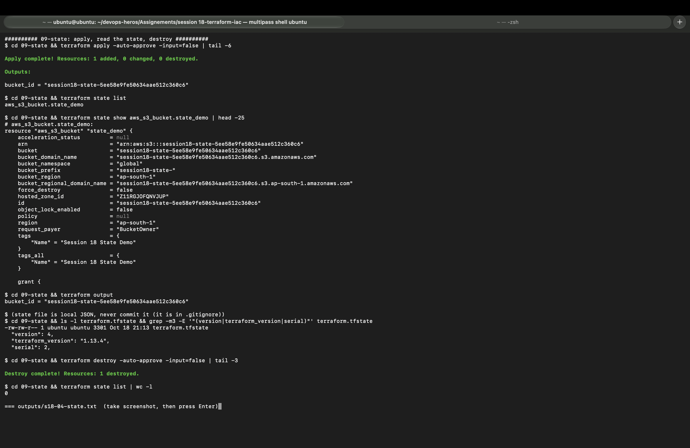

## Step 3: init, fmt, validate

`bash session18_lab.sh 3` runs everything for my own project:

```text
$ terraform init -input=false
- Reusing previous version of hashicorp/aws from the dependency lock file
- Using hashicorp/aws v6.66.0 from the shared cache directory
Terraform has been successfully initialized!

$ terraform fmt -check -recursive && echo 'fmt: all files already formatted'
fmt: all files already formatted

$ terraform validate
Success! The configuration is valid.
```

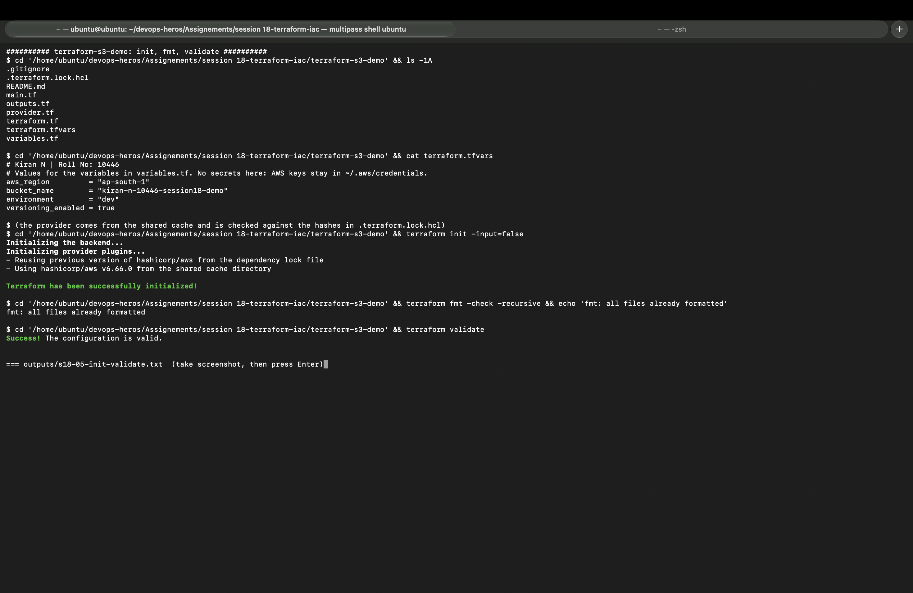

## Step 4: plan

`terraform plan -out=tfplan` shows the 5 resources, the tags coming from `default_tags`, and the outputs. Saving the plan means `apply` does exactly what was reviewed.

```text
  # aws_s3_bucket.kiran_demo will be created
  # aws_s3_bucket_public_access_block.kiran_demo will be created
  # aws_s3_bucket_server_side_encryption_configuration.kiran_demo will be created
  # aws_s3_bucket_versioning.kiran_demo will be created
  # aws_s3_object.hello will be created
Plan: 5 to add, 0 to change, 0 to destroy.
```

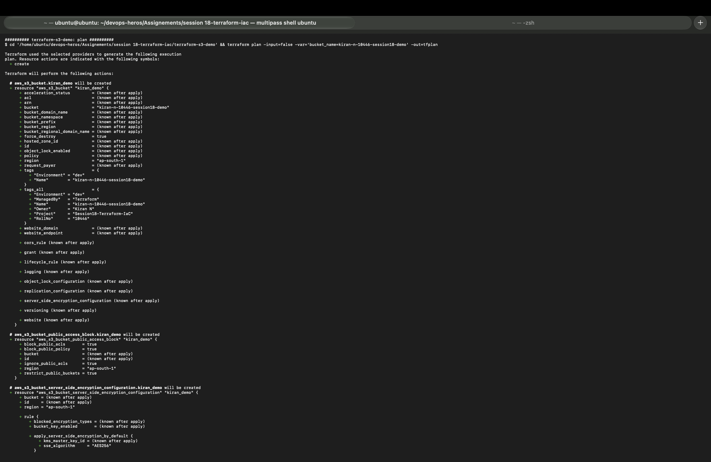
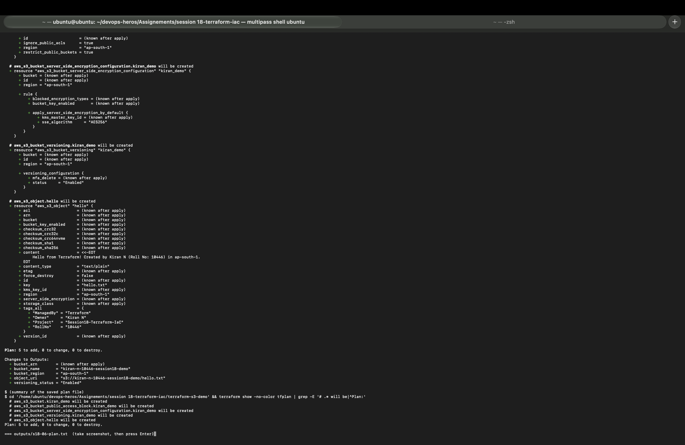

## Step 5: apply and output

Terraform creates the bucket first. Versioning, encryption and the public access block are created in parallel next, because they each depend only on the bucket. `hello.txt` comes last because of `depends_on`.

```text
aws_s3_bucket.kiran_demo: Creation complete after 2s [id=kiran-n-10446-session18-demo]
aws_s3_bucket_public_access_block.kiran_demo: Creation complete after 0s
aws_s3_bucket_server_side_encryption_configuration.kiran_demo: Creation complete after 0s
aws_s3_bucket_versioning.kiran_demo: Creation complete after 2s
aws_s3_object.hello: Creation complete after 0s [id=kiran-n-10446-session18-demo/hello.txt]

Apply complete! Resources: 5 added, 0 changed, 0 destroyed.

Outputs:
bucket_arn = "arn:aws:s3:::kiran-n-10446-session18-demo"
bucket_name = "kiran-n-10446-session18-demo"
bucket_region = "ap-south-1"
object_uri = "s3://kiran-n-10446-session18-demo/hello.txt"
versioning_status = "Enabled"
```

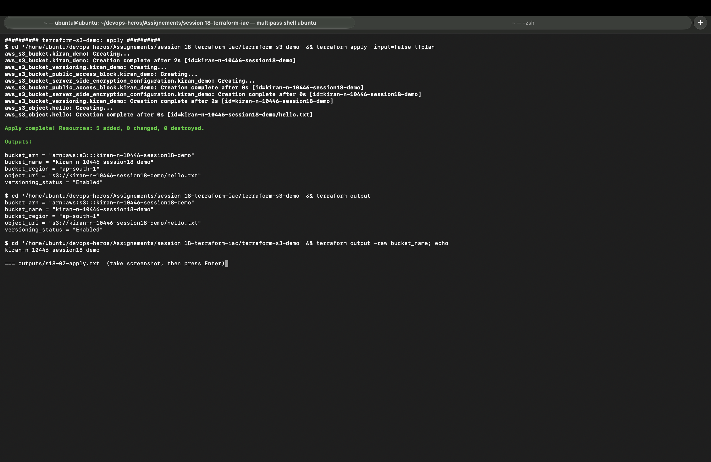

## Step 6: show, state list, state show

```text
$ terraform state list
aws_s3_bucket.kiran_demo
aws_s3_bucket_public_access_block.kiran_demo
aws_s3_bucket_server_side_encryption_configuration.kiran_demo
aws_s3_bucket_versioning.kiran_demo
aws_s3_object.hello
```

`terraform show` and `terraform state show aws_s3_bucket.kiran_demo` print what AWS returned: the ARN, region `ap-south-1`, all 6 tags, `sse_algorithm = "AES256"`.

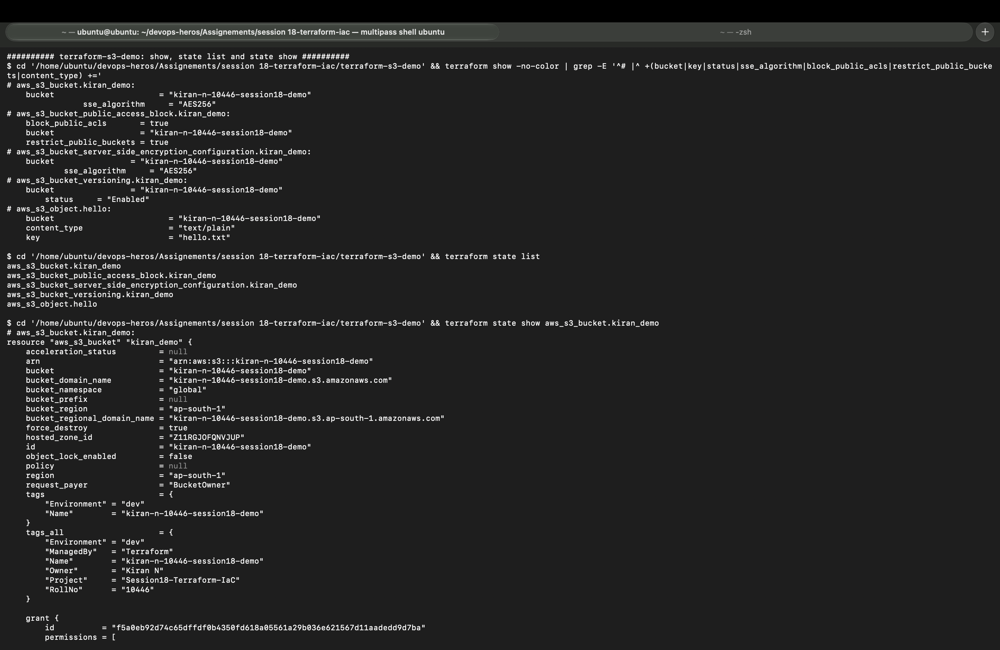
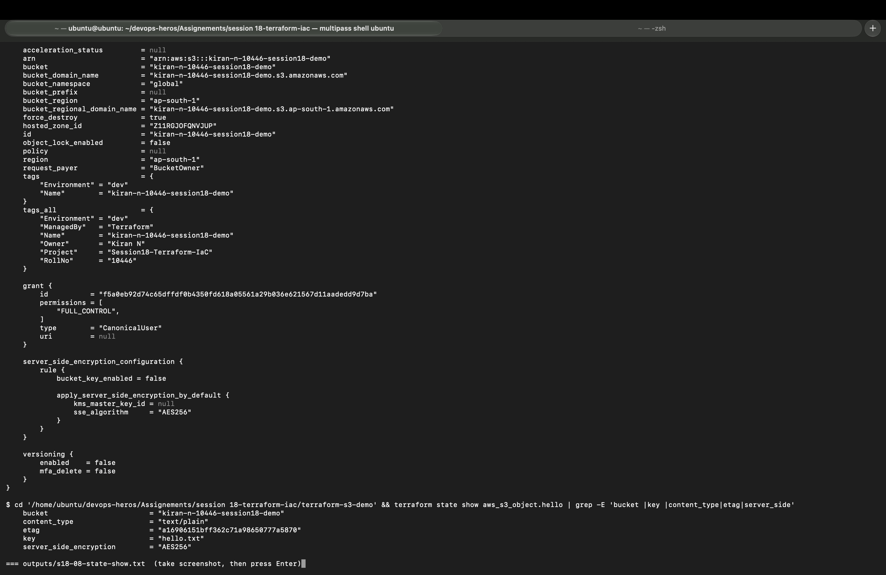

## Step 7: Proof with the AWS CLI

The same settings, read back directly from AWS:

```text
$ aws s3api get-bucket-versioning --bucket kiran-n-10446-session18-demo
{ "Status": "Enabled" }

$ aws s3api get-public-access-block --bucket kiran-n-10446-session18-demo     # (shortened)
"BlockPublicAcls": true, "IgnorePublicAcls": true, "BlockPublicPolicy": true, "RestrictPublicBuckets": true

$ aws s3 cp s3://kiran-n-10446-session18-demo/hello.txt -
Hello from Terraform! Created by Kiran N (Roll No: 10446) in ap-south-1.

$ terraform plan -detailed-exitcode     # drift check
Terraform has compared your real infrastructure against your configuration
and found no differences, so no changes are needed.
exit code 0 (0 = no changes)
```

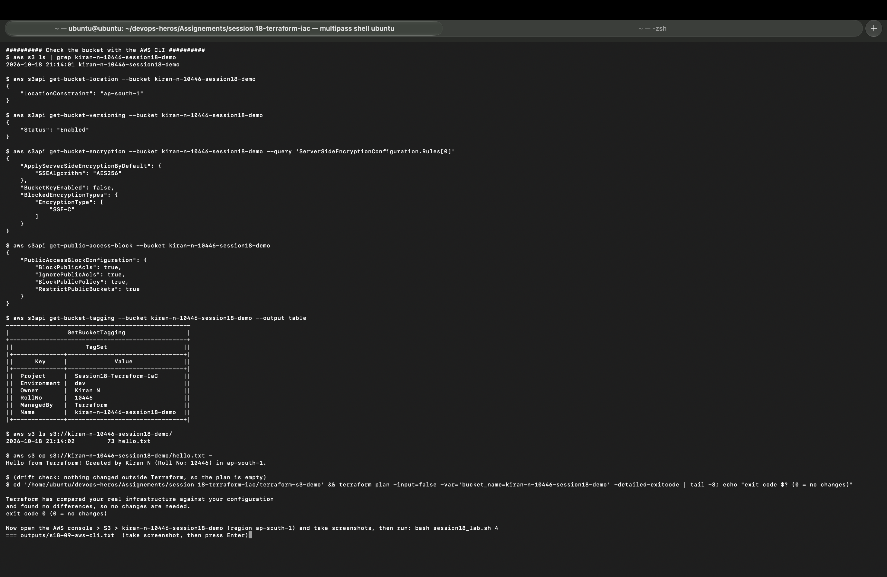

## Step 8: Proof in the AWS console

| | |
|---|---|
| Bucket in Asia Pacific (Mumbai) | 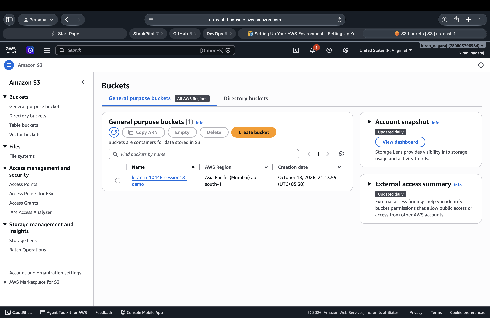 |
| `hello.txt` uploaded by Terraform | 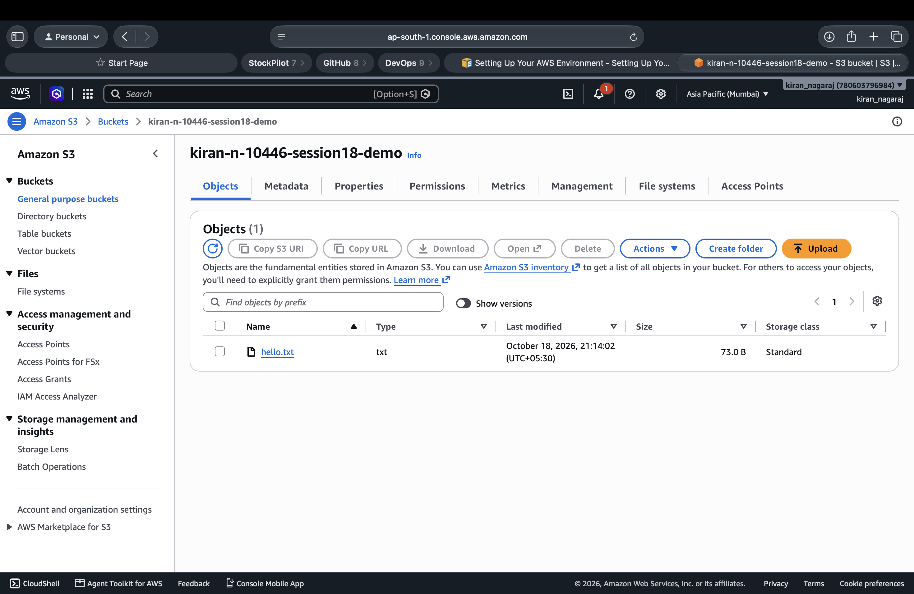 |
| Bucket Versioning: Enabled | 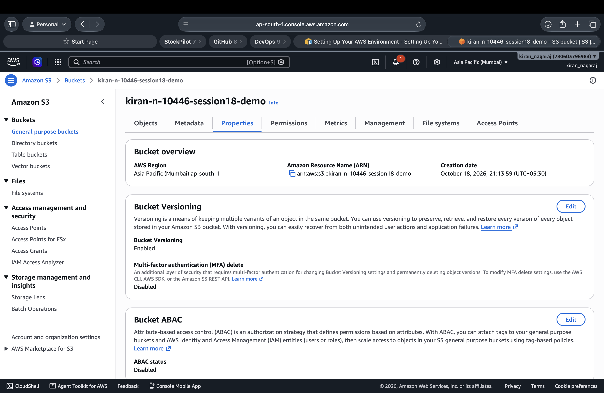 |
| Default encryption SSE-S3 | 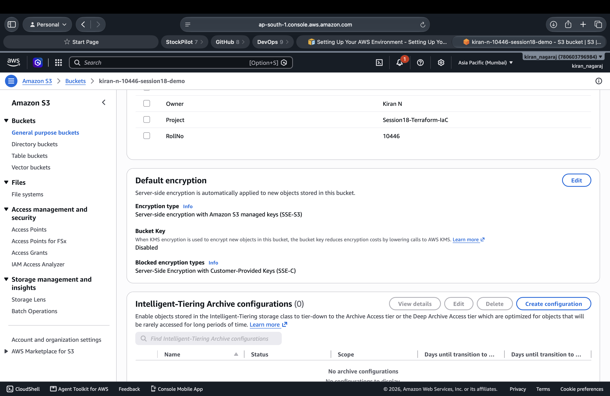 |
| Tags from `default_tags` + resource tags | 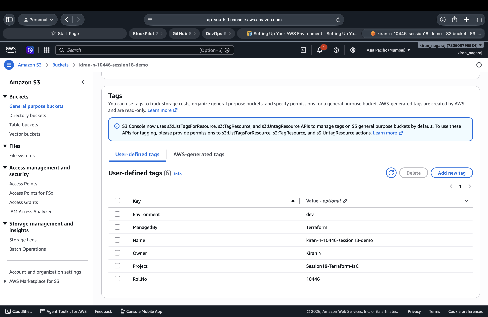 |
| Block all public access: On | 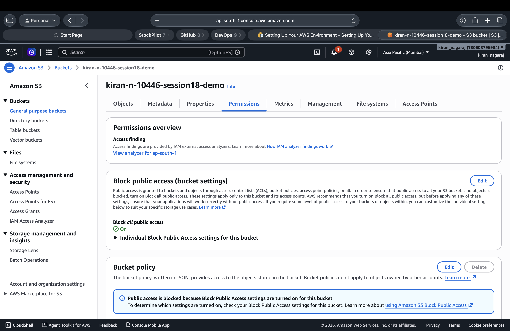 |

## Step 9: destroy

`bash session18_lab.sh 4` previews the delete with `plan -destroy`, then runs `destroy`. It also proves the bucket no longer exists.

```text
Plan: 0 to add, 0 to change, 5 to destroy.
...
Destroy complete! Resources: 5 destroyed.

$ terraform state list | wc -l
0
$ aws s3api head-bucket --bucket kiran-n-10446-session18-demo
An error occurred (404) when calling the HeadBucket operation: Not Found
```

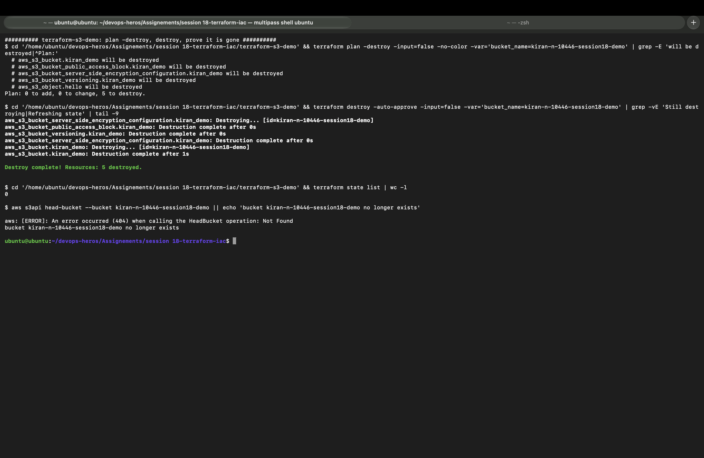
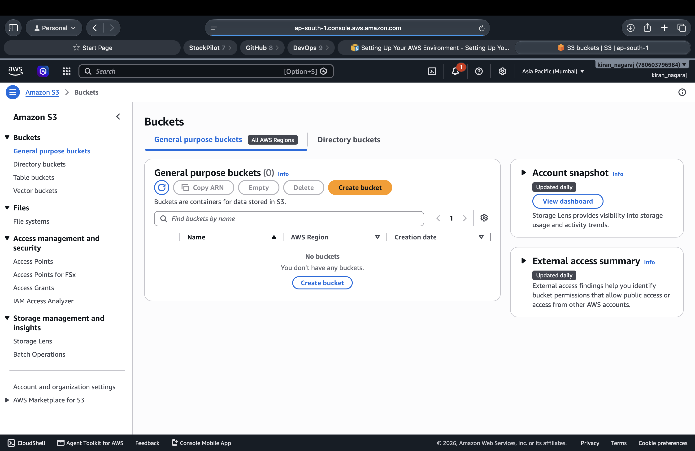

---

## Problems I hit and how I fixed them

| Problem | Cause | Fix |
|---|---|---|
| `terraform init` failed in the class `terraform-s3-demo`: *An argument named "type" is not expected here* | The class `outputs.tf` had `type = string` inside `output` blocks; only variables take a type | Removed `type` from my [`outputs.tf`](terraform-s3-demo/outputs.tf) |
| `init` failed in every folder: *mkdir .terraform: no space left on device* | The VM disk was 100% full, and every folder downloaded its own ~800 MB AWS provider (two different versions) | Freed space (old minikube cluster and Session 17 scanner files), then used one shared plugin cache (`TF_PLUGIN_CACHE_DIR`) and pinned all folders to provider 6.66.0 with the same lock file |
| Cache rejected by the lock file | `.terraform.lock.hcl` from the class only had the macOS `h1:` checksum | Ran `terraform providers lock -platform=linux_arm64 -platform=linux_amd64` to add the Linux checksums |
| `terraform.tfvars` would not be committed | `.gitignore` ignores `*.tfvars` (they often hold secrets) | Mine has no secrets, so I added `!terraform.tfvars` in [`terraform-s3-demo/.gitignore`](terraform-s3-demo/.gitignore) |
| AWS requests can fail on a VM with a wrong clock | AWS rejects signatures more than 5 minutes off | The lab script compares the VM clock with AWS's `Date` header and corrects it first |

## Key learnings

- **Declarative:** I describe the end state, and `plan` works out the steps. Running `plan` again after `apply` shows "No changes", which proves the code and AWS match.
- **State** is how Terraform knows what it owns. It holds real IDs, so it stays out of Git. A team would keep it in an S3 backend with locking.
- **Dependencies** come from references (`aws_s3_bucket.kiran_demo.id`). `depends_on` is only needed for ordering that Terraform can't see.
- **Variables + tfvars** make the same code reusable. **Validation blocks** catch bad input at `plan` time.
- **`default_tags`** on the provider tags every resource without repeating code.
- **Security:** use an IAM user with limited policies (not root), keep keys only in `~/.aws/credentials`, and make the bucket private and encrypted by default.
- **Always destroy** lab resources and verify that they are gone.

## How to run it again

```bash
cd "Assignements/session 18-terraform-iac"
bash session18_lab.sh 1          # install tools, then: export PATH=$HOME/.local/bin:$PATH; aws configure
bash session18_lab.sh 2 3        # class examples + create my bucket (outputs in outputs/)
bash session18_lab.sh 4          # destroy
```
