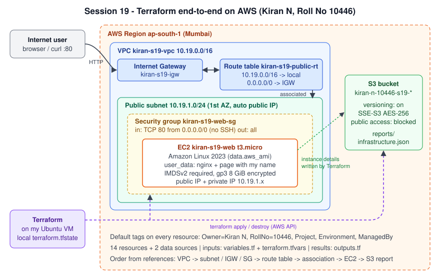
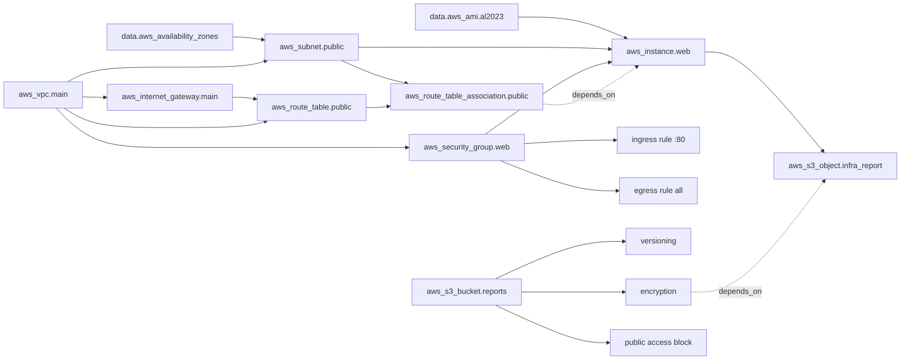

# Terraform End-to-End Project on AWS

**Name:** Kiran N | **Roll No:** 10446 | **Session 19 - Cloud & Terraform in Action (homework)**

One Terraform project builds a small but complete AWS setup in `ap-south-1`: a **VPC** with a **public subnet**, **internet gateway** and **route table**, a **security group**, an **EC2 web server** that shows a page with my name, and a private **S3 bucket** that stores a JSON report about the server. Everything is created with `terraform apply` and removed with `terraform destroy`.

## Architecture



Dependency graph (what Terraform works out from the references in `main.tf`):



## Project structure

```text
09-terraform-end-to-end/
|-- versions.tf           # Terraform >= 1.6, AWS provider ~> 6.0, provider "aws" with region + default tags
|-- variables.tf          # 9 inputs with types, descriptions and validation rules
|-- terraform.tfvars      # my values (no secrets)
|-- main.tf               # 2 data sources + 14 resources
|-- user_data.sh.tftpl    # first-boot script for EC2: installs nginx, writes my page
|-- outputs.tf            # 11 outputs (IDs, public IP, website URL, bucket, report URI)
|-- architecture.svg      # diagram above
|-- .terraform.lock.hcl   # exact provider version (aws 6.66.0) + checksums, committed
|-- .gitignore            # keeps .terraform/, *.tfstate and plan files out of Git
|-- README.md
```

## What the homework asks for and where it is

| Concept | Where in this project |
|---|---|
| **Provider** | `versions.tf`: `hashicorp/aws ~> 6.0`, region from `var.aws_region`, `default_tags` puts Owner/RollNo/Project/Environment/ManagedBy on every resource |
| **Variables** | `variables.tf`: string, list and validated inputs (`environment` must be dev/test/prod, `vpc_cidr` must be a valid CIDR, `project_name` only lowercase letters, digits and dashes). Values in `terraform.tfvars`, override with `-var` |
| **Resources** | `main.tf`: 14 resources (table below) |
| **Data sources** | `aws_availability_zones` (no hard-coded AZ) and `aws_ami` (latest Amazon Linux 2023, no hard-coded AMI ID) |
| **Outputs** | `outputs.tf`: `vpc_id`, `subnet_id`, `security_group_id`, `instance_id`, `instance_public_ip`, `website_url`, `s3_bucket_name`, `s3_report_uri` and more |
| **Dependencies** | Implicit: `aws_subnet.public` uses `aws_vpc.main.id`, so it waits for the VPC. Explicit: `aws_instance.web` has `depends_on = [aws_route_table_association.public]` so the route to the internet exists before first boot (nginx is downloaded then); the S3 report waits for bucket encryption |
| **Functions / expressions** | `templatefile()` for user_data, `jsonencode()` for the report, `for_each` over `allowed_http_cidrs`, `can(cidrhost())` and `regex()` in validations |
| **State** | Local `terraform.tfstate` (git-ignored); `terraform state list` / `state show` |
| **Plan / apply / destroy** | `terraform plan -out=tfplan`, `terraform apply tfplan`, `terraform plan -destroy`, `terraform destroy` |

## Resources

| # | Terraform address | AWS resource |
|---|---|---|
| 1 | `aws_vpc.main` | VPC `kiran-s19-vpc`, 10.19.0.0/16, DNS hostnames on |
| 2 | `aws_subnet.public` | Subnet `kiran-s19-public-subnet`, 10.19.1.0/24, first AZ, public IP on launch |
| 3 | `aws_internet_gateway.main` | IGW `kiran-s19-igw` attached to the VPC |
| 4 | `aws_route_table.public` | Route table with `0.0.0.0/0 -> IGW` |
| 5 | `aws_route_table_association.public` | Makes the subnet public |
| 6 | `aws_security_group.web` | `kiran-s19-web-sg` |
| 7 | `aws_vpc_security_group_ingress_rule.http["0.0.0.0/0"]` | Inbound TCP 80 (no SSH port is opened) |
| 8 | `aws_vpc_security_group_egress_rule.all` | Outbound all (for `dnf install nginx`) |
| 9 | `aws_instance.web` | EC2 `kiran-s19-web`, t3.micro, Amazon Linux 2023, IMDSv2 required, encrypted gp3 8 GiB, nginx via user_data |
| 10 | `aws_s3_bucket.reports` | Bucket `kiran-n-10446-s19-<random suffix>` (`bucket_prefix`, so the name is always unique) |
| 11 | `aws_s3_bucket_versioning.reports` | Versioning Enabled |
| 12 | `aws_s3_bucket_server_side_encryption_configuration.reports` | SSE-S3 AES-256 |
| 13 | `aws_s3_bucket_public_access_block.reports` | All 4 public access blocks on |
| 14 | `aws_s3_object.infra_report` | `reports/infrastructure.json`: VPC, subnet, SG and instance details written by Terraform |

## How to run

Prerequisites: Terraform >= 1.6, AWS CLI v2, `aws configure` with an IAM user (my `kiran-terraform` user has only EC2 and S3 permissions, which is all this project needs).

```bash
cd 09-terraform-end-to-end

terraform init                       # downloads hashicorp/aws 6.66.0 (from the lock file)
terraform fmt -check                 # code is formatted
terraform validate                   # syntax, types, references

terraform plan -out=tfplan           # Plan: 14 to add, 0 to change, 0 to destroy
terraform apply tfplan               # creates everything in dependency order
terraform output                     # IDs, website_url, bucket name
terraform state list                 # 2 data sources + 14 resources
terraform state show aws_instance.web

curl "$(terraform output -raw website_url)"                    # page served by nginx on EC2 (wait 1-2 min after apply)
aws s3 cp "$(terraform output -raw s3_report_uri)" -           # the JSON report in S3

terraform plan                       # "No changes" = AWS matches the code (no drift)
terraform plan -var='environment=test'   # tags change in place, EC2 is replaced (user_data changes)

terraform plan -destroy              # Plan: 0 to add, 0 to change, 14 to destroy
terraform destroy                    # removes all 14 resources
```

On my VM all of this is run by [`../session19_lab.sh`](../session19_lab.sh), which saves every step to `outputs/`.

## Design choices

- **No hard-coded IDs:** AZ and AMI come from data sources, so the code works in any region.
- **Security:** only port 80 is open, there is no SSH key and no port 22; IMDSv2 is required; the root disk and the bucket are encrypted; the bucket can never be public.
- **Unique bucket name:** `bucket_prefix = "kiran-n-10446-s19-"` lets AWS add a random suffix, so `apply` never fails with "bucket already exists".
- **`user_data_replace_on_change = true`:** if the boot script changes, Terraform replaces the instance instead of silently keeping the old page.
- **`force_destroy = true`** on the bucket: `terraform destroy` empties it first (it has a versioned object inside).
- **Cost:** t3.micro (free tier eligible) + one public IPv4 address for the time of the demo. Everything is destroyed right after the screenshots.

All my real outputs and screenshots are in [`../resultReadme.md`](../resultReadme.md).
