# Session 20: Monitoring, Observability and GitOps

| | |
|---|---|
| **Name** | Kiran N |
| **Roll No.** | 10446 |
| **Session** | 20: Monitoring, Observability and GitOps |
| **Repository** | [Kirann1973/devops-heros](https://github.com/Kirann1973/devops-heros), branch `assignment` |
| **Monitoring + observability demo** | [`09-monitoring-observability-demo/`](09-monitoring-observability-demo/): app + Prometheus + Alertmanager + Grafana + Jaeger + node-exporter |
| **GitOps demo** | [`10-gitops-argocd-demo/`](10-gitops-argocd-demo/): Kubernetes manifests deployed by Argo CD from this Git branch |
| **Lab script** | [`session20_lab.sh`](session20_lab.sh) (parts 1-12) + [`lab_helpers.py`](lab_helpers.py), run on my Ubuntu VM |
| **VM** | Multipass `ubuntu` (arm64), 2 CPUs, 5.8 GB RAM, IP 192.168.252.2 |
| **Tools** | Docker 29.1.3, Compose 2.40.3, Prometheus v3.5.0, Alertmanager v0.28.1, Grafana 12.1.1, Jaeger 1.62.0, Minikube (Kubernetes v1.37.0), Argo CD v3.5.5 |

Everything below ran on my VM on 18 Oct 2026. The browser screenshots are from my Mac, opening the VM's IP. All screenshots are in [`screenshots/`](screenshots/).

---

## Homework tasks and where they are answered

| Homework | Where |
|---|---|
| **Task 1: Monitoring** (metrics, logs, alerts, CPU, memory, application health) | [Part A](#part-a-monitoring), with the table in the [demo README](09-monitoring-observability-demo/README.md#task-1-monitoring) |
| **Task 2: Observability** (3 pillars, why it is needed, tools, Kubernetes observability) | [Part B](#part-b-observability), with the full write-up in the [demo README](09-monitoring-observability-demo/README.md#task-2-observability) |
| **Task 3: GitOps** (what it is, Git as source of truth, declarative config, continuous reconciliation, workflow, Kubernetes + GitOps) | [Part C](#part-c-gitops-with-argo-cd), with concepts in the [GitOps README](10-gitops-argocd-demo/README.md#gitops-concepts) |
| Deliverable: monitoring demo | [`09-monitoring-observability-demo/`](09-monitoring-observability-demo/), Steps 1-7 |
| Deliverable: observability documentation | [`09-monitoring-observability-demo/README.md`](09-monitoring-observability-demo/README.md) |
| Deliverable: GitOps demo | [`10-gitops-argocd-demo/`](10-gitops-argocd-demo/), Steps 8-12 |
| Deliverable: screenshots | 22 screenshots in [`screenshots/`](screenshots/), shown below |
| Deliverable: README.md | This file + the two demo READMEs |
| Class examples 01-08 | Restored unchanged in this folder |

---

## Architecture

### Monitoring and observability (Docker Compose)

```text
                    my Mac browser  ->  http://192.168.252.2:3000 Grafana | :9090 Prometheus | :9093 Alertmanager | :16686 Jaeger
                                                     |                       |                       |                 |
  traffic (curl)  -->  app :8000  ---- /metrics ---> Prometheus ---- alerts ---> Alertmanager ---> alert-receiver (webhook)
                        |   |                         ^    ^ evaluates 8 alert rules             (prints FIRING / RESOLVED)
                        |   |        node-exporter ---+    +--- Grafana reads Prometheus and Jaeger
                        |   |        (VM CPU, memory, disk)
                        |   +--- spans (Zipkin JSON) ---> Jaeger (traces)
                        +------- JSON logs with trace_id ---> docker compose logs app
```

The app ([`app/app.py`](09-monitoring-observability-demo/app/app.py)) uses only the Python standard library. It produces all three signals itself:
- **Metrics** on `/metrics`: requests, errors, a latency histogram, CPU, memory, and `app_info` with my name and roll number.
- **Logs** as one JSON line per request, including the `trace_id`.
- **Traces** sent to Jaeger, with a child span for each step.

Endpoints: `/` is normal, `/slow` is a slow downstream call, `/error` returns HTTP 500 from a failing DB call, `/work` uses CPU, and `/health` reports health.

### GitOps (Minikube + Argo CD)

```text
 me: git commit + push  ->  GitHub Kirann1973/devops-heros, branch assignment, folder 10-gitops-argocd-demo/app/
                                         |  desired state
                                         v
                     Argo CD (namespace argocd): compare Git with the cluster, sync, self-heal
                                         |  actual state
                                         v
                     Minikube, namespace session20: Deployment session20-mini (nginx) + Service + ConfigMap
```

---

## Part A: Monitoring

### Step 1: VM and tools

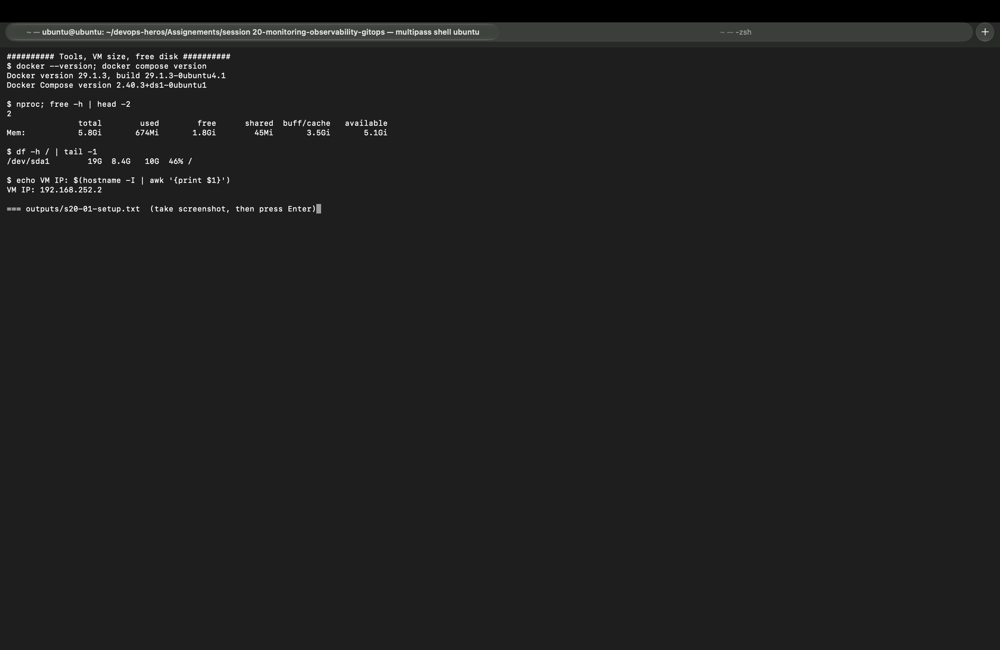

### Step 2: Start the stack, check targets and Grafana

`docker compose up -d` starts 7 containers. The app reports healthy. Prometheus scrapes all **5 targets** (`up`), and Grafana has its two data sources and my dashboard, all created from files ([provisioning](09-monitoring-observability-demo/grafana/)).

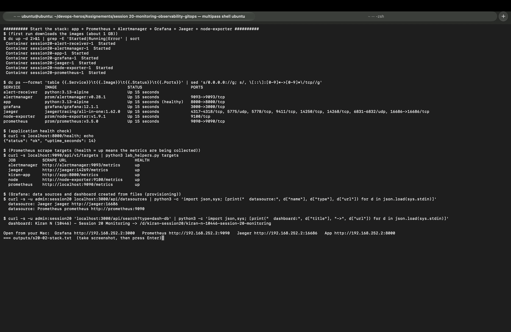

The same 5 targets in the Prometheus UI (Status > Targets):

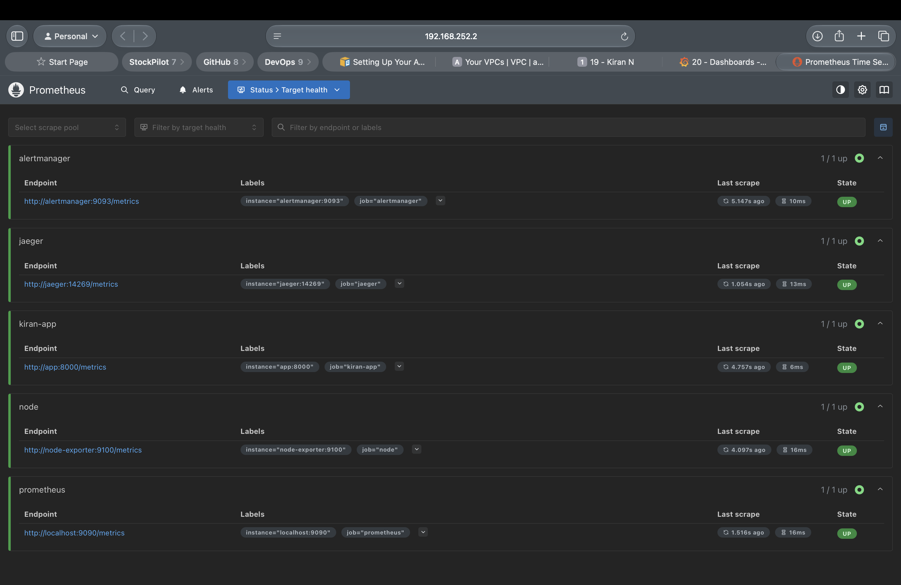

### Step 3: Metrics: requests, errors, latency, CPU, memory

60 seconds of mixed traffic, followed by PromQL queries against Prometheus:

| What | PromQL | My result |
|---|---|---|
| Application health | `up{job="kiran-app"}` | `1` (up) |
| Requests per second | `sum by (path, status) (rate(http_requests_total[1m]))` | `/` 2.87, `/slow` 0.4, `/error` 0.2 req/s |
| Error rate | `5xx / all` | 0.0516 (5.2%) |
| Latency p50 / p95 | `histogram_quantile(0.5 / 0.95, ...)` | 7.3 ms / **1.70 s** (the `/slow` requests) |
| App CPU | `rate(process_cpu_seconds_total[1m])` | 0.0086 cores |
| App memory | `process_resident_memory_bytes / 1e6` | 25.2 MB |
| VM CPU | `100 - avg(rate(node_cpu_seconds_total{mode="idle"}[1m])) * 100` | 5.7 % |
| VM memory | `(1 - MemAvailable / MemTotal) * 100` | 17.6 % |

`docker stats` shows the CPU and memory of every container directly from Docker.

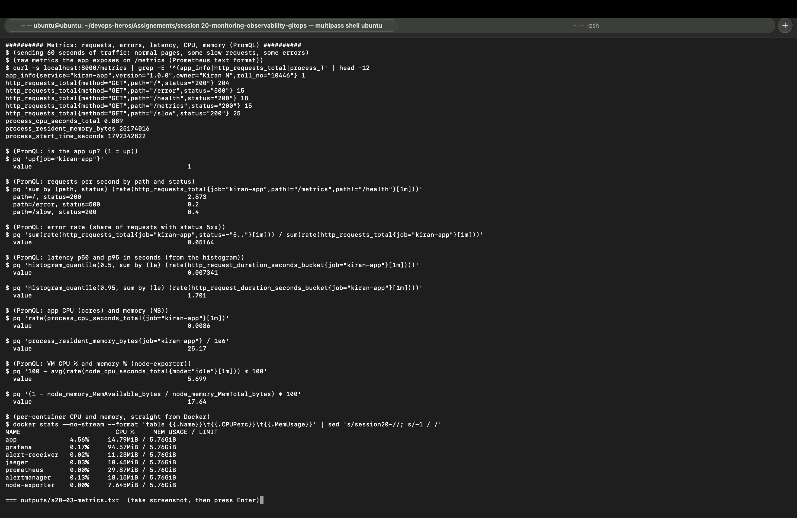

### Step 4: Alerts fire

[`alert-rules.yml`](09-monitoring-observability-demo/prometheus/alert-rules.yml) has 8 rules: `AppDown`, `HighErrorRate`, `SlowRequests`, `HighAppCPU`, `HighAppMemory`, `HostHighCPU`, `HostHighMemory` and `HostDiskAlmostFull`. All were `inactive` at first. I then caused two problems:
1. **CPU load and failing requests** (`/work` and `/error` for about 70 s). `HighAppCPU` fired at 0.59 cores (limit 0.5) and `HighErrorRate` at 29.1 % (limit 10 %).
2. **App crash** (`docker compose stop app`). `AppDown` (critical) fired after 15 s.

Alertmanager received the alerts and sent them to the webhook. The webhook log shows 4 `[FIRING]` notifications: SlowRequests from the earlier `/slow` traffic, then HighErrorRate, HighAppCPU and AppDown.

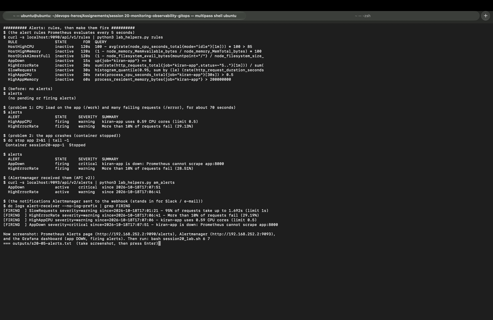

In the Prometheus UI, the `kiran-app` group shows **AppDown FIRING**:

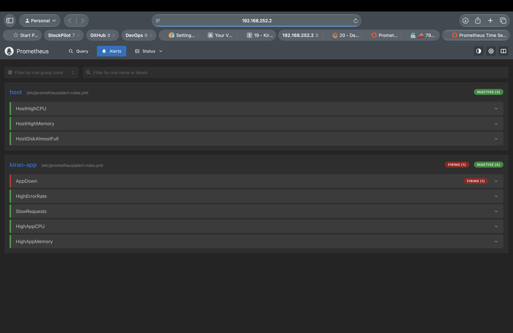

Alertmanager shows the AppDown alert routed to my `kiran-webhook` receiver, with labels `severity="critical"` and `owner="kiran-n-10446"`:

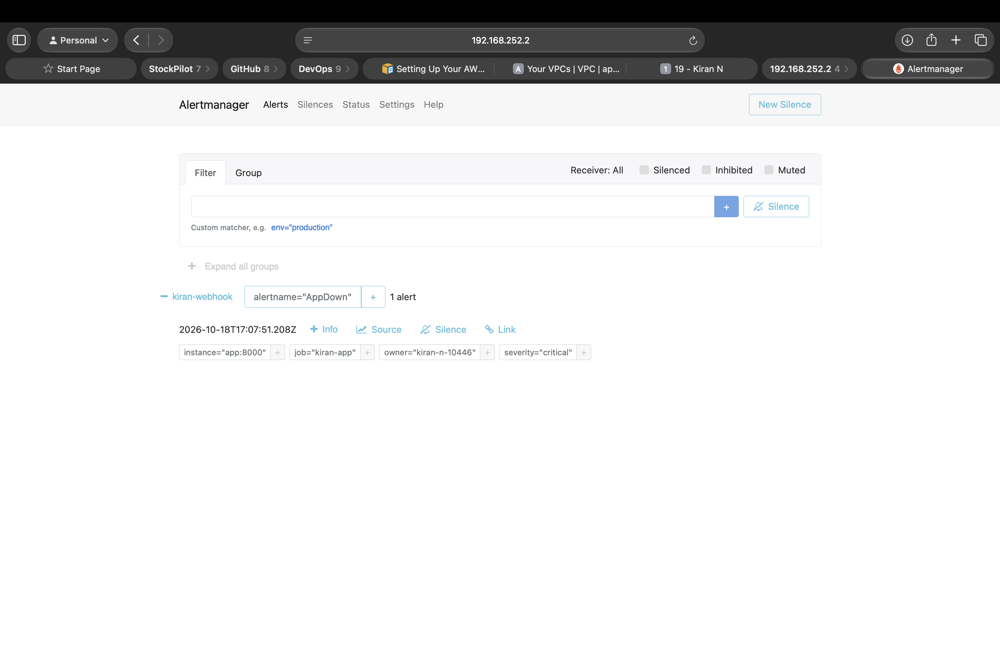

My Grafana dashboard **"Kiran N (10446) - Session 20 Monitoring"** during the outage:
- App health shows **DOWN**.
- Error rate is 27 %, from the `/error` load.
- 1 alert is firing.
- The latency graph shows the p95/p99 spike from `/slow`.
- The requests graph shows the `/work` and `/error` load.

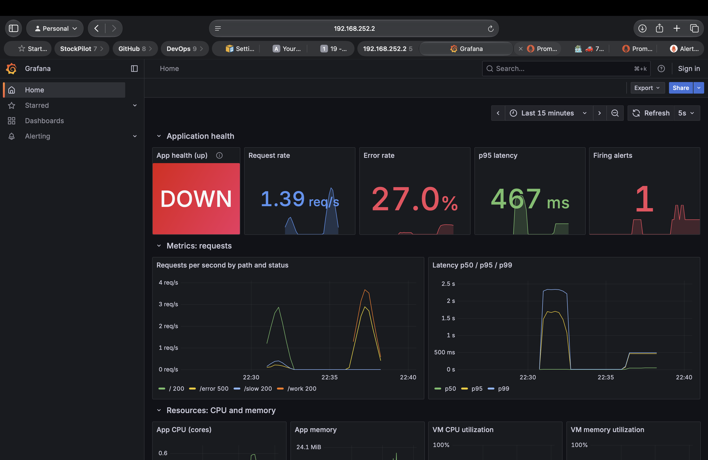

### Step 5: Fix, and the alerts resolve

`docker compose start app`, then `/health` is OK and `up` is 1 again. Prometheus has no firing alerts. Alertmanager sent a `[RESOLVED]` notification for each alert, because `send_resolved: true` is set.

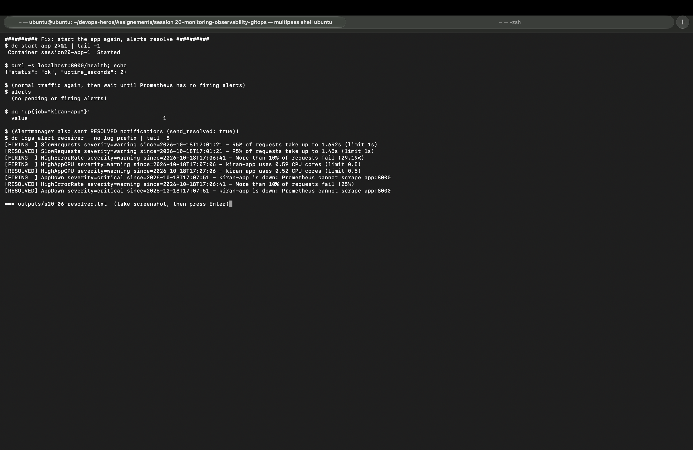

### Step 6: Stop the stack

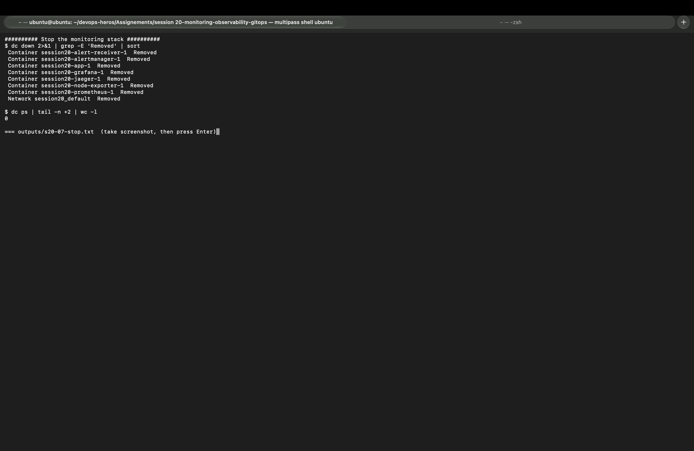

---

## Part B: Observability

Monitoring told me **that** something was wrong: an alert fired. Observability told me **why**, by following one request across the three pillars:

| Pillar | What I saw | Tool |
|---|---|---|
| **Metrics** | Error rate 29 %, p95 latency 1.7 s | Prometheus + Grafana |
| **Logs** | `{"level": "error", "path": "/error", "status": 500, "duration_ms": 32.9, "trace_id": "79e98c6f..."}` | `docker compose logs app` |
| **Traces** | Trace `79e98c6f...`: `GET /error` 32.9 ms, child span `db-query` with `error=true, error.message=connection refused: orders-db:5432` | Jaeger |

So **metric** (high error rate) → **log** (which request, with `trace_id`) → **trace** (the failing step and the exact error).

The slowest `/slow` request took 1656 ms. Its trace shows that `call-inventory-service` used 1656 ms of it, so the time goes to the downstream call, not the app itself.

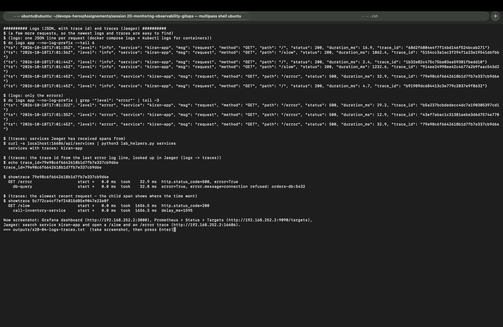

The `/slow` trace in Jaeger, where the child span `call-inventory-service` fills almost the whole request:

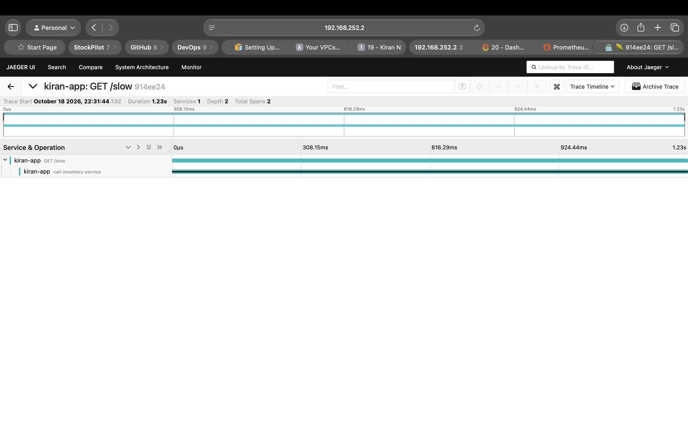

The `/error` trace in Jaeger is **the same trace `79e98c6`** as the error log line above: 32.91 ms, 2 spans. Both `GET /error` and the `db-query` span are marked with the red error icon:

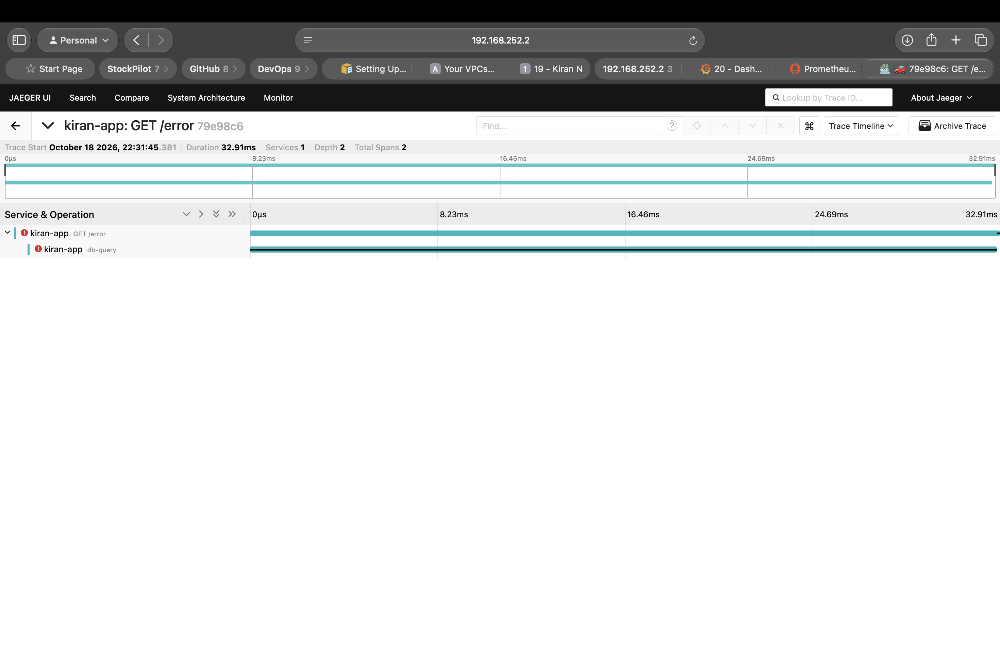

The theory part of Task 2 is in the [demo README](09-monitoring-observability-demo/README.md#task-2-observability):
- monitoring vs observability
- the three pillars, with examples from my app
- why observability is required (many services, MTTD/MTTR, SLIs/SLOs)
- common tools (Prometheus, Grafana, Loki/ELK, Jaeger/Tempo, OpenTelemetry, Datadog and others)
- Kubernetes observability (metrics-server, cAdvisor, kube-state-metrics, node-exporter, ServiceMonitor, Fluent Bit/Loki, events, probes, kube-prometheus-stack)

---

## Part C: GitOps with Argo CD

### Step 7: Install Argo CD on Minikube

I used Minikube (the same cluster as in earlier sessions) instead of kind. Argo CD v3.5.5 was installed from the official stable manifests, and all 7 Argo CD pods are running.

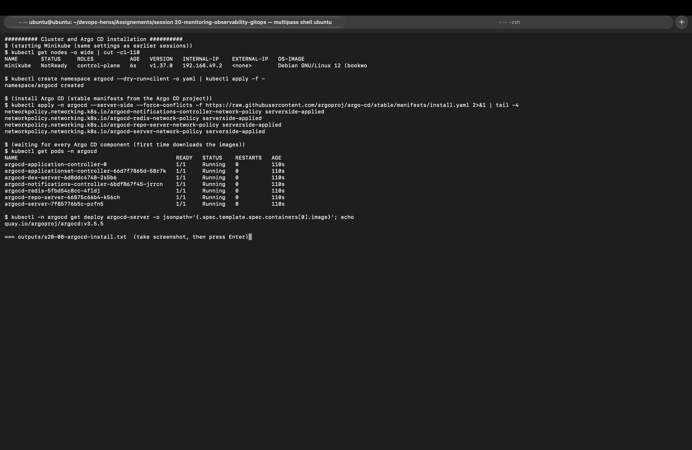

### Step 8: The Argo CD Application: Git → Kubernetes

[`argocd-application.yaml`](10-gitops-argocd-demo/argocd-application.yaml) is the **only** file I applied by hand. It tells Argo CD to watch my repo `Kirann1973/devops-heros`, branch `assignment`, folder `10-gitops-argocd-demo/app`, and deploy it to namespace `session20`, with `prune: true` and `selfHeal: true`.

Argo CD then created the Namespace, ConfigMap, Deployment (2 replicas, from Git) and Service on its own:
- Status: **Synced / Healthy**, synced to commit `c35188a`.
- The page is served through the Service and shows "Kiran N | Roll No: 10446 ... deployed by Argo CD from Git".

The admin password is hidden in the screenshot.

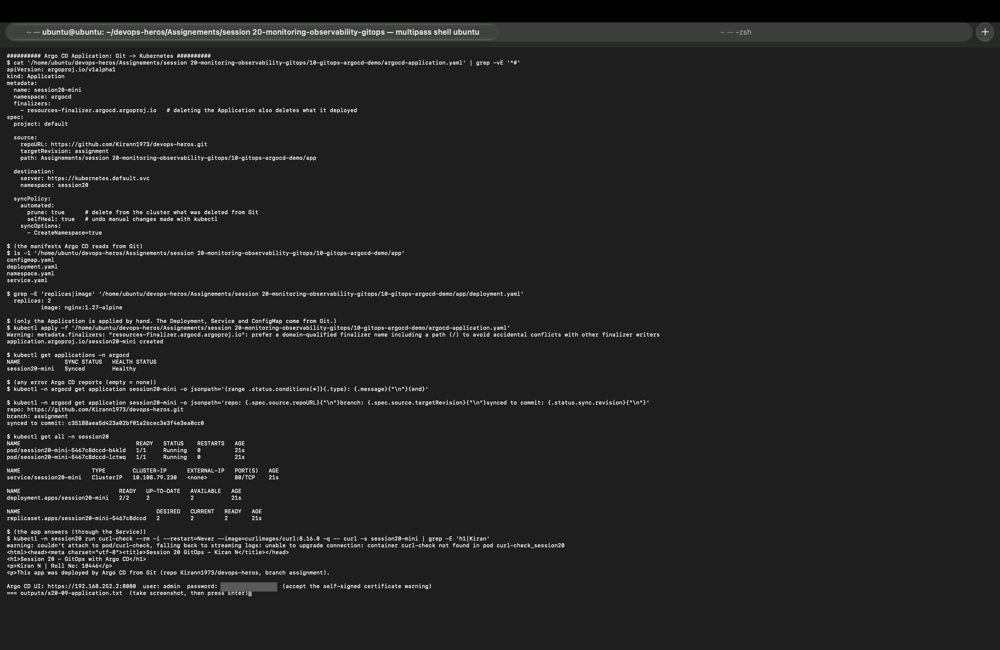

In the Argo CD UI, the app tile shows Healthy + Synced, my repo, branch `assignment` and the path:

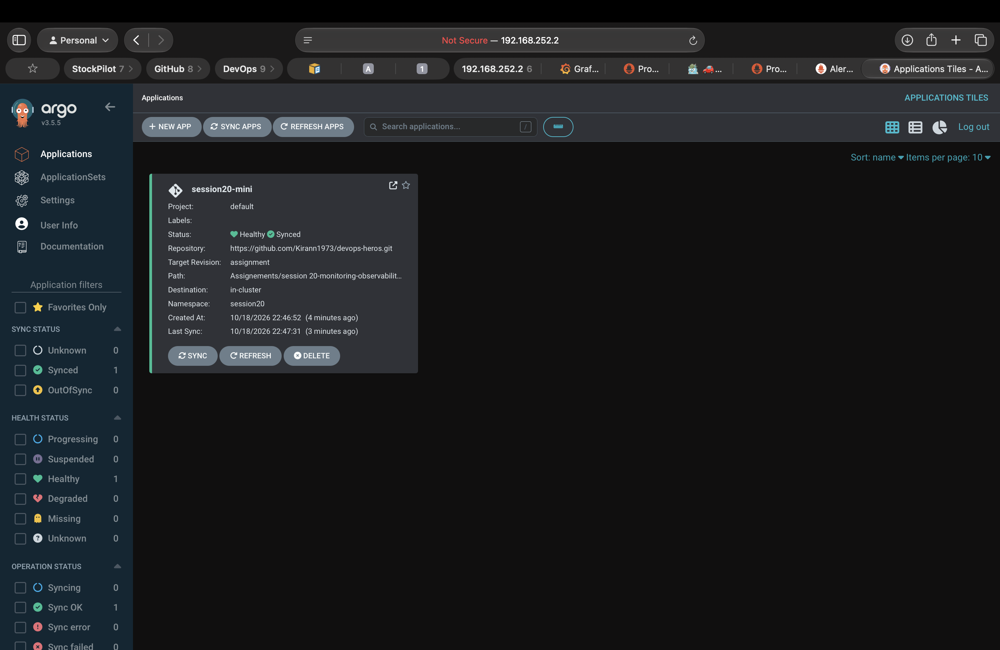

The resource tree: Application → ConfigMap, Namespace, Service, Deployment → ReplicaSet → **2 pods**. It is synced to `c35188a`, authored by Kirann1973:

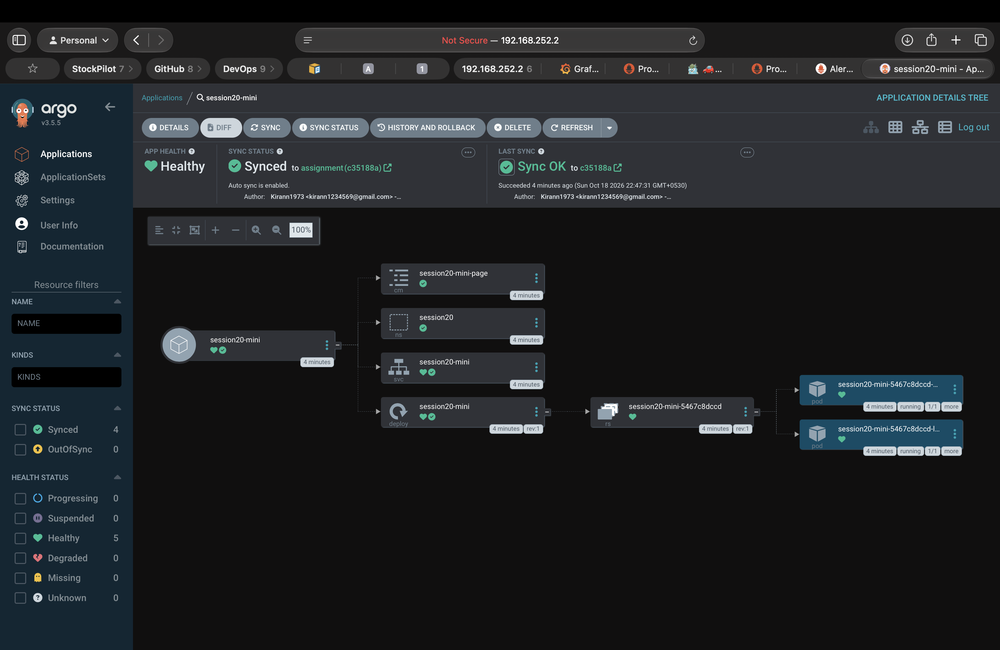

### Step 9: Change Git, and Argo CD deploys it

I did not run `kubectl scale`. I changed **Git**: commit `12600e0`, "scale session20-mini from 2 to 3 replicas", which changes `replicas: 2` to `replicas: 3` in [`app/deployment.yaml`](10-gitops-argocd-demo/app/deployment.yaml), and pushed it.

After a refresh, Argo CD saw the new commit and synced it:
- The Deployment is **3/3**.
- The history shows two deployments: `c35188a`, then `12600e0`.

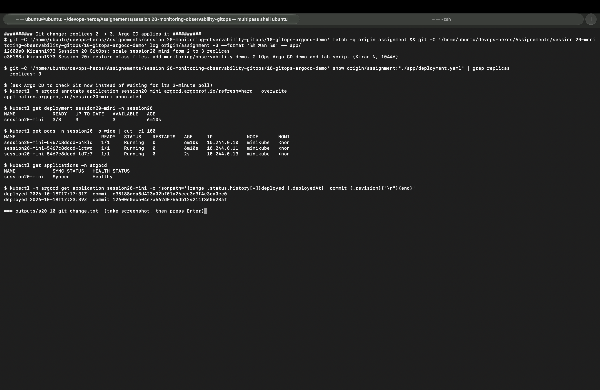

The tree now shows **3 pods**, "Synced to assignment (12600e0)":

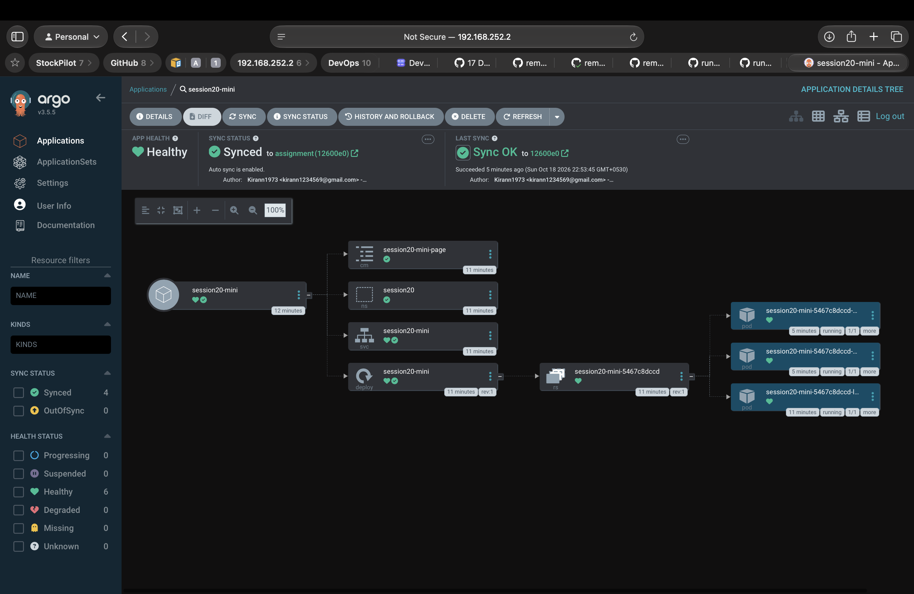

History and Rollback lists both of my commits, each deployed by the **automated sync policy**. Rolling back would mean `git revert`, or picking the older revision here.

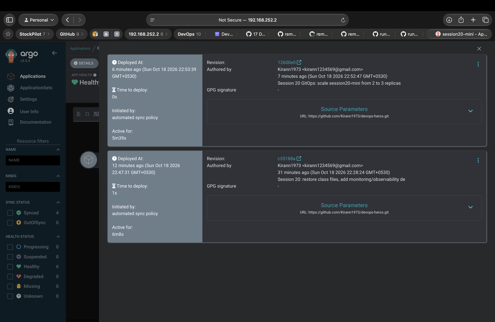

### Step 10: Self-healing (continuous reconciliation)

Someone changes the cluster by hand: `kubectl scale --replicas=1` creates drift. Actual state (1) no longer matches desired state in Git (3).

Within a few seconds Argo CD put it back to **3/3**. The events show the whole sequence: scaled up 0 → 2 (first sync), 2 → 3 (my Git commit), down 3 → 1 (manual change), then up 1 → 3 (Argo CD self-heal). The app stayed Synced / Healthy. The pod logs show the Kubernetes readiness and liveness probes getting HTTP 200.

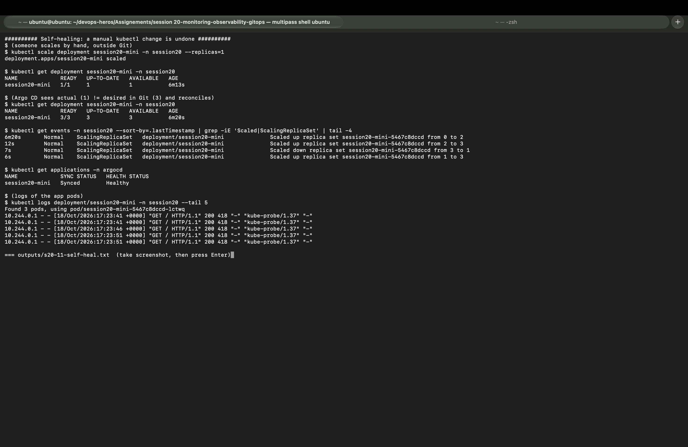

### Step 11: Cleanup

Deleting the Application also deleted everything it deployed, because of `resources-finalizer.argocd.argoproj.io`. `session20` is then empty, and the `argocd` namespace was removed.

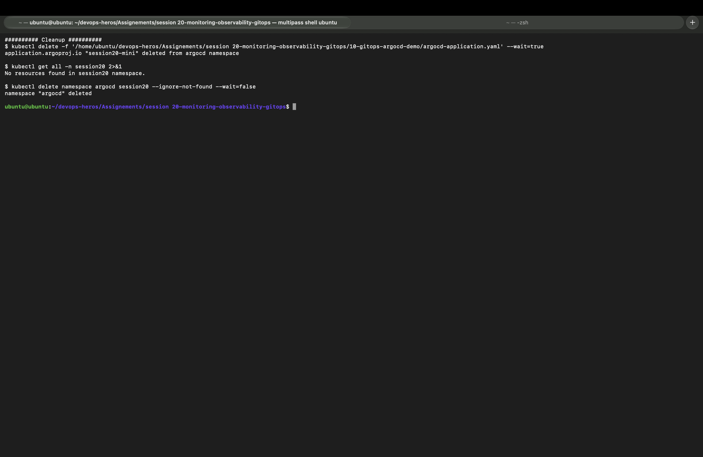

### What this demo shows about GitOps

| Concept | Evidence above |
|---|---|
| **Git is the single source of truth** | The replica count came from a commit by me (`12600e0`). Argo CD shows the author, message and commit for each deployment |
| **Declarative configuration** | Plain YAML that describes the end state (3 nginx pods with my page), with no scripts |
| **Continuous reconciliation** | Argo CD compared Git with the cluster, synced the new commit, and undid the manual `kubectl scale` |
| **Pull model** | No CI pipeline or person ran `kubectl apply` on the app. Argo CD inside the cluster pulled from GitHub |
| **Audit and rollback** | History and Rollback lists every deployed commit; `git revert` would roll back |
| **Workflow** | Edit YAML, commit, push, Argo CD detects OutOfSync, syncs, Synced/Healthy, heals drift ([full workflow](10-gitops-argocd-demo/README.md#gitops-workflow)) |
| **Kubernetes + GitOps** | Kubernetes reconciles pods to the Deployment, and Argo CD reconciles the Deployment to Git: the same loop one level higher ([details](10-gitops-argocd-demo/README.md#kubernetes--gitops)) |

---

## How to run it again

```bash
cd "Assignements/session 20-monitoring-observability-gitops"
bash session20_lab.sh 1 2 3 4     # stack up, metrics, logs and traces  (screenshots: Grafana, Prometheus, Jaeger)
bash session20_lab.sh 5           # make alerts fire                   (screenshots: Prometheus alerts, Alertmanager, Grafana)
bash session20_lab.sh 6 7         # alerts resolve, stack down
bash session20_lab.sh 8 9         # Minikube + Argo CD + Application    (Argo CD UI: https://<vm-ip>:8080)
#   change replicas in 10-gitops-argocd-demo/app/deployment.yaml, commit, push
bash session20_lab.sh 10 11       # Git change deployed, self-heal
bash session20_lab.sh 12          # cleanup
```

Each part also saves its output to `outputs/s20-NN-*.txt`.
