# Session 21: Final DevOps Project and Troubleshooting

| | |
|---|---|
| **Name** | Kiran N |
| **Roll No.** | 10446 |
| **Session** | 21: Final DevOps Project and Troubleshooting |
| **Final project** | **StockPilot**: [github.com/Kirann1973/stockpilot-devops-capstone](https://github.com/Kirann1973/stockpilot-devops-capstone) (inventory management app on a full DevOps pipeline, 33 commits) |
| **This folder** | [Kirann1973/devops-heros](https://github.com/Kirann1973/devops-heros), branch `assignment`: DevSecOps gate + final troubleshooting challenge, run against StockPilot |
| **Lab script** | [`session21_lab.sh`](session21_lab.sh) (parts 1-16) + [`lab_helpers.py`](lab_helpers.py), run on my Ubuntu VM |
| **VM** | Multipass `ubuntu` (arm64), 2 CPUs, 5.8 GB RAM, IP 192.168.252.2 |
| **Tools** | Docker 29.1.3, Minikube v1.39.0 (Kubernetes v1.37.0), kubectl v1.35.9, Helm v3.22.1, Bandit 1.9.4, pip-audit 2.10.1, npm audit (Node 22), Gitleaks 8.28.0, Trivy 0.67.2 |

The application, CI/CD, Terraform/EKS, Helm, monitoring and GitOps are in the StockPilot repository. Their evidence is in its own [`docs/screenshots/`](https://github.com/Kirann1973/stockpilot-devops-capstone/tree/main/docs/screenshots). For this session I added two things on top of it, both run on my VM on 18 Oct 2026:

1. **DevSecOps**: SAST, SCA, secret scanning and image scanning, joined into one **security gate** ([`security/`](security/)). The gate passes on StockPilot and blocks a deliberately bad commit.
2. **Final troubleshooting challenge**: StockPilot is deployed on Minikube with its own Helm chart, then broken **6 times**. Each issue is identified, investigated, fixed and verified ([`troubleshooting-challenge/`](troubleshooting-challenge/)).

All 18 screenshots from this session are in [`screenshots/`](screenshots/). The instructor's TaskBoard reference project (`backend/`, `frontend/`, `helm/`, `terraform/`, `GRADING.md`, ...) is kept unchanged in this folder.

---

## Homework checklist and where each item is

| Homework item | Where it is |
|---|---|
| **Application** | StockPilot: React + FastAPI + PostgreSQL ([`backend/`](https://github.com/Kirann1973/stockpilot-devops-capstone/tree/main/backend), [`frontend/`](https://github.com/Kirann1973/stockpilot-devops-capstone/tree/main/frontend)). [Screenshot](#application) |
| **Git / GitHub** | Public repo, 33 commits with meaningful messages, [`.gitignore`](https://github.com/Kirann1973/stockpilot-devops-capstone/blob/main/.gitignore) |
| **CI pipeline, build and test** | [`.github/workflows/ci-cd.yml`](https://github.com/Kirann1973/stockpilot-devops-capstone/blob/main/.github/workflows/ci-cd.yml): pytest (14 tests), React build, terraform validate |
| **Security scanning** | CI: Trivy on both images. This session: [the security gate](#part-a-devsecops-security-gate) (Steps 1-8) |
| **Docker image** | Non-root, multi-stage Dockerfiles + [`docker-compose.yml`](https://github.com/Kirann1973/stockpilot-devops-capstone/blob/main/docker-compose.yml) |
| **Container registry** | GHCR, tag = Git commit SHA (`ghcr.io/kirann1973/stockpilot-backend:bc270c5…`) |
| **Kubernetes** | Deployment, Service, ConfigMap, Secret, Ingress, HPA, probes, StatefulSet + PVC. All verified in [Step 9](#step-9-deploy-stockpilot-on-minikube-with-helm) |
| **Helm** | [`helm/stockpilot`](https://github.com/Kirann1973/stockpilot-devops-capstone/tree/main/helm/stockpilot). Installed, upgraded and rolled back 8 times in Part B |
| **Monitoring** | kube-prometheus-stack, ServiceMonitor on `/metrics`, Grafana dashboard ([`monitoring/`](https://github.com/Kirann1973/stockpilot-devops-capstone/tree/main/monitoring)) |
| **GitOps** | Argo CD Application ([`argocd/`](https://github.com/Kirann1973/stockpilot-devops-capstone/tree/main/argocd)). CI commits the new image tag, and Argo CD deploys it |
| **Infrastructure (Terraform)** | [`terraform/`](https://github.com/Kirann1973/stockpilot-devops-capstone/tree/main/terraform): AWS VPC (2 public + 2 private subnets) + EKS. Plan, apply and destroy screenshots |
| **DevSecOps: SAST, SCA, secret scan, image scan, security gate** | [Part A](#part-a-devsecops-security-gate) |
| **Final troubleshooting challenge** (identify, investigate, root cause, fix, verify, document) | [Part B](#part-b-final-troubleshooting-challenge): 6 issues |
| **Final deliverables structure** | [Mapping table](#final-deliverables-structure) |
| **README contents** (overview, architecture, technologies, setup, ..., lessons learned) | This file + the [StockPilot README](https://github.com/Kirann1973/stockpilot-devops-capstone#readme) |

---

## Project overview

StockPilot is a small inventory management app for a store or office team. With it, the team can:
- keep a product catalogue (SKU, category, supplier, unit price)
- receive and ship stock with one click
- see which items are in stock, low or out of stock
- watch KPIs such as units on hand and inventory value

The DevOps layer takes it from a `git push` to a monitored Kubernetes cluster.

## Architecture

```text
 Developer ── git push ──► GitHub (Kirann1973/stockpilot-devops-capstone)
                              │
                              ▼
   GitHub Actions ci-cd.yml:  pytest ─► React build ─► terraform validate ─► docker build
                              ─► Trivy scan (fail on HIGH/CRITICAL) ─► push to GHCR (tag = commit SHA)
                              ─► GitOps bump: commit the new tag into helm/stockpilot/values-gitops.yaml
                              │
   Security gate (this session): Bandit (SAST) + pip-audit / npm audit (SCA) + Gitleaks (secrets)
                              + Trivy (images) ─► PASS = push and deploy, FAIL = pipeline stops
                              │
   Terraform ──► AWS VPC + EKS (ap-south-1)        Argo CD ──► watches helm/stockpilot on main
                              │                               │
                              ▼                               ▼
                  Kubernetes (EKS or Minikube), Helm release "stockpilot"
   Ingress nginx ── /     ──► frontend Service ──► React on nginx (2 pods, probes /nginx-health)
                 └─ /api  ──► backend Service  ──► FastAPI (2-4 pods, HPA 60% CPU, probes /ready /health)
                                                    └──► PostgreSQL StatefulSet + 1Gi PVC (Secret stockpilot-db)
   Prometheus (ServiceMonitor scrapes /metrics) ──► Grafana dashboard "StockPilot API" (ConfigMap)
```

## Technologies used

| Layer | Tools |
|---|---|
| Application | React 18 + Vite, FastAPI, SQLAlchemy 2, Alembic, PostgreSQL 16 |
| Tests | Pytest (14 tests, isolated SQLite test DB) |
| Containers | Docker (non-root images, multi-stage frontend), Docker Compose |
| CI/CD | GitHub Actions, GHCR |
| DevSecOps | Bandit, pip-audit, npm audit, Gitleaks, Trivy (image + config) |
| Infrastructure | Terraform, `terraform-aws-modules` VPC + EKS |
| Orchestration | Kubernetes, Helm, NGINX Ingress, HPA, metrics-server |
| Observability | Prometheus (kube-prometheus-stack), Grafana |
| GitOps | Argo CD |

## Final deliverables structure

The homework suggests a `final-devops-project/` layout. This is where each folder lives in StockPilot:

| Suggested folder | In StockPilot |
|---|---|
| `application/` | [`backend/`](https://github.com/Kirann1973/stockpilot-devops-capstone/tree/main/backend) (FastAPI, Alembic, tests) + [`frontend/`](https://github.com/Kirann1973/stockpilot-devops-capstone/tree/main/frontend) (React) |
| `docker/` | `backend/Dockerfile`, `frontend/Dockerfile`, [`docker-compose.yml`](https://github.com/Kirann1973/stockpilot-devops-capstone/blob/main/docker-compose.yml) |
| `kubernetes/` | [`k8s/namespace.yaml`](https://github.com/Kirann1973/stockpilot-devops-capstone/tree/main/k8s) + [`troubleshooting/`](https://github.com/Kirann1973/stockpilot-devops-capstone/tree/main/troubleshooting) labs |
| `helm/` | [`helm/stockpilot/`](https://github.com/Kirann1973/stockpilot-devops-capstone/tree/main/helm/stockpilot) (Chart.yaml, values, 10 templates) |
| `terraform/` | [`terraform/`](https://github.com/Kirann1973/stockpilot-devops-capstone/tree/main/terraform) (VPC + EKS, `terraform.tfvars.example`) |
| `.github/workflows/` | [`ci-cd.yml`](https://github.com/Kirann1973/stockpilot-devops-capstone/blob/main/.github/workflows/ci-cd.yml) |
| `security/` | Trivy steps in `ci-cd.yml` + [`docs/trivy.md`](https://github.com/Kirann1973/stockpilot-devops-capstone/blob/main/docs/trivy.md) + **this folder's [`security/`](security/)** (the full gate) |
| `monitoring/` | [`monitoring/`](https://github.com/Kirann1973/stockpilot-devops-capstone/tree/main/monitoring) + `servicemonitor.yaml` and `grafana-dashboard.yaml` in the chart |
| `gitops/` | [`argocd/`](https://github.com/Kirann1973/stockpilot-devops-capstone/tree/main/argocd) + `values-gitops.yaml` |
| `README.md` | [StockPilot README](https://github.com/Kirann1973/stockpilot-devops-capstone#readme) + this file |

I did not rename the StockPilot folders, because the repository is already submitted as my capstone.

## Evidence from the StockPilot repository

These screenshots were taken when I built StockPilot. They live in its repository.

| Area | Screenshots |
|---|---|
| <a id="application"></a>Application | [App in the browser](https://github.com/Kirann1973/stockpilot-devops-capstone/blob/main/docs/screenshots/01-app-browser.png), [pytest 14 passed](https://github.com/Kirann1973/stockpilot-devops-capstone/blob/main/docs/screenshots/02-pytest.png), [docker compose up](https://github.com/Kirann1973/stockpilot-devops-capstone/blob/main/docs/screenshots/03-compose-up.png), [git log](https://github.com/Kirann1973/stockpilot-devops-capstone/blob/main/docs/screenshots/04-git-log.png) |
| CI/CD | [Green pipeline](https://github.com/Kirann1973/stockpilot-devops-capstone/blob/main/docs/screenshots/05-actions-green.png), [GHCR images with SHA tags](https://github.com/Kirann1973/stockpilot-devops-capstone/blob/main/docs/screenshots/07-ghcr.png) |
| Security in CI | [Trivy clean](https://github.com/Kirann1973/stockpilot-devops-capstone/blob/main/docs/screenshots/06-trivy.png), [run #1 blocked by Trivy](https://github.com/Kirann1973/stockpilot-devops-capstone/blob/main/docs/screenshots/06b-trivy-blocked.png) |
| Terraform | [plan](https://github.com/Kirann1973/stockpilot-devops-capstone/blob/main/docs/screenshots/08-terraform-plan.png), [apply](https://github.com/Kirann1973/stockpilot-devops-capstone/blob/main/docs/screenshots/08b-terraform-apply.png), [VPC](https://github.com/Kirann1973/stockpilot-devops-capstone/blob/main/docs/screenshots/09a-aws-vpc.png), [subnets](https://github.com/Kirann1973/stockpilot-devops-capstone/blob/main/docs/screenshots/09b-aws-subnets.png), [EKS](https://github.com/Kirann1973/stockpilot-devops-capstone/blob/main/docs/screenshots/09c-aws-eks.png), [node group](https://github.com/Kirann1973/stockpilot-devops-capstone/blob/main/docs/screenshots/09d-aws-nodegroup.png), [EKS nodes](https://github.com/Kirann1973/stockpilot-devops-capstone/blob/main/docs/screenshots/09e-eks-nodes.png), [destroy](https://github.com/Kirann1973/stockpilot-devops-capstone/blob/main/docs/screenshots/10-terraform-destroy.png) |
| Kubernetes + Helm | [pods, svc, ingress, HPA, helm list](https://github.com/Kirann1973/stockpilot-devops-capstone/blob/main/docs/screenshots/11-kubernetes-helm.png), [Ingress in browser](https://github.com/Kirann1973/stockpilot-devops-capstone/blob/main/docs/screenshots/14-ingress-browser.png), [HPA 2 → 4 pods](https://github.com/Kirann1973/stockpilot-devops-capstone/blob/main/docs/screenshots/15-hpa.png) |
| Monitoring | [/metrics](https://github.com/Kirann1973/stockpilot-devops-capstone/blob/main/docs/screenshots/16-metrics.png), [Prometheus targets UP](https://github.com/Kirann1973/stockpilot-devops-capstone/blob/main/docs/screenshots/17-prometheus-targets.png), [Grafana dashboard](https://github.com/Kirann1973/stockpilot-devops-capstone/blob/main/docs/screenshots/18-grafana.png) |
| GitOps | StockPilot commits such as `Deploy bc270c5 via Argo CD [skip ci]` are the CI tag bumps that Argo CD deploys (visible in [Step 1](#step-1-tools-and-the-project)). The Argo CD workflow itself is shown in [Session 20 Part C](../session%2020-monitoring-observability-gitops/resultReadme.md#part-c-gitops-with-argo-cd) |

---

# Part A: DevSecOps security gate

StockPilot's pipeline already had **Trivy** image scanning. The homework asks for the full set: **SAST, SCA, secret scanning, image scanning and a security gate**. I built them as one script, [`security/security_gate.sh`](security/security_gate.sh). Every tool runs in a container, so the VM needs only Docker. Details are in [`security/README.md`](security/README.md).

| Check | Tool | Fails the gate when |
|---|---|---|
| SAST | Bandit | any HIGH severity issue in `backend/app` |
| SCA, Python | pip-audit | any known vulnerability in `backend/requirements.txt` |
| SCA, JavaScript | npm audit | HIGH/CRITICAL in production dependencies |
| Secret scan | Gitleaks | any secret in **any commit** of the history |
| Image scan | Trivy | HIGH/CRITICAL with a fixed version available |

The gate exits with code 1 if any check fails, and that is what stops a CI job before the image push and the deploy:

```text
Code ─► Build ─► Unit test ─► SAST ─► SCA ─► Secret scan ─► Docker build ─► Image scan ─► GATE ─► Push ─► Deploy
                                                                                             └─ FAIL: stop
```

### Step 1: Tools and the project

```bash
bash session21_lab.sh 1
```

This step clones StockPilot (33 commits, all by me), builds the scanner image `kiran-sec-tools:1` (Bandit + pip-audit, from [`security/Dockerfile.tools`](security/Dockerfile.tools)), and pulls Trivy, Gitleaks and Node.

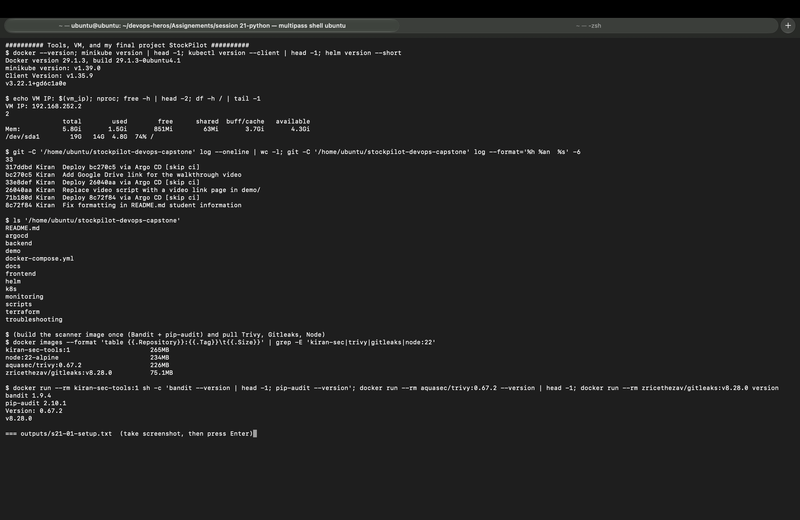

### Step 2: SAST with Bandit

Bandit reads the Python source without running it, looking for patterns such as `shell=True`, `eval` and weak hashes. StockPilot's backend (194 lines of code) has **0 issues** at any severity.

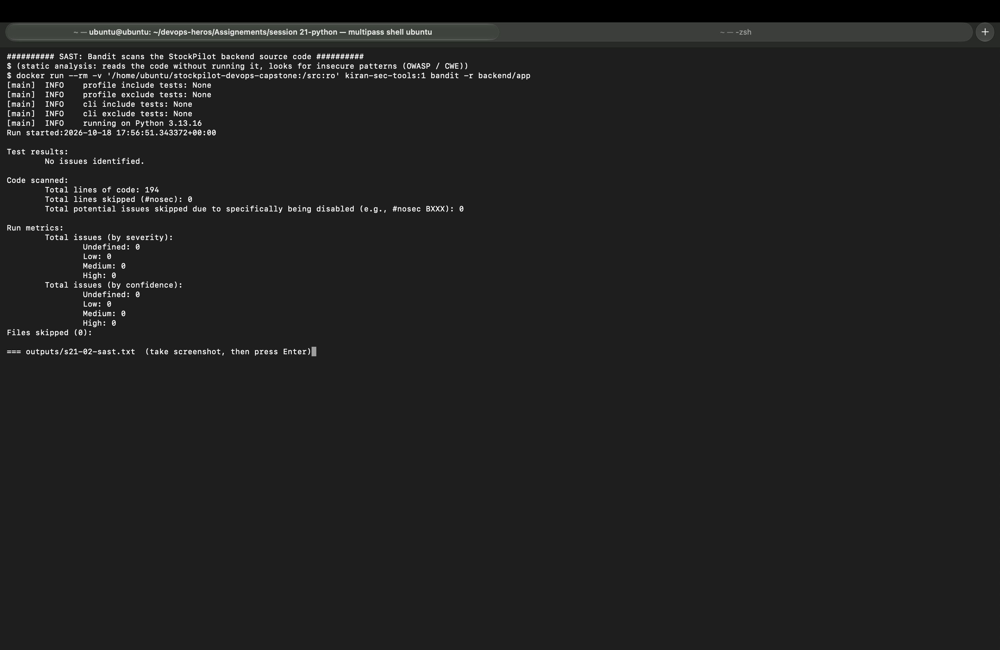

### Step 3: SCA with pip-audit, npm audit and Trivy fs

SCA checks the libraries the app depends on against advisory databases (PyPI/OSV, the npm registry). All three were clean: pip-audit found **no known vulnerabilities**, npm audit found **0 vulnerabilities**, and Trivy filesystem found **0**.

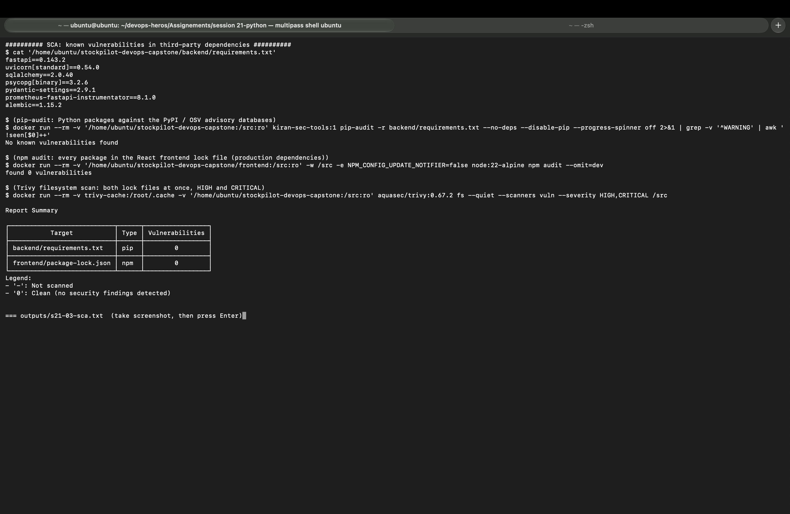

### Step 4: Secret scanning with Gitleaks

Gitleaks scans **every commit**, not only the current files, because a secret that was committed and later deleted is still in Git history. Result: **32 commits scanned, no leaks found**.

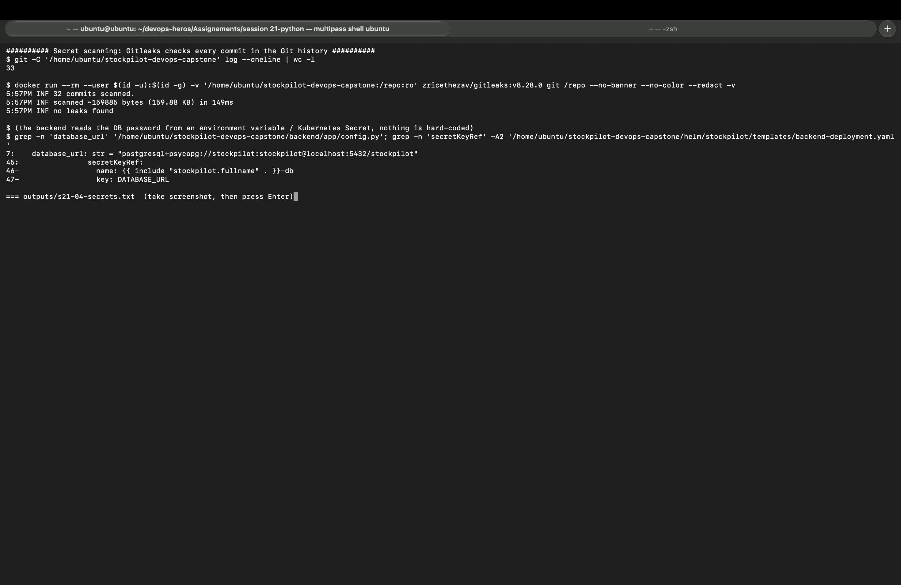

### Step 5: IaC misconfiguration scan and image scan with Trivy

`trivy config` checks the Helm templates, Terraform and Dockerfiles against best practices. It is report-only, not part of the gate. It found **11 HIGH** findings:
- **KSV014** (root file system not read-only) and **KSV118** (default security context) in the Helm templates and the troubleshooting lab
- **AWS-0040 / AWS-0041** in the EKS module: the cluster API endpoint is public and open to 0.0.0.0/0. That was a deliberate choice, so I could run `kubectl` from my laptop. Production would use a private endpoint or a CIDR allow-list.
- **aws-vpc-no-public-egress-sgr**: the security group allows unrestricted egress to any IP

`trivy image` scanned the real images that CI pushed to GHCR:

| Image | Base OS | HIGH | CRITICAL |
|---|---|---|---|
| `stockpilot-backend:bc270c5…` | Debian 13.7 | 0 | 0 |
| `stockpilot-frontend:bc270c5…` | Alpine 3.23.4 | 0 | 0 |

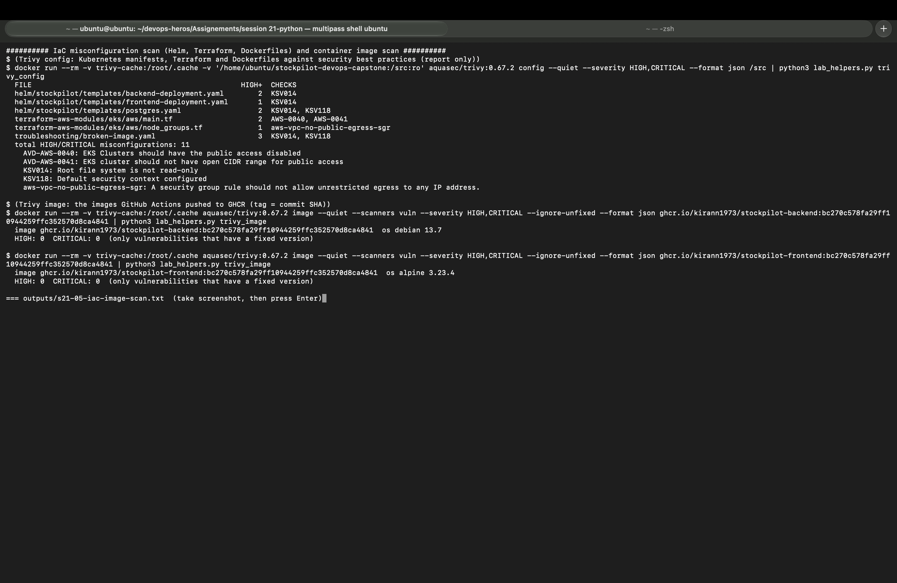

### Step 6: The gate on StockPilot

```bash
bash security/security_gate.sh ~/stockpilot-devops-capstone \
  ghcr.io/kirann1973/stockpilot-backend:bc270c5… ghcr.io/kirann1973/stockpilot-frontend:bc270c5…
```

All 6 checks **PASS**, so the gate printed `GATE PASSED` and exited with **code 0**.

On the first run, `npm audit` failed because npm's audit server returned "audit endpoint returned an error". That is a network problem, not a vulnerability, so I re-ran this step and it passed. A gate that fails closed on a scanner error is the safe behaviour: when it can't check, it doesn't let the code through.

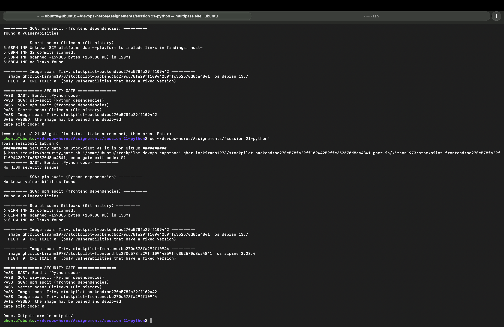

### Step 7: A bad commit, and the gate blocks it

In a **throw-away local clone** (never pushed), the lab makes one commit, "Add product export feature" (`1ce8978`), which adds:
- [`export_report.py`](security/bad-commit/export_report.py), with `subprocess.call(..., shell=True)` on user input (command injection) and `yaml.load` (unsafe deserialisation)
- `requests==2.19.1` and `PyYAML==5.3` in `requirements.txt`
- a hard-coded GitHub token in `settings_local.py`. It is random and fake, generated at run time, and Gitleaks prints it as `REDACTED`.

The image under test is an old base image, `nginx:1.21.0-alpine`.

| Check | Result | Why |
|---|---|---|
| SAST | **FAIL** | `HIGH B602 export_report.py:11 subprocess call with shell=True` |
| SCA Python | **FAIL** | 14 known vulnerabilities in 2 packages (requests 2.19.1, pyyaml 5.3) |
| SCA npm | PASS | frontend not changed |
| Secret scan | **FAIL** | `github-pat` in `backend/app/settings_local.py:2`, commit `1ce8978` |
| Image scan | **FAIL** | 52 HIGH + 9 CRITICAL (e.g. CVE-2021-22945 in curl, CVE-2021-3711 in OpenSSL) |

`GATE FAILED: 4 check(s) failed`, exit code **1**, so there is no push and no deploy.

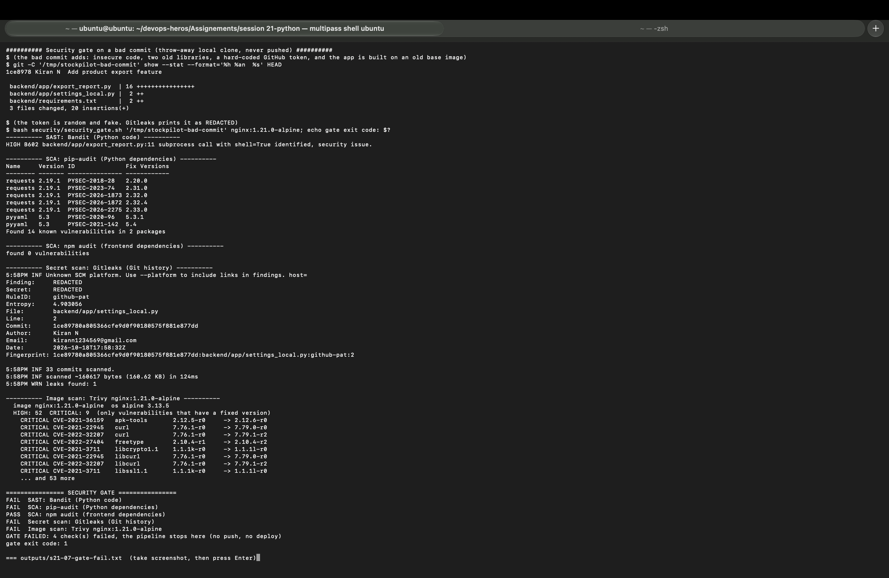

### Step 8: Fix, and the gate passes again

The fix is to drop the commit (`git reset --hard HEAD~1`) and go back to the StockPilot backend image. The gate shows **PASS** for all checks, exit code **0**.

In real life, removing the commit is not enough for the secret. Once a token is pushed, it must be **revoked** and rotated, because anyone who cloned the repo has it.

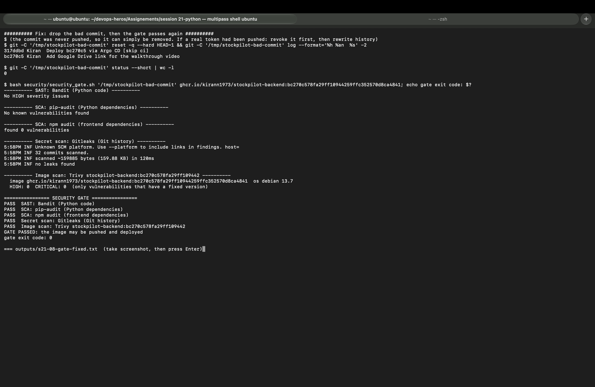

---

# Part B: Final troubleshooting challenge

StockPilot is deployed on Minikube with its own Helm chart and [`values-lab.yaml`](troubleshooting-challenge/values-lab.yaml). Then I broke it six times, the way real outages happen. Each issue follows the same steps: **identify → investigate → root cause → fix → verify**. The summary table is in [`troubleshooting-challenge/README.md`](troubleshooting-challenge/README.md).

### Step 9: Deploy StockPilot on Minikube with Helm

```bash
bash session21_lab.sh 9
```

This step enables the `ingress` and `metrics-server` addons, then runs `helm upgrade --install stockpilot … --wait`. The release contains:

| Kubernetes object | In the release |
|---|---|
| Deployment | `stockpilot-backend` 2/2, `stockpilot-frontend` 2/2 |
| StatefulSet + storage | `stockpilot-postgres` 1/1 with PVC `data-stockpilot-postgres-0` (1Gi, Bound) |
| Service | 3 × ClusterIP (backend 8000, frontend 80, postgres 5432) |
| Ingress | `stockpilot`, class nginx, `/` → frontend, `/api` → backend |
| HPA | backend, 2-4 replicas at 60% CPU |
| ConfigMap | `stockpilot-grafana-dashboard` |
| Secret | `stockpilot-db` (DB user, password, `DATABASE_URL`) |
| Probes | backend readiness `/ready` (checks the DB), liveness `/health`; frontend `/nginx-health` |
| Resources | backend requests 100m / 128Mi, limits 500m / 384Mi |

`GET /` and `GET /api/products/stats` through the Ingress both returned **HTTP 200**. The API returned `{"total_products":6,"total_units":215,"inventory_value":224285.0,...}`.

My first attempt failed. Helm got `failed calling webhook "validate.nginx.ingress.kubernetes.io" … connection refused`, because I had just enabled the Ingress addon and its admission webhook was not running yet. I uninstalled the failed release and installed again. The script now waits for the webhook and removes a failed release itself.

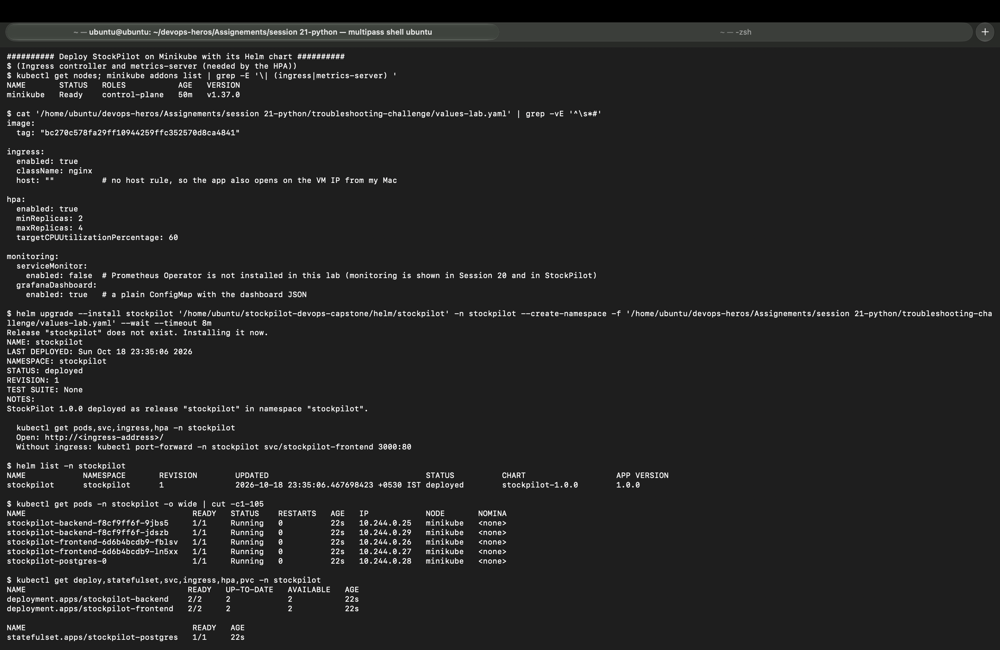
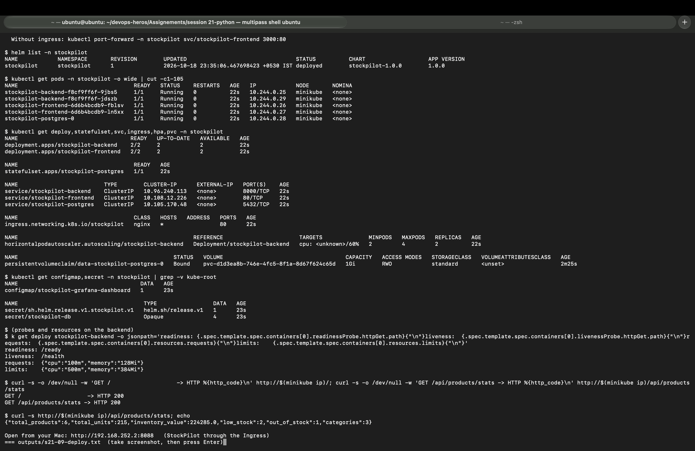

StockPilot opened from my Mac through the Ingress (a port-forward of the ingress controller to `http://192.168.252.2:8088`). The 6 products, ₹2,24,285 inventory value, 2 low stock and 1 out of stock match the API output above:

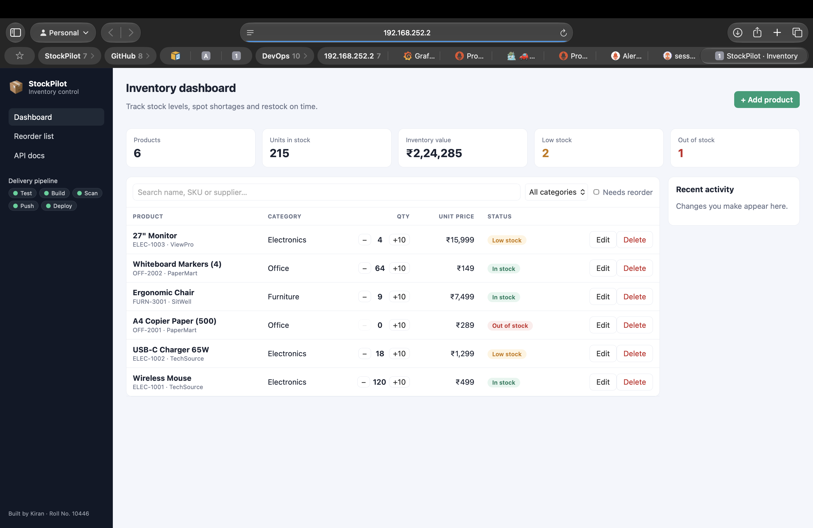

### Step 10: Issue 1, ImagePullBackOff

| | |
|---|---|
| **Break** | `helm upgrade … --set image.tag=v2.0.0` (a tag CI never built) |
| **Symptom** | New pods `ErrImagePull`. The old pods keep running, and the app still returns 200 |
| **Investigate** | `kubectl describe pod`: `Failed to pull image "ghcr.io/kirann1973/stockpilot-backend:v2.0.0"`. `helm history` shows revision 2 |
| **Root cause** | The tag does not exist in GHCR. The rolling update only removes old pods after new ones are Ready, so users saw no outage |
| **Fix** | `helm rollback stockpilot 1` |
| **Verify** | 5 pods `1/1 Running`, HTTP 200 / 200 |

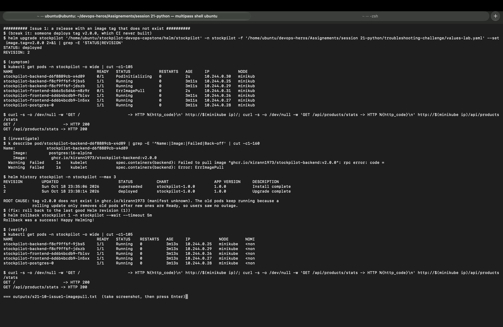

### Step 11: Issue 2, CrashLoopBackOff (wrong DB password)

| | |
|---|---|
| **Break** | `helm upgrade … --set postgres.password=Summer2026` |
| **Symptom** | New backend pod `0/1`, restarts climbing, last exit code 1 |
| **Investigate** | `kubectl logs --previous`: `FATAL: password authentication failed for user "stockpilot"`. Decoding the Secret's `DATABASE_URL` (password masked) shows what the app uses |
| **Root cause** | The Secret has the new password, but Postgres keeps the one it was initialised with, because it reads it only on the first start |
| **Fix** | `helm rollback stockpilot 3`. To really change the password: run `ALTER USER` in Postgres first, then update the Secret |
| **Verify** | All pods Ready, HTTP 200 / 200 |

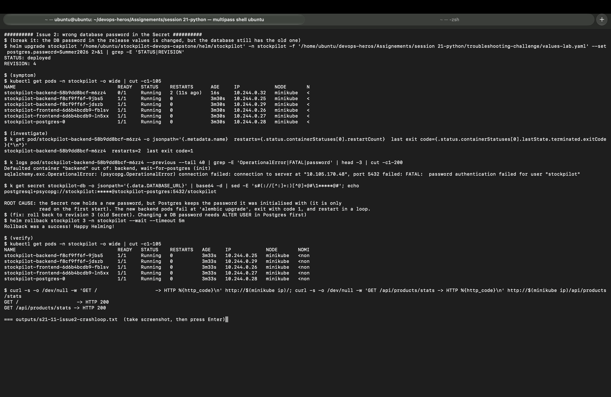

### Step 12: Issue 3, Pending (not enough CPU)

| | |
|---|---|
| **Break** | Backend `resources.requests.cpu=4` |
| **Symptom** | New pod `Pending`, no node, no IP |
| **Investigate** | Events: `FailedScheduling 0/1 nodes are available: 1 Insufficient cpu`. `kubectl describe node`: 1450m (72%) already requested, allocatable cpu 2 |
| **Root cause** | No node can fit a pod asking for 4 CPUs |
| **Fix** | `helm rollback stockpilot 5` (requests 100m / limits 500m) |
| **Verify** | Pending pod gone, 5 pods Running |

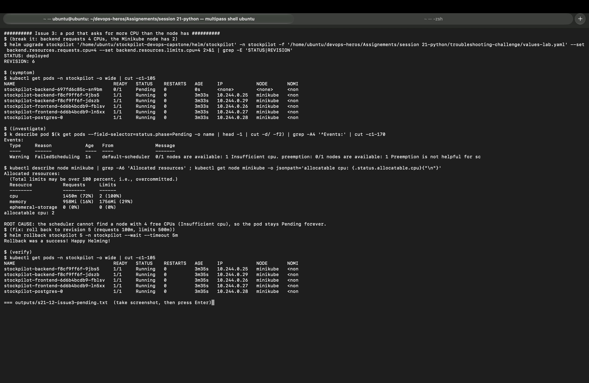

### Step 13: Issue 4, Service with no endpoints (503)

| | |
|---|---|
| **Break** | A manual `kubectl patch` of the backend Service selector to `app: stockpilot-api` (a typo) |
| **Symptom** | `GET /` → 200, but `GET /api/products/stats` → **503** |
| **Investigate** | `kubectl get endpointslices`: ENDPOINTS `<unset>`. `kubectl get svc -o wide`: selector `app=stockpilot-api`. `kubectl get pods --show-labels`: pods are `app=stockpilot-backend` |
| **Root cause** | The selector matches no pod, so the Service has no endpoints and the Ingress returns 503 |
| **Fix** | `helm rollback stockpilot 7` (the same revision). Helm 3's three-way merge compares the chart, the last release and the live object, so it undoes the manual change |
| **Verify** | Selector back to `app=stockpilot-backend`, endpoints `10.244.0.25,10.244.0.29`, HTTP 200 / 200 |

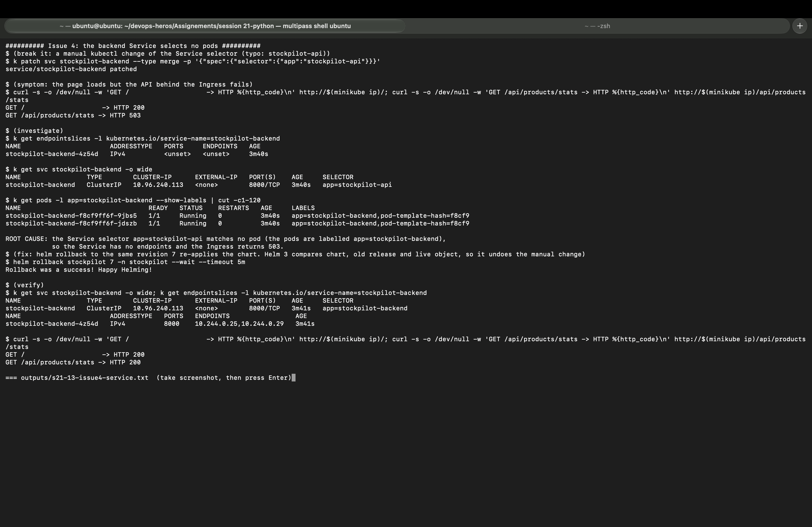

### Step 14: Issue 5, Readiness probe on the wrong port

| | |
|---|---|
| **Break** | The frontend readiness probe port is changed to 9090, but nginx listens on 8080 |
| **Symptom** | New pod `Running` but **`0/1`**, `rollout status` times out ("1 out of 2 new replicas have been updated") |
| **Investigate** | `kubectl describe pod`: `Readiness probe failed: Get "http://10.244.0.44:9090/nginx-health": dial tcp … connection refused`. containerPort 8080 vs probe port 9090. `kubectl exec … wget`: port 8080 → `ok`, port 9090 → `Connection refused` |
| **Root cause** | The probe checks a port nothing listens on, so the pod never becomes Ready and gets no traffic. The 2 old pods keep serving, so the app stays up, but the new version never rolls out |
| **Fix** | `kubectl rollout undo deploy/stockpilot-frontend` |
| **Verify** | 2 frontend pods `1/1`, HTTP 200 / 200 |

On my first try I changed the probe **path** to `/healthz`, and nothing broke: StockPilot's nginx sends every unknown path to `index.html` (React routing), so `/healthz` returned 200. That is why a single-page app needs its own health endpoint (`/nginx-health`), and why I re-ran this issue with a wrong port.

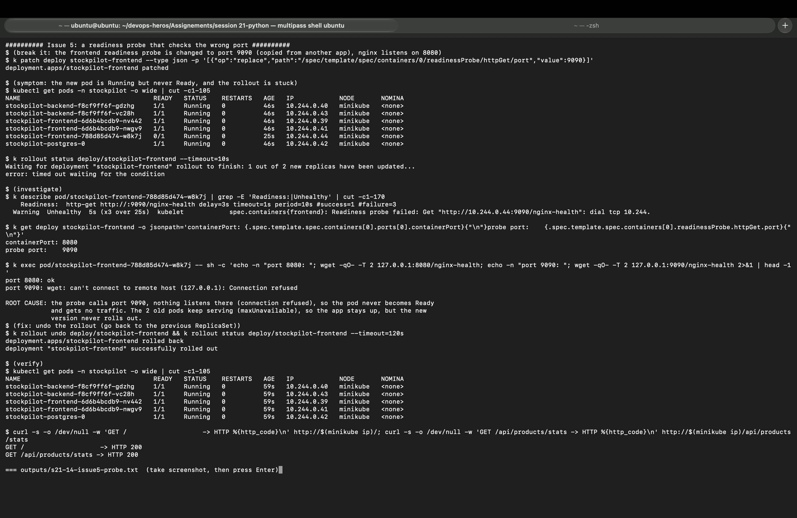

### Step 15: Issue 6, DNS (wrong namespace in the backend URL)

| | |
|---|---|
| **Break** | `kubectl set env deploy/stockpilot-frontend BACKEND_URL=http://stockpilot-backend.stockpilot-prod.svc.cluster.local:8000` (copied from another environment) |
| **Symptom** | New frontend pod `0/1`, restarting |
| **Investigate** | `kubectl logs --previous`: `[emerg] host not found in upstream "stockpilot-backend.stockpilot-prod.svc.cluster.local"`. `nslookup` from a busybox pod: `NXDOMAIN` for `stockpilot-prod`, but `stockpilot-backend.stockpilot.svc.cluster.local` → `10.96.240.113` |
| **Root cause** | DNS. The name is `<service>.<namespace>.svc.cluster.local`, and the namespace `stockpilot-prod` does not exist. nginx resolves `proxy_pass` hosts at start-up, so it crashes |
| **Fix** | `kubectl rollout undo deploy/stockpilot-frontend` |
| **Verify** | `BACKEND_URL=http://stockpilot-backend:8000`, HTTP 200 / 200 (the last `Error` pod in the list is the old broken one being removed) |

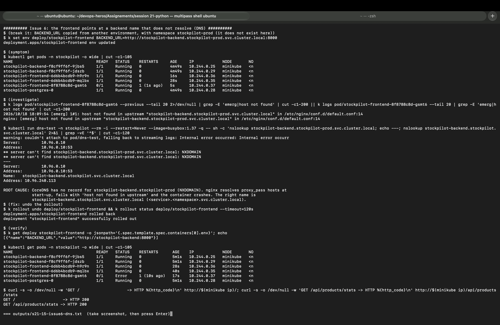

### Step 16: Helm history and cleanup

`helm history` shows the whole challenge: revision 1 install, then each bad upgrade followed by its rollback, ending at revision 8. The events summary counts the failures:
- `Failed` (image pull)
- `FailedScheduling` (CPU)
- `Unhealthy` (probe)
- `FailedGetResourceMetric` on the HPA, while metrics-server was still starting

Then `helm uninstall` removes the release and the namespace is deleted (`grep -c stockpilot` → 0).

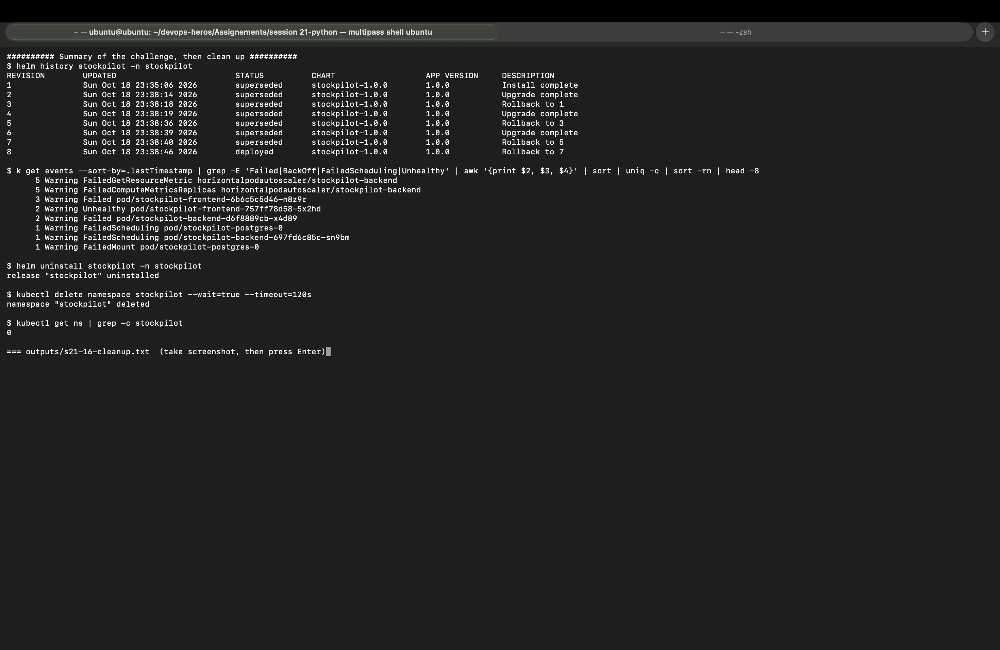

---

## How to run it again

```bash
cd ~/devops-heros/Assignements/"session 21-python"
bash session21_lab.sh 1 2 3 4 5 6 7 8          # Part A: scanners and the security gate
bash session21_lab.sh 9                        # deploy StockPilot, then open http://<VM IP>:8088
bash session21_lab.sh 10 11 12 13 14 15 16     # Part B: the 6 issues, then cleanup
for f in outputs/*.txt; do clear; cat "$f"; read -p "=== $f  (take screenshot, then press Enter)"; done
```

Requirements: Docker, Minikube, kubectl and Helm on the VM. StockPilot is cloned to `~/stockpilot-devops-capstone` by part 1.

## Lessons learned

1. **One gate, many scanners.** Each tool sees a different risk: Bandit sees my code, pip-audit and npm audit see my libraries, Gitleaks sees my history, Trivy sees the OS inside the image. The bad commit was caught by 4 different tools for 4 different reasons.
2. **Exit codes are the gate.** A scan that only prints a report protects nothing. The pipeline stops because the step exits with 1. A scanner that cannot reach its database must also fail, not pass.
3. **Secrets live forever in Git.** Scan the whole history, and revoke a leaked token instead of only deleting the line.
4. **Rolling updates protect users.** In issues 1, 2, 5 and 6 the broken pods never became Ready, so the old pods kept serving and the app never went down.
5. **The pod state tells you where to look:**

   | State | Where to look |
   |---|---|
   | `ImagePullBackOff` | the image tag |
   | `CrashLoopBackOff` | `logs --previous` |
   | `Pending` | scheduler events |
   | `0/1 Running` | the probe |
   | `503` from the Ingress | Service endpoints |
   | `host not found` | DNS name and namespace |

6. **Helm history is an undo button**, and `helm rollback` also undoes manual `kubectl` drift. In StockPilot, Argo CD does the same thing continuously from Git.
7. **Test the failure, not only the success.** My first probe "break" didn't break anything, and that taught me something real about SPA routing and health checks. The first Helm install failed on a webhook race, and the fix (wait for readiness) went into the script.
