# Session 10: Deployment Strategies and Pod Lifecycle

| | |
|---|---|
| **Name** | Kiran N |
| **Roll No.** | 10446 |
| **Session** | 10: Kubernetes deployment strategies and pod lifecycle |
| **Environment** | Multipass Ubuntu VM (arm64) on Mac, Minikube v1.39.0 (docker driver), Kubernetes v1.37.0, node IP 192.168.49.2 |

All outputs below are copied from my own runs of [`strategies_lab.sh`](strategies_lab.sh) and [`pod_lifecycle_lab.sh`](pod_lifecycle_lab.sh). Full text outputs are in [`outputs/`](outputs/) and screenshots are in [`screenshots/`](screenshots/).

---

## Homework tasks

| # | Task | Where |
|---|------|-------|
| 1 | Rolling Update strategy | [Strategy 1](#strategy-1-rolling-update) |
| 2 | Blue-Green strategy | [Strategy 2](#strategy-2-blue-green) |
| 3 | Canary strategy | [Strategy 3](#strategy-3-canary) |
| 4 | Recreate strategy | [Strategy 4](#strategy-4-recreate) |
| 5 | Compare the strategies | [Comparison](#strategy-comparison) |
| 6 | Pod lifecycle: all 12 states and probes | [Pod lifecycle](#pod-lifecycle) |

---

## Folder structure

```
session 10/
├── readme.md
├── strategies_lab.sh        # runs the 4 strategies, saves outputs/s10-0*.txt
├── pod_lifecycle_lab.sh     # runs the 12 pod lifecycle YAMLs, saves outputs/s10-lc-*.txt
├── 01-rolling-update/       deployment-v1.yaml, deployment-v2.yaml, service.yaml
├── 02-blue-green/           deployment-blue.yaml, deployment-green.yaml, service-blue.yaml, service-green.yaml
├── 03-canary/               deployment-stable.yaml, deployment-canary.yaml, service.yaml
├── 04-recreate/             deployment-v1.yaml, deployment-v2.yaml, service.yaml
├── pod-lifecycle/           01-running.yaml ... 12-termination.yaml
├── outputs/                 s10-01 ... s10-lc-12 full command outputs (.txt)
└── screenshots/
```

Every app page shows its version and my name: `Kiran N - Roll No 10446`. The scripts check traffic with `curl` against the NodePort and count the answers with `sort | uniq -c`.

---

# Part 1: Deployment strategies

## Strategy 1: Rolling Update

**Files:** [deployment-v1.yaml](01-rolling-update/deployment-v1.yaml), [deployment-v2.yaml](01-rolling-update/deployment-v2.yaml), [service.yaml](01-rolling-update/service.yaml) (NodePort 30010)

```yaml
replicas: 4
strategy:
  type: RollingUpdate
  rollingUpdate:
    maxSurge: 1        # 1 extra pod allowed during the update
    maxUnavailable: 0  # never go below 4 ready pods
```

```
$ kubectl apply -f 01-rolling-update/deployment-v1.yaml -f 01-rolling-update/service.yaml
deployment.apps/app-rolling created
service/app-rolling-service created

$ curl -s http://192.168.49.2:30010 | grep -oE 'VERSION: v[0-9]|Kiran N - Roll No 10446'
VERSION: v1
Kiran N - Roll No 10446

$ kubectl apply -f 01-rolling-update/deployment-v2.yaml
deployment.apps/app-rolling configured

(pods during the update: old and new running side by side)
--- t=2s
app-rolling-67d4c969d-56cn5    1/1   Running             0   6s   v1
app-rolling-67d4c969d-7nqc5    1/1   Running             0   6s   v1
app-rolling-67d4c969d-fpld9    1/1   Running             0   6s   v1
app-rolling-67d4c969d-qq6jj    1/1   Running             0   6s   v1
app-rolling-86d7cb89c7-6dsfd   0/1   ContainerCreating   0   0s   v2
--- t=8s
app-rolling-67d4c969d-56cn5    0/1   Completed   0   13s   v1
app-rolling-67d4c969d-7nqc5    1/1   Running     0   13s   v1
app-rolling-67d4c969d-fpld9    1/1   Running     0   13s   v1
app-rolling-67d4c969d-qq6jj    1/1   Running     0   13s   v1
app-rolling-86d7cb89c7-4x6p8   0/1   Running     0   1s    v2
app-rolling-86d7cb89c7-6dsfd   1/1   Running     0   7s    v2
--- t=16s
app-rolling-67d4c969d-7nqc5    1/1   Running   0   21s   v1
app-rolling-67d4c969d-qq6jj    1/1   Running   0   21s   v1
app-rolling-86d7cb89c7-4x6p8   1/1   Running   0   9s    v2
app-rolling-86d7cb89c7-6dsfd   1/1   Running   0   15s   v2
app-rolling-86d7cb89c7-b9dt8   0/1   Running   0   3s    v2

$ kubectl get pods -l app=app-rolling -L version
NAME                           READY   STATUS      RESTARTS   AGE   VERSION
app-rolling-67d4c969d-7nqc5    0/1     Completed   0          30s   v1
app-rolling-86d7cb89c7-4x6p8   1/1     Running     0          18s   v2
app-rolling-86d7cb89c7-6dsfd   1/1     Running     0          24s   v2
app-rolling-86d7cb89c7-b9dt8   1/1     Running     0          12s   v2
app-rolling-86d7cb89c7-m24s4   1/1     Running     0          6s    v2

$ kubectl rollout history deployment/app-rolling
REVISION  CHANGE-CAUSE
1         <none>
2         <none>

$ kubectl get rs -l app=app-rolling
NAME                     DESIRED   CURRENT   READY   AGE
app-rolling-67d4c969d    0         0         0       2m44s
app-rolling-86d7cb89c7   4         4         4       2m38s
```

**What happened:** Kubernetes made one new v2 pod (maxSurge 1), waited until it was ready, then removed one v1 pod, and repeated this until all 4 pods were v2. With `maxUnavailable: 0` there were always at least 4 ready pods, so there was no downtime. The old ReplicaSet `67d4c969d` is kept at 0 replicas so `kubectl rollout undo` can go back to v1. (The last v1 pod shows `Completed` only because nginx exits with code 0 when it is stopped.)

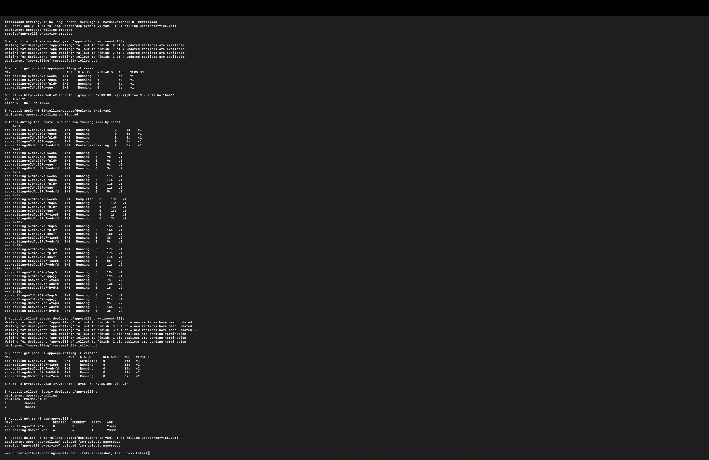

---

## Strategy 2: Blue-Green

**Files:** [deployment-blue.yaml](02-blue-green/deployment-blue.yaml) (v1, `slot: blue`), [deployment-green.yaml](02-blue-green/deployment-green.yaml) (v2, `slot: green`), [service-blue.yaml](02-blue-green/service-blue.yaml), [service-green.yaml](02-blue-green/service-green.yaml) (NodePort 30020)

Both versions run at the same time. The Service selector decides which one gets traffic.

```
$ kubectl get pods -l app=myapp -L slot,version
NAME                         READY   STATUS    RESTARTS   AGE   SLOT    VERSION
app-blue-59c5bdd66c-49v8c    1/1     Running   0          8s    blue    v1
app-blue-59c5bdd66c-p5jn6    1/1     Running   0          8s    blue    v1
app-blue-59c5bdd66c-qvnx8    1/1     Running   0          8s    blue    v1
app-green-59c9cbf7dd-nv657   1/1     Running   0          8s    green   v2
app-green-59c9cbf7dd-rscmm   1/1     Running   0          8s    green   v2
app-green-59c9cbf7dd-zgkrc   1/1     Running   0          8s    green   v2

$ kubectl get service myapp-service -o jsonpath="{.spec.selector}"
{"app":"myapp","slot":"blue"}

(10 requests while the Service points to BLUE)
     10 BLUE ENVIRONMENT

$ kubectl apply -f 02-blue-green/service-green.yaml
service/myapp-service configured

$ kubectl get service myapp-service -o jsonpath="{.spec.selector}"
{"app":"myapp","slot":"green"}

(10 requests after switching the Service to GREEN)
     10 GREEN ENVIRONMENT

$ kubectl get endpoints myapp-service
NAME            ENDPOINTS                                            AGE
myapp-service   10.244.0.101:80,10.244.0.103:80,10.244.0.98:80      13s
```

**What happened:** before the switch 10/10 requests went to BLUE, and after changing only the Service selector 10/10 went to GREEN. The switch is instant and all users move together. Rollback is just applying `service-blue.yaml` again. The cost is running double the pods during the release.

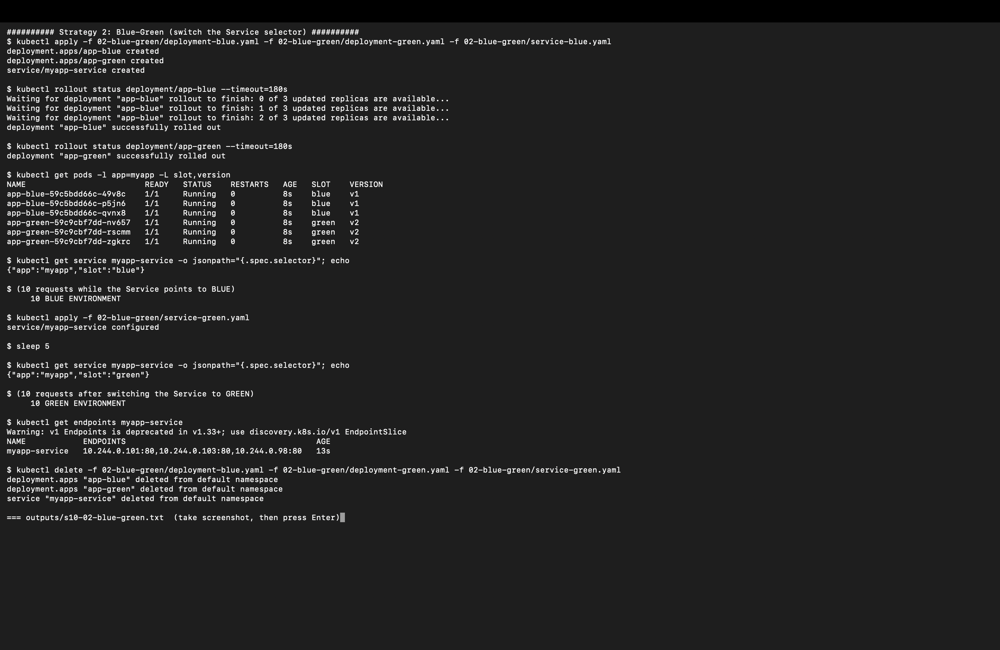

---

## Strategy 3: Canary

**Files:** [deployment-stable.yaml](03-canary/deployment-stable.yaml) (9 replicas, v1, `track: stable`), [deployment-canary.yaml](03-canary/deployment-canary.yaml) (1 replica, v2, `track: canary`), [service.yaml](03-canary/service.yaml) (NodePort 30030, selector only `app: myapp-canary`)

The Service matches both Deployments, so traffic is split by the number of pods: 1 canary out of 10 pods is about 10%.

```
$ kubectl get deployments -l app=myapp-canary -L track
NAME         READY   UP-TO-DATE   AVAILABLE   AGE   TRACK
app-canary   1/1     1            1           8s    canary
app-stable   9/9     9            9           8s    stable

$ kubectl get pods -l app=myapp-canary -L track,version
NAME                          READY   STATUS    RESTARTS   AGE   TRACK    VERSION
app-canary-7795ff4f9-dclhj    1/1     Running   0          8s    canary   v2
app-stable-58dccfc99b-2j564   1/1     Running   0          8s    stable   v1
... (9 stable pods in total)

(100 requests to the canary Service)
     13 CANARY v2
     87 STABLE v1
```

**What happened:** 13 of 100 requests reached v2, close to the expected 10% (kube-proxy picks pods at random, so it is never exact). If the canary looks good I scale `app-canary` up and `app-stable` down step by step. If it is bad I delete only the canary and 90% of users never saw it.

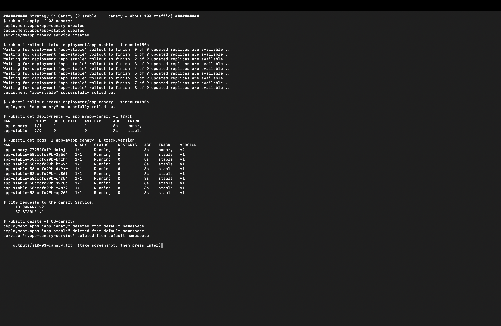

---

## Strategy 4: Recreate

**Files:** [deployment-v1.yaml](04-recreate/deployment-v1.yaml), [deployment-v2.yaml](04-recreate/deployment-v2.yaml) (`strategy: type: Recreate`), [service.yaml](04-recreate/service.yaml) (NodePort 30040)

```
$ curl -s http://192.168.49.2:30040 | grep -oE 'VERSION: v[0-9]'
VERSION: v1

$ kubectl apply -f 04-recreate/deployment-v2.yaml
deployment.apps/app-recreate configured

(pods during the update: v1 terminates first, then v2 is created)
--- t=2s
app-recreate-7869bc4b7b-777fc   1/1   Terminating   0   6s   v1
app-recreate-7869bc4b7b-lxtwz   0/1   Completed     0   6s   v1
app-recreate-7869bc4b7b-wsnjn   1/1   Terminating   0   6s   v1
--- t=4s
app-recreate-84dcd486bd-8p8n9   1/1   Running   0   2s   v2
app-recreate-84dcd486bd-twfqq   1/1   Running   0   2s   v2
app-recreate-84dcd486bd-vxw7t   1/1   Running   0   2s   v2

$ curl -s http://192.168.49.2:30040 | grep -oE 'VERSION: v[0-9]'
VERSION: v2

$ kubectl describe deployment app-recreate | grep -E "StrategyType|Scaled"
StrategyType:       Recreate
  Normal  ScalingReplicaSet  26s  deployment-controller  Scaled up replica set app-recreate-7869bc4b7b from 0 to 3
  Normal  ScalingReplicaSet  20s  deployment-controller  Scaled down replica set app-recreate-7869bc4b7b from 3 to 0
  Normal  ScalingReplicaSet  20s  deployment-controller  Scaled up replica set app-recreate-84dcd486bd from 0 to 3
```

**What happened:** unlike the rolling update, v1 and v2 never ran together. The events show the old ReplicaSet scaled **3 to 0** first, and only then the new one scaled **0 to 3**. Between those steps there were no pods, so users get errors for a short time. It is useful when two versions cannot run at the same time (for example a database schema change or a single-writer app).

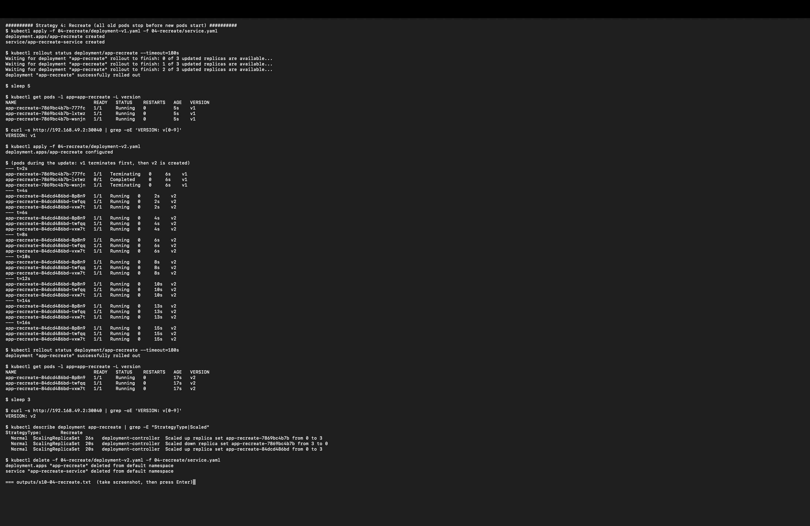

---

## Strategy comparison

| | Rolling Update | Blue-Green | Canary | Recreate |
|---|---|---|---|---|
| **How** | Replace pods a few at a time | Run both, switch Service selector | Small share of pods on the new version | Kill all old, then start all new |
| **Downtime** | None | None | None | Yes, short |
| **Both versions live together** | Yes, during rollout | Yes, but only one gets traffic | Yes, both get traffic | No |
| **Extra resources** | Small (maxSurge) | Double | Small (canary pods) | None |
| **Rollback** | `kubectl rollout undo` | Switch selector back (instant) | Delete the canary | Redeploy old version |
| **Risk to users** | Medium | Low | Lowest (only ~10% see it) | High |
| **My result** | 4 × v1 → 4 × v2, always 4 ready | 10/10 BLUE → 10/10 GREEN | 13 % v2, 87 % v1 | 3 → 0, then 0 → 3 |
| **Use when** | Default for stateless apps | Need instant switch and rollback | Want to test with real users | Versions cannot run side by side |

---

# Part 2: Pod lifecycle

A pod's **phase** is one of `Pending`, `Running`, `Succeeded`, `Failed` or `Unknown`. Inside a pod each container has a **state** (`Waiting`, `Running`, `Terminated`) with a reason such as `CrashLoopBackOff` or `ImagePullBackOff`. Probes decide when a container is ready or needs a restart.

For each YAML in [`pod-lifecycle/`](pod-lifecycle/), the script applies it, waits for the interesting state, prints `kubectl get pod`, the logs and a `details` summary (status, state, restart count and the last events from `kubectl describe`), and then deletes the pod.

### Summary of what I saw

| # | YAML | What it does | Status I saw | Screenshot |
|---|------|--------------|--------------|-----------|
| 01 | [01-running.yaml](pod-lifecycle/01-running.yaml) | Plain nginx:1.27 pod | `1/1 Running` | [s10-lc-01](screenshots/s10-lc-01-running.png) |
| 02 | [02-pending.yaml](pod-lifecycle/02-pending.yaml) | Requests 9Gi memory | `0/1 Pending`, Insufficient memory | [s10-lc-02](screenshots/s10-lc-02-pending.png) |
| 03 | [03-succeeded.yaml](pod-lifecycle/03-succeeded.yaml) | Task exits 0, restartPolicy Never | `Completed`, phase Succeeded, exit 0 | [s10-lc-03](screenshots/s10-lc-03-succeeded.png) |
| 04 | [04-failed.yaml](pod-lifecycle/04-failed.yaml) | Task exits 1, restartPolicy Never | `Error`, phase Failed, exit 1 | [s10-lc-04](screenshots/s10-lc-04-failed.png) |
| 05 | [05-crashloopbackoff.yaml](pod-lifecycle/05-crashloopbackoff.yaml) | Exits 1 every 3s, restartPolicy Always | `CrashLoopBackOff`, restarts rising | [s10-lc-05](screenshots/s10-lc-05-crashloopbackoff.png) |
| 06 | [06-imagepullbackoff.yaml](pod-lifecycle/06-imagepullbackoff.yaml) | Image name does not exist | `ErrImagePull` → `ImagePullBackOff` | [s10-lc-06](screenshots/s10-lc-06-imagepullbackoff.png) |
| 07 | [07-readiness.yaml](pod-lifecycle/07-readiness.yaml) | HTTP readiness probe, 5s delay | `0/1 Running` → `1/1 Running` | [s10-lc-07](screenshots/s10-lc-07-readiness.png) |
| 08 | [08-liveness.yaml](pod-lifecycle/08-liveness.yaml) | Health file removed after 20s | Liveness failed, restarted, exit 137 | [s10-lc-08](screenshots/s10-lc-08-liveness.png) |
| 09 | [09-startup.yaml](pod-lifecycle/09-startup.yaml) | App needs 30s to start | `0/1` for ~30s, then `1/1`, 0 restarts | [s10-lc-09](screenshots/s10-lc-09-startup.png) |
| 10 | [10-init-container.yaml](pod-lifecycle/10-init-container.yaml) | Init container sleeps 10s first | `Init:0/1` → `1/1 Running` | [s10-lc-10](screenshots/s10-lc-10-init-container.png) |
| 11 | [11-multi-container.yaml](pod-lifecycle/11-multi-container.yaml) | nginx app + busybox sidecar | `2/2 Running` | [s10-lc-11](screenshots/s10-lc-11-multi-container.png) |
| 12 | [12-termination.yaml](pod-lifecycle/12-termination.yaml) | Traps SIGTERM, 20s grace period | `Terminating`, cleanup log, then gone | [s10-lc-12](screenshots/s10-lc-12-termination.png) |

---

### 01 Running

```
$ kubectl get pod lifecycle-running -o wide
NAME                READY   STATUS    RESTARTS   AGE   IP             NODE
lifecycle-running   1/1     Running   0          1s    10.244.0.120   minikube

Status:           Running
    State:          Running
    Ready:          True
    Restart Count:  0
Events:  Scheduled → Pulled (nginx:1.27) → Created → Started
```

The normal healthy case: scheduled to `minikube`, image pulled, container started and ready.

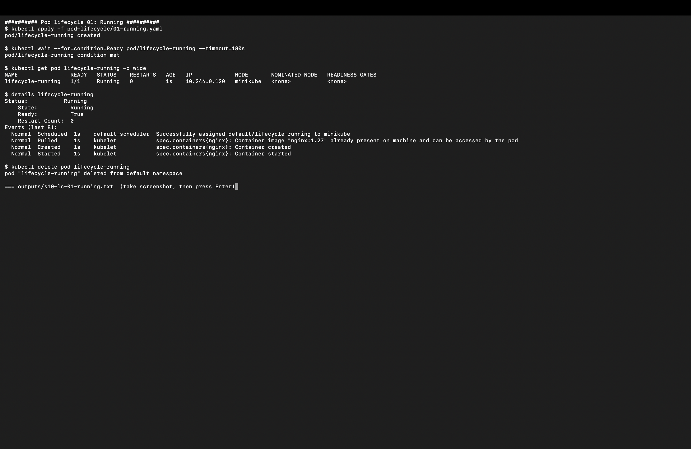

### 02 Pending

```
$ kubectl get pod lifecycle-pending
NAME                READY   STATUS    RESTARTS   AGE
lifecycle-pending   0/1     Pending   0          10s

Status:           Pending
Events:
  Warning  FailedScheduling  11s  default-scheduler  0/1 nodes are available: 1 Insufficient memory.
           preemption: 0/1 nodes are available: 1 Preemption is not helpful for scheduling.
```

The pod asks for 9Gi of memory but my Minikube node has 3.5Gi, so the **scheduler** cannot place it anywhere. It stays Pending forever. Fix: lower the request or add a bigger node.

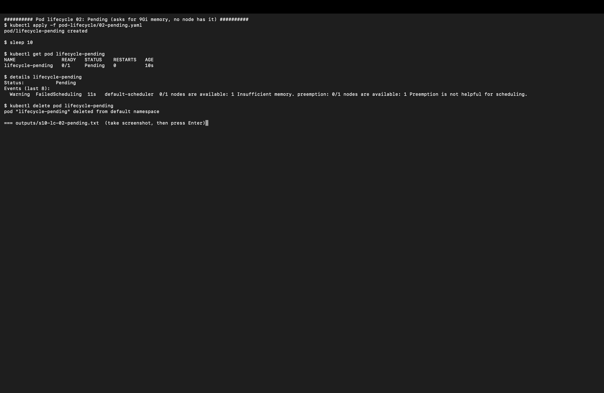

### 03 Succeeded

```
$ kubectl get pod lifecycle-succeeded
NAME                  READY   STATUS      RESTARTS   AGE
lifecycle-succeeded   0/1     Completed   0          6s

$ kubectl logs lifecycle-succeeded
Task started
Task completed successfully

Status:           Succeeded
    State:          Terminated
      Reason:       Completed
      Exit Code:    0
```

The command finished with exit code 0 and `restartPolicy: Never`, so the phase is **Succeeded** (shown as `Completed`). This is how Jobs work.

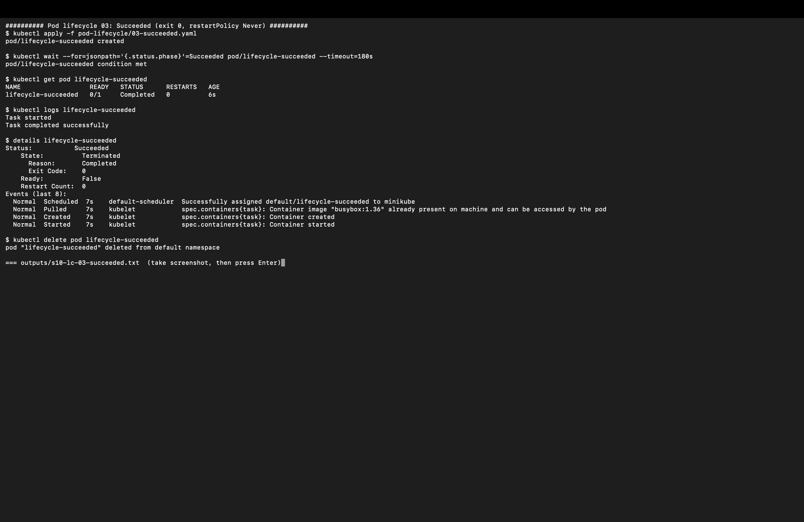

### 04 Failed

```
$ kubectl get pod lifecycle-failed
NAME               READY   STATUS   RESTARTS   AGE
lifecycle-failed   0/1     Error    0          7s

$ kubectl logs lifecycle-failed
Task started
Task failed

Status:           Failed
    State:          Terminated
      Reason:       Error
      Exit Code:    1
```

Same as 03 but the command exits with 1. With `restartPolicy: Never` Kubernetes does not retry, so the phase is **Failed**.

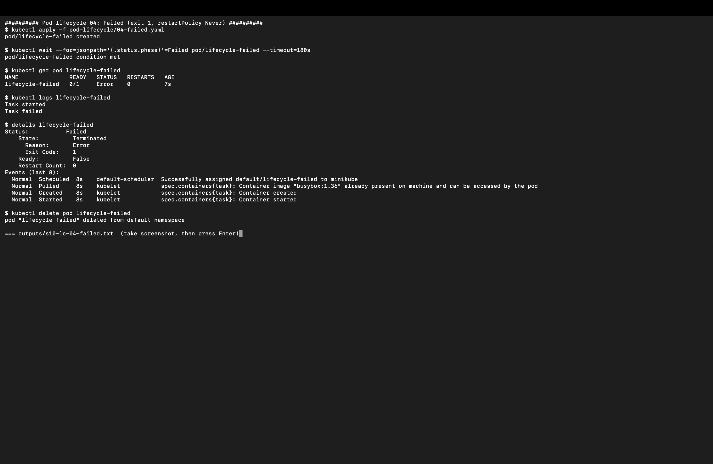

### 05 CrashLoopBackOff

```
$ kubectl wait --for=jsonpath='{.status.containerStatuses[0].state.waiting.reason}'=CrashLoopBackOff pod/lifecycle-crashloop --timeout=180s
pod/lifecycle-crashloop condition met

$ kubectl get pod lifecycle-crashloop
NAME                  READY   STATUS    RESTARTS      AGE
lifecycle-crashloop   1/1     Running   2 (13s ago)   20s

Status:           Running
    State:          Running
      Reason:       Error
      Exit Code:    1
    Ready:          True
    Restart Count:  2
Events:
  Warning  BackOff  12s  kubelet  Back-off restarting failed container crashing-app in pod lifecycle-crashloop_default
  Normal   Started  0s (x3 over 20s)  kubelet  Container started
```

The app exits with 1 after 3 seconds, and with `restartPolicy: Always` the kubelet keeps restarting it. Each time it waits longer (10s, 20s, 40s... up to 5 minutes), and this waiting state is **CrashLoopBackOff**. The `kubectl wait` confirmed the CrashLoopBackOff reason; the `get` caught the pod in the short moment it was running again after the 2nd restart. Debug with `kubectl logs --previous` and `kubectl describe pod`.

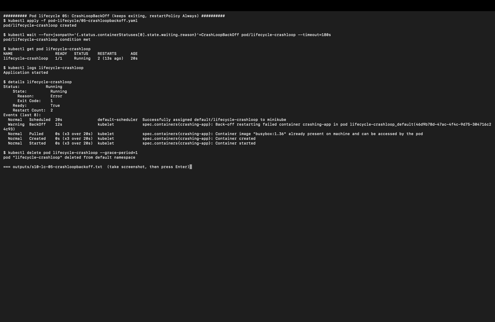

### 06 ErrImagePull / ImagePullBackOff

```
$ kubectl get pod lifecycle-image-error
NAME                    READY   STATUS             RESTARTS   AGE
lifecycle-image-error   0/1     ImagePullBackOff   0          12s

Status:           Pending
    State:          Waiting
      Reason:       ImagePullBackOff
Events:
  Warning  Failed   11s  kubelet  Failed to pull image "jakwehrgkaejw:kahsdfgkhj": ... pull access denied,
                                  repository does not exist or may require authorization
  Warning  Failed   11s  kubelet  Error: ErrImagePull
  Normal   BackOff  10s  kubelet  Back-off pulling image "jakwehrgkaejw:kahsdfgkhj"
  Warning  Failed   10s  kubelet  Error: ImagePullBackOff
```

The image does not exist on Docker Hub. The first failure is **ErrImagePull**, then the kubelet backs off and the status becomes **ImagePullBackOff**. The phase stays Pending because the container never started. Fix: correct the image name/tag or add an `imagePullSecret` for private registries.

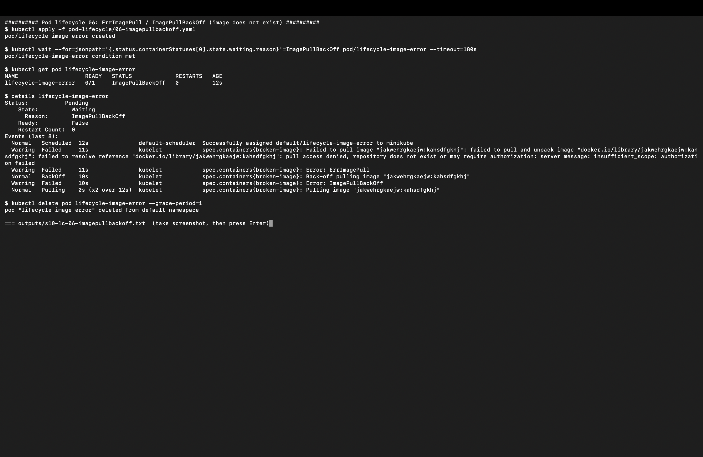

### 07 Readiness probe

```
$ kubectl get pod lifecycle-readiness
NAME                  READY   STATUS    RESTARTS   AGE
lifecycle-readiness   0/1     Running   0          0s

$ sleep 12
$ kubectl get pod lifecycle-readiness
NAME                  READY   STATUS    RESTARTS   AGE
lifecycle-readiness   1/1     Running   0          12s

    Readiness:      http-get http://:80/ delay=5s timeout=1s period=5s #success=1 #failure=3
```

The container is Running at once but **not Ready (0/1)** until the HTTP probe on port 80 passes after the 5s delay. A Service only sends traffic to Ready pods, so users never hit a pod that is still starting. A failed readiness probe removes the pod from the Service but does **not** restart it.

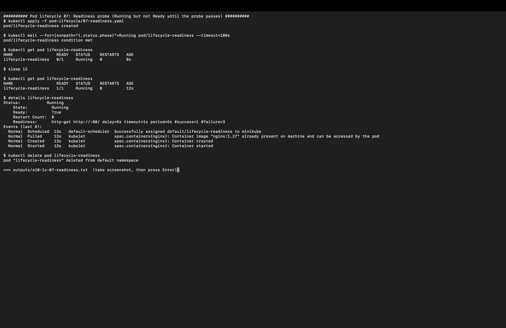

### 08 Liveness probe

```
$ kubectl get pod lifecycle-liveness          # at start
NAME                 READY   STATUS    RESTARTS   AGE
lifecycle-liveness   1/1     Running   0          1s

$ sleep 75
$ kubectl get pod lifecycle-liveness
NAME                 READY   STATUS    RESTARTS      AGE
lifecycle-liveness   1/1     Running   1 (16s ago)   76s

Status:           Running
    State:          Running
      Reason:       Error
      Exit Code:    137
    Ready:          True
    Restart Count:  1
    Liveness:       exec [sh -c test -f /tmp/healthy] delay=5s timeout=1s period=5s #success=1 #failure=2
Events:
  Warning  Unhealthy  46s (x2 over 51s)  kubelet  Liveness probe failed:
  Normal   Killing    46s                kubelet  Container app failed liveness probe, will be restarted
```

The app deletes `/tmp/healthy` after 20 seconds. The probe failed twice (`#failure=2`), so the kubelet **killed** the container (exit code 137 = SIGKILL) and started it again. Liveness fixes apps that hang without crashing.

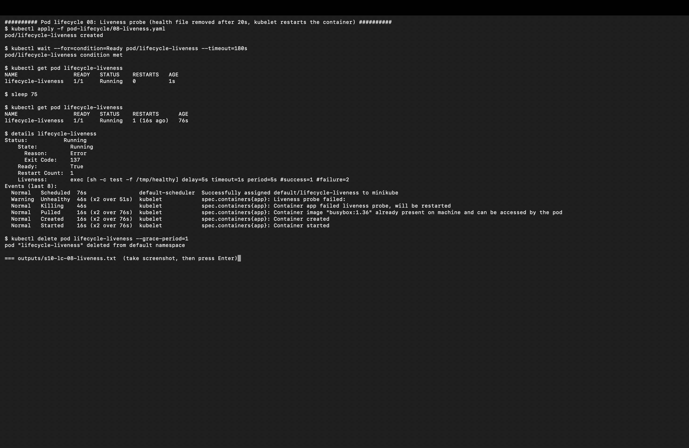

### 09 Startup probe

```
$ kubectl get pod lifecycle-startup
NAME                READY   STATUS    RESTARTS   AGE
lifecycle-startup   0/1     Running   0          0s

$ kubectl wait --for=condition=Ready pod/lifecycle-startup --timeout=90s
pod/lifecycle-startup condition met

$ kubectl get pod lifecycle-startup
NAME                READY   STATUS    RESTARTS   AGE
lifecycle-startup   1/1     Running   0          35s

$ kubectl logs lifecycle-startup
Application starting...
Application started

    Startup:        exec [sh -c test -f /tmp/started] delay=0s timeout=1s period=5s #success=1 #failure=10
Events:
  Warning  Unhealthy  5s (x6 over 30s)  kubelet  Startup probe failed:
```

The app needs 30 seconds to start. The startup probe allows 10 × 5s = 50s. It failed 6 times while the app was starting but the pod was **not restarted** (0 restarts) and became Ready at about 35s. Without a startup probe, a liveness probe would kill a slow app before it ever finished starting.

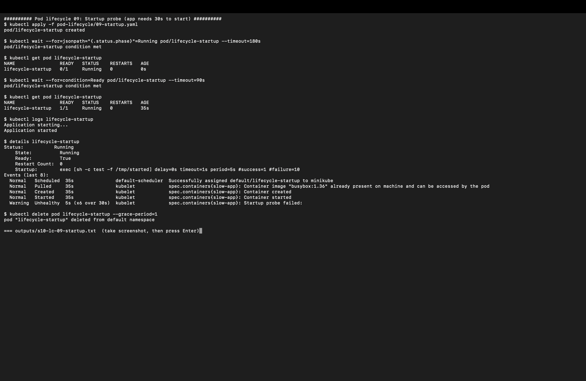

### 10 Init container

```
$ kubectl get pod lifecycle-init
NAME             READY   STATUS     RESTARTS   AGE
lifecycle-init   0/1     Init:0/1   0          3s

$ kubectl get pod lifecycle-init
NAME             READY   STATUS    RESTARTS   AGE
lifecycle-init   1/1     Running   0          11s

$ kubectl logs lifecycle-init -c setup
Init container running
Init complete

Events:
  Started  11s  spec.initContainers{setup}: Container started
  Started  0s   spec.containers{app}: Container started
```

`Init:0/1` means 0 of 1 init containers have finished. The `setup` container ran for 10s and ended with `Completed, exit 0`, and only then the `app` (nginx) container started. Init containers are used for setup work such as waiting for a database or downloading config.

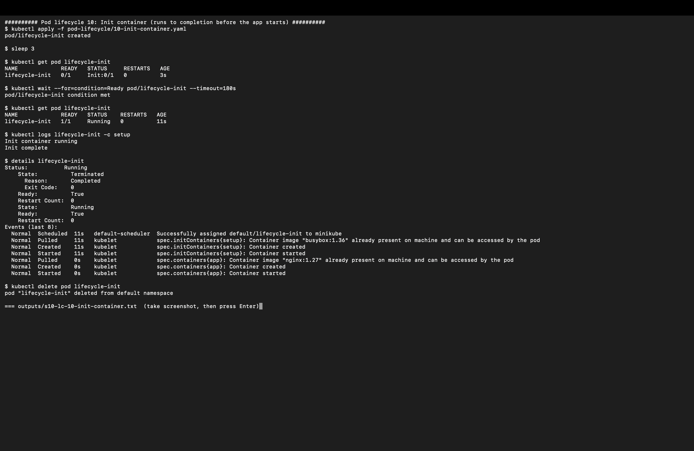

### 11 Multi-container pod (sidecar)

```
$ kubectl get pod lifecycle-multi-container
NAME                        READY   STATUS    RESTARTS   AGE
lifecycle-multi-container   2/2     Running   0          1s

$ kubectl get pod lifecycle-multi-container -o jsonpath="{.spec.containers[*].name}"
app sidecar

$ kubectl logs lifecycle-multi-container -c sidecar
Sidecar is running
Sidecar is running
```

`2/2` means both containers are ready. They share the same IP and volumes, and I use `-c sidecar` to choose which container's logs to read. Sidecars are used for log shipping, proxies (service mesh) and similar helpers.

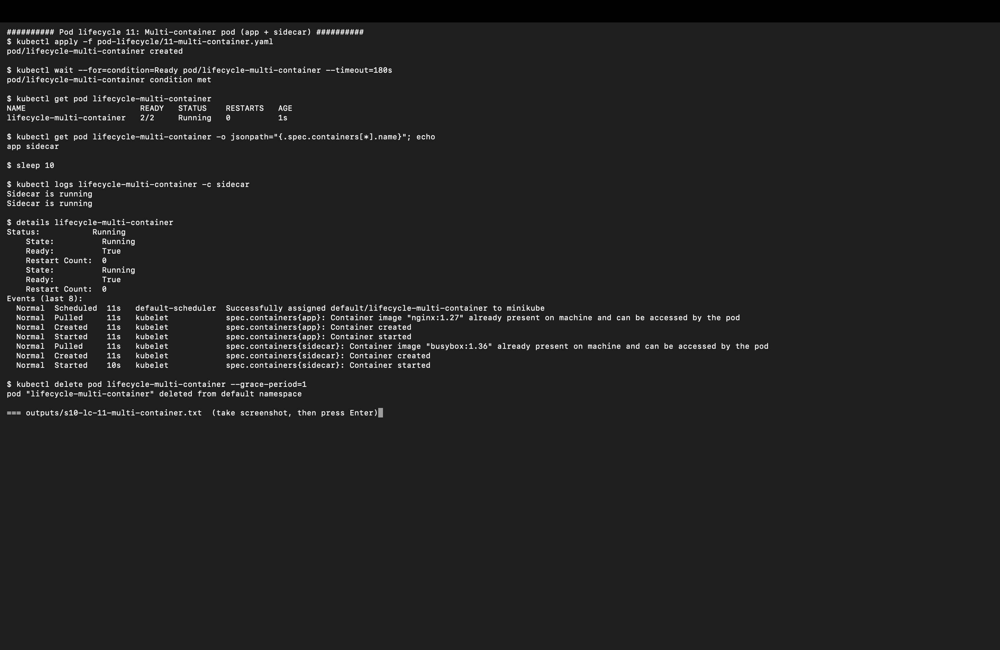

### 12 Graceful termination

```
$ kubectl delete pod lifecycle-termination --wait=false
pod "lifecycle-termination" deleted from default namespace

$ sleep 3
$ kubectl get pod lifecycle-termination
NAME                    READY   STATUS        RESTARTS   AGE
lifecycle-termination   1/1     Terminating   0          4s

$ kubectl logs lifecycle-termination
Application running
SIGTERM received; cleaning up...

$ sleep 12
$ kubectl get pod lifecycle-termination
Error from server (NotFound): pods "lifecycle-termination" not found
```

On delete, Kubernetes sends **SIGTERM** and the pod shows `Terminating`. My container traps the signal and cleans up for 10 seconds, which is inside the `terminationGracePeriodSeconds: 20`. If it had not stopped within 20s it would get SIGKILL. After cleanup the pod is gone (NotFound).

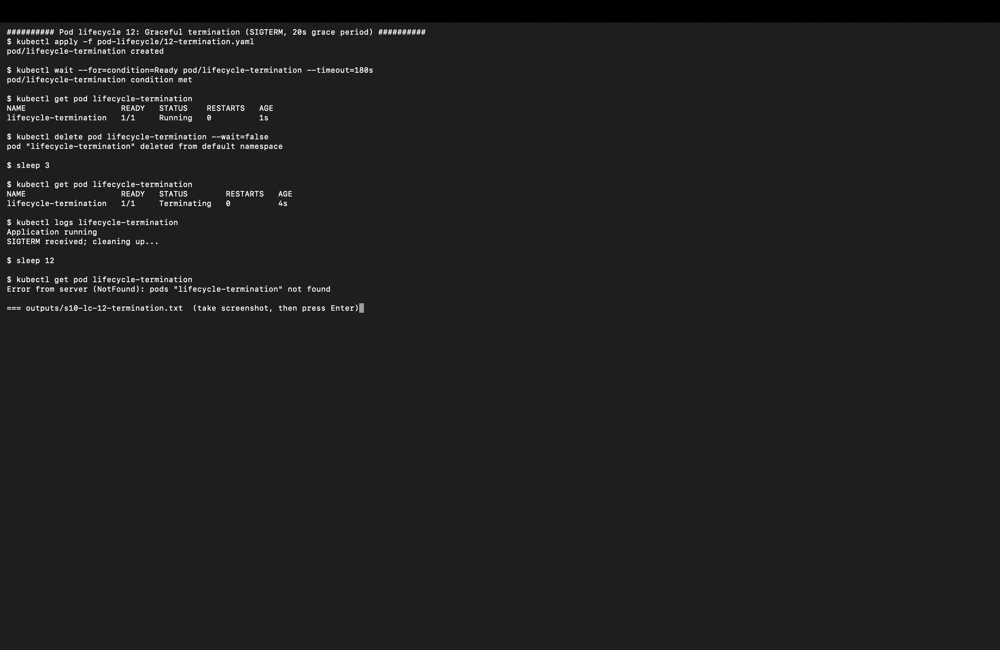

---

## Probes compared

| Probe | Question it answers | On failure | Seen in |
|-------|--------------------|------------|---------|
| **Startup** | Has the app finished starting? | Keeps waiting until `failureThreshold`, then restarts. Liveness/readiness are paused until it passes. | 09 |
| **Readiness** | Can it take traffic now? | Removed from Service endpoints, **no restart** | 07 |
| **Liveness** | Is it still alive? | Container is **killed and restarted** | 08 |

## What I learned

* Choose the strategy by risk and cost: Rolling Update is the safe default, Blue-Green gives an instant switch, Canary limits who sees a new version, and Recreate is only for apps that cannot run two versions together.
* `STATUS` in `kubectl get pods` mixes the pod phase and container reasons. `kubectl describe pod` (state, exit code, events) shows the real cause.
* Exit code 0 means Succeeded, other exit codes mean Failed, and 137 means the container was killed (SIGKILL).
* Probes and grace periods are what make zero-downtime deployments actually work.

---

**Kiran N | Roll No. 10446**
