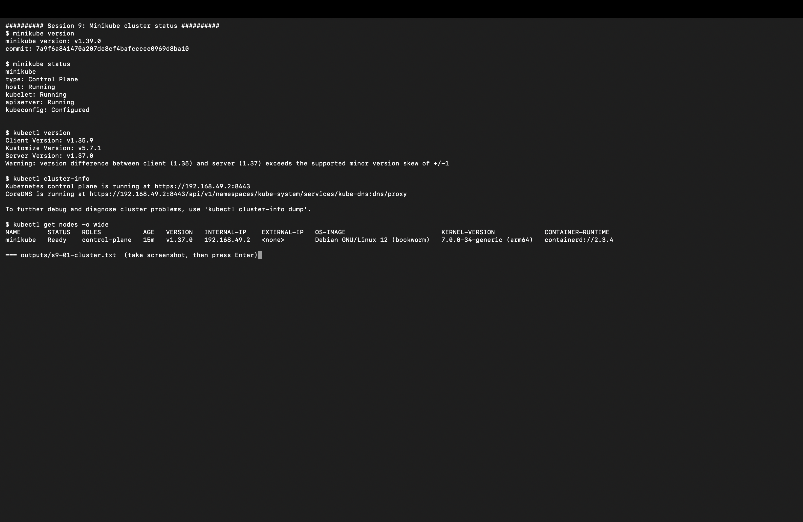
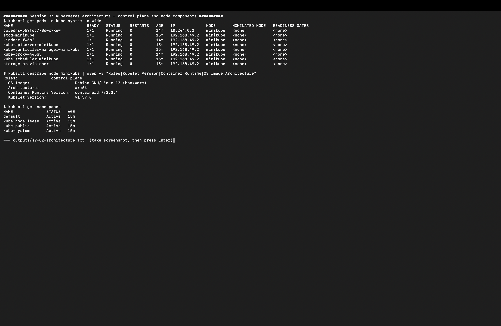
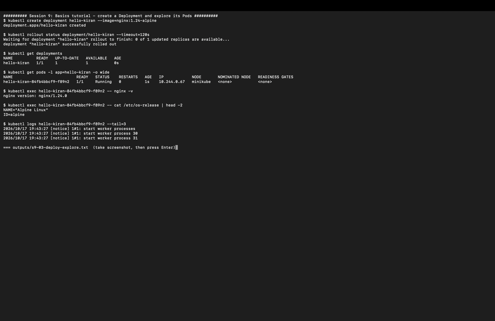
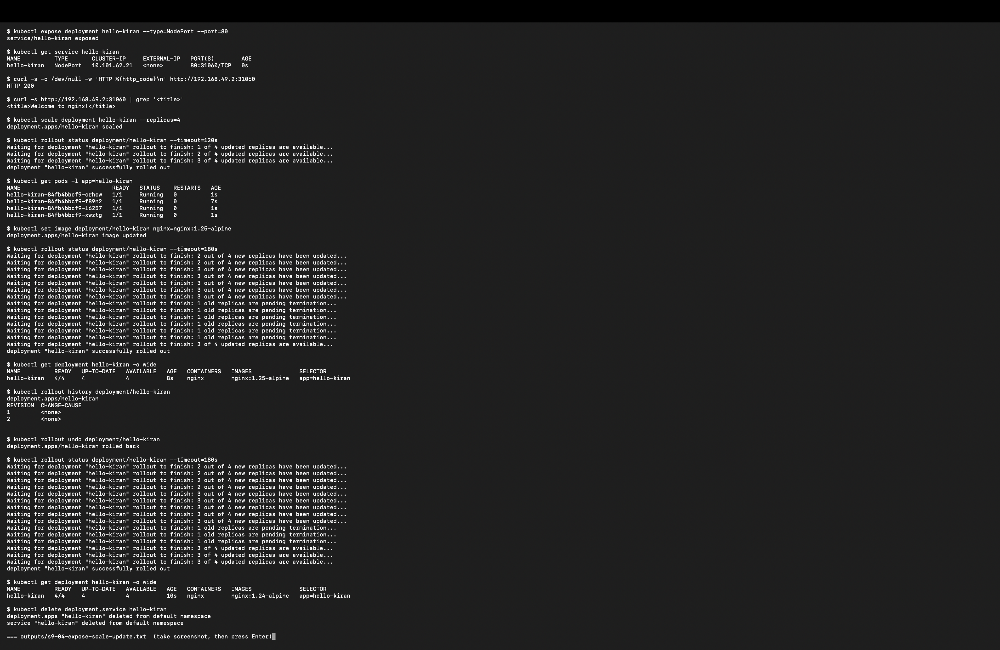
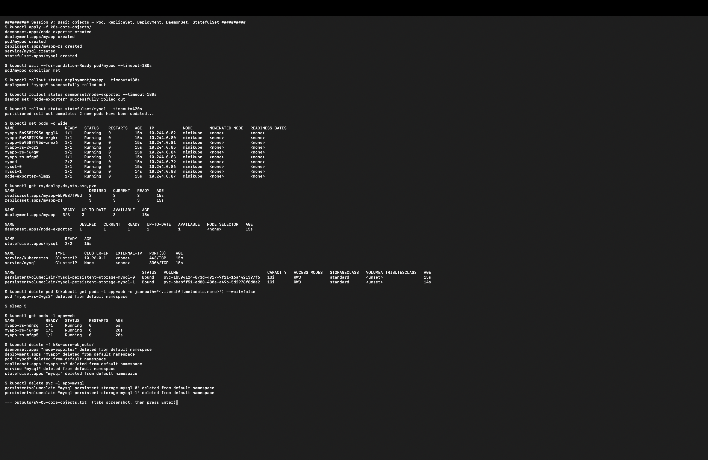

# Session 9: Kubernetes Introduction, Architecture and Core Objects

| | |
|---|---|
| **Name** | Kiran N |
| **Roll No.** | 10446 |
| **Session** | 9: Kubernetes basics (Minikube, architecture, kubectl, core objects) |
| **Environment** | Multipass Ubuntu VM (arm64) on Mac, Minikube v1.39.0 (docker driver), Kubernetes v1.37.0 |

All outputs below are copied from my own run of [`session9_lab.sh`](session9_lab.sh). The full text outputs are in [`outputs/`](outputs/) and the screenshots are in [`screenshots/`](screenshots/).

---

## Homework tasks

| # | Task | Where |
|---|------|-------|
| 1 | Install Minikube and start a local cluster | [Task 1](#task-1-install-minikube-and-start-the-cluster) |
| 2 | Learn the Kubernetes architecture (control plane and node components) | [Task 2](#task-2-kubernetes-architecture) |
| 3 | Kubernetes Basics tutorial: deploy, explore, expose, scale, update | [Task 3](#task-3-kubernetes-basics-tutorial) |
| 4 | Create the basic objects: Pod, ReplicaSet, Deployment, DaemonSet, StatefulSet | [Task 4](#task-4-core-objects) |

---

## Folder structure

```
session 9/
├── readme.md                 # this file
├── session9_lab.sh           # script I ran; saves every section to outputs/*.txt
├── k8s-core-objects/         # homework YAMLs (Task 4)
│   ├── pod.yaml
│   ├── replicaset.yaml
│   ├── deployment.yaml
│   ├── deamonset.yaml
│   └── statefulset.yaml
├── class-practice/           # YAMLs from the class demo (pod, rs, deployment, ds, troubleshooting)
├── outputs/                  # s9-01 ... s9-05 full command outputs (.txt)
└── screenshots/              # s9-01 ... s9-05
```

---

## Task 1: Install Minikube and start the cluster

Install steps I used on the Ubuntu VM (arm64):

```bash
# Docker is the driver for minikube
sudo apt install -y docker.io && sudo usermod -aG docker $USER

# kubectl
sudo snap install kubectl --classic

# minikube (arm64 build)
curl -LO https://storage.googleapis.com/minikube/releases/latest/minikube-linux-arm64
sudo install minikube-linux-arm64 /usr/local/bin/minikube

# start a single-node cluster
minikube start --driver=docker --cpus=2 --memory=3500
```

Output:

```
$ minikube version
minikube version: v1.39.0
commit: 7a9f6a841470a207de8cf4bafcccee0969d8ba10

$ minikube status
minikube
type: Control Plane
host: Running
kubelet: Running
apiserver: Running
kubeconfig: Configured

$ kubectl version
Client Version: v1.35.9
Kustomize Version: v5.7.1
Server Version: v1.37.0

$ kubectl cluster-info
Kubernetes control plane is running at https://192.168.49.2:8443
CoreDNS is running at https://192.168.49.2:8443/api/v1/namespaces/kube-system/services/kube-dns:dns/proxy

$ kubectl get nodes -o wide
NAME       STATUS   ROLES           AGE   VERSION   INTERNAL-IP    OS-IMAGE                         KERNEL-VERSION             CONTAINER-RUNTIME
minikube   Ready    control-plane   15m   v1.37.0   192.168.49.2   Debian GNU/Linux 12 (bookworm)   7.0.0-34-generic (arm64)   containerd://2.3.4
```

The node is `Ready`, so the cluster works. kubectl prints a version skew warning (client 1.35, server 1.37) because the snap kubectl is older than minikube's Kubernetes; every command still worked.



---

## Task 2: Kubernetes architecture

A Kubernetes cluster has a **control plane** (the brain) and **worker nodes** (where the pods run). In Minikube one node does both jobs, so all the components show up as pods in the `kube-system` namespace.

```
$ kubectl get pods -n kube-system -o wide
NAME                               READY   STATUS    RESTARTS   AGE   IP             NODE
coredns-559f6c778d-x7k6w           1/1     Running   0          14m   10.244.0.2     minikube
etcd-minikube                      1/1     Running   0          15m   192.168.49.2   minikube
kindnet-fw5h2                      1/1     Running   0          14m   192.168.49.2   minikube
kube-apiserver-minikube            1/1     Running   0          15m   192.168.49.2   minikube
kube-controller-manager-minikube   1/1     Running   0          15m   192.168.49.2   minikube
kube-proxy-445g5                   1/1     Running   0          14m   192.168.49.2   minikube
kube-scheduler-minikube            1/1     Running   0          15m   192.168.49.2   minikube
storage-provisioner                1/1     Running   0          15m   192.168.49.2   minikube

$ kubectl describe node minikube | grep -E "Roles|Kubelet Version|Container Runtime|OS Image|Architecture"
Roles:              control-plane
  OS Image:                   Debian GNU/Linux 12 (bookworm)
  Architecture:               arm64
  Container Runtime Version:  containerd://2.3.4
  Kubelet Version:            v1.37.0

$ kubectl get namespaces
NAME              STATUS   AGE
default           Active   15m
kube-node-lease   Active   15m
kube-public       Active   15m
kube-system       Active   15m
```

### Control plane components

| Component | Pod in my cluster | What it does |
|-----------|-------------------|--------------|
| **kube-apiserver** | `kube-apiserver-minikube` | Front door of the cluster. Every `kubectl` command is a REST call to it. It validates requests and stores them in etcd. |
| **etcd** | `etcd-minikube` | Key-value database that holds the whole cluster state (desired and current). |
| **kube-scheduler** | `kube-scheduler-minikube` | Picks a node for every new pod based on CPU/memory requests, taints and affinity. |
| **kube-controller-manager** | `kube-controller-manager-minikube` | Runs the control loops (Deployment, ReplicaSet, Node, Job...) that keep current state equal to desired state. |

### Node components

| Component | Where | What it does |
|-----------|-------|--------------|
| **kubelet** | runs on the node as a service (`kubelet: Running` in `minikube status`) | Talks to the API server, starts the pod's containers through the runtime and reports their status. Runs the probes. |
| **kube-proxy** | `kube-proxy-445g5` | Programs iptables rules so a Service IP sends traffic to the right pods. |
| **Container runtime** | `containerd://2.3.4` | Pulls images and runs the containers. |
| **CNI plugin** | `kindnet-fw5h2` | Gives every pod an IP (10.244.0.x) and connects pods across nodes. |
| **CoreDNS** (add-on) | `coredns-559f6c778d-x7k6w` | Cluster DNS, so pods can reach a Service by name. |
| **storage-provisioner** (minikube add-on) | `storage-provisioner` | Creates PersistentVolumes automatically for PVCs (used by the StatefulSet in Task 4). |

### How a request flows

```
kubectl apply -f deployment.yaml
      │
      ▼
kube-apiserver ──► etcd            (desired state saved)
      │
      ├─► controller-manager       (Deployment → ReplicaSet → Pod objects created)
      ├─► scheduler                (Pod gets a node)
      ▼
kubelet on the node ──► containerd (containers started)
      │
      ▼
kube-proxy / CNI                   (pod gets an IP, Services route to it)
```



---

## Task 3: Kubernetes Basics tutorial

I followed the six modules of the official [Kubernetes Basics](https://kubernetes.io/docs/tutorials/kubernetes-basics/) tutorial with my own deployment called `hello-kiran`.

### Module 2 and 3: create a Deployment and explore the Pod

```
$ kubectl create deployment hello-kiran --image=nginx:1.24-alpine
deployment.apps/hello-kiran created

$ kubectl rollout status deployment/hello-kiran --timeout=120s
deployment "hello-kiran" successfully rolled out

$ kubectl get deployments
NAME          READY   UP-TO-DATE   AVAILABLE   AGE
hello-kiran   1/1     1            1           0s

$ kubectl get pods -l app=hello-kiran -o wide
NAME                           READY   STATUS    RESTARTS   AGE   IP            NODE
hello-kiran-84fb4bbcf9-f89n2   1/1     Running   0          1s    10.244.0.67   minikube

$ kubectl exec hello-kiran-84fb4bbcf9-f89n2 -- nginx -v
nginx version: nginx/1.24.0

$ kubectl exec hello-kiran-84fb4bbcf9-f89n2 -- cat /etc/os-release | head -2
NAME="Alpine Linux"
ID=alpine

$ kubectl logs hello-kiran-84fb4bbcf9-f89n2 --tail=3
2026/10/17 19:43:27 [notice] 1#1: start worker processes
2026/10/17 19:43:27 [notice] 1#1: start worker process 30
2026/10/17 19:43:27 [notice] 1#1: start worker process 31
```

`kubectl exec` runs a command inside the container (like `docker exec`), and `kubectl logs` shows its stdout.



### Module 4, 5 and 6: expose, scale, update and roll back

```
$ kubectl expose deployment hello-kiran --type=NodePort --port=80
service/hello-kiran exposed

$ kubectl get service hello-kiran
NAME          TYPE       CLUSTER-IP     EXTERNAL-IP   PORT(S)        AGE
hello-kiran   NodePort   10.101.62.21   <none>        80:31060/TCP   0s

$ curl -s -o /dev/null -w 'HTTP %{http_code}\n' http://192.168.49.2:31060
HTTP 200

$ curl -s http://192.168.49.2:31060 | grep '<title>'
<title>Welcome to nginx!</title>

$ kubectl scale deployment hello-kiran --replicas=4
deployment.apps/hello-kiran scaled

$ kubectl get pods -l app=hello-kiran
NAME                           READY   STATUS    RESTARTS   AGE
hello-kiran-84fb4bbcf9-crhcw   1/1     Running   0          1s
hello-kiran-84fb4bbcf9-f89n2   1/1     Running   0          7s
hello-kiran-84fb4bbcf9-l6257   1/1     Running   0          1s
hello-kiran-84fb4bbcf9-xwztg   1/1     Running   0          1s

$ kubectl set image deployment/hello-kiran nginx=nginx:1.25-alpine
deployment.apps/hello-kiran image updated

$ kubectl get deployment hello-kiran -o wide
NAME          READY   UP-TO-DATE   AVAILABLE   AGE   CONTAINERS   IMAGES              SELECTOR
hello-kiran   4/4     4            4           8s    nginx        nginx:1.25-alpine   app=hello-kiran

$ kubectl rollout history deployment/hello-kiran
REVISION  CHANGE-CAUSE
1         <none>
2         <none>

$ kubectl rollout undo deployment/hello-kiran
deployment.apps/hello-kiran rolled back

$ kubectl get deployment hello-kiran -o wide
NAME          READY   UP-TO-DATE   AVAILABLE   AGE   CONTAINERS   IMAGES              SELECTOR
hello-kiran   4/4     4            4           10s   nginx        nginx:1.24-alpine   app=hello-kiran

$ kubectl delete deployment,service hello-kiran
```

What I saw:

* **Expose:** the NodePort Service opened port `31060` on the node and `curl` got `HTTP 200` with the nginx welcome page.
* **Scale:** 1 pod became 4. All have the same ReplicaSet hash `84fb4bbcf9`.
* **Update:** `set image` started a rolling update ("2 out of 4 new replicas have been updated... 1 old replicas are pending termination") and the image became `nginx:1.25-alpine` (revision 2).
* **Rollback:** `rollout undo` went back to revision 1, and the image is `nginx:1.24-alpine` again.



---

## Task 4: Core objects

YAMLs are in [`k8s-core-objects/`](k8s-core-objects/).

| Object | File | What it creates | Why it is used |
|--------|------|-----------------|----------------|
| **Pod** | [pod.yaml](k8s-core-objects/pod.yaml) | `mypod` with 2 containers: `app` (nginx) and `logger` (busybox) | Smallest unit. Containers in one pod share network and storage. No self-healing on its own. |
| **ReplicaSet** | [replicaset.yaml](k8s-core-objects/replicaset.yaml) | `myapp-rs`, 3 nginx pods with label `app=web` | Keeps a fixed number of pods running. If one dies it creates a new one. |
| **Deployment** | [deployment.yaml](k8s-core-objects/deployment.yaml) | `myapp`, 3 nginx replicas | Manages ReplicaSets and adds rolling updates and rollbacks. Used for stateless apps. |
| **DaemonSet** | [deamonset.yaml](k8s-core-objects/deamonset.yaml) | `node-exporter` (prom/node-exporter) | Runs exactly one pod on every node. Used for monitoring and log agents. |
| **StatefulSet** | [statefulset.yaml](k8s-core-objects/statefulset.yaml) | headless Service `mysql` + StatefulSet `mysql` (2 replicas, 1Gi PVC each) | For databases: fixed pod names (`mysql-0`, `mysql-1`), ordered start and one PVC per pod. |

> **Change I made:** the original StatefulSet used `mysql:5.7`, which has no arm64 image, so it could not start on my Mac VM. I changed it to `mysql:8.4`, set 2 replicas with 1Gi storage, and added the headless Service `mysql` that `serviceName: mysql` points to.

```
$ kubectl apply -f k8s-core-objects/
daemonset.apps/node-exporter created
deployment.apps/myapp created
pod/mypod created
replicaset.apps/myapp-rs created
service/mysql created
statefulset.apps/mysql created

$ kubectl rollout status statefulset/mysql --timeout=420s
partitioned roll out complete: 2 new pods have been updated...

$ kubectl get pods -o wide
NAME                     READY   STATUS    RESTARTS   AGE   IP            NODE
myapp-5b9587f95d-qpgl4   1/1     Running   0          15s   10.244.0.82   minikube
myapp-5b9587f95d-vrgkr   1/1     Running   0          15s   10.244.0.80   minikube
myapp-5b9587f95d-znwz6   1/1     Running   0          15s   10.244.0.81   minikube
myapp-rs-2vgr2           1/1     Running   0          15s   10.244.0.85   minikube
myapp-rs-j64gw           1/1     Running   0          15s   10.244.0.84   minikube
myapp-rs-mfqp5           1/1     Running   0          15s   10.244.0.83   minikube
mypod                    2/2     Running   0          15s   10.244.0.79   minikube
mysql-0                  1/1     Running   0          15s   10.244.0.86   minikube
mysql-1                  1/1     Running   0          14s   10.244.0.88   minikube
node-exporter-4lmg2      1/1     Running   0          15s   10.244.0.87   minikube

$ kubectl get rs,deploy,ds,sts,svc,pvc
NAME                               DESIRED   CURRENT   READY   AGE
replicaset.apps/myapp-5b9587f95d   3         3         3       15s
replicaset.apps/myapp-rs           3         3         3       15s

NAME                    READY   UP-TO-DATE   AVAILABLE   AGE
deployment.apps/myapp   3/3     3            3           15s

NAME                           DESIRED   CURRENT   READY   UP-TO-DATE   AVAILABLE   NODE SELECTOR   AGE
daemonset.apps/node-exporter   1         1         1       1            1           <none>          15s

NAME                     READY   AGE
statefulset.apps/mysql   2/2     15s

NAME                 TYPE        CLUSTER-IP   EXTERNAL-IP   PORT(S)    AGE
service/kubernetes   ClusterIP   10.96.0.1    <none>        443/TCP    15m
service/mysql        ClusterIP   None         <none>        3306/TCP   15s

NAME                                                     STATUS   VOLUME                                     CAPACITY   ACCESS MODES   STORAGECLASS
persistentvolumeclaim/mysql-persistent-storage-mysql-0   Bound    pvc-1b594124-873d-4917-9f21-16a4421397f6   1Gi        RWO            standard
persistentvolumeclaim/mysql-persistent-storage-mysql-1   Bound    pvc-bbabff51-ed80-480e-a49b-5d2978f8d0a2   1Gi        RWO            standard
```

Things to notice in my output:

* `mypod` shows **2/2** because it has two containers.
* Deployment pods have a hash in the name (`myapp-5b9587f95d-...`) because the Deployment created ReplicaSet `myapp-5b9587f95d`. The plain ReplicaSet pods are `myapp-rs-...`.
* The DaemonSet has DESIRED **1** because Minikube has one node.
* StatefulSet pods have stable names `mysql-0` and `mysql-1`, and each one got its own **Bound** 1Gi PVC. The `mysql` Service has `CLUSTER-IP None` (headless).

### Self-healing test (ReplicaSet)

```
$ kubectl delete pod $(kubectl get pods -l app=web -o jsonpath="{.items[0].metadata.name}") --wait=false
pod "myapp-rs-2vgr2" deleted from default namespace

$ sleep 5
$ kubectl get pods -l app=web
NAME             READY   STATUS    RESTARTS   AGE
myapp-rs-hdnrg   1/1     Running   0          5s
myapp-rs-j64gw   1/1     Running   0          20s
myapp-rs-mfqp5   1/1     Running   0          20s
```

I deleted `myapp-rs-2vgr2` and the ReplicaSet created `myapp-rs-hdnrg` (age 5s) right away, so the count stayed at 3.

Cleanup: `kubectl delete -f k8s-core-objects/` and `kubectl delete pvc -l app=mysql` (PVCs are not deleted with the StatefulSet, so the data is safe by default).



---

## Commands used

| Command | Purpose |
|---------|---------|
| `minikube start / status` | Start and check the local cluster |
| `kubectl cluster-info`, `get nodes -o wide` | Check the control plane and nodes |
| `kubectl get pods -n kube-system` | See the control plane components |
| `kubectl create deployment <name> --image=` | Create a Deployment |
| `kubectl exec <pod> -- <cmd>` / `kubectl logs <pod>` | Run a command in a pod / read its logs |
| `kubectl expose deployment <name> --type=NodePort --port=80` | Make the app reachable from outside |
| `kubectl scale deployment <name> --replicas=4` | Scale up or down |
| `kubectl set image deployment/<name> <container>=` | Rolling update |
| `kubectl rollout status / history / undo` | Follow, list and roll back updates |
| `kubectl apply -f <dir>/` / `kubectl delete -f <dir>/` | Create or delete everything from YAML |
| `kubectl get rs,deploy,ds,sts,svc,pvc` | List many object types at once |

## What I learned

* Kubernetes works on **desired state**: I write YAML, the API server stores it in etcd, and controllers keep fixing the cluster until it matches.
* A Pod alone is not self-healing. ReplicaSets keep the count, Deployments add versioned rollouts on top, DaemonSets put one pod per node, and StatefulSets give stable names and storage for databases.
* Images must exist for the node's CPU architecture: `mysql:5.7` failed on arm64, `mysql:8.4` works.

---

**Kiran N | Roll No. 10446**
